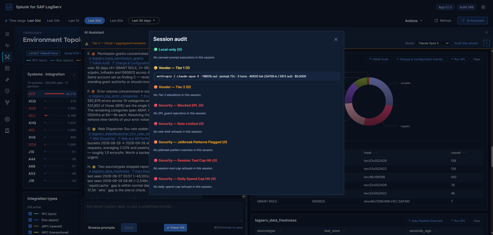

# Audit Log

Every action the AI Assistant takes — predefined-prompt dispatches, free-form vendor calls, security blocks, privacy-tier elevations, legal acknowledgements — produces an audit event in a dedicated `logserv_ai_assistant_audit` index. The audit trail is the evidence layer for compliance reviews, SOC investigations, and tamper-resistance posture.

Splunk writes those events only for a user whose role holds the **`edit_tcp`** or the **`edit_log_alert_event`** capability. Of Splunk Enterprise's default roles, `admin` holds both, `power` holds `edit_log_alert_event` and `user` holds neither. Users without either are not audited, and the AI Assistant panel shows them a warning; see [Who Can Write Audit Events](#who-can-write-audit-events).

!!! note "Which categories fire with no LLM provider configured"
    Until an admin configures an LLM provider credential — and in any deployment with **Templates-only mode** on or a compile-time [templates-only build](templates-only-build.md) installed — there is no LLM dispatch, no vendor call and no model discovery. In that state only **`local_only`** (every canned-prompt dispatch), **`audit_forwarder_failure`**, **`forwarder_disabled_acceptance`**, and **`ai_assistant_enable_acceptance`** are ever emitted; the other nine categories are defined but structurally dormant (nothing can trigger them). Once a credential is configured, eight of those nine can fire as well; `vendor_tier2` is declared but never emitted (see below).

## :material-circle-box:{ .taiconcolor } The Thirteen Audit Categories

| Category | When | Key fields |
|---|---|---|
| `local_only` | Predefined-prompt dispatch (no LLM call). | `promptId`, `spl`, `rowCount`, `executionMs`, `ok` |
| `vendor_tier1` | A free-form prompt sent to the vendor completed, **at any tier** (Tier 1 or Tier 2) — one event per prompt, recorded after its last turn. The event does not carry the tier. | `provider`, `model`, `inputTokens`, `outputTokens`, `vendorCostEstimateUsd`, `outboundBytes`, `outboundSha256`, `promptLength`, `toolDefCount`, `turnCount`, `powerMode`, `tier2RedactionsApplied` (the PII redactions Tier 2 applied across the prompt's tool results; 0 in Tier 1, with redaction off, or when nothing needed redacting) |
| `vendor_tier2` | **Declared, not emitted.** Every free-form prompt, at any tier, records `vendor_tier1`; a non-zero `tier2RedactionsApplied` on it marks a Tier 2 prompt in which redaction fired. When Tier 2 was switched on is recorded by `vendor_tier2_elevation`. | — |
| `vendor_tier2_elevation` | Admin saves Settings elevating `tier` to 2 (from Tier 0 or Tier 1). | Admin user, `previousTier`, `newTier` |
| `security_blocked_spl` | The SPL guard rejected an AI-authored `splunk_run_query` (its denylist, its command allow-list, or the check against Splunk's search parser); a `splunk_run_saved_search` call from the AI named a saved search outside the App's prompt catalog; or the AI asked for a tool the App does not offer. In each case the call is refused and never dispatched. | `spl` (truncated to 1000 chars): the query for a blocked `splunk_run_query`, `(saved search) <name>` for a refused saved search, `(tool) <name>` for an undeclared tool. `operator`: for a query the denylist blocks, the forbidden command or word (lower-cased) or one of `inline_comment`, `unbalanced_backtick`, `unterminated_quote`, `escaped_quote`, `external_lookup`, `fit_into`, `macro` (`macro` is also the operator for the `macro` command, an alias of `savedsearch`; `command` tells the two apart — the macro's own name, or `macro` for the command); for a query the allow-list blocks, one of `command_not_allowed` (also for `union`, with `command` = `union`), `query_start`, `index_not_allowed`, `lookup_not_allowed`, `eval_lookup`, `subsearch_not_allowed`, `subsearch_fields`, `macro_position` (also for a macro written against other text), `ambiguous_single_quote`, `unbalanced_bracket`, `escaped_outside_quotes` (a backslash outside double-quoted text); for the search-parser check, `parser_mismatch` (Splunk's parser reads the query differently — also when a `lookup` / `inputlookup` names, as the parser reports it, a lookup that is not one of the App's, recorded with `command` = `lookup` / `inputlookup`), `parser_rejected` (the parser rejected it as invalid SPL) or `parser_unavailable` (the parser could not be asked, failed or timed out — the query is refused, never run unchecked; a query the user stops while the parser checks it records no event); `saved_search_not_in_catalog` for a refused saved search; `tool_not_declared` for an undeclared tool. `command` (optional): the command, lookup or macro the refusal is about, as the AI wrote it (`fit`, `customer_hr_lookup`, `customer_hr_macro`, `index`); names that are not made of letters, digits, `_ . : -` (at most 64 characters) are recorded as `(unnamed)`. The in-app viewers show it next to the operator. |
| `rate_limited_prompt` | Per-user rate limit denied a free-form prompt. | `threshold`, `countInWindow`, `promptLength`, `secondsUntilNextSlot` |
| `user_prompt_jailbreak_flag` | Jailbreak-pattern analyzer flagged a user prompt (flag-and-proceed; the prompt still ran). | `promptHash`, `promptLength`, `matchedGroups`, `charClassFingerprint` |
| `session_tool_cap_hit` | Per-session tool-dispatch cap reached; dispatch refused. | `cap`, `attemptedCount`, `toolName` |
| `daily_spend_cap_hit` | Daily USD spend cap reached; vendor call refused. | `capUsd`, `spentTodayUsd`, `promptLength`, `secondsUntilMidnight` |
| `audit_forwarder_failure` | HEC forwarder POST failed (DNS, network, 4xx/5xx response). | `destinationUrl` (sanitized), `reason`, `batchSize` |
| `forwarder_disabled_acceptance` | Admin acknowledged the forwarder-disabled legal modal. | Admin user, `host` (Splunk-stamped IP), `tcVersion`, `optInChoice`, `disclaimerHash` |
| `ai_assistant_enable_acceptance` | Admin acknowledged the AI-Assistant-enable legal modal. | Same as forwarder acceptance, plus the seven-clause enable-disclaimer hash |
| `model_discovery` | A [dynamic model-discovery](settings.md#how-model-discovery-works) refresh ran (any trigger, success or failure). | `provider`, `trigger` (`credential_save` / `settings_refresh` / `ttl`), `ok`, `modelCount`, `durationMs`, `error` |

Every event also carries a small set of common fields:

- `timestamp` — ISO-8601 UTC.
- `user` — Splunk username (from `services/authentication/current-context`).
- `sessionId` — Per-tab session id baked at AI Assistant init.
- `seq` — Monotonic per-session sequence number, useful for ordering events within a session even when timestamps tie.

## :material-circle-box:{ .taiconcolor } The In-App Audit Log Viewer


The Audit Log tab in [Settings → AI Assistant](settings.md#audit-log-tab) provides a read-only browser of the index. Filters:

| Filter | Default | Notes |
|---|---|---|
| **Time range** | Last 30 days (the global picker's default) | Reads from the global TimeRange picker; not a separate field. Re-runs on picker change. |
| **Category** | (all 13) | Multi-select with colour-coded chips — each category gets a distinct flat accent colour from the app palette; `user_prompt_jailbreak_flag` is highlighted in red. |
| **User contains** | (empty) | Substring filter on the `user` field. Useful for "what did admin X do?" reviews. |
| **Limit** | 100 | One of 50 / 100 / 250 / 500. Larger values slow page rendering. |

The table renders 25 rows per page (`PAGE_SIZE = 25`); footer shows "Page X of Y" + Previous / Next buttons (only when total exceeds 25). Clicking a row's **+** button expands to show the full event JSON.

**Splunk reserved-field gotcha:** the `category` field on these events is a Splunk reserved name. The viewer's SPL uses `| eval category=json_extract(_raw, "category")` after `spath` to retrieve the audit-event category from the raw JSON, because `spath` does NOT overwrite reserved fields. It does the same for `user` (`| eval user=json_extract(_raw, "user")`, since build 394): when a search filters on `user` before `spath` — as the **User contains** filter does — Splunk extracts the field to apply the filter and `spath` adds the same value again, so the field comes back with two values. If you write your own searches against this index, replicate this pattern.

## :material-circle-box:{ .taiconcolor } Tamper-Resistance Threat Model

Audit events live in a Splunk index on the same host as the LogServ App. **A host-root admin can edit the underlying bucket files** — they can delete events, rewrite events, replay old events, or delete the entire index. The audit log is **NOT** tamper-evident on the local instance alone.

Mitigation: forward audit events to a separate Splunk / SIEM / S3-with-Object-Lock destination owned by a **different admin team**. The HEC forwarder (below) provides this. The threat model assumes a malicious or compromised insider with admin rights to the LogServ Splunk instance but NOT to the destination instance.

Disclaimer text shown at the top of the Audit Log tab:

> Audit events live in a Splunk index. A host-root admin can edit the bucket files. Mitigation: forward audit events to a separate Splunk instance / SIEM / S3-with-Object-Lock owned by a different admin team. Configure the HEC forwarder under Settings → General → Audit & Telemetry.

## :material-circle-box:{ .taiconcolor } HEC Forwarder

Optional admin-configurable forwarding of audit events to a separate Splunk / SIEM via Splunk's HTTP Event Collector. When enabled:

- **Browser-side dual-write at flush.** The `AuditWriter.flush()` path (and the per-event `postOneOff()` path) sends to BOTH the local `logserv_ai_assistant_audit` index (via the standard `services/receivers/simple` REST endpoint) AND the configured HEC URL. The two writes are independent — local-index failure doesn't block forwarder write, and vice versa.
- **Failure visibility.** When the HEC POST fails (DNS error, network timeout, 4xx/5xx response), an `audit_forwarder_failure` event is generated locally. So a disabled / down forwarder is visible in the local audit log itself, not silently failing.
- **Auth.** The HEC token is sent on every POST as `Authorization: Splunk <token>` header. Token is stored in Splunk's encrypted password store at realm `logserv_ai_assistant_forwarder` name `hec_token` and never displayed in cleartext.
- **Sanitized URL in failure events.** When a forwarder failure event records the `destinationUrl`, query strings + fragments are stripped to prevent accidental exposure of any auth-bearing URL params.

### Configuring the forwarder

1. Open Settings → AI Assistant → **General**.
2. Find the **Audit & Telemetry** subsection.
3. Set `audit_forwarder_url` to the HEC base URL (e.g., `https://siem.example.com:8088` — the App appends `/services/collector/event`).
4. Optionally set `audit_forwarder_index` (recommended: a dedicated index like `splunk_audit` on the destination).
5. Optionally set `audit_forwarder_source` (defaults to `logserv_ai_assistant_remote` — deliberately distinct from the local sourcetype `logserv:ai_assistant:audit` so forwarded copies are distinguishable).
6. Set `audit_forwarder_enabled = true`.
7. Open Settings → AI Assistant → **Splunk MCP** → **Audit Log Forwarder** panel.
8. Click **Set** next to the HEC token field.
9. Paste the HEC token from your destination Splunk's HEC input.
10. Save. The next audit event triggers a forwarder POST.
11. Check the destination Splunk for events arriving at the configured index/source.

### When the admin saves with the forwarder OFF

A [forwarder-disabled-acceptance modal](settings.md#legal-acknowledgement-modals) blocks the save until the admin acknowledges the integrity-mitigation responsibility. The acceptance is recorded as a `forwarder_disabled_acceptance` audit event with admin identity, Splunk-stamped IP, timestamp, and SHA-256 of the disclaimer revision. The event is written as soon as the answer is recorded, with the audit settings in place at that moment, so when the same save turns forwarding off, the acceptance is also sent to that forwarder: an attempt with the forwarder settings the page has applied, and when it fails (no HEC token, no URL, the destination refusing it), a local `audit_forwarder_failure` record is written instead (build 392).

## :material-circle-box:{ .taiconcolor } Audit Index Provisioning

The `logserv_ai_assistant_audit` index is defined in the Data TA's `default/indexes.conf` and created automatically when the Data TA is installed on the indexer / search head. No customer-side provisioning is needed to create it; who can read it is set per role - see [Restricting Who Can Read the Audit Index](#restricting-who-can-read-the-audit-index).

The index name is **macro-configurable** — see [Renaming an index](../install-setup/install-ta.md#renaming-an-index) for the procedure (update the `sap_logserv_audit_idx_macro` macro definition for reads, plus the `audit_index_name` field in Settings → AI Assistant → General → Audit & Telemetry for writes).

**Retention** is set by the Data TA to **90 days** (`frozenTimePeriodInSecs = 7776000` on `[logserv_ai_assistant_audit]`) — for compliance reviews going back further, override that stanza in `local/indexes.conf` on the indexer. Recommended retention for compliance use cases: **2 years** to cover annual audit cycles plus a buffer. For SOX / PCI / HIPAA contexts where regulator records-retention requirements apply, follow the regulator's spec.

## :material-circle-box:{ .taiconcolor } Who Can Write Audit Events

The App writes audit events from the browser, as the signed-in user, through Splunk's `services/receivers/simple` REST endpoint (by way of Splunk Web's splunkd proxy). Splunk accepts a write there only from a user whose role holds the **`edit_tcp`** or the **`edit_log_alert_event`** capability (`capability = edit_tcp or edit_log_alert_event` on `[input:simple]` in Splunk's default `restmap.conf`). Of Splunk Enterprise's default roles, `admin` holds both and `power` holds `edit_log_alert_event`. With Splunk's default roles, therefore:

- **Admins and power users are audited.**
- **Users whose only role is `user` are not audited.** Splunk refuses each of their writes with HTTP 403 (seen on Splunk Enterprise 9.4.3, where a `power` user's write was accepted). The App drops the event and carries on: a refused audit write never blocks the AI Assistant.

When a write fails, the AI Assistant panel shows a warning under the privacy banner, **Audit events are not being written**, with the HTTP status: for HTTP 403 it names the `edit_log_alert_event` and `edit_tcp` capabilities, says Splunk's default `user` role has neither, and tells the user to ask their Splunk admin (`edit_log_alert_event` is the narrower one to grant; see below); for HTTP 401, which usually means the Splunk Web session has ended, it asks for a reload first and names the capabilities as the cause if a reload does not help. The **Audit this session** list then notes that the events it shows from about that time on may not be in the index. The warning clears as soon as a write succeeds again. Writes can also fail for other reasons, such as an indexer outage; the warning gives the status for those too. A write Splunk accepts but cannot index (for example into an `audit_index_name` that names no index on the indexers) may raise no warning, so check that the index exists.

The [HEC forwarder](#hec-forwarder) does not cover these users. It runs in the same browser tab and needs to read the forwarder's HEC token, which by default only admins can read.

### Granting a capability: the trade-off

To audit users whose only role is `user`, give them a role that holds `edit_log_alert_event` (**Settings → Roles → *role* → Capabilities**, or `edit_log_alert_event = enabled` under `[role_<name>]` in `authorize.conf`). It is the narrower of the two capabilities Splunk accepts here. Weigh what each grants first:

- **TCP data inputs (`edit_tcp`).** `edit_tcp` is the capability that lets a role create and change TCP data inputs on the instance, which is far more than writing audit events; prefer `edit_log_alert_event`.
- **The Log Event alert action (`edit_log_alert_event`).** It also lets the role use Splunk's *Log Event* alert action, which writes events to an index.
- **Any index.** `receivers/simple` takes the destination index from the request, so a holder of either capability can send events to any index, not only the audit index. That includes writing events into the audit index that look like someone else's activity. With Splunk's default roles every `power` user can already do this, and the default `user` and `power` roles also hold `run_collect`, the capability the `collect` command needs to write search results into an index. The local audit index is therefore not tamper-evident against signed-in users; for tamper-evidence, use the [HEC forwarder](#hec-forwarder) to a separately-administered destination.
- **The `user` field comes from the browser.** The App stamps the signed-in user's name on each event in the browser before sending it, and Splunk does not check it. To tie an event to the account that really sent it, find the matching `POST /services/receivers/simple` request in splunkd's access log (`index=_internal sourcetype=splunkd_access`), which Splunk records with the authenticated user.
- **Splunk Cloud.** On Splunk Cloud Platform, check under **Settings → Roles** which of the two capabilities your roles hold or can be given (`edit_tcp` may not be grantable to customer roles), or ask Splunk Cloud Support. Where neither can be granted, only the roles that already hold one of them are audited.

!!! note "Grant it narrowly"
    Grant `edit_log_alert_event` rather than `edit_tcp`, in a dedicated role (for example `logserv_ai_audit_writer`) assigned only to the people whose AI Assistant use must be audited, rather than adding it to `user`, which most users hold. `power` already holds it.

## :material-circle-box:{ .taiconcolor } Restricting Who Can Read the Audit Index

Splunk decides per role which indexes a user can search: the role's allowed indexes (`srchIndexesAllowed` in `authorize.conf`; in Splunk Web, **Settings → Roles → *role* → Indexes**). The wildcard `*` in that list matches every index whose name does not start with `_`, so it includes `logserv_ai_assistant_audit`, and Splunk's default `user` role allows `*`. Unless you narrow it, every user can read the audit trail: who used the AI Assistant and when, the SPL each prompt ran, every refused query, and the network address Splunk recorded on each admin acknowledgement.

A role's allowed indexes are its own list plus those of every role it imports, and a user can search an index if any of their roles allows it. To keep the index to its reviewers:

1. **Narrow the roles that should not read it.** In `user`, and in every other role whose own list contains `*`, replace `*` with the indexes the role needs, for example `main` and `sap_logserv_logs` (or your renamed SAP data index, so the App's raw-event panels keep working). Avoid patterns that still match the audit index, such as `logserv*` or `*audit*`. A role that imports an unchanged `user` role can still read every index.
2. **Create a reviewer role**, for example `logserv_audit_reader`, that allows `logserv_ai_assistant_audit`, and assign it to the people who review the trail.
3. **Keep the index allowed for the admins who use Settings → AI Assistant → Audit Log.** That tab searches the index as the signed-in user; without access it shows no events, not an error.

The same change in `authorize.conf` on the search head (on Splunk Cloud, use **Settings → Roles**):

```ini
[role_user]
srchIndexesAllowed = main;sap_logserv_logs

[role_logserv_audit_reader]
importRoles = user
srchIndexesAllowed = logserv_ai_assistant_audit
```

:material-lightning-bolt:{ .taiconcolor } **Verify with two test users.** Splunk returns no rows and no error for an index a role cannot search, so a zero count proves nothing on its own:

1. As a user who holds only the narrowed roles, run `` `sap_logserv_audit_idx_macro` earliest=-30d | stats count `` and expect `0`.
2. Run the same search as a member of the reviewer role and expect the events.
3. As the first user, run one predefined prompt in the AI Assistant, then, as the reviewer, look for its event. Narrowing what a role can read does not change what it can write: writing needs the `edit_tcp` or the `edit_log_alert_event` capability ([Who Can Write Audit Events](#who-can-write-audit-events)). A first user whose only role is `user` holds neither, so the AI Assistant shows **Audit events are not being written** and the reviewer finds no event; that comes from the missing capability, not from the narrowing. If a role the first user holds has either capability (`power` does), the reviewer finds the event:

```spl
`sap_logserv_audit_idx_macro` earliest=-15m
| spath
| search user="<test user>"
```

This controls who can read the trail, not who can alter it; for that, see the [HEC forwarder](#hec-forwarder).

## :material-circle-box:{ .taiconcolor } Querying the Audit Index Directly

You can query the audit index from any search bar — the in-app viewer is just a curated UX over the same SPL. The starter searches below use the `\`sap_logserv_audit_idx_macro\`` macro so they continue to work after a rename:

**Free-form vendor prompts in the last 7 days, with USD cost and Tier 2 redactions by user** *(only ever emitted once an LLM provider credential is configured)*:

```spl
`sap_logserv_audit_idx_macro` earliest=-7d
| spath
| eval category=json_extract(_raw, "category")
| where category="vendor_tier1"
| eval t2=if(tonumber(tier2RedactionsApplied)>0, 1, 0)
| stats sum(vendorCostEstimateUsd) as total_usd, count as prompts, sum(t2) as tier2_redacted_prompts, sum(tier2RedactionsApplied) as tier2_redactions by user
| sort - total_usd
```

Every prompt, at any tier, is a `vendor_tier1` event, and the event does not say which tier was active. `tier2_redacted_prompts` counts only the Tier 2 prompts in which PII redaction fired; a Tier 2 prompt with nothing to redact, or one sent with redaction off, records 0 like a Tier 1 prompt. To see when Tier 2 was switched on, read the `vendor_tier2_elevation` events below; a switch back to Tier 1 is not audited (see [Privacy Tiers](privacy-tiers.md#switching-tiers)).

**All security blocks in the last 30 days, grouped by user + offending operator:**

```spl
`sap_logserv_audit_idx_macro` earliest=-30d
| spath
| eval category=json_extract(_raw, "category")
| where category="security_blocked_spl"
| stats count by user, operator
| sort - count
```

**Which commands and lookups the AI tried that the allow-list refused (last 30 days):**

```spl
`sap_logserv_audit_idx_macro` earliest=-30d
| spath
| eval category=json_extract(_raw, "category")
| where category="security_blocked_spl" AND isnotnull(command)
| stats count by operator, command
| sort - count
```

A steady `parser_unavailable` count (a query the user stopped is not counted) means the App could not reach Splunk's search parser (`search/parser`, through Splunk Web's splunkd proxy, as the signed-in user): every free-form query is refused until it can, by design. Check that the user's role can run searches and that splunkd answers.

**All Tier 2 elevation events ever (compliance review):**

```spl
`sap_logserv_audit_idx_macro` earliest=0
| spath
| eval category=json_extract(_raw, "category")
| where category="vendor_tier2_elevation"
| table _time, user, previousTier, newTier
```

**Forwarder failures grouped by reason (operational health):**

```spl
`sap_logserv_audit_idx_macro` earliest=-7d
| spath
| eval category=json_extract(_raw, "category")
| where category="audit_forwarder_failure"
| stats count by reason, destinationUrl
```

## :material-circle-box:{ .taiconcolor } Audit Modal in the AI Assistant Panel

The privacy banner at the top of the AI Assistant chat panel includes an **Audit this session** button. Clicking it opens a per-session audit modal:



The modal shows a chronological list of the audit events recorded by the AI Assistant **since this page was loaded** (the provider's in-memory buffer for the current session — it does not query the index, so a page reload starts the list over). Useful for users who want to confirm what their last few prompts triggered without leaving the AI Assistant panel. The modal is the in-pane equivalent of the Settings → Audit Log tab, scoped to the current session.

Because the list is the session's own record, it shows events whether or not Splunk accepted them. While audit writes are failing (see [Who Can Write Audit Events](#who-can-write-audit-events)), a note at the top of the list gives the time of the first failed write and the reason, and says that the events listed from about that time on may not be in the index.
