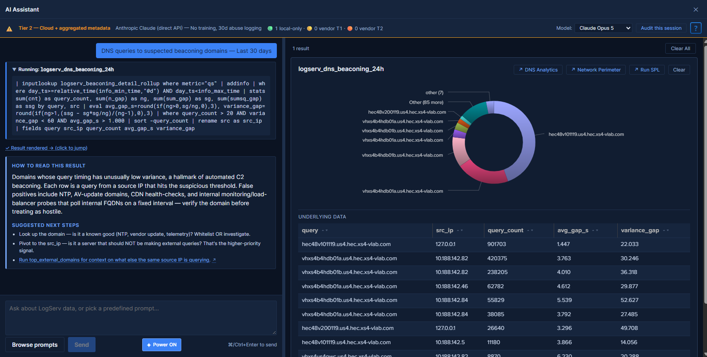

# AI Assistant — Overview

!!! info "The AI Assistant ships turned off"
    On a fresh install the LogServ App shows no **AI Assistant** button, panel or route. To use it, install the Splunk MCP Server on the search head, grant its `mcp_tool_execute` capability to the roles that will use the assistant, and have an admin turn on **Enable AI Assistant** and accept the acknowledgements: [Set Up the AI Assistant](enable.md). From then on the predefined prompts work with no LLM provider, credential or vendor call. The released v0.1.2 App package is the full-LLM build, so free-form questions are also possible once an admin configures an [LLM provider credential](settings.md#provider-credentials-tab). An admin can keep the deployment to predefined prompts with **Templates-only mode**; see [Restricting the LLM Path](templates-only-build.md).

## :material-circle-box:{ .taiconcolor } What the AI Assistant Is

The AI Assistant is a Splunk-aware assistant panel in the LogServ App that lets analysts run cataloged investigations against their Splunk data. Once turned on, it opens to the right of every dashboard as a side panel, from the **AI Assistant** button at the right end of the header's second row.



The feature has **two paths**. **The first needs only the Splunk MCP Server; the second also needs an LLM provider credential:**

- **Predefined prompts (no LLM call).** The user opens the prompt browser and clicks one of the cataloged prompts (three packs plus a context-aware **Dashboard Focused** tab). The App runs the prompt's saved search through the [Splunk MCP Server](mcp-setup.md), shows the result as a tile in the right pane (table / chart / KPI / pie), and adds a static interpretation and suggested-next-steps card. **No vendor LLM is invoked.** No cost, search latency only, and no data leaves your Splunk environment.
- **Free-form prompts (LLM-driven).** Once an admin configures an [LLM provider credential](settings.md#provider-credentials-tab), the user can also type a natural-language question. The App sends a system primer, the question and the tool definitions to the configured vendor (Anthropic / OpenAI / Azure OpenAI / AWS Bedrock); the AI runs saved searches or its own queries and writes a narrative reply. The shipped default provider is **Mock (development only)**: until an admin selects a real provider and stores its credential, a typed question gets a canned mock reply and no vendor is contacted. An admin can switch this path off with **Templates-only mode**, or install a compile-time templates-only build, in which it cannot be switched back on; see [Restricting the LLM Path](templates-only-build.md), which also covers the separate v0.0.6 line, whose bundle has no provider code at all.

## :material-circle-box:{ .taiconcolor } The Privacy Posture

> **With no LLM provider credential configured, nothing is ever transmitted to any AI vendor — there are no vendor calls at all.**

The predefined-prompt path runs entirely between your browser, your Splunk search head, and the Splunk MCP Server on it. Search results render locally in the right pane; no summary, no metadata, and no prompt text leaves your Splunk environment.

Once a provider credential is configured, a second guarantee takes over:

> **No raw event and no unsummarized search result from your Splunk instance is ever transmitted to any AI vendor — only the summary the active privacy tier allows.**

That guarantee is not policy; it is **enforced by the type system at build time, with a runtime defense-in-depth scan as a second layer**. The TypeScript compiler refuses to put any tool-result value from MCP into an outbound vendor payload; the only conversion path is the active tier's summarizer. As a second layer, every outbound payload is serialized and scanned at dispatch time and rejected if a Splunk data field name (`_raw`, `_time`, `host`, `source`, `sourcetype`, `index`, …) appears as a key; the scan checks the payload's structure, not the text of a summary. What a summary may contain is set by the active **privacy tier** ([Privacy Tiers](privacy-tiers.md)):

- **Tier 1 (default)** sends two numbers per call, a count and a timing — no field value from any event. A model that writes its own queries can still make those numbers depend on event data, so a few bits per call can leak.
- **Tier 2 (admin opt-in)** adds aggregated metadata: per-column statistics and top-N values with counts — field values from the events, filtered, capped at 40 characters each and, with PII redaction on, sent in clear only when the App can trace the column to a field that marks no identifier — column names only when Splunk generates them or every word in them was written by the model in its own query or by the App's catalog search that ran (others appear as `col_N`), and the time range only as UTC timestamps the App formats. No raw rows.
- **Tier 0 (Ollama, local)** does not work in this release: do not select it ([Privacy Tiers](privacy-tiers.md#tier-0-and-the-ollama-provider-do-not-select)).

In every tier a failed call sends only its HTTP status and a fixed error class. What the vendor sees: the user's question, schema descriptions, tool definitions, and the tier-bounded summaries.

For the build-time type-system mechanism, see [LogServ App and AI Assistant Internals](../developer/ai-assistant-internals.md).

## :material-circle-box:{ .taiconcolor } Architecture at a Glance

A predefined prompt has no vendor in its flow:

```
   User picks a prompt (prompt browser)
        |
        v
   Orchestrator  -->  Splunk MCP Server  -->  Splunk search-job
        |                                           |
        |  <------  results (stay client-side) <----+
        v
   Guidance card (left pane)      Tool result tile (right pane)
```

A free-form question adds the vendor loop around the same MCP dispatch:

```
   User question
        |
        v
   AI vendor  -->  AI picks tools  -->  Splunk MCP Server  -->  Splunk search-job
        |                                                              |
        |                                  (raw rows stay client-side) |
        |  <-----  privacy-tier summary  <----+ (count + timing,
        |                                       Tier 2 adds aggregates)
        |
        v  AI synthesizes narrative reply
   Chat panel (left pane)        Tool result tiles (right pane)
```

When a search fails, the vendor is told only the HTTP status and a fixed error class, never Splunk's error text; the full error shows in the tile. See [Privacy Tiers](privacy-tiers.md#failed-tool-calls-every-tier).

Every saved-search dispatch produces a tool-result tile in the right pane (table / chart / KPI / pie based on the prompt's `renderHint`). Drill-down chips (`↗ <Dashboard name>`, `↗ Run SPL`) on each tile connect the conversation back into the dashboards or Splunk's Search app — see [Drill-down Chips](drill-down-chips.md).

## :material-circle-box:{ .taiconcolor } Key Capabilities

**Without an LLM credential:**

- **The predefined-prompt catalog** in three packs (SAP Basis / Security / Operations) plus a context-aware **Dashboard Focused** tab that shows the prompts relevant to the dashboard you have open. Many prompts read the same KV Store rollups the dashboards use, so they stay fast at any data volume. See [Predefined Prompts](predefined-prompts.md).
- **Result tiles + guidance cards** — every dispatch renders the actual data (table / chart / KPI / pie) plus a static "How to read this result" interpretation and suggested next steps from the intent map.
- **[Drill-down chips](drill-down-chips.md)** — a `↗ <Dashboard name>` chip per related dashboard, which opens that dashboard in a new tab at the App's default time range (Last 30 days), and `↗ Run SPL` on every tile, which opens the search in Splunk's Search app with the dispatch's exact time window.
- **[Audit log](audit-log.md)** — every predefined-prompt dispatch (and every admin acknowledgement) lands in a dedicated `logserv_ai_assistant_audit` index, with an in-app browser and an optional [HEC forwarder](audit-log.md#hec-forwarder) for tamper-evidence. Writing it needs Splunk's `edit_tcp` or `edit_log_alert_event` capability, which by default `admin` and `power` hold and `user` does not ([who can write audit events](audit-log.md#who-can-write-audit-events)).
- **[Application Settings](settings.md)** — the admin page (General / Provider Credentials / Splunk MCP / Audit Log sub-tabs), including the MCP request timeout and the audit-forwarder configuration.

**Once an LLM provider credential is configured:**

- **Free-form prompts** against four providers (Anthropic, OpenAI, Azure OpenAI, AWS Bedrock), with a per-user model picker and [dynamic model discovery](settings.md#how-model-discovery-works). See [Free-form Prompts](free-form-prompts.md).
- **[Power Mode](power-mode.md)** — a role-gated `✦ Power` toggle that adds a rule to the system primer: run a saved search before answering.
- **[Privacy tiers](privacy-tiers.md)** + **[time-window reasoning](time-window-reasoning.md)** — the vendor-facing privacy envelope and the primer rules that keep AI severity claims honest.
- **[OWASP LLM Top 10 (2025) controls](owasp-llm-compliance.md)** — prompt-injection sanitization, type-bounded data redaction, SPL static-analysis guard, jailbreak detection, per-user rate limit, USD spend cap, PII redaction.

## :material-circle-box:{ .taiconcolor } Prerequisites

- **Splunk 9.4.3 or later.**
- **[Splunk MCP Server (Splunkbase App 7931)](https://splunkbase.splunk.com/app/7931) 1.1.0 or later is required; 1.2.1 or later is recommended** (it fixes SVD-2026-1004). The predefined prompts run through its Run Saved Search tool, first shipped in 1.1.0. The App's health check refuses only versions below 1.0.3 (the CVE-2026-20205 fix), so 1.0.3 to 1.0.5 pass that check but every predefined prompt fails. It must be on the same search head as the LogServ App. See [Splunk MCP Setup](mcp-setup.md). By default the App authenticates to it with the user's Splunk Web session; an optional bearer token can be added.
- **The `mcp_tool_execute` capability** on every role that uses the AI Assistant. The MCP Server grants it by default only to `admin` and `sc_admin` ([Roles and Capabilities](mcp-setup.md#roles-and-capabilities)).
- **To be audited:** `edit_log_alert_event` or `edit_tcp` on the user's role ([Who Can Write Audit Events](audit-log.md#who-can-write-audit-events)).
- **No LLM provider and no vendor credential** for the predefined prompts. For free-form questions: a provider credential, and each user's role must be able to read it from Splunk's password store (`list_storage_passwords`, which `admin` holds).
- **A role named exactly `admin`, `sc_admin` or `sc_subadmin`** to turn the feature on, configure MCP, manage the audit forwarder, and view the Audit Log tab ([Who can open the page](settings.md#who-can-open-the-page)).

## :material-circle-box:{ .taiconcolor } First-time UX

Before the first use, an admin turns the AI Assistant on: [Set Up the AI Assistant](enable.md). Then:

1. Click **AI Assistant** at the right end of the header's second row. The right-side panel opens. (Where **Templates-only mode** is on, or a templates-only build is installed, an info banner at the top of the chat pane says that free-form prompts are off.)
2. If the MCP Server is not reachable for this user, the panel shows a setup card with guidance instead of the chat — see [Splunk MCP Setup](mcp-setup.md#health-check-and-setup-wizard). Otherwise, the panel is ready.
3. Click **Browse prompts** to open the catalog. Pick a prompt from the Dashboard Focused / SAP Basis / Security / Operations tab.
4. The prompt runs through MCP and renders a tool tile in the right pane, with a static "How to read this result" guidance card on the left.
5. Click any of the drill-down chips on the tile (`↗ <Dashboard name>`, `↗ Run SPL`) to investigate further.

(Once an LLM provider credential is configured, the chat input also takes free-form questions — see [Free-form Prompts](free-form-prompts.md).)

## :material-circle-box:{ .taiconcolor } When to Use Which Path

| Use case | Path |
|---|---|
| Routine "show me X" investigations on the cataloged dimensions | Predefined prompts (no credential needed) |
| Compliance / audit reports with a fixed cadence | Predefined prompts (deterministic, zero vendor traffic) |
| Free-form questions the catalog doesn't cover | Free-form — **requires a provider credential**, with [Power Mode](power-mode.md) on if available |
| Cross-cutting "what's most critical right now?" investigations | Free-form — **requires a provider credential** (the AI runs several saved searches and synthesizes) |
| Environments where vendor-LLM access is intentionally unavailable | Configure no provider credential, or turn on **Templates-only mode** and clear **Model discovery** (which can otherwise still list the provider's models); a compile-time templates-only build makes it irreversible ([Restricting the LLM Path](templates-only-build.md)) |
| Policy requires the vendor client code physically absent from the bundle | The separate, frozen **v0.0.6 line** ([Restricting the LLM Path](templates-only-build.md#the-v006-line-vendor-code-absent)) |

## :material-circle-box:{ .taiconcolor } Where to Go Next

**Works without an LLM credential:**

- **[Set Up the AI Assistant](enable.md)** — turning the feature on, step by step.
- **[Predefined Prompts](predefined-prompts.md)** — the prompt catalog, the prompt browser, and how the catalog is customized.
- **[Splunk MCP Setup](mcp-setup.md)** — installing and configuring the prerequisite MCP Server.
- **[Application Settings](settings.md)** — the admin page (`#/settings`): top-level **AI Assistant** and **Dashboard Data** tabs, with the AI Assistant configuration as sub-tabs.
- **[Audit Log](audit-log.md)** — what's logged, the in-app viewer, and the optional HEC forwarder for tamper-evidence.
- **[Restricting the LLM Path](templates-only-build.md)** — Templates-only mode, the compile-time templates-only build, and the v0.0.6 line.

**Once a provider credential is configured:**

- **[Free-form Prompts](free-form-prompts.md)** — the LLM-driven flow, tool dispatch, citations, and rate limiting.
- **[Privacy Tiers](privacy-tiers.md)** — what each tier exposes to the vendor, and the decision matrix for picking one.
- **[OWASP LLM Top 10 Compliance](owasp-llm-compliance.md)** — security controls posture for compliance reviews.
