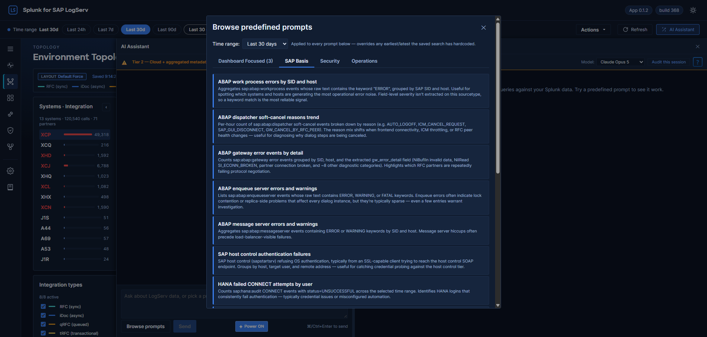

# Predefined Prompts

Predefined prompts are cataloged saved searches across three packs that the AI Assistant can dispatch via the [Splunk MCP Server](mcp-setup.md) **without invoking any LLM**. They are the deterministic, vendor-traffic-free path through the AI Assistant: the user clicks a prompt card, the orchestrator dispatches the saved search, the result tile renders in the right pane, and a static interpretation + suggested-next-steps card appears in the chat.

This is the path that works **without an LLM credential**: predefined prompts need no LLM provider, no credential, and make no vendor call. The AI Assistant ships turned off; once an admin has turned it on and the Splunk MCP Server is installed ([Set Up the AI Assistant](enable.md)), the predefined prompts are the whole AI Assistant in any deployment that never configures a provider. Once an [LLM provider credential](settings.md#provider-credentials-tab) is configured, the same catalog coexists with the [free-form path](free-form-prompts.md).

## :material-circle-box:{ .taiconcolor } The Three Packs

| Pack | Count | Focus |
|---|---|---|
| **SAP Basis** | 15 | SAP Basis admin investigations: HANA trace severity trend, ABAP work-process errors, integration topology call volume, RFC partner failures |
| **Security** | 28 | Auth failures, beaconing detection, after-hours admin activity, permission grants, privilege-chain detection (failure → success → grant), service-account interactive logins, Windows lockouts |
| **Operations** | 18 | Ingest health, error rate trends, error-category breakdowns, top error categories, host volume drop, freshness checks, Cloud Connector backend latency |

The full catalog ships inside the LogServ App as a data-driven intent map. Each prompt entry carries the saved-search name, label, description, render hint, dashboard mapping, interpretation, and suggested next steps, plus an optional chart hint and chart palette.

Thirteen of the Security prompts run the App's Enterprise Security saved searches (`splunk_sap_logserv_es_*`). Such a prompt returns an error while its saved search is disabled; to keep those prompts working on a search head without Enterprise Security, turn off only the schedule of those 13 searches. Before you disable the ES content, read [Disabling or tuning the ES content](../enterprise-security/overview.md#disabling-or-tuning-the-es-content).

## :material-circle-box:{ .taiconcolor } The Dashboard Focused Tab

The first-position tab in the prompt browser is **Dashboard Focused** — it auto-filters the catalog to prompts that are mapped to the dashboard you currently have open. The mapping is the per-prompt `dashboard` field in the intent map (single string or array — multi-target prompts map to multiple dashboards). The tab auto-hides when the active dashboard has zero matching prompts (e.g., on Settings or AI Assistant pages).

Each card on the Dashboard Focused tab carries a small pack-origin chip (cyan-light SAP Basis / salmon-red Security / gold-orange Operations) so users can find the prompt back in its home pack later.

## :material-circle-box:{ .taiconcolor } What Happens When You Click a Prompt

1. **Dispatch.** The orchestrator calls `splunk_run_saved_search` on the MCP server with the prompt's saved-search name and the time window selected in the prompt browser's own **Time range** dropdown (Last 1 hour … Last 30 days; default **Last 24 hours**, remembered per browser tab in `sessionStorage`). That window is passed as the dispatched search's `earliest_time` / `latest_time`, so it bounds the saved search — narrowing the dropdown makes a heavier prompt return faster.
2. **Tile renders.** The MCP server returns the rows. The orchestrator renders them in a tool-result tile in the right pane, with the prompt's pre-configured `renderHint` (`table` / `timechart` / `kpi` / `pie`) and optional companion `chartHint` (chart on top + table below for `renderHint=table` prompts that benefit from a visual).
3. **Guidance card.** A "How to read this result" card appears in the left chat pane below the user's prompt label. The card has two parts:
    - **Interpretation** — one paragraph explaining what the result means and what shapes are normal vs. concerning. Sourced from the intent map's `interpretation` field.
    - **Suggested next steps** — a bulleted list of follow-up investigations. Some entries are plain text; others are clickable deep-link chips that open Splunk's universal Search app with a focused SPL pre-filled and the dispatch's exact earliest/latest pre-applied. Sourced from the intent map's `nextSteps` array.
4. **Drill-down chips on the tile.** Every tile carries a `↗ <Dashboard name>` chip per resolvable dashboard (from the prompt's `dashboard` field), then a `↗ Run SPL` chip, then **Clear**, in its actions slot. See [Drill-down Chips](drill-down-chips.md).

**No LLM call.** No vendor traffic. No tokens. The dispatch is recorded as a `local_only` audit event with the prompt id + SPL + row count + execution time + ok flag. See [Audit Log](audit-log.md).

!!! note "High-volume prompts read precomputed rollups"
    About half the catalog — every high-volume investigation plus the whole-estate host-volume prompts — reads the same hourly KV-Store rollups that power the dashboards instead of scanning every event live. These prompts stay sub-second even over a 30-day window on a large dataset, where a raw scan of the same window can run past the MCP request timeout (60 seconds by default, **MCP request timeout (seconds)** in [Application Settings](settings.md#feature)) at high ingest volumes. The trade-off is identical to the dashboards: results reflect data through the most-recently-completed hour (the beaconing prompt's rollup is daily), and on a fresh install these prompts populate older windows only after the [Dashboard Data backfill](../logserv-app/dashboard-data.md) has run. The remaining prompts dispatch a live search bounded by the Time range you select.

## :material-circle-box:{ .taiconcolor } The Tab Persistence Convention

The prompt browser remembers your last-selected tab across modal-open events, persisted per-tab in `sessionStorage` under `logserv.aiAssistant.promptActivePack`. The persistence rule is **selection-based, not casual-flipping-based** — your tab choice is only remembered if you actually picked a prompt from it. Casual tab-flipping (browsing without clicking a card) doesn't persist. If your last selected tab points at a tab that's hidden on the current dashboard (e.g., persisted to Dashboard Focused on a dashboard with no matching prompts), the resolver falls back to `sap_basis`.

## :material-circle-box:{ .taiconcolor } Customizing the Catalog

The prompt catalog is data-driven: each prompt is an entry in the App's intent map (`default/data/mcp/logserv_intent_map.json`) with a matching saved search in `default/savedsearches.conf`. The intent map is compiled into the App's JavaScript bundle at build time, so adding or editing a prompt means changing the App's source, rebuilding the App and redeploying it; editing the installed copy of `logserv_intent_map.json` does not change the catalog. On Splunk Cloud Platform, the rebuilt App goes through private-app vetting again. The steps, the full JSON schema, the build-time consistency check and a pre-deploy SPL dry run are in [Adding a New Predefined Prompt](../developer/ai-assistant-internals.md#adding-a-new-predefined-prompt); the build itself is in [Build the LogServ App](../developer/build-from-source.md#build-the-logserv-app).

## :material-circle-box:{ .taiconcolor } The Splunk Risky-Command Safeguard

Splunk Web's Search app asks for confirmation before it runs a search that arrives in a link (a URL to `/app/search/search?q=...`) and contains a command Splunk marks as risky, for example `map`, `delete`, `script`, `tscollect`, `outputlookup`, `outputcsv`, `sendalert` or `sendemail`. Splunk's SPL safeguards documentation has the full list for each Splunk version; [Splunk risky-command safeguard](../developer/ai-assistant-internals.md#splunk-risky-command-safeguard) gives it for 9.4. The saved searches the AI Assistant dispatches through the MCP Server are not affected: the safeguard applies to searches opened in Splunk Web from a link.

The **↗ Run SPL** chips and the next-step links of the guidance cards open Splunk Search that way, so they are subject to it. No search in the shipped catalog (the prompts' searches and their next-step searches) uses a risky command. If you customize the catalog, scan any new SPL for risky commands before shipping; [Splunk risky-command safeguard](../developer/ai-assistant-internals.md#splunk-risky-command-safeguard) shows the rewrite pattern (`map` → first-class subsearch).

## :material-circle-box:{ .taiconcolor } Clear All / Per-Result Clear

The right pane carries a **Clear All** button in the toolbar above the result list, plus a **Clear** button on every individual tile (in the actions slot, alongside the drill-down chips). Both prune the conversation:

- **Per-tile Clear** removes the tool_call + tool_result + the user message that triggered the dispatch (so a canned-prompt's chat label disappears alongside its result panel) + the guidance card. Outbound vendor refs for that tile are also stripped from the next-turn vendor-message buffer.
- **Clear All** wipes the entire conversation, including all tool_results, all guidance cards, all assistant_text messages, and all user messages. The chat session id is preserved so audit events continue with the same correlation id.
