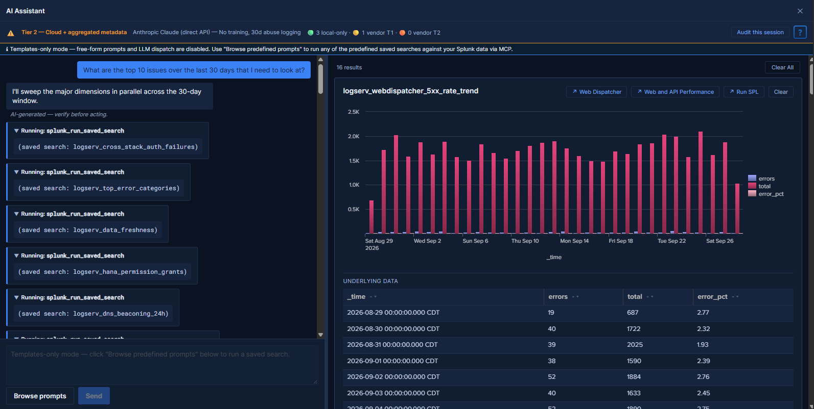

# Restricting the LLM Path

The AI Assistant has two paths: predefined prompts, which never call an LLM, and free-form questions, which an LLM vendor answers. This page is for deployments where the free-form path must stay off. There are three ways to keep it off, from the easiest to undo to the hardest; pick the one your policy needs.

| Option | What it is | Who can undo it | What you install |
|---|---|---|---|
| [Templates-only mode](#templates-only-mode-runtime) | A setting on **Settings → AI Assistant → General** | Any LogServ App admin, with a save | The released App package (no change) |
| [Templates-only build](#templates-only-build-compile-time) | The same App source built with the flag fixed on | Nobody, short of installing a different build | A package you build from source |
| [The v0.0.6 line](#the-v006-line-vendor-code-absent) | An older, frozen line whose bundle has no vendor client code | Nobody | The v0.0.6 App package (not in the v0.1.2 download location) |

The released v0.1.2 App package is the full-LLM build: the free-form path is present, and starts working only once an admin selects a provider and stores its credential. Until then a typed question gets a canned reply from the Mock provider and no vendor is contacted.

## :material-circle-box:{ .taiconcolor } Templates-only Mode (Runtime)

**Templates-only mode** is a setting (`templates_only_mode`, default off) in the released package. To turn it on:

1. Open **Settings → AI Assistant → General**.
2. Under **Feature**, select **Templates-only mode** (the toggle then reads **Templates-only**).
3. Click **Save Defaults**. The change applies to your page at once and to other users' pages at their next page load.

While it is on, every source of free-form dispatch is off: the chat input is read-only, **Send** is disabled, the model picker and the Power Mode toggle are hidden, the **Provider Credentials** sub-tab is hidden, and the banners described [below](#what-changes) appear. If any code path still reaches the LLM dispatch entry point, a guard there refuses it with a notice in the chat before any vendor call.

Choose it for demonstration environments, partners, and deployments that do not want the LLM path now but may later. Its limit: any user who can open the **Settings** page (a role named `admin`, `sc_admin` or `sc_subadmin`) can turn it off again with a save. Where that is not acceptable, use a templates-only build.

## :material-circle-box:{ .taiconcolor } Templates-only Build (Compile-time)

The templates-only build is the LogServ App built from the same source with the free-form path **disabled at compile time**. No configuration change can restore it: the build flag forces the `templates_only_mode` setting on where it is read, so every source of that setting (the KV Store settings row, a `local/ai_assistant_settings.conf` override, or the shipped default) reports templates-only whatever it contains. Changing the setting, by any route including a direct REST write, has no effect, and the **Templates-only mode** toggle is hidden in this build because it could not change anything. The dispatch guard is tied to the build flag as well as to the setting, so it holds even if the setting never reaches the dispatch layer.

This is a **functional** disable: the vendor provider code is still in the bundle, but nothing can reach it. It suits demos, partners and most restricted environments. If your policy requires the vendor code to be physically absent, see [the v0.0.6 line](#the-v006-line-vendor-code-absent).

### Building it

No templates-only package is published for v0.1.2: the only App package in the release is the full-LLM build. To get one, build it from the release's source and package it yourself:

1. Install the dependencies at the App workspace root (`sap_logserv_package/splunk_app_sap_logserv/`): `yarn install --frozen-lockfile --ignore-engines`.
2. In `packages/log-serv-app`, run `yarn build:templates-only`. Like the regular build, it first runs the intent-map and diagnostics checks; it then builds into `stage/` and sets `templates_only_mode = true` in the staged `default/ai_assistant_settings.conf`, and fails if it cannot.
3. Package `stage/` as `splunk_app_sap_logserv`: `tar -czf splunk_app_sap_logserv-0.1.2-templates-only.tar.gz --transform 's|^stage|splunk_app_sap_logserv|' stage`.
4. Install it like the released package ([Install the App and Seed the Dashboards](../logserv-app/installation.md)), after checking it with AppInspect if your process requires that.

The prerequisites (Node.js and yarn versions) are in [Building the Packages from Source](../developer/build-from-source.md#before-you-start), the steps shared with the regular build in [Build the LogServ App](../developer/build-from-source.md#build-the-logserv-app), and this variant in [The Templates-Only Variant](../developer/build-from-source.md#the-templates-only-variant). Building, checking and supporting a package you build yourself fall to you.

## :material-circle-box:{ .taiconcolor } The v0.0.6 Line (Vendor Code Absent)

The **v0.0.6 line** deletes the LLM provider implementations from the source, so its bundle contains no outbound vendor client at all. Its App package (0.0.6, build 266) is a templates-only build. Choose it only when the presence of the vendor client code is itself the concern.

!!! warning "Frozen at build 266, with no later fixes"
    The v0.0.6 line was closed out at App build 266 on 2026-08-07 and receives no further changes: no dashboard, rollup, Data TA, AI Assistant or security fix made in the v0.1.1 or v0.1.2 line after that date is in it. For example, it lacks the nightly retention that cannot empty a rollup, admin-only write access to most of the App's KV Store collections, and the Data TA's routing of events longer than about 4 KB. Its packages are not part of the v0.1.2 download location. [Release Notes: 0.0.6](../overview/release-notes-0.0.6.md) describes the line; [Release Notes: 0.1.2](../overview/release-notes.md) and [Release Notes: 0.1.1](../overview/release-notes-0.1.1.md) list what changed after it.

## :material-circle-box:{ .taiconcolor } What Changes { #what-changes }

These apply to Templates-only mode and to a templates-only build alike, except where noted.

### In the AI Assistant panel

- **Chat input**: read-only, with the placeholder *"Templates-only mode — click "Browse predefined prompts" below to run a saved search."*
- **Send**: always disabled.
- **Power Mode toggle**: hidden (with no LLM call there is nothing to run a saved search before).
- **Browse prompts**: fully enabled; the only way to run anything.
- **Model picker** in the privacy banner: hidden.
- **Info banner** at the top of the chat: *"Templates-only mode — free-form prompts and LLM dispatch are disabled. Use "Browse predefined prompts" to run any of the predefined saved searches against your Splunk data via MCP."*

### On the Settings page

- **Provider Credentials** sub-tab: hidden (if it was open, the page falls back to General).
- **Info banner** at the top of the AI Assistant tab: says that LLM dispatch is disabled and that the provider, model, tier and Power Mode fields have no effect. Its last sentence differs: in Templates-only mode it says the mode can be turned off on the General sub-tab; in a templates-only build, that the mode is fixed at compile time.
- **Templates-only mode** toggle: hidden in a templates-only build only.
- **Model discovery** rows (the toggle and **Refresh model list**): hidden in a templates-only build, where model discovery makes no vendor call at all. In Templates-only mode they stay visible.
- The **General**, **Splunk MCP** and **Audit Log** sub-tabs stay visible and work, for the MCP connection, the audit forwarder and the audit trail.

## :material-circle-box:{ .taiconcolor } What Stays Active

- **The full predefined-prompt catalog.** Click any card in the prompt browser to run it.
- **Tool tiles in the right pane.** Tables, charts, KPIs and pies, as in the full path.
- **Guidance cards.** The static interpretation and suggested next steps of each prompt.
- **Drill-down chips.** `↗ <Dashboard name>` (one per related dashboard) and `↗ Run SPL` on every tile.
- **Audit log.** A `local_only` event for every predefined prompt, plus `audit_forwarder_failure` events if the forwarder fails. No `vendor_tier1` events, because no question reaches a vendor.
- **HEC audit forwarder.** Same behavior as in the full path.
- **All dashboards**, the Environment Topology view, the auto-refresh picker, Download PNG and time-range URL preservation.

## :material-circle-box:{ .taiconcolor } What Is Disabled

- **Free-form prompts.** Chat input read-only and **Send** disabled; the dispatch guard refuses any code path that reaches the LLM dispatch entry point.
- **Power Mode.** Toggle hidden.
- **Provider Credentials sub-tab.** Hidden.
- **Model picker in the privacy banner.** Hidden.
- **Vendor calls for chat.** No free-form question reaches a vendor, and no `vendor_tier1` audit event is written. In Templates-only mode (not in a templates-only build), **Model discovery** can still call the provider's model-listing endpoint, with metadata only: when the chat panel opens and the active provider's cached list is missing, more than 24 hours old or from a failed refresh, and when an admin clicks **Refresh model list**. For no vendor contact at all, also clear **Model discovery**, or leave **Active Provider** on **Mock (development only)**.

## :material-circle-box:{ .taiconcolor } End-User Experience

The user clicks the **AI Assistant** button and sees the Templates-only banner at the top of the chat panel. They open the prompt browser, run prompts, read the tiles and guidance, and follow the drill-down chips into the dashboards: the full LogServ analytics experience, without the free-form path.

Every option still needs the [Splunk MCP Server](mcp-setup.md) on the search head, because the predefined prompts run through it.
