# AWS Remote S3 Copy Setup Guide

### :material-circle-box:{ .taiconcolor } Introduction

This guide adds a Lambda function in your AWS account that copies each new LogServ object into a bucket of your own, which Splunk then reads. Use it only if you want your own copy of new log files; otherwise the [AWS Remote S3 Connect Setup](aws-remote-s3-connect-guide.md) is the default ([Choose Your Cloud and AWS Scenario](choose-your-cloud.md)).

The deployment diagram below shows two different AWS accounts.  For brevity and clarity, the AWS account at the top of the diagram will be referred to as the **_SAP ECS account_** and the second AWS account on the bottom left of the diagram will be referred to as the **_Secondary account_** from this point onward. 

Your SAP ECS LogServ subscription for AWS (e.g. in your **_SAP ECS account_**) should have one S3 Bucket in that account where LogServ will store your LogServ logs.  It should also have one SQS Queue in your **_SAP ECS account_** that receives notifications when new logs are added to the S3 Bucket in that account.

You will need to obtain the <a href="https://docs.aws.amazon.com/IAM/latest/UserGuide/reference-arns.html" target="_blank">AWS ARN</a> for the SQS Queue and the S3 Bucket that resides in your **_SAP ECS account_** prior to performing the steps in this setup guide.

Take note of the AWS Region in your **_SAP ECS account_** where the S3 Bucket and SQS Queue are located as you will need to deploy the CloudFormation template provided in that same region in your **_Secondary account_**. 

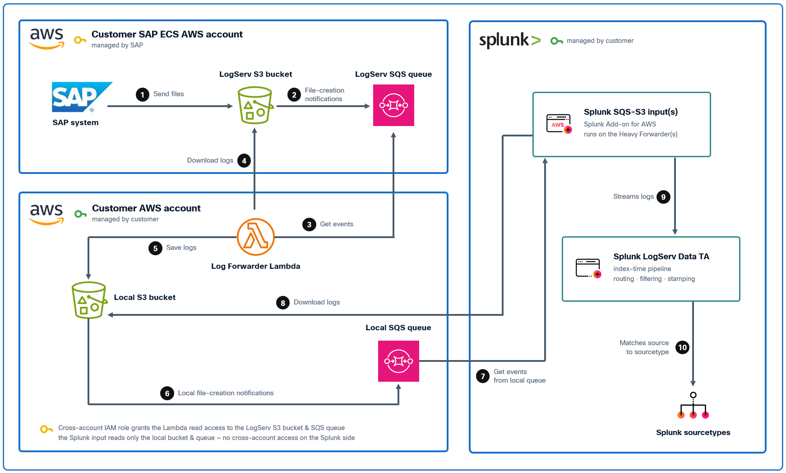

!!! note "What the copy holds, and what it does not"
    The Lambda copies the object named in each notification it receives from SAP's SQS Queue: the notifications still waiting there when you activate its trigger (step 9), then every new object. It never lists SAP's bucket, so it **does not copy history**: objects whose notifications are already gone stay only in SAP's bucket. To load those days, use [AWS S3 Direct](aws-s3-direct.md) against SAP's bucket once this setup works.

    The copy is not byte-identical. A gzipped object is stored **decompressed**, under the same key without `.gz` (`...json.gz` becomes `...json`), with a content type guessed from its name; only an object that fails to decompress is stored as the original gzip under its original key. The copy therefore takes several times the storage of SAP's bucket, and each copy's LastModified time is the time it was copied.

<br>

### :material-circle-box:{ .taiconcolor } High Level Steps

Below are the high level steps for this setup process listed in the order they should be followed.

:material-lightning-bolt:{ .taiconcolor } Please ensure the user you log in with in your AWS **_Secondary account_** has the appropriate permissions to perform all the steps outlined below.  

- **Before you begin:** check where each step runs, and install the Splunk Add-on for AWS on each instance that will run the input (see [Before You Begin](#before-you-begin))

1. Obtain the ARNs for the SQS Queue and the S3 Bucket in your **_SAP ECS account_**
2. Create a new S3 Bucket, with a name of your own, in the correct AWS Region in your **_Secondary account_** and upload the <a href="https://github.com/splunk/splunk-sap-logserv/blob/main/aws_assets/lambda_function/splunk-logserv-lambda-binary.zip" target="_blank">splunk-logserv-lambda-binary.zip</a> file to the root of the bucket (do not rename the file — the CloudFormation template looks for the object key `splunk-logserv-lambda-binary.zip` at the bucket root) 
3. Deploy the AWS <a href="https://github.com/splunk/splunk-sap-logserv/blob/main/aws_assets/cloud_formation/splunk-logserv-remote-s3-copy.yaml" target="_blank">CloudFormation Template</a> provided for this remote S3 copy deployment approach in your **_Secondary account_**
4. Contact SAP LogServ support and request an update to the access policies for the <a href="https://github.com/splunk/splunk-sap-logserv/blob/main/aws_assets/sap_ecs_account_policies/sap-ecs-account-sqs-access-policy.json" target="_blank">SQS Queue</a> and <a href="https://github.com/splunk/splunk-sap-logserv/blob/main/aws_assets/sap_ecs_account_policies/sap-ecs-account-s3-access-policy.json" target="_blank">S3 Bucket</a> residing in your **_SAP ECS account_**, and wait for SAP to confirm that both are applied
5. Create an <a href="https://docs.aws.amazon.com/IAM/latest/UserGuide/access-keys-admin-managed.html#admin-create-access-key" target="_blank">Access Key</a> for the new IAM User that was created with the CloudFormation template in your **_Secondary account_**
6. Configure your AWS **_Secondary account_** in the <a href="https://splunk.github.io/splunk-add-on-for-amazon-web-services/ManageAwsAccounts/" target="_blank">Splunk Add-on for Amazon Web Services (AWS)</a>
7. Configure the new cross-account <a href="https://splunk.github.io/splunk-add-on-for-amazon-web-services/ManageAwsIAMRole/" target="_blank">IAM Role</a> from your AWS **_Secondary account_** in the Splunk Add-on for Amazon Web Services (AWS).
8. Configure a new <a href="https://splunk.github.io/splunk-add-on-for-amazon-web-services/SQS-basedS3/" target="_blank">SQS-Based S3 Input</a> in the Splunk Add-on for Amazon Web Services (AWS), and give it the `_meta = cloud_provider::aws` line.
9. Once SAP has confirmed both policies, create the SQS Queue Trigger on the Lambda function the CloudFormation template created (the template does not create the trigger)
10. Confirm that LogServ logs are being ingested into Splunk

<br>

### :material-circle-box:{ .taiconcolor } Before You Begin

#### :material-crop-square:{ .taiconcolor } Where These Steps Run

| Steps | Where |
|---|---|
| 1 to 5, and 9 | The AWS console of your **_Secondary account_**, and a request to SAP LogServ Support |
| Install the Splunk Add-on for AWS (below), 6 to 8 | Splunk Web on each instance that will run the input: each heavy forwarder (recommended), the single instance, or, with no heavy forwarder, your Splunk Cloud search head. Configure each heavy forwarder directly, not through a Deployment Server |
| 10 | A search head that can search the LogServ data index |

Several heavy forwarders can read the same local SQS Queue: the queue hands each message to one of them, so they share the work. Give each one the same account, IAM role and input; see *Adding Capacity* in [Capacity Planning and First Start](../getting-started/capacity-planning.md).

#### :material-crop-square:{ .taiconcolor } Check These First

Steps 1 to 4 need nothing in Splunk, so do them on day one (step 1 of the [Deployment Roadmap](../getting-started/roadmap.md#1-request-from-sap-and-prepare-your-cloud)). Check the items below before you go on with step 5.

- **The prerequisites are met and the Data TA is on each of those instances** ([Plan and Prerequisites](../getting-started/prerequisites.md), [Create the Indexes and Install the Data TA](install-ta.md)). On heavy forwarders, check its build with [Version Check](../getting-started/capacity-planning.md#version-check). Routing to the LogServ sourcetypes happens at index time, so events indexed before the Data TA arrives keep the sourcetype `sap_logserv_logs` for good.
- **You have decided [cloud attribution](cloud-attribution.md) and [filtering](decide-filtering.md).** Both apply at index time, to what is indexed after you save them.
- **You have planned the first start.** Once its trigger is active, the Lambda copies the object of every notification already waiting in SAP's queue. Read [First Start: The Queue Backlog](../getting-started/capacity-planning.md#first-start-the-queue-backlog) before step 9, including whether to ask SAP to purge the older messages.

#### :material-crop-square:{ .taiconcolor } Install the Splunk Add-on for AWS

Install the <a href="https://splunkbase.splunk.com/app/1876" target="_blank">Splunk Add-on for Amazon Web Services (AWS)</a> (Splunkbase app 1876) on each instance from the table above. It runs the SQS-Based S3 input and holds the AWS account and IAM role you configure in steps 6 to 8; the LogServ dashboards do not need it on the search head. See the <a href="https://splunk.github.io/splunk-add-on-for-amazon-web-services/Installationandconfiguration/" target="_blank">add-on's installation documentation</a>.

- **Version:** 8.2.2 or later is recommended. Splunk advisory <a href="https://advisory.splunk.com/advisories/SVD-2026-1005" target="_blank">SVD-2026-1005</a> (fixes in third-party packages) says to upgrade to 8.2.2 or higher. The solution enforces no minimum version; these guides were checked on 8.3.1, and the AWS S3 Direct screen shows a warning below 8.1.0.
- **Install it directly on each heavy forwarder.** Do not add it to the `SAP_LogServ_HeavyForwarders` server class, and do not distribute it with a Deployment Server: a push replaces an app's `local/` folder on the forwarder, which is where Splunk Web saves the account, the IAM role and the input you create in steps 6 to 8.
- Just install it now; steps 6 to 8 configure it.

<br>

### :material-circle-box:{ .taiconcolor } 1. Obtain ARNs from SAP ECS Account

Before you can create the local S3 Bucket and deploy the CloudFormation template in your **_Secondary account_**, you need to obtain the AWS <a href="https://docs.aws.amazon.com/IAM/latest/UserGuide/reference-arns.html" target="_blank">ARN</a> for two resources that reside in your **_SAP ECS account_**:

- The **S3 Bucket** that stores your LogServ logs
- The **SQS Queue** that receives notifications when new logs are added to the S3 Bucket

You will also need to note the **AWS Region** where these resources are located, because the S3 Bucket and CloudFormation template in the next two sections must be created and deployed into that same region in your **_Secondary account_**.

??? tip "What does an ARN look like?"
    AWS Amazon Resource Names (ARNs) follow a predictable format. Examples:

    - S3 Bucket ARN: `arn:aws:s3:::sap-hec-clz-ap-south-1-hec53-xsd`
    - SQS Queue ARN: `arn:aws:sqs:ap-south-1:121212121212:sap-hec-clz-ap-south-1-hec53-xsd-logserv`

**How to obtain the ARNs:**

1.<b class="taiconcolor">a</b> If you do not have console access to your **_SAP ECS account_**, contact SAP LogServ Support to obtain the ARN for the S3 Bucket, the ARN for the SQS Queue, and the AWS Region where these resources reside.

1.<b class="taiconcolor">b</b> If you **do** have console access to your **_SAP ECS account_**, obtain the ARNs yourself:

- For the **S3 Bucket**: navigate to the S3 console, find the bucket used for LogServ logs, click on the bucket name, and copy the ARN from the **_Properties_** tab.
- For the **SQS Queue**: navigate to the SQS console, find the queue that receives S3 notifications, click on the queue name, and copy the ARN from the **_Details_** section.

1.<b class="taiconcolor">c</b> Save both ARNs and the AWS Region in a secure location -- you will reference them when creating the S3 Bucket (next section), deploying the CloudFormation Template, and configuring the SQS-Based S3 Input later in this guide.

<br>

### :material-circle-box:{ .taiconcolor } 2. Create S3 Bucket with Lambda Function ZIP File

This bucket holds the Lambda function's code. The CloudFormation template does not create it; it creates only the bucket for the copies (step 3.i).

2.<b class="taiconcolor">a</b> Take note of the AWS Region in your **_SAP ECS account_** where the S3 Bucket and SQS Queue are located.

2.<b class="taiconcolor">b</b> Log into your AWS **_Secondary account_** and change to the region that matches the region in your **_SAP ECS account_**. Create the bucket in that Region, the one you will deploy the stack in: Lambda requires its code bucket in the function's Region.

2.<b class="taiconcolor">c</b> Choose a name of your own for the new S3 bucket. S3 bucket names are global: each name can be used by only one AWS account, so pick one no other account is likely to hold, for example `splunk-logserv-lambda-code-<your-account-id>-<region>`. Write it down; you enter it in step 3.g.

2.<b class="taiconcolor">d</b> Navigate to the S3 console and create a <a href="https://docs.aws.amazon.com/AmazonS3/latest/userguide/create-bucket-overview.html" target="_blank">general purpose S3 bucket</a> using all the default settings

2.<b class="taiconcolor">e</b> <a href="https://docs.aws.amazon.com/AmazonS3/latest/userguide/upload-objects.html" target="_blank">Upload</a> the <a href="https://github.com/splunk/splunk-sap-logserv/blob/main/aws_assets/lambda_function/splunk-logserv-lambda-binary.zip" target="_blank">splunk-logserv-lambda-binary.zip</a> file to the root of the S3 bucket

??? note "Example"
    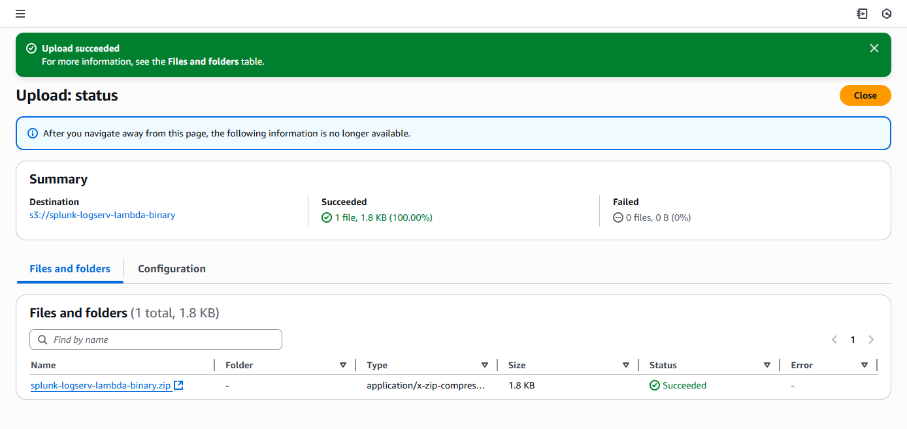

<br>

### :material-circle-box:{ .taiconcolor } 3. Deploy CloudFormation Template

:material-lightning-bolt:{ .taiconcolor } Before you deploy the CloudFormation template, take note of the AWS Region in your **_SAP ECS account_** where the S3 Bucket and SQS Queue are located as you will need to deploy the CloudFormation template provided in that same region in your **_Secondary account_**.

??? tip "What does the CloudFormation template do?"
    Creates the following resources:
    
    - An IAM User - Default name is **_splunk_logserv_user_**
    - An IAM Policy named **_splunk-logserv-ta-policy_**
    - An IAM Role named **_splunk-logserv-ta-role_**
    - An Inline IAM Policy on the IAM User to assume the IAM Role created above
    - An S3 Bucket with an Event Notification to the SQS Queue below- Default name is **_splunk-logserv-local-target-bucket_**
    - An SQS Queue - Default name is **_splunk-logserv-local-target-queue_**
    - A Dead Letter SQS Queue - Default name is **_splunk-logserv-local-target-queue-dlq_**. It takes the messages of the local SQS Queue that are received three times without being deleted; it does not protect the SQS Queue in your **_SAP ECS account_**
    - A Lambda Function (Python 3.12 runtime) - Default name is **_splunk-logserv-lambda-logforwarder_**
    - A LogGroup used by the Lambda Function

    It does not create the bucket for the Lambda code (step 2), the access key (step 5) or the Lambda's SQS trigger (step 9).

    A stack created from an earlier copy of this template runs the Lambda on python3.9, which AWS deprecated on 15 December 2025 (AWS: <a href="https://docs.aws.amazon.com/lambda/latest/dg/lambda-runtimes.html" target="_blank">Lambda runtimes</a>). To move it to Python 3.12, update the stack with the current template and keep the existing parameter values. The runtime is the only resource setting the two templates differ in; the function's code is the same.

3.<b class="taiconcolor">a</b> Navigate to the CloudFormation console (ensure the region you are in matches the region in your **_SAP ECS account_**)

3.<b class="taiconcolor">b</b> Click on the **_Create stack_** button and select **_With new resources (standard)_**
??? indented-note "Example"
    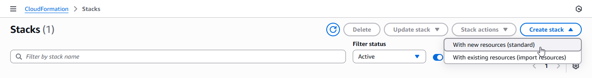

3.<b class="taiconcolor">c</b> Upload the AWS <a href="https://github.com/splunk/splunk-sap-logserv/blob/main/aws_assets/cloud_formation/splunk-logserv-remote-s3-copy.yaml" target="_blank">CloudFormation Template file provided</a> for this remote S3 copy deployment approach, then click the **_Next_** button
??? indented-note "Example"
    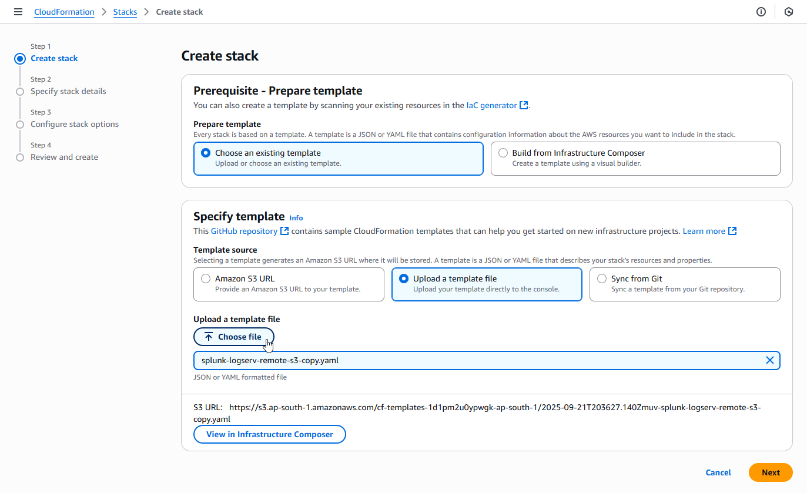

3.<b class="taiconcolor">d</b> Enter a name for the CloudFormation Stack - **_splunk-logserv-remote-s3-copy_**
??? indented-note "Example"
    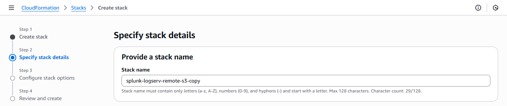

3.<b class="taiconcolor">e</b> Enter just the name (not the ARN) of the S3 Bucket in your **_SAP ECS account_** in the **_CrossAccountS3Bucket_** parameter
   - If your ARN looks like this *arn:aws:s3:::sap-hec-clz-ap-south-1-hec53-xsd* then just use the name like this *sap-hec-clz-ap-south-1-hec53-xsd*
??? indented-note "Example"
    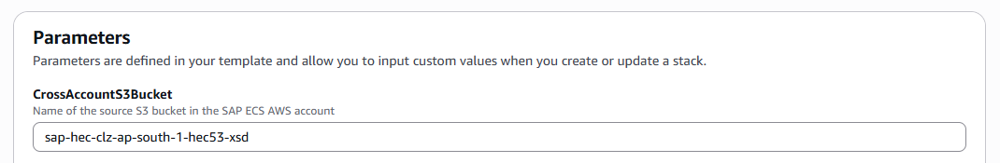

3.<b class="taiconcolor">f</b> Enter the complete ARN of the SQS Queue in your **_SAP ECS account_** in the **_CrossAccountSQSQueueArn_** parameter
??? indented-note "Example"
    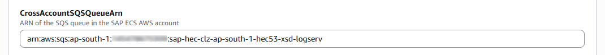

3.<b class="taiconcolor">g</b> Enter the exact name of the S3 Bucket you created in step 2 in the **LambdaCodeBucket** parameter. The parameter has no default; the example image shows an older default name, which you must not use.
??? indented-note "Example"
    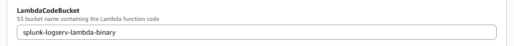

3.<b class="taiconcolor">h</b> Choose and enter a name for the Lambda Function to be created in your **_Secondary account_** in the **LambdaFunctionName** parameter
??? indented-note "Example"
    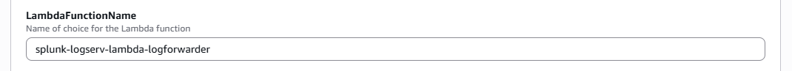

3.<b class="taiconcolor">i</b> Choose and enter a name for the S3 Bucket to be created in your **_Secondary account_** in the **LocalS3BucketName** parameter. The template creates this bucket for the copies, and bucket names are global too: replace the default with a name of your own, or the stack fails if another account already holds the name.
??? indented-note "Example"
    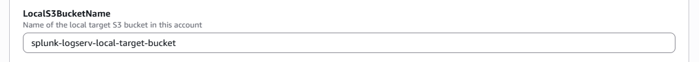

3.<b class="taiconcolor">j</b> Choose and enter a name for the SQS Queue to be created in your **_Secondary account_** in the **LocalSQSQueueName** parameter
??? indented-note "Example"
    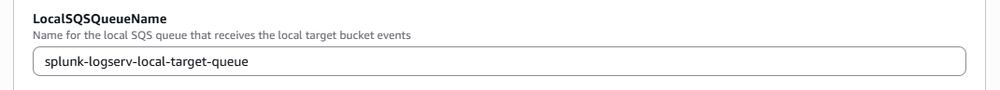

3.<b class="taiconcolor">k</b> Choose and enter a name for the IAM User to be created in your **_Secondary account_** in the **NewIAMUserName** parameter, then click on the **_Next_** button
??? indented-note "Example"
    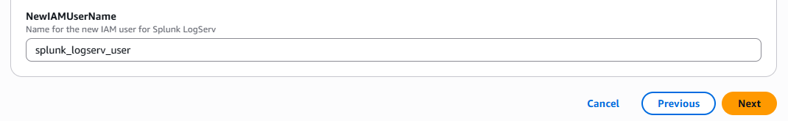

3.<b class="taiconcolor">l</b> Scroll down to the bottom of the page and check the **_I acknowledge that AWS CloudFormation might create IAM resources with custom names_** checkbox, then click on the **_Next_** button
??? indented-note "Example"
    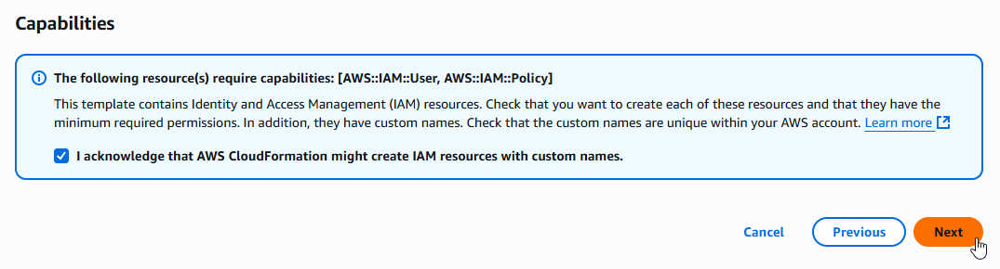

3.<b class="taiconcolor">m</b> Scroll down to the bottom of the page and click on the **_Submit_** button
??? indented-note "Example"
    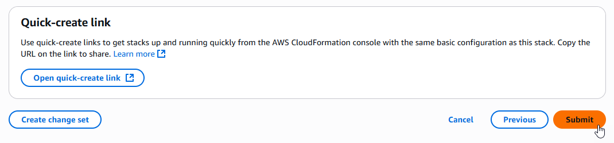

3.<b class="taiconcolor">n</b> Ensure the deployment of the CloudFormation template completes successfully
??? indented-note "Example"
    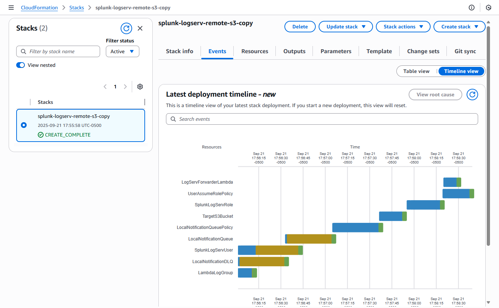

<br>

### :material-circle-box:{ .taiconcolor } 4. Contact SAP LogServ Support

Once the deployment of the CloudFormation templates completes successfully, you will need to provide SAP LogServ Support with the ARN of the IAM Role named **_splunk-logserv-ta-role_** that was created by the template.

The ARN for the IAM Role should look like the one below but with your 12-digit AWS account Id of your **_Secondary account_**.

arn:aws:iam::**_secondary-account-id_**:role/splunk-logserv-ta-role

Example access policies for the SQS Queue and S3 Bucket residing in your **_SAP ECS account_** are provided as a reference to provide clarity on the specific permissions that need to be applied by the SAP LogServ Support team.

- <a href="https://github.com/splunk/splunk-sap-logserv/blob/main/aws_assets/sap_ecs_account_policies/sap-ecs-account-sqs-access-policy.json" target="_blank">Example SQS Queue Access Policy</a>
- <a href="https://github.com/splunk/splunk-sap-logserv/blob/main/aws_assets/sap_ecs_account_policies/sap-ecs-account-s3-access-policy.json" target="_blank">Example S3 Bucket Access Policy</a>

Ask SAP to keep `s3:ListBucket` on the bucket itself (`arn:aws:s3:::<bucket-name>`) in the S3 Bucket policy, as the example does. The copy Lambda does not need it, but [AWS S3 Direct](aws-s3-direct.md) does when it loads history from SAP's bucket: for a bucket in SAP's account, AWS requires both your IAM Role's policy and SAP's bucket policy to allow it. The template already grants it on your side.

:material-lightning-bolt:{ .taiconcolor } **Wait until SAP LogServ Support confirms that both policies are applied** before you create the SQS Queue Trigger in step 9. Steps 5 to 8 can be done in the meantime.

<br>

### :material-circle-box:{ .taiconcolor } 5. Create Access Key for IAM User

The CloudFormation template creates the IAM User but no access key for it, so you create one here (AWS: <a href="https://docs.aws.amazon.com/IAM/latest/UserGuide/access-keys-admin-managed.html#admin-create-access-key" target="_blank">To create an access key for an IAM user</a>).

5.<b class="taiconcolor">a</b> Navigate to the IAM console in your **_Secondary account_** and search for the IAM User name you used when deploying the CloudFormation template. Click on the name of the IAM User to see the user details.
??? indented-note "Example"
    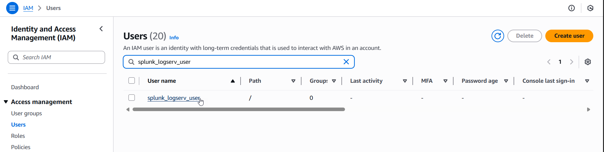

5.<b class="taiconcolor">b</b> Click on the **_Security credentials_** tab in the middle of the screen. Scroll down and click on the **_Create access key_** button.
??? indented-note "Example"
    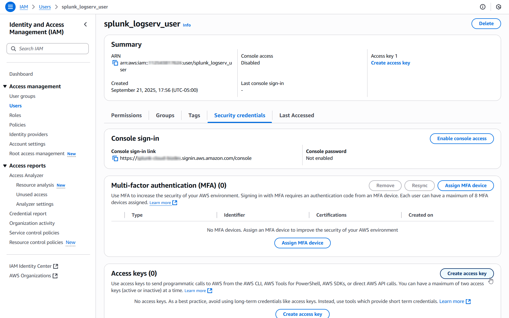

5.<b class="taiconcolor">c</b> Select the **_Local code_** use case, check the **_Confirmation_** checkbox and click on the **_Next_** button.
??? indented-note "Example"
    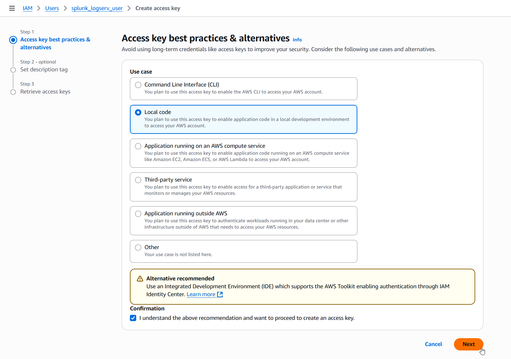

5.<b class="taiconcolor">d</b> Enter a description tag value if desired and click on the **_Create access key_** button.
??? indented-note "Example"
    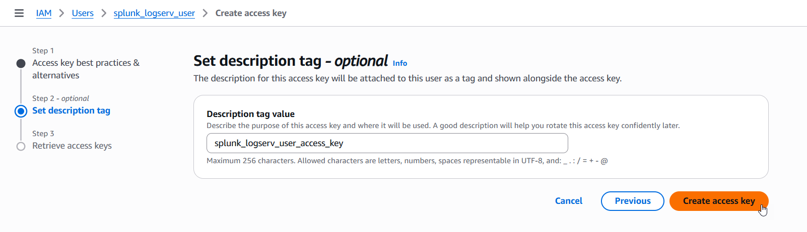

5.<b class="taiconcolor">e</b> Copy the values for both the **_Access key_** and the **_Secret access key_** and save them in a secure place as you will need them in the upcoming steps. Now click on the **_Done_** button.
??? indented-note "Example"
    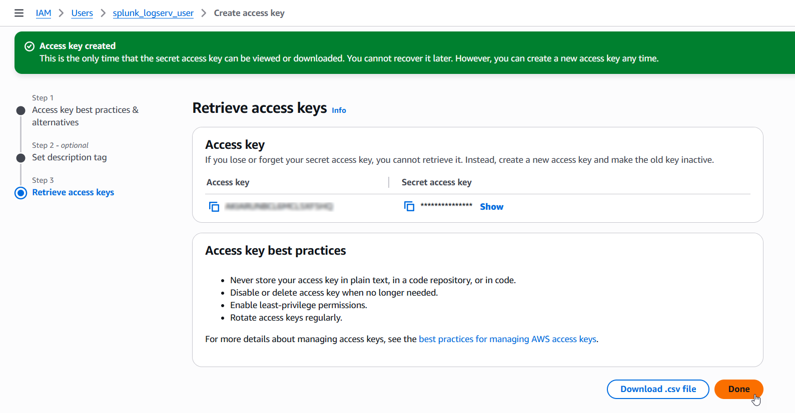

<br>

### :material-circle-box:{ .taiconcolor } 6. Configure Secondary Account (AWS Add-on)

:material-lightning-bolt:{ .taiconcolor } Please ensure the user you log in with in your Splunk instance has the appropriate permissions to perform all the steps outlined below. Do steps 6 to 8 on each instance that will run the input ([Where These Steps Run](#where-these-steps-run)).

6.<b class="taiconcolor">a</b> Login to your Splunk console then find and open the **_Splunk Add-on for AWS_** App
??? indented-note "Example"
    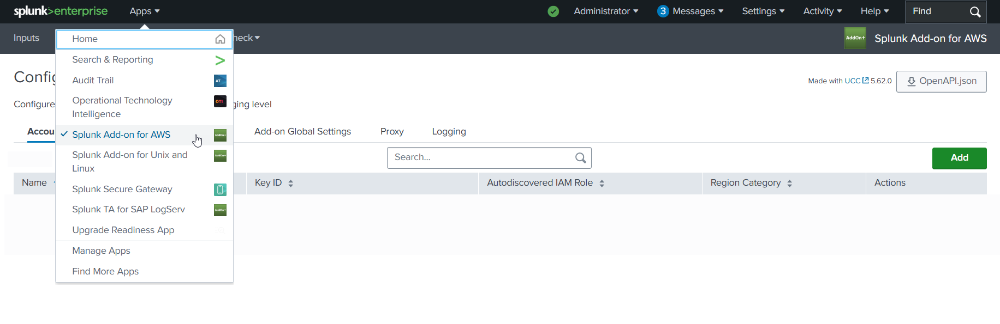

6.<b class="taiconcolor">b</b> Click on the **_Configuration_** tab, then click on the **_Account_** tab, then click on the **_Add_** button
??? indented-note "Example"
    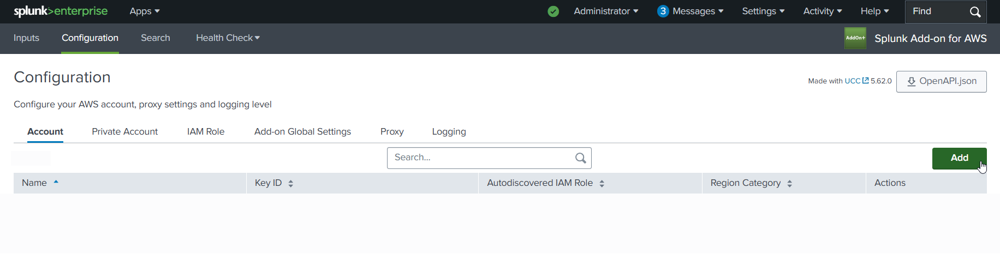

6.<b class="taiconcolor">c</b> Choose and enter a descriptive name for the account in the **_Name_** field. Enter the access key ID you created for the IAM User in the **_Key ID_** field and its secret in the **_Secret Key_** field. Leave the Region Category set to **_Global_**. Click on the **_Add_** button.
??? indented-note "Example"
    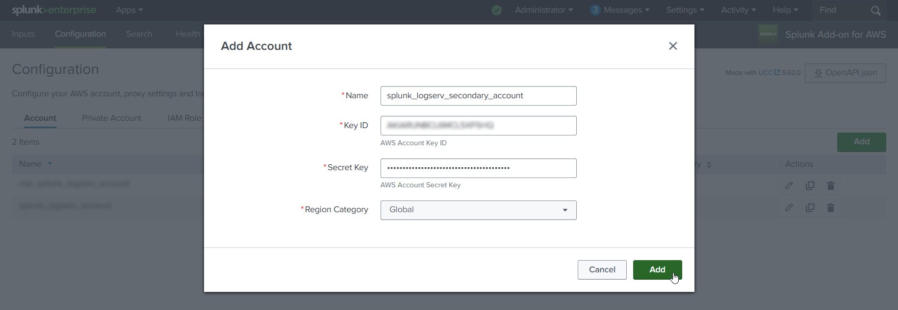

<br>

### :material-circle-box:{ .taiconcolor } 7. Configure IAM Role (AWS Add-on)

7.<b class="taiconcolor">a</b> Click on the **_IAM Role_** tab to the right of the Account tab, then click on the **_Add_** button
??? indented-note "Example"
    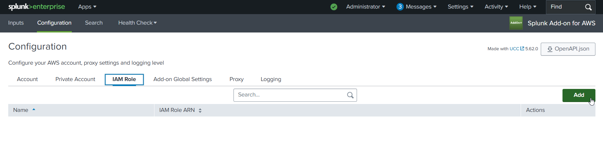

7.<b class="taiconcolor">b</b> Choose and enter a descriptive name for the role in the **_Name_** field. Enter the IAM Role ARN in the **_IAM Role ARN_** field, then click the **_Add_** button. The ARN for the IAM Role should look like the one below but with your 12-digit AWS account Id of your **_Secondary account_**.

- arn:aws:iam::**_secondary-account-id_**:role/splunk-logserv-ta-role

??? indented-note "Example"
    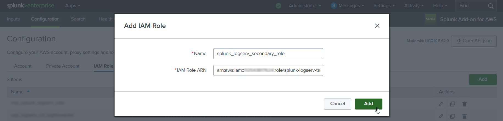

<br>

### :material-circle-box:{ .taiconcolor } 8. Configure SQS-Based S3 Input (AWS Add-on)

:material-lightning-bolt:{ .taiconcolor } Create the input only after the Data TA is on this instance ([Check These First](#check-these-first)). It reads the local SQS Queue, which stays empty until the trigger in step 9 is active.

8.<b class="taiconcolor">a</b> Click on the **_Inputs_** tab. Click on the **_Create New Input_** button. Select the **_Custom Data Type_** option at the bottom of the drop-down, then select the **_SQS-Based S3 (Recommended)_** option.
??? indented-note "Example"
    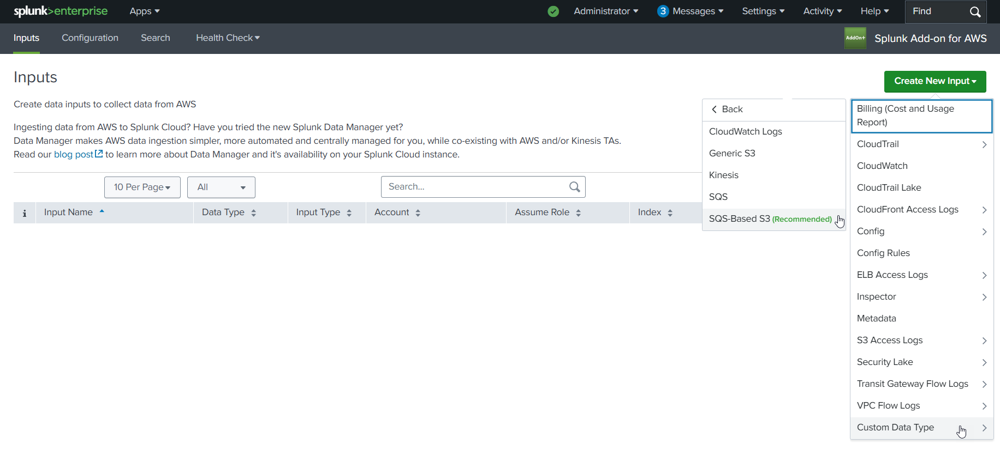

8.<b class="taiconcolor">b</b> Fill out the first three fields in the SQS-Based S3 Input (**_Name_**, **_AWS Account_**, **_Assume Role_**)

- Choose and enter a descriptive name for the input
- Select the AWS Account you configured previously
- Select the IAM Role you configured previously

??? indented-note "Example"
    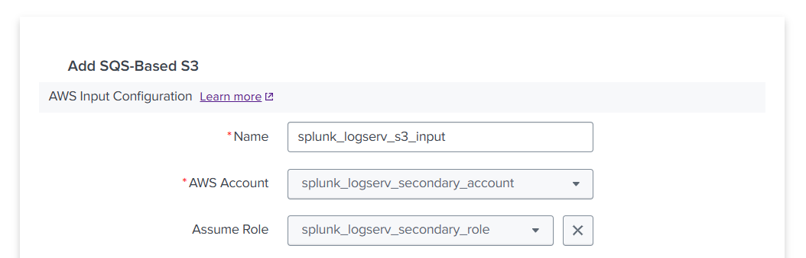

8.<b class="taiconcolor">c</b> Fill out the next three fields in the SQS-Based S3 Input (**_Force using DLQ_**, **_AWS Region_**, **_Use Private Endpoints_**)

- Leave the **_Force using DLQ (Recommended)_** checkbox **__checked__**
- Select the **_AWS Region_** where you deployed the CloudFormation template previously
- Leave the **_Use Private Endpoints_** checkbox **__unchecked__**

??? indented-note "Example"
    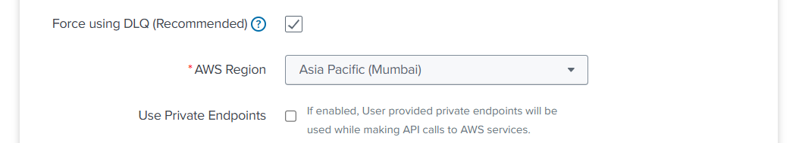

8.<b class="taiconcolor">d</b> Fill out the next three fields in the SQS-Based S3 Input (**_SQS Queue Name_**, **_SQS Batch Size_**, **_S3 File Decoder_**)

- Select the **_SQS Queue Name_** you entered in step **3.j** (**_LocalSQSQueueName_**) when previously deploying the CloudFormation template
- Leave the **_SQS Batch Size_** set to 10
- Leave the **_S3 File Decoder_** set to Custom Logs

??? indented-note "Example"
    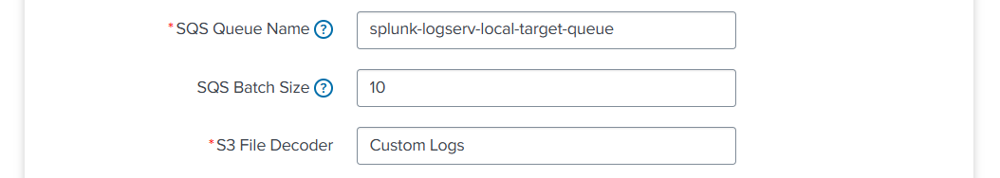

8.<b class="taiconcolor">e</b> Fill out the next three fields in the SQS-Based S3 Input (**_Signature Validate All Events_**, **_Source Type_**, **_Index_**)

- **__Uncheck__** the **_Signature Validate All Events_** checkbox (`sqs_sns_validation = 0` in `inputs.conf`). The notifications reach the queue directly from S3, not through SNS, so they carry no SNS signature; with the box checked, the add-on logs that a message has no valid SNS signature and does not process it.
- Enter the value of **_sap_logserv_logs_** in the **_Source Type_** field
- Enter **_sap_logserv_logs_** in the **_Index_** field: the LogServ data index, or the name you gave it if you renamed it ([Renaming an Index](install-ta.md#renaming-an-index))
- Click on the **_Add_** button

??? indented-note "Example"
    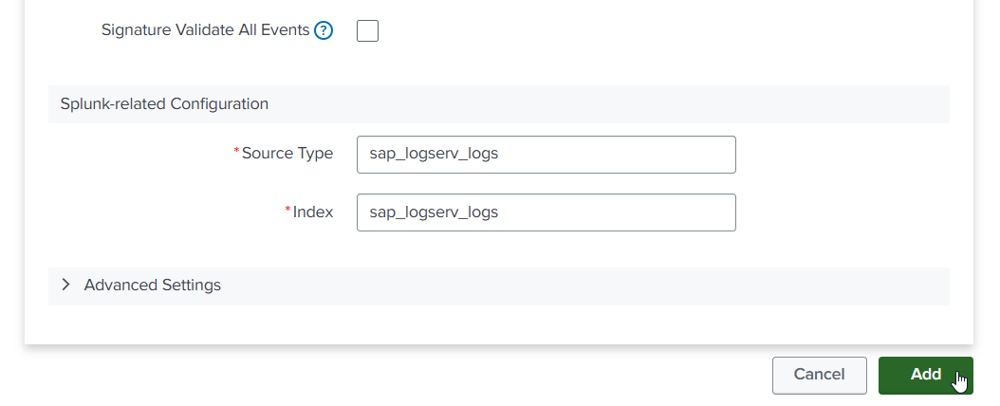

8.<b class="taiconcolor">f</b> Add the cloud attribution to the input. Leave the Data TA's **Cloud Provider** dropdown at **Not set**, and give this input its own stamp instead ([Choose Cloud Attribution](cloud-attribution.md)). The form has no field for it. The local SQS Queue stays empty until the trigger in step 9 is active, so add the line now, before the input has anything to read:

- Add this line to the input's stanza, `[aws_sqs_based_s3://<input name>]`, in `$SPLUNK_HOME/etc/apps/Splunk_TA_aws/local/inputs.conf`:

```ini
_meta = cloud_provider::aws
```

- Restart Splunk.
- After any later edit of this input in the form, check that the line is still there.

This follows [Add the `_meta` Line to an AWS Input](cloud-attribution.md#add-the-meta-line-to-an-aws-input); the disable and enable steps there are not needed while the local SQS Queue is empty. The sequence has not yet been run end to end on Splunk Add-on for AWS 8.3.1, and whether a later edit of the input in the form keeps the line is not known. Once events arrive (step 10), check the result with the search in [Check the Result](cloud-attribution.md#check-the-result).

Events the input reads without the line carry no `cloud_provider` field: the LogServ App's dashboards count them as AWS, but searches of the raw events do not see it. On Splunk Cloud, where you cannot edit the file, see [Splunk Cloud Without a Heavy Forwarder](cloud-attribution.md#splunk-cloud-without-a-heavy-forwarder).

<br>

### :material-circle-box:{ .taiconcolor } 9. Create the SQS Queue Trigger

:material-lightning-bolt:{ .taiconcolor } **Create the trigger only after SAP LogServ Support has confirmed that both policies from step 4 are applied, and at least 5 minutes after the stack was created.**

:material-lightning-bolt:{ .taiconcolor } Once the trigger is active, the Lambda copies the object of every notification already waiting in the SQS Queue in your **_SAP ECS account_** (up to 14 days of them) into the S3 Bucket in your **_Secondary account_**, and the forwarder parses them all on top of the live feed. It copies nothing older: objects whose notifications are already gone stay only in SAP's bucket, and [AWS S3 Direct](aws-s3-direct.md) loads them. Before you activate it, see [First Start: The Queue Backlog](../getting-started/capacity-planning.md#first-start-the-queue-backlog), which includes asking SAP to purge the older messages.

9.<b class="taiconcolor">a</b> Navigate to the Lambda console in your **_Secondary account_** and ensure the region you are in matches the region in your **_SAP ECS account_**. Find the Lambda function that was created by the CloudFormation template and click on its name to view details. 

??? indented-note "Example"
    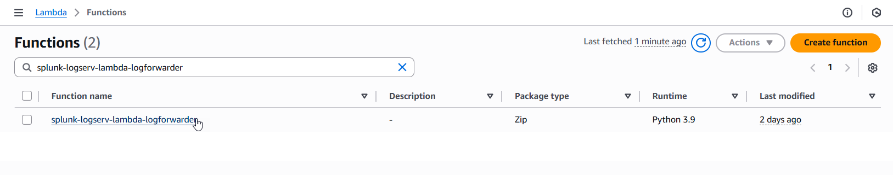


9.<b class="taiconcolor">b</b> The CloudFormation template does not create this trigger: the Lambda can read SAP's SQS Queue only after SAP has applied the policies, so the trigger is a manual step. On a new stack, follow the **_Create SQS Queue Trigger_** steps below. Use **_Configure SQS Queue Trigger_** only if the Function overview diagram already shows an SQS trigger, as in the example image below: for example one you created earlier, or one left from a stack you deleted and created again with the same Lambda function name (AWS does not delete a function's triggers when it deletes the function).

??? indented-note "Example"
    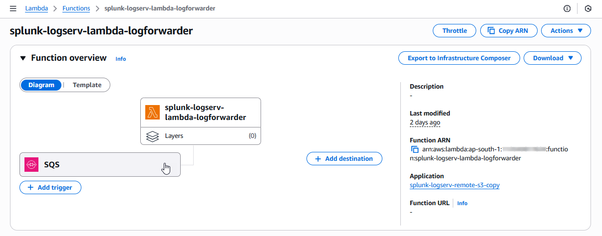

<br>

#### :material-crop-square:{ .taiconcolor } Create SQS Queue Trigger

1. Click on the **_Add trigger_** button on the left side of the Function overview diagram to create a new SQS Queue Trigger

??? indented-note "Example"
    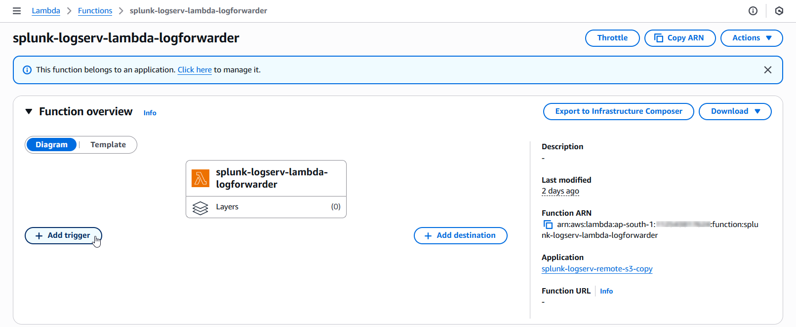

2. Click on the dropdown and select **_SQS_** as the trigger source

??? indented-note "Example"
    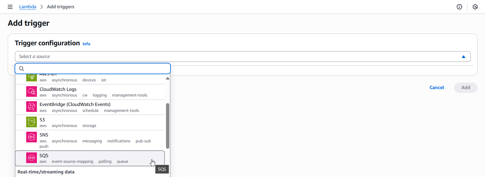

3. Fill out the first three fields in the SQS Trigger (**_SQS queue ARN_**, **_Activate trigger_**, **_Enable metrics_**)

    - Enter the complete **_ARN_** of the SQS Queue in your **_SAP ECS account_**
    - **_Check_** the **_Activate trigger_** checkbox
    - **_Check_** the **_Enable metrics_** checkbox

??? indented-note "Example"
    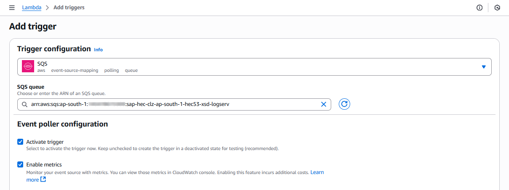

4. Fill out the next three fields in the SQS Trigger (**_Batch size_**, **_Batch window_**, **_Maximum concurrency_**)

    - Set the **_Batch Size_** to 10
    - Set the **_Batch window_** to 5
    - Set the **_Maximum concurrency_** to 10, the value in the template's commented-out trigger. The example image shows 8, an older value: enter 10.

??? indented-note "Example"
    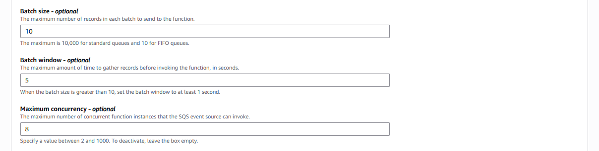

5. Fill out the last field in the SQS Trigger (**_Report batch item failures_**) and save the trigger

    - **_Check_** the **_Report batch item failures_** checkbox. The copy Lambda returns the ID of each message it could not copy in a `batchItemFailures` list. With this box checked, Lambda makes only those messages visible again in SAP's SQS Queue, for another try (AWS: <a href="https://docs.aws.amazon.com/lambda/latest/dg/services-sqs-errorhandling.html" target="_blank">Handling errors for an SQS event source in Lambda</a>). Without it, Lambda deletes the whole batch, those messages included, because the function itself does not fail.
    - Click on the **_Add_** button on the bottom right of the screen to save the trigger

??? indented-note "Example"
    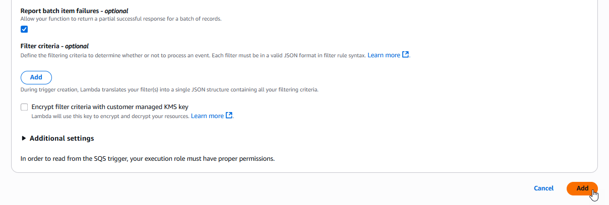


<br>

#### :material-crop-square:{ .taiconcolor } Configure SQS Queue Trigger

Use these steps only when a trigger already exists (see 9.b), to check that it has the settings below.

1. Click on the **_SQS_** rectangle on the left side of the Function overview diagram to navigate to the SQS Queue Trigger configuration

??? indented-note "Example"
    

2. Check the checkbox for the **_SQS_** trigger and then click on the **_Edit_** button

??? indented-note "Example"
    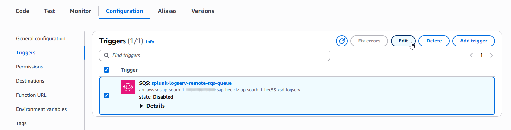

3. Validate the first three fields in the SQS Trigger (**_SQS queue ARN_**, **_Activate trigger_**, **_Enable metrics_**)

    - Ensure the complete **_ARN_** of the SQS Queue in your **_SAP ECS account_** is referenced here
    - Ensure the **_Activate trigger_** checkbox is **_checked_**
    - Ensure the **_Enable metrics_** checkbox is **_checked_**

??? indented-note "Example"
    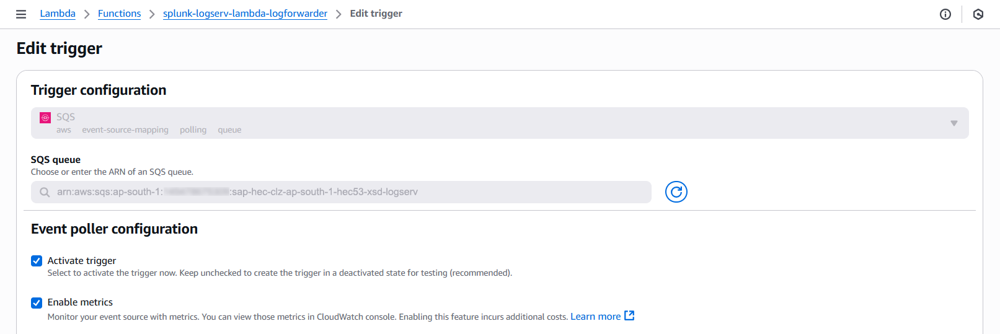


4. Validate the next three fields in the SQS Trigger (**_Batch size_**, **_Batch window_**, **_Maximum concurrency_**)

    - Ensure the **_Batch Size_** is set to 10
    - Ensure the **_Batch window_** is set to 5
    - Ensure the **_Maximum concurrency_** is set to 10 (the example image shows 8, an older value)

??? indented-note "Example"
    

5. Validate the last field in the SQS Trigger (**_Report batch item failures_**) and save the trigger

    - Ensure the **_Report batch item failures_** checkbox is **_checked_**
    - Click on the **_Save_** button on the bottom right of the screen to save the trigger

??? indented-note "Example"
    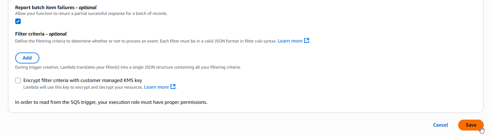

<br>

### :material-circle-box:{ .taiconcolor } 10. Confirm LogServ Logs are Being Ingested

After completing all the previous steps, verify that LogServ logs are successfully being ingested into Splunk.

:material-lightning-bolt:{ .taiconcolor } The first events typically appear within 5-10 minutes of activating the SQS Queue Trigger in step 9. The Lambda function copies objects from the SAP ECS S3 Bucket to the local target S3 Bucket in your **_Secondary account_** when an SQS notification arrives, then the SQS-Based S3 Input polls the local SQS Queue at the configured interval (default 300 seconds, under the input's Advanced Settings), so allow a short lag before the first events arrive.

10.<b class="taiconcolor">a</b> Log in to Splunk Web on a search head that can search the LogServ data index and open the **_Search & Reporting_** app.

10.<b class="taiconcolor">b</b> Search with the index name itself (`sap_logserv_logs`, or the name you gave it). The `sap_logserv_idx_macro` macro is defined only where the LogServ App or the Data TA is installed, which a search head may not have yet.

    index=sap_logserv_logs earliest=-1h | stats count by sourcetype, host

10.<b class="taiconcolor">c</b> You should see the LogServ sourcetypes your SAP LogServ subscription delivers, from several hosts; [Supported Log Types](../getting-started/supported-log-types.md) lists them. Log types without a route of their own keep the sourcetype `sap_logserv_logs`. [Verify Your Data](../getting-started/verify-data.md) has the full set of checks, including the routing and attribution searches.

10.<b class="taiconcolor">d</b> Check that copies arrive: the S3 Bucket in your **_Secondary account_** gains new objects under `logserv/`, without the `.gz` ending.

10.<b class="taiconcolor">e</b> If no events appear after 15-20 minutes, troubleshoot as follows:

- **Lambda function errors** -- In the AWS Console, open CloudWatch Logs for the Lambda function created by the CloudFormation template (Section 3). Check for errors copying objects from the SAP ECS S3 Bucket to your local S3 Bucket. Common causes are missing access policies on the SAP ECS resources (Section 4) or an IAM Role propagation delay (wait 5 minutes after initial setup).
- **Local SQS Queue has no messages** -- Verify the SAP LogServ Support team has applied the updated access policies (from Section 4) to the SQS Queue and S3 Bucket in your **_SAP ECS account_**. Without those policies, the Lambda function cannot receive SQS notifications from the SAP ECS account or read from the SAP ECS S3 Bucket. Also verify the SQS Queue Trigger on the Lambda function is active (Section 9).
- **Authentication or permission errors** -- In the Splunk Add-on for AWS, check the logs for errors: run `index=_internal source=*aws* level IN (ERROR,WARNING) earliest=-1h | head 50`. Common causes are a mis-copied Access Key/Secret Key (Section 5), an incorrect IAM Role ARN (Section 7), or the IAM Role not yet propagated through AWS (wait 5 minutes after initial setup).
- **SQS URL format** -- Double-check the **_SQS Queue Name_** field in the SQS-Based S3 Input (Section 8) points to the **_local_** SQS Queue that was created by the CloudFormation template in your **_Secondary account_** (not the SAP ECS SQS Queue).
- **Wrong AWS Region** -- The CloudFormation template (Section 3) and the SQS-Based S3 Input (Section 8) must both be in the same AWS Region as the SQS Queue and S3 Bucket in your **_SAP ECS account_**.

<br>

### :material-circle-box:{ .taiconcolor } Rotate the Access Key

The access key from step 5 does not expire on its own; replace it as your security policy requires. An IAM User can hold two access keys at a time, so you can switch without a gap (AWS: <a href="https://docs.aws.amazon.com/IAM/latest/UserGuide/id_credentials_access-keys.html" target="_blank">Managing access keys for IAM users</a>). The Lambda does not use the key: it runs as the IAM Role.

1. In the IAM console of your **_Secondary account_**, open the IAM User and create a second access key, as in step 5. Save the new key ID and secret.
2. On each instance that runs the input, open the **_Splunk Add-on for AWS_**, then **_Configuration_** → **_Account_**, edit the account from step 6, enter the new access key ID in **_Key ID_** and the new secret in **_Secret Key_**, and save.
3. Check that events still arrive (step 10) and that the `_internal` search in step 10.e shows no new authentication errors.
4. In IAM, make the old key **Inactive**. Once nothing has failed for a day, delete it.

<br>

## :material-circle-box:{ .cboxmove } Next Steps

1. [Verify Your Data](../getting-started/verify-data.md).
2. Load the history you need with [AWS S3 Direct](aws-s3-direct.md).
3. [Install the LogServ App](../logserv-app/installation.md) and seed its dashboards.
