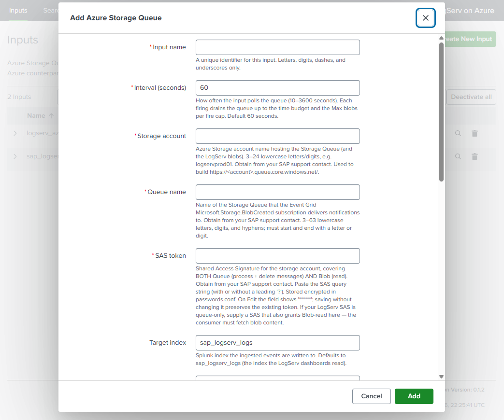

# SAP LogServ on Azure — Setup Guide

This page covers ingesting LogServ data from **Microsoft Azure Blob Storage** using the standalone **LogServ Azure add-on** (`splunk_ta_sap_logserv_azure`, shown in Splunk Web as **Splunk TA for SAP LogServ on Azure**) and its **`sap_logserv_azure_queue`** modular input — the Azure twin of `Splunk_TA_aws`'s **SQS-Based S3** input. An Azure **Event Grid** subscription drops a `BlobCreated` notification onto a **Storage Queue**; this input consumes the queue, fetches each named blob over a SAS, and emits its NDJSON. This is the model SAP's LogServ-on-Azure collector uses (Storage Queue notifications). You install this small, first-party add-on **on the heavy forwarder that runs the input** — the same deployment model as the Splunk Add-on for AWS — and the LogServ **Data TA** on the same instance provides the downstream sourcetype routing, filtering, and stamping. The downstream pipeline (sourcetype routing, filtering, dashboards, ES integration) is identical to the AWS S3 path.

!!! info "The Azure infrastructure is provided by SAP — you only install the add-on and configure the input"
    In a RISE / SAP ECS deployment the **storage account, blob container, Storage Queue, Event Grid subscription, and SAS are all provisioned and managed by SAP in the SAP ECS Azure account.** You do **not** create or configure anything in Azure. Your only tasks are to **install the `splunk_ta_sap_logserv_azure` add-on on the heavy forwarder that will run the input** and create **one Splunk input per Azure queue** on it — one per Azure landscape (most deployments have a single landscape, hence one input; you can define several on the same HF if you ingest from more than one — see [Multiple landscapes / fleets](#multiple-landscapes-fleets)), using a small set of parameter values that you obtain from your **SAP support contact** — see [Parameters to obtain from SAP](#parameters-to-obtain-from-sap).

## :material-circle-box:{ .taiconcolor } High Level Steps

Follow these steps in order. Each step links to its section below.

1. **Get the parameters from SAP**: the storage account name, the queue name and the SAS. Ask also when the SAS expires (its `se=` value) and how SAP will give you a new one. See [Parameters to obtain from SAP](#parameters-to-obtain-from-sap).
2. **Decide about the queue backlog** with SAP before the input exists. A purged day cannot be loaded later. See [First Start: The Queue Backlog](../getting-started/capacity-planning.md#first-start-the-queue-backlog) and [Historical backfill](#historical-backfill).
3. **Check the Data TA and the indexes.** The Data TA must be on the instance that will run the input, and the indexes must exist, before the input reads anything: events indexed without the Data TA keep the base sourcetype for good. See [Prerequisites](#prerequisites).
4. **Download and install the add-on** on that instance, directly (never through the Deployment Server). See [Install the Azure add-on](#install-the-azure-add-on).
5. **Before the input starts, check the Data TA's two index-time settings.** Leave **Cloud Provider** at **Not set**: the input stamps `cloud_provider=azure` itself (see [`cloud_provider` attribution](#cloud_provider-attribution) and [Choose Cloud Attribution](cloud-attribution.md)). Decide filtering, including whether to drop the Unix command output that arrives under `undefined/undefined` (see [Decide Filtering](decide-filtering.md#3-azure-the-unix-command-output)). Whatever the queue holds when the input starts is indexed with the settings in place at that moment.
6. **Create one input for the queue**, with a role that holds `admin_all_objects`. See [Configure the input](#configure-the-input).
7. **Check that data arrives.** See [Validation](#validation).
8. **Put the SAS expiry in your calendar**, and replace the SAS before it. See [Rotate credentials](#rotate-credentials).

## :material-circle-box:{ .taiconcolor } Architecture overview


```
SAP LogServ RISE-ECS
  |
  +-> writes NDJSON.gz blobs to Azure Blob Storage under the logserv/ prefix
        |
        +-> Azure Event Grid subscription (Microsoft.Storage.BlobCreated)
              |
              +-> Azure Storage Queue (one message per new blob)
                    |
                    +-> [Azure add-on: sap_logserv_azure_queue]  (runs on the Heavy Forwarder)
                          |   reads the queue, fetches each blob over a SAS, gunzips, splits NDJSON
                          |
                          +-> emits via EventWriter, sourcetype=sap_logserv_logs, cloud_provider=azure
                                |
                                +-> [LogServ Data TA pipeline]  (same Heavy Forwarder):
                                      sourcetype routing by clz_dir/clz_subdir or source path,
                                      Configuration -> Filters nullQueue, _time drop,
                                      splunk_solution stamping
                                      |
                                      +-> forwarded to the Indexer
                                            |
                                            +-> dashboards + ES integration
```

Everything from the LogServ blob writer down through the **Storage Queue lives in the SAP ECS Azure account and is managed by SAP.** The **Azure add-on's `sap_logserv_azure_queue` input** — the only component you install and configure — runs on **your heavy forwarder**, consumes the queue SAP exposes to you, and hands its events to the **LogServ Data TA** (also on that HF) for routing/filtering/stamping. This is exactly how `Splunk_TA_aws` and the Data TA cooperate for the AWS S3 path.

**Why EventWriter, not HEC:** the input runs on the heavy forwarder and emits through the HF's native index-time pipeline, so every existing LogServ Data TA feature — sourcetype routing (by the `clz_dir` / `clz_subdir` folder fields or by the `source` path, depending on the log type; see [Supported Log Types](../getting-started/supported-log-types.md)), the Configuration → Filters `nullQueue` filtering, the `days_in_past` / `_time` drop, and the `splunk_solution` stamping — applies to Azure events **unchanged**, exactly as it does to AWS S3 events. The `cloud_provider` value comes from the add-on itself (see [`cloud_provider` attribution](#cloud_provider-attribution)). The input is **stdlib-only** (Azure Storage REST over `urllib` — no Azure SDK), so it adds no AArch64 / native-binary burden and is Splunk Cloud-clean.

## :material-circle-box:{ .taiconcolor } Prerequisites

**Provided by SAP** (in the SAP ECS Azure account — you obtain the *values*, you do not build the resources):

- An **Azure Storage Account** holding the LogServ container (blobs under the `logserv/` prefix — same path convention as AWS S3: `<container>/logserv/<clz_dir>/<clz_subdir>/<YYYY>/<MM>/<DD>/<file>.json.gz`).
- A **Storage Queue** in that account, fed by an **Event Grid subscription** that routes `Microsoft.Storage.BlobCreated` events to it.
- A **SAS** that is **both blob-readable and queue-processable** (see [What the SAP-provided SAS must cover](#what-the-sap-provided-sas-must-cover)).

Obtain the storage account name, the queue name, and the SAS from your **SAP support contact** — see [Parameters to obtain from SAP](#parameters-to-obtain-from-sap).

**On your side (the instance that runs the input — a heavy forwarder is strongly recommended):**

- **LogServ Data TA `0.1.1`+** installed on that instance (it provides the index-time routing/filtering/stamping; see [Installing the Data TA](install-ta.md)). On heavy forwarders the Data TA is normally distributed by the Deployment Server (see [Distribute the Data TA to Heavy Forwarders](distribute-data-ta.md)). Its build decides the parsing cost on the forwarder: use build 1792189743 or later, and see [Version Check](../getting-started/capacity-planning.md#version-check) to read the build on a forwarder.
- **The indexes** (`sap_logserv_logs`, and the AI Assistant audit index) on your indexer tier, before any data arrives. See [Create the indexes](install-ta.md#1-create-the-indexes).
- **LogServ Azure add-on (`splunk_ta_sap_logserv_azure`) `0.1.1`+** installed on the **same instance** (see [Install the Azure add-on](#install-the-azure-add-on)). It registers the `sap_logserv_azure_queue` input kind. The input is inert until you create an input instance.
- **A Splunk role that holds the `admin_all_objects` capability** on that instance, to create, edit or delete the input (see [Configure the input](#configure-the-input)).
- Network egress from that instance to `<account>.blob.core.windows.net` **and** `<account>.queue.core.windows.net` (port 443 / HTTPS). The add-on has no proxy setting of its own; if the instance reaches the internet through a proxy, see *Outbound proxy* under [Heavy Forwarders](../getting-started/prerequisites.md#heavy-forwarders).

!!! warning "Compact JSON format required"
    Each blob is gzipped NDJSON (one event per line). The index-time routing transforms assume **compact JSON** (no whitespace after `:`). The SAP LogServ collector emits compact JSON natively, so no action is required on your side. (For reference: pretty-printed JSON would bypass the transforms and land as `sourcetype=sap_logserv_logs`, breaking dashboards.)

## :material-circle-box:{ .taiconcolor } Parameters to obtain from SAP

You do **not** create any Azure resources. SAP has already provisioned the storage account, container, queue, and Event Grid subscription in the SAP ECS Azure account. **Contact your SAP support contact** to obtain the following values for your environment, then plug them into the Splunk input ([Configure the input](#configure-the-input)):

| Parameter | Input field | Description |
|---|---|---|
| Storage account name | `account_name` | The Azure Storage account holding the LogServ container (`^[a-z0-9]{3,24}$`). |
| Storage Queue name | `queue_name` | The queue receiving the Event Grid `BlobCreated` notifications. |
| SAS token | `sas_token` | An account SAS covering both services (`ss=bq`, `srt=o`) with blob **read** (`r`) and queue **process** (`p`, which covers Get Messages and Delete Message); add `a` only if you configure a `dead_letter_queue`. List (`l`) is not needed, because the input never lists the container. See below. Treat it as a secret. |

The blob container name and `logserv/` prefix are already covered by the SAS and the queue — they are not separate input fields. The account name also determines the two endpoints your heavy forwarder must reach (`<account>.blob.core.windows.net` and `<account>.queue.core.windows.net`).

Ask SAP also **when the SAS expires** (its `se=` value) and **how they will give you a new one** before then. When the SAS expires the input stops (see [Rotate credentials](#rotate-credentials)).

### What the SAP-provided SAS must cover

The input fetches blobs **and** reads/deletes queue messages with the single SAS SAP gives you, so that SAS must cover **both** services. Confirm with your SAP support contact that the SAS includes:

| SAS field | Must include | For |
|---|---|---|
| `ss` (services) | `b` (blob) **and** `q` (queue) | blob fetch + queue ops |
| `srt` (resource types) | `o` (object) is what the add-on actually needs; `sco` is fine if that is what SAP issues | account-SAS resource scope |
| `sp` (permissions) | `r` (blob read) **and** `p` (queue process — covers Get + Delete Messages); add `a` (add) only if you configure a `dead_letter_queue` (poison messages are written to it) | fetch blobs + consume queue |
| `se` (expiry) | a date far enough ahead, and a renewal agreed with SAP | the input stops when it passes |

`l` (list) and `d` (delete) are not needed: the input never lists the container, and in an account SAS `p` already covers deleting queue messages.

You can decode a SAS string to check its scope and expiry before configuring the input:

```bash
echo "$SAS" | tr '&' '\n' | grep -E '^(ss|srt|sp|se)='
```

!!! warning "If the SAS is queue-only"
    If `ss` lacks `b`, blob fetches fail with HTTP 401/403 and the input logs it explicitly: *"blob read forbidden … the SAS likely lacks Blob-read permission or has expired."* The decisive question for your SAP support contact is **"is the LogServ SAS Blob-readable, or queue-only?"** If it is queue-only, you will need a second, blob-read credential from SAP.

## :material-circle-box:{ .taiconcolor } Install the Azure add-on

Download `splunk_ta_sap_logserv_azure-0.1.2.tar.gz` from the `release_binaries` folder of the [Splunk for SAP LogServ GitHub repository](https://github.com/splunk/splunk-sap-logserv/tree/main/release_binaries). Its AppInspect report sits beside it, and the folder's `README.md` lists each tarball's md5. The build and md5 of each package are also listed under [Download the Packages](install-ta.md#3-download-the-packages).

Install it **directly on the instance that runs the input**. A heavy forwarder is strongly recommended — it is the tier where `Splunk_TA_aws` runs for the AWS path. A search head is not blocked (see [Running the TAs on a search head](install-ta.md#running-the-tas-on-a-search-head)). You can install the add-on on every heavy forwarder that may run an input, for example to keep a standby ready; the input for a given queue still runs on one of them (see [Configure the input](#configure-the-input)).

- Splunk Web → **Manage Apps → Install app from file** → upload the tarball, **or**
- `/opt/splunk/bin/splunk install app /path/splunk_ta_sap_logserv_azure-0.1.2.tar.gz`, **or**
- configuration management (Ansible / Puppet / Chef) drops the app into `etc/apps/`, then `chown -R splunk:splunk` and restart.

!!! danger "Do NOT distribute the Azure add-on via the Deployment Server"
    Install it **directly on each instance that runs an input — never as a deployment-app.** The input's SAS is stored, encrypted, in the add-on's own `local/passwords.conf`; a Deployment Server push **replaces the app's `local/` directory**, which would wipe the per-HF SAS. (This is the same reason `Splunk_TA_aws` is configured per-HF rather than DS-distributed.) The **Data TA** stays DS-managed as before — only the Azure add-on is per-HF.

After installing + restarting, the `sap_logserv_azure_queue` input kind is registered and the add-on's **Inputs** page is available under **Apps → Splunk TA for SAP LogServ on Azure**.

Upgrading from an earlier build? See [Upgrading to This Release](../getting-started/upgrading.md#ingest-add-ons).

### Single instance

On a single Splunk Enterprise instance (no separate forwarder or indexer), install the Data TA and the Azure add-on on that instance and create the input there, as described below. The Data TA's bundled `indexes.conf` creates both indexes on that instance; set the retention of `sap_logserv_logs` if you want one other than the default (see [Create the indexes](install-ta.md#1-create-the-indexes)). There is no Deployment Server step: the Data TA's settings are saved on the instance itself. The LogServ App goes on the same instance.

### Splunk Cloud

With Splunk Cloud, run the input on a heavy forwarder you manage:

1. **Create both indexes in your Splunk Cloud stack first** (**Settings → Indexes**, or the Admin Config Service), with the retention you want, before any data arrives. See [Create the indexes](install-ta.md#1-create-the-indexes).
2. **Set the heavy forwarder up to forward to your stack**, with your stack's universal forwarder credentials app installed on it.
3. **Put the Data TA on the heavy forwarder** (through your Deployment Server, or directly if you have none), and **install the Azure add-on on it directly**, as above.
4. **Create the input on the heavy forwarder** ([Configure the input](#configure-the-input)).

The LogServ App goes on the Splunk Cloud search head. The Data TA is not needed on the Cloud stack in this layout.

**Without a heavy forwarder.** The add-on's `app.manifest` declares the search-head workload, so a search head is an allowed target for it; installing it on a Splunk Cloud search head has not been tested. In this layout, install the Data TA and the Azure add-on on the search head as private apps, and create the input there. The Data TA must sit beside the add-on, because it parses the events where the input runs. We strongly recommend against this layout, because the input puts ingest load on the tier your users search on. Creating the input needs a role that holds `admin_all_objects` there too. See [Running the TAs on a search head](install-ta.md#running-the-tas-on-a-search-head) and [Splunk Cloud Considerations](../getting-started/splunk-cloud.md).

## :material-circle-box:{ .taiconcolor } Configure the input

Create **one input for each Azure queue**, on **one** instance (normally one heavy forwarder). You can install the add-on on every HF, for example to keep a standby ready, but run the input for a given queue on one HF only. Every other input on the same queue, on the same HF or another one, keeps its own dedup record, so a redelivered message can be indexed twice (see *Scaling one queue by cloning* below). The SAS is encrypted into the **add-on's own** `local/passwords.conf` and is **not** Deployment-Server-managed — it survives restarts and Data-TA pushes.

!!! note "Creating or editing an input needs `admin_all_objects`"
    On Splunk Enterprise and Splunk Cloud alike, creating, editing (including replacing the SAS) and deleting an input runs as the signed-in user and needs a role that holds the `admin_all_objects` capability. Without it, Save fails with HTTP 403, *"This operation is forbidden"*. The REST call below has the same requirement.

!!! note "A new input starts with what is already in the queue"
    The queue may already hold notifications from before your input exists: up to 7 days of them by default, and with no limit if SAP's Event Grid subscription sets them never to expire. A new input works through all of them on top of the live feed. Before you create it, see [First Start: The Queue Backlog](../getting-started/capacity-planning.md#first-start-the-queue-backlog), which includes asking SAP to purge the older messages. The add-on cannot load purged days later (see [Historical backfill](#historical-backfill)).

!!! tip "Decide on the Unix command output before the input starts"
    SAP files some Azure data under a storage folder named `undefined/undefined`, without folder fields. Most of it is Unix command output (`ps`, `top`, `netstat` and others, about 0.7 million events a day on the reference system), which stays under the base sourcetype unparsed. Filtering is index time, so decide before the input starts whether to drop it with the Data TA's **Exclude Sources**. See [Decide Filtering](decide-filtering.md) and [Data Delivered Without Folder Fields](../getting-started/supported-log-types.md#data-delivered-without-folder-fields).

### Via Splunk Web (per Heavy Forwarder)

Splunk Web → **Apps → Splunk TA for SAP LogServ on Azure → Inputs → Create New Input → Azure Storage Queue**, and fill in the fields below with the values you obtained from SAP. (For a second landscape on the same HF, use the Inputs table's **Clone** action and give it a new name — the SAS is not carried on clone, so re-enter it.)




### Via REST (scriptable, per Heavy Forwarder)

```bash
# Write the SAS to a single-line temp file (no trailing newline), then create the input:
curl -sk -u admin:<pwd> -X POST \
  https://localhost:8089/servicesNS/nobody/splunk_ta_sap_logserv_azure/splunk_ta_sap_logserv_azure_sap_logserv_azure_queue \
  --data-urlencode name=logserv_azure \
  --data-urlencode account_name=<storage-account> \
  --data-urlencode queue_name=logservqueue \
  --data-urlencode index=sap_logserv_logs \
  --data-urlencode event_sourcetype=sap_logserv_logs \
  --data-urlencode interval=60 \
  --data-urlencode sas_token@/tmp/azure_sas.txt
rm -f /tmp/azure_sas.txt
```

The resulting stanza in the add-on's `local/inputs.conf` looks like:

```ini
[sap_logserv_azure_queue://logserv_azure]
account_name = <storage-account>
queue_name = logservqueue
sas_token = ******
index = sap_logserv_logs
event_sourcetype = sap_logserv_logs
interval = 60
disabled = 0
```

(Only the masked placeholder `sas_token = ******` is written to `inputs.conf` — the real SAS is stored encrypted in the add-on's own `local/passwords.conf`.)

| Field | Default | Notes |
|---|---|---|
| `account_name` | — | Storage account name from SAP (`^[a-z0-9]{3,24}$`). |
| `queue_name` | — | The Storage Queue name from SAP (receives Event Grid notifications). |
| `sas_token` | — | The SAS from SAP (blob + queue scoped). Encrypted credential: the value lives in the add-on's `local/passwords.conf`; `inputs.conf` carries only the masked `******` placeholder. |
| `index` | `sap_logserv_logs` | Target index. Does **not** affect parsing — the Data TA's index-time pipeline keys on the sourcetype, not the index. You may point it at a custom index, but the dashboards query through the `sap_logserv_idx_macro` macro, so update that macro to match (see caveat below). |
| `event_sourcetype` (UI label **Sourcetype**) | `sap_logserv_logs` | **Fixed at `sap_logserv_logs`.** The add-on hard-codes this sourcetype (it is not read from the stanza), and the field is shown read-only when editing the input. Leave it at the default. |
| `interval` | `60` | Seconds between firings (10–3600). Each firing drains the queue within a per-firing time budget (currently `min(240 s, interval × 0.9)`). |
| `batch_size` | `32` | Queue messages dequeued per request (1–32, the Azure max). |
| `visibility_timeout` | `300` | Seconds a dequeued message is hidden while processing (30–604800). |
| `max_blobs_per_fire` | `500` | Cap on blobs ingested per firing (1–100000; backlog safety valve). |
| `poison_threshold` | `5` | A message redelivered more than this many times (1–100) is dead-lettered / dropped. |
| `dead_letter_queue` | *(empty)* | Optional queue name for poison messages (Storage Queue has no native DLQ). |
| `include_filters` / `exclude_filters` | *(empty)* | Optional **comma-separated**, case-insensitive substrings matched against the blob path (the Event Grid subject), applied on top of the built-in `logserv` requirement. Subjects containing `azure-webjobs-hosts` are always skipped. |
| `verify_ssl` | `1` | TLS verification for Azure REST calls. |

!!! note "Sourcetype is fixed; the Index is yours to change"
    The **Sourcetype** is effectively fixed at **`sap_logserv_logs`** — the add-on always emits it (the value is hard-coded in the input, not read from the stanza), and the field is shown read-only (disabled) when editing an existing input. When you create an input the field can still be typed into, but whatever you enter is ignored and the add-on still emits `sap_logserv_logs`. This is deliberate: the Data TA's index-time routing, Filters `nullQueue`, `_time` drop, and `splunk_solution` / `cloud_provider` stamping all key on `sourcetype = sap_logserv_logs` (`props.conf` stanzas match on sourcetype, **not** index), so it must never vary.

    The **`index`**, by contrast, may be changed safely — parsing is unaffected (events are routed, filtered, and stamped identically no matter which index they land in). You may point it at a custom index (for example a per-customer index such as `sap_logserv_logs_con01`). The only follow-up is dashboard visibility: the dashboards and rollups search through the `sap_logserv_idx_macro` macro (default `index="sap_logserv_logs"`), so override that macro in the App's `local/macros.conf` to match your index, or the dashboards won't find the data.

### `cloud_provider` attribution

The input stamps every event it emits with the indexed field `cloud_provider=azure` (the add-on's `default/inputs.conf` sets `_meta = cloud_provider::azure` for every input of this kind), so search-time queries and the **Multi-Cloud Overview** dashboard can distinguish Azure-sourced from AWS-sourced data.

!!! warning "When you ingest from AWS as well as Azure"
    The Data TA's **Configuration → Cloud Provider** dropdown stamps `cloud_provider` TA-wide at index time. If it is set to `aws` on a forwarder that also runs this Azure input, that index-time stamp co-fires with the input's per-event `_meta=azure`, leaving `cloud_provider` **multivalued (`azure` + `aws`)** on the Azure events. For correct per-channel attribution on a mixed forwarder, set the **Cloud Provider dropdown to "Not set"** and add `_meta = cloud_provider::aws` to the `Splunk_TA_aws` SQS-S3 input — then each input self-attributes. This applies even when AWS and Azure run on separate forwarders: a Deployment Server pushes the dropdown's value to every forwarder in the `SAP_LogServ_HeavyForwarders` server class. Leave the dropdown at **Not set** on forwarders that run this add-on: its input already stamps `cloud_provider`, and the dropdown would add the value a second time. A forwarder can run the AWS and Azure add-ons together; see [Capacity Planning and First Start → More Than One Cloud](../getting-started/capacity-planning.md#more-than-one-cloud) for when to separate them. See [Choose Cloud Attribution](cloud-attribution.md).

### Multiple landscapes / fleets

- **Multiple Azure landscapes on one HF:** create one input instance per landscape (different `account_name` / `queue_name`), using the Inputs table's **Clone** action. The per-instance credential is keyed by the input name; re-enter the SAS on each (clone never carries secrets).
- **A fleet of heavy forwarders:** install the add-on on each HF that may run an input (still never through the DS). Create the input for a given queue on one HF. Add it on more HFs only for throughput or to catch up a backlog, accepting at-least-once delivery (see the note below); to fail over, enable the standby HF's input after you disable the first one. For zero-touch fleets, config management can drop the add-on into `etc/apps/` and seed the SAS via the REST call above (it encrypts under each HF's own `splunk.secret`). **Do not** add the add-on to the Deployment Server's `deployment-apps/`.

!!! note "Scaling one queue by cloning — supported (like the AWS add-on), but at-least-once"
    Separate input *instances* are normally for **different** queues (different `queue_name`). You *can* also point several identical inputs at the **same** queue to raise throughput — this is the same competing-consumer pattern Splunk's AWS add-on uses to scale its **SQS-Based S3** input: the queue's visibility lease hands each message to one consumer at a time, so N inputs fetch and ingest N batches of blobs in parallel (across one HF, since the input is not single-instance, or across several HFs). Understand the trade-off first:

    - A **single** input is **effectively duplicate-free across the queue's redelivery window** — its per-input dedup checkpoint (`<input_name>.dedup.json`; entries are retained for about 7 days, up to 50,000 blobs) skips an already-ingested blob if a message reappears.
    - **Cloned same-queue inputs don't share that checkpoint**, so they fall back to **at-least-once** (the same guarantee as the AWS SQS-S3 input). If a message is not deleted within its `visibility_timeout` (default 300 s), the message reappears and another input re-ingests it → **duplicate events**. The lease starts when a batch of up to `batch_size` messages is dequeued, and each message is deleted after its own blobs are done, so what must fit is the time from dequeue to delete for the last message of a batch. The guard is identical to the AWS pattern: **set `visibility_timeout` comfortably above that time.** (`dequeue_count` is the queue's server-side, shared counter, so the `poison_threshold` decision stays coordinated across the clones — but unlike SQS, Azure Storage Queue has no native dead-letter/redrive, so poison handling is the TA's client-side `poison_threshold` + optional `dead_letter_queue`.)

    For typical LogServ volumes a **single input already keeps up** (it drains up to `max_blobs_per_fire` blobs per firing). Prefer raising `batch_size` / `max_blobs_per_fire` or lowering `interval` on one input before cloning; clone same-queue inputs only when one input genuinely can't keep up, and raise `visibility_timeout` when you do.

## :material-circle-box:{ .taiconcolor } Reliability behavior

- **At-least-once + dedup.** A queue message carrying LogServ blobs is deleted **only after** those blobs ingest successfully (poison messages and irrelevant / unparseable notifications are removed without ingest — see below); each blob is deduplicated by `url|etag` in a checkpoint sidecar, so a redelivered message re-ingests nothing.
- **Transient failures leave the message.** A 5xx / network error on a blob fetch leaves the message on the queue (it redelivers after the visibility timeout); already-ingested blobs in that message are no-ops on retry.
- **Blob-read denied (401/403) leaves the message** and logs loudly — this is the queue-only-SAS signal (get a blob-readable credential from SAP, the message reprocesses).
- **Poison messages** (redelivered more than `poison_threshold` times) are moved to `dead_letter_queue` if configured, else dropped, so one permanently-bad blob can't loop forever.

## :material-circle-box:{ .taiconcolor } Historical backfill

Queue-driven ingest is **forward-only by nature** — Event Grid fires only on *new* `BlobCreated` events, so once SAP's subscription is live the input ingests everything written from that point on (plus the notifications still in the queue when you create the input), but does **not** replay blobs that already existed. This solution has no historical load for Azure; to load older blobs, agree a method with your Splunk team.

The add-on reads only the blobs that queue messages name and never lists the container. A day whose notifications were purged, or expired before the input read them, stays in SAP's storage, but nothing in Splunk for SAP LogServ will load it. If you will need such days, agree with your Splunk team how to load them before you ask SAP to purge anything (see [First Start: The Queue Backlog](../getting-started/capacity-planning.md#first-start-the-queue-backlog)).

When filtering is on, the Data TA's [Days in the Past](configure-filters.md#days-in-the-past) filter applies to everything the input reads, the queue backlog included: events older than its cutoff are dropped before indexing.

## :material-circle-box:{ .taiconcolor } Rotate credentials

The SAS stops working at its expiry time, the `se=` value in the SAS string. From then on every queue read fails with HTTP 403 (`queue read failed (... 403 ...); aborting firing` in the input log), and the input ingests nothing. The notifications wait in the queue only as long as their time-to-live allows (7 days by default); days whose notifications expire before you replace the SAS cannot be loaded later (see [Historical backfill](#historical-backfill)).

To replace the SAS:

1. Ask your SAP support contact for the new SAS before the current one expires. Check its scope and expiry as in [What the SAP-provided SAS must cover](#what-the-sap-provided-sas-must-cover).
2. On the instance that runs the input, open **Apps → Splunk TA for SAP LogServ on Azure → Inputs** and choose **Edit** on the input. The **SAS token** field shows `******`.
3. Replace `******` with the new SAS and click **Update**. Saving needs a role that holds `admin_all_objects`. (If you leave `******` in the field, the stored SAS is kept.)
4. The input reads the SAS at every firing, so the next firing uses the new one. Check the input log for a `done:` line and no `queue read failed` (see [Validation](#validation)).
5. Repeat on every other instance that has an input using this SAS, such as a standby heavy forwarder. Each instance keeps its own encrypted copy in the add-on's `local/passwords.conf`; the Deployment Server does not carry it.

Then put the new `se=` date in your calendar.

## :material-circle-box:{ .taiconcolor } Validation

Confirm the input is registered and firing (run on the heavy forwarder):

```bash
curl -sk -u admin:<pwd> \
  "https://localhost:8089/servicesNS/nobody/splunk_ta_sap_logserv_azure/splunk_ta_sap_logserv_azure_sap_logserv_azure_queue?output_mode=json"
```

Watch the input log on the HF:

```bash
sudo tail -f /opt/splunk/var/log/splunk/splunk_ta_sap_logserv_azure_queue.log
# look for:  Input 'logserv_azure' done: messages=N blobs=N events=N dups=N deleted=N ...
```

Search the indexer (events route to per-source sourcetypes just like AWS):

```spl
index=sap_logserv_logs cloud_provider=azure _index_earliest=-1h | stats count by sourcetype
```

For the full set of checks (sourcetypes, one `cloud_provider` value per event, routing), see [Verify Your Data](../getting-started/verify-data.md).

### Troubleshooting

| Symptom (in the input log unless noted) | Cause | Fix |
|---|---|---|
| Splunk Web shows *"This operation is forbidden"* (HTTP 403) when you save, edit or delete an input | The signed-in role lacks the `admin_all_objects` capability | Use a role that holds `admin_all_objects` on this instance (see [Configure the input](#configure-the-input)). |
| `SAS token not found in passwords.conf; skipping` | No credential for this input name on this host | Re-enter the SAS on this HF (Inputs tab → Edit, or the REST call above). The SAS lives in the add-on's own `local/passwords.conf`; it is **not** affected by Deployment-Server pushes. |
| `queue read failed (... 403 ...)` | The SAS has expired (`se=` has passed), or it lacks queue process (`p`), or `ss` lacks `q`, or `srt` lacks `o` | Decode the SAS (see [What the SAP-provided SAS must cover](#what-the-sap-provided-sas-must-cover)). If it has expired, get a new one from SAP and [replace it](#rotate-credentials). Otherwise ask SAP for a SAS with `ss` ⊇ `q`, `srt` ⊇ `o`, `sp` ⊇ `p` and a future `se=`. `d` is not needed: Delete does not apply to queue messages in an account SAS, and `p` already covers Delete Message. |
| `blob read forbidden (HTTP 401/403)` | SAS is queue-only (no blob read) or expired | Ask SAP for a blob-readable SAS (`ss` ⊇ `b`, `sp` ⊇ `r`); the message is left for retry. |
| `done: messages=0` every firing, but blobs exist | The Event Grid subscription (SAP-managed) isn't enqueuing, or the queue name is wrong | Confirm with your SAP support contact that the Event Grid subscription is active and the queue name is correct; verify network egress to `<account>.queue.core.windows.net`. |
| Input kind `sap_logserv_azure_queue` not listed / Inputs page missing | The Azure add-on isn't installed (or Splunkd wasn't restarted) on this HF | Install `splunk_ta_sap_logserv_azure` on the HF and restart (see [Install the Azure add-on](#install-the-azure-add-on)). |

For problems that are not specific to the Azure input, see [Troubleshooting](../getting-started/troubleshooting.md).

## :material-circle-box:{ .cboxmove } Next steps

- [Verify Your Data](../getting-started/verify-data.md): check that events arrive with the expected sourcetypes and one `cloud_provider` value
- Check the [LogServ App prerequisites](../logserv-app/prerequisites.md), then [install the LogServ App](../logserv-app/installation.md) on your Search Head
- Review the [supported log types](../getting-started/supported-log-types.md) reference
- For Splunk Cloud considerations, see [Splunk Cloud Considerations](../getting-started/splunk-cloud.md)
