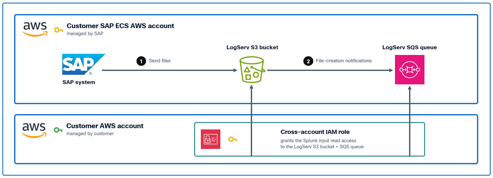
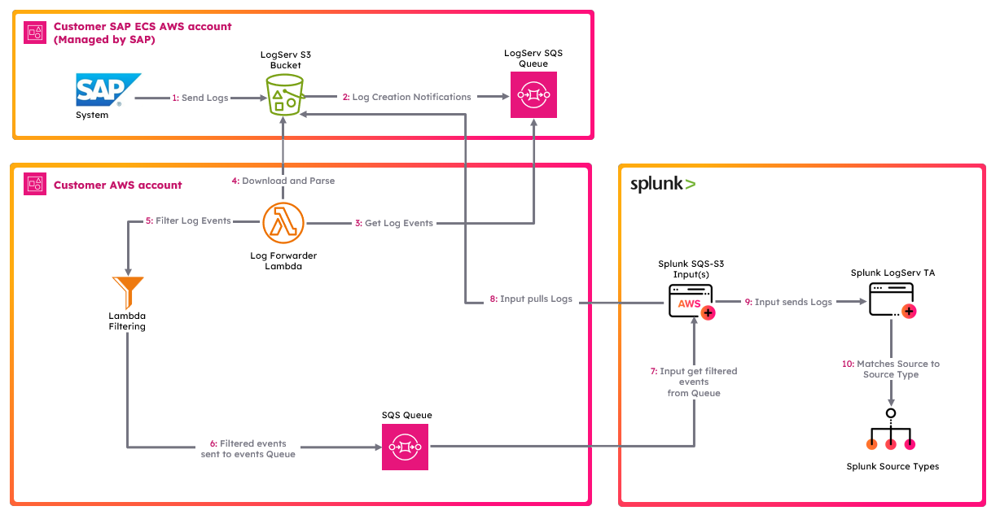

# Choose Your Cloud and AWS Scenario

Use this page to pick the setup guide for the cloud your SAP ECS (RISE) environment runs in and, on AWS, the deployment scenario. You read it twice:

- **While planning** (step 1 of the [Deployment Roadmap](../getting-started/roadmap.md#1-request-from-sap-and-prepare-your-cloud)): pick your guide and, on AWS, the scenario, because the scenario decides which template you deploy. Then start the cloud side of the guide, which needs nothing in Splunk.
- **Before you create the inputs** (step 10 of the [Deployment Roadmap](../getting-started/roadmap.md#10-connect-your-cloud)), once:
    - the [prerequisites](../getting-started/prerequisites.md) are met;
    - the Data TA is installed ([Create the Indexes and Install the Data TA](install-ta.md)) and has reached the instances that will run your inputs ([Distribute the Data TA to Heavy Forwarders](distribute-data-ta.md));
    - you have made the two index-time decisions, [cloud attribution](cloud-attribution.md) and [filtering](decide-filtering.md).

Both decisions apply only to what is indexed after you save them, so the first events your inputs deliver get whatever is in place when they start.

!!! tip "Which setup guide?"
    1. **Choose the cloud first.** It is the cloud SAP runs your SAP ECS environment in: Amazon Web Services, Microsoft Azure or Google Cloud Platform. Azure and GCP each have one setup guide; AWS has three scenarios.
    2. **On AWS, use [AWS Remote S3 Connect](aws-remote-s3-connect-guide.md) unless you have a reason not to.** It deploys only an IAM user and a role in your own account, and the Splunk Add-on for AWS reads SAP's queue and bucket directly. The Data TA's own filters work with it.
    3. **Choose [AWS Remote S3 Filter](aws-remote-s3-filter-guide.md)** when the load on your forwarders, or the backlog of notifications waiting in SAP's queue at the first start, needs cutting before it reaches Splunk. A Lambda in your account drops the notifications of the objects you do not want, so the forwarder never downloads them.
    4. **Choose [AWS Remote S3 Copy](aws-remote-s3-copy-guide.md) only if you want your own copy of new log files** in a bucket in your account. It copies the objects whose notifications are still waiting in SAP's queue when you activate its trigger, then every new object, so it cannot load history, and it stores gzipped files decompressed.
    5. **History comes from [AWS S3 Direct](aws-s3-direct.md) in every case.** No AWS scenario loads objects older than the notifications still waiting in SAP's queue when your input or Lambda first reads it (4 days by default, at most 14; SAP sets the retention). Load older days with AWS S3 Direct once the setup works.

### :material-circle-box:{ .taiconcolor } Where These Steps Run

Each setup guide has a cloud side, done in your cloud's console and with SAP, and a Splunk side. The Splunk side runs on the instance that holds the input, because an input collects data on the instance it is defined on:

| Your topology | Ingest add-on, its account or credential, and its input | The Data TA (must be there before the input starts) |
|---|---|---|
| Single instance | The instance | The instance |
| Heavy forwarders, with or without a Deployment Server | Each heavy forwarder that runs an input, configured directly on it, not through the Deployment Server | Each heavy forwarder: pushed by the Deployment Server, or installed directly where there is none |
| Splunk Cloud with no heavy forwarder | The Splunk Cloud search head. Not blocked, but a heavy forwarder is strongly recommended | The Splunk Cloud search head |

- The ingest add-on is the Splunk Add-on for AWS, the LogServ Azure add-on or the LogServ GCP add-on. The LogServ Azure and GCP add-ons declare search heads as an allowed target, but neither has been tested on a Splunk Cloud search head.
- Routing to the LogServ sourcetypes happens at index time, on the instance where the input runs. Events that arrive before the Data TA is there keep the sourcetype `sap_logserv_logs` for good, so check the Data TA build on each heavy forwarder first ([Version Check](../getting-started/capacity-planning.md#version-check)).
- Creating an AWS S3 Direct backfill needs the `admin_all_objects` capability. The Azure and GCP guides say what their inputs need.

### :material-circle-box:{ .taiconcolor } Amazon Web Services (AWS)
All AWS deployment scenarios ingest the same LogServ logs into Splunk, with some differences in what they deploy and what they add. All of them involve two distinct AWS accounts.

All deployment scenarios for AWS require the use of an AWS **_Secondary account_** (a different AWS account than the one SAP ECS is running in) due to the requirement from SAP for a cross-account IAM Role to access the AWS **_SAP ECS account_** where the LogServ logs reside.  See the diagram below for reference.

For brevity and clarity, the AWS account at the top of the diagram will be referred to as the **_SAP ECS account_** and the second AWS account on the bottom of the diagram will be referred to as the **_Secondary account_** from this point onward. 

The table below lists the AWS Resources required for each deployment scenario:

| AWS Resources    | [AWS Remote S3 Connect Setup](aws-remote-s3-connect-guide.md) | [AWS Remote S3 Filter Setup](aws-remote-s3-filter-guide.md) | [AWS Remote S3 Copy Setup](aws-remote-s3-copy-guide.md) |
|-------------------------------------------|---------------------------|---------------------------|------------------------|
| S3 Bucket (**_SAP ECS account_**)          | ✅ Required             | ✅ Required               | ✅ Required           |
| SQS Queue (**_SAP ECS account_**)          | ✅ Required             | ✅ Required               | ✅ Required           |
| S3 Bucket for the Lambda code (**_Secondary account_**, you create it) | ❌ Not Required | ✅ Required | ✅ Required |
| S3 Bucket for the log copies (**_Secondary account_**, the template creates it) | ❌ Not Required | ❌ Not Required | ✅ Required |
| SQS Queue (**_Secondary account_**)        | ❌ Not Required         | ✅ Required               | ✅ Required           |
| SQS Queue DLQ (**_Secondary account_**)    | ❌ Not Required         | ✅ Required               | ✅ Required           |
| IAM Policy (**_Secondary account_**)       | ✅ Required             | ✅ Required               | ✅ Required           |
| IAM Role (**_Secondary account_**)         | ✅ Required             | ✅ Required               | ✅ Required           |
| IAM User (**_Secondary account_**)         | ✅ Required             | ✅ Required               | ✅ Required           |
| Lambda Function (**_Secondary account_**)  | ❌ Not Required         | ✅ Required               | ✅ Required           |
| Lambda Log Group (**_Secondary account_**) | ❌ Not Required         | ✅ Required               | ✅ Required           |

Under Connect, the Splunk Add-on for AWS reads SAP's queue and downloads each object from SAP's bucket. Under Filter, a Lambda reads SAP's queue and passes the notifications it keeps to the queue in your account; the add-on reads that queue and still downloads each object from SAP's bucket. Under Copy, a Lambda copies each new object into the bucket in your account, which notifies the queue in your account; the add-on reads that queue and that bucket. Filter and Copy also need a bucket of your own to hold the Lambda's code.

If you want your own copy of the LogServ logs, in a bucket in your **_Secondary account_**, [AWS Remote S3 Copy Setup](aws-remote-s3-copy-guide.md) provides one. Its Lambda copies the object of every notification it receives from SAP's queue: the notifications still waiting there when you activate the Lambda's trigger, then every new object. It never lists SAP's bucket, so objects that were there before are not copied. Gzipped objects are stored decompressed, under the same key without `.gz`, so the copy takes more storage than SAP's bucket.

The table below lists the different features supported by each deployment scenario:

| Feature    | [AWS Remote S3 Connect Setup](aws-remote-s3-connect-guide.md) | [AWS Remote S3 Filter Setup](aws-remote-s3-filter-guide.md) | [AWS Remote S3 Copy Setup](aws-remote-s3-copy-guide.md) |
|-------------------------------------------|---------------------------|---------------------------|------------------------|
| Your own copy of the logs                 | ❌ Not Supported        | ❌ Not Supported          | ✅ Supported, for the notifications in SAP's queue at trigger activation and every new object after that |
| Loads history from SAP's bucket           | ❌ Not Supported        | ❌ Not Supported          | ❌ Not Supported      |
| Cuts the forwarder's load before download | ❌ Not Supported        | ✅ Supported              | ❌ Not Supported      |
| AWS Lambda-based Filtering                | ❌ Not Supported        | ✅ Supported              | ❌ Not Supported      |
| **Native TA Index-Time Filtering**        | ✅ Supported            | ✅ Supported              | ✅ Supported          |

To load history in any scenario, use [AWS S3 Direct](aws-s3-direct.md).

??? tip "Native TA Filtering vs. AWS Lambda-based Filtering"
    The Data TA's **native index-time filtering** works with every scenario and every cloud. It runs inside Splunk, on the heavy forwarders or the single instance, and is configured in Splunk Web. Dropped events cost no license or index storage, but the forwarder still downloads and parses them before it drops them.

    The **AWS Lambda-based filtering** of the S3 Filter Setup runs in your AWS account, before Splunk. The forwarder never downloads the objects it drops. The Lambda itself reads every new object once to decide, so S3 GET requests rise rather than fall, and the Lambda and the queue in your account add AWS cost. It decides per object: when any one record in an object passes, the whole object is passed on. Its patterns and its day cutoff do not behave exactly like the Data TA's; see [AWS Lambda-Based Filtering](configure-filters.md#aws-lambda-based-filtering).

    The two can be used together. See [Configuring Filters](configure-filters.md) for the native filtering.

### &nbsp;&nbsp;&nbsp;&nbsp;&nbsp;&nbsp; :material-crop-square:{ .cboxmove } [AWS Remote S3 Connect Setup Guide](aws-remote-s3-connect-guide.md) 
??? indented-note "Note"
    This deployment scenario uses an IAM User with a configured Access Key and a cross-account IAM Role to directly access LogServ resources in the AWS SAP ECS account where the LogServ logs reside without the need to copy logs to a secondary S3 bucket. It is the default AWS scenario.

    - No S3 Bucket or SQS Queue in your **_Secondary account_**
    - The input reads SAP's SQS Queue and downloads from SAP's S3 Bucket
    - <a href="https://github.com/splunk/splunk-sap-logserv/blob/main/aws_assets/cloud_formation/splunk-logserv-remote-s3-connect.yaml" target="_blank">CloudFormation Template</a> provided    
    
    

### &nbsp;&nbsp;&nbsp;&nbsp;&nbsp;&nbsp; :material-crop-square:{ .cboxmove } [AWS Remote S3 Filter Setup Guide](aws-remote-s3-filter-guide.md) 
??? indented-note "Note"
    This deployment scenario uses an IAM User with a configured Access Key and a cross-account IAM Role to directly access LogServ resources in the AWS SAP ECS account where the LogServ logs reside without the need to copy logs to a secondary S3 bucket. A Lambda function filters the notifications by the age and the folder (`clz_dir/clz_subdir`) of each object's records, set through parameters on the Lambda function.

    - An S3 Bucket you create for the Lambda code; no bucket for log copies
    - Secondary SQS Queue needed; the input reads it and downloads from SAP's S3 Bucket
    - Log filtering options supported
    - <a href="https://github.com/splunk/splunk-sap-logserv/blob/main/aws_assets/cloud_formation/splunk-logserv-remote-s3-filter.yaml" target="_blank">CloudFormation Template</a> provided    
    
    
    
### &nbsp;&nbsp;&nbsp;&nbsp;&nbsp;&nbsp; :material-crop-square:{ .cboxmove } [AWS Remote S3 Copy Setup Guide](aws-remote-s3-copy-guide.md)
??? indented-note "Note"
    This deployment scenario uses an IAM User with a configured Access Key and a cross-account IAM Role along with a secondary S3 bucket and SQS queue.  Use this deployment scenario only if you want your own copy of the new LogServ log files in your own S3 Bucket; it does not copy history.

    - Your own copy of new log files, stored decompressed, under your own retention
    - Requires an S3 Bucket you create for the Lambda code, plus the bucket for the copies that the template creates
    - Requires secondary SQS Queue
    - <a href="https://github.com/splunk/splunk-sap-logserv/blob/main/aws_assets/cloud_formation/splunk-logserv-remote-s3-copy.yaml" target="_blank">CloudFormation Template</a> provided    
    
    

### &nbsp;&nbsp;&nbsp;&nbsp;&nbsp;&nbsp; :material-crop-square:{ .cboxmove } [AWS S3 Direct: Backfill and Recovery](aws-s3-direct.md)
??? indented-note "Note"
    Not a deployment scenario in its own right — a second channel that complements any of the three above. It uses the Splunk Add-on for AWS's Generic S3 input to read a bucket prefix directly, with no queue in the path.

    - For loading history (days older than the notifications in SAP's queue), and for recovering a window whose notifications expired, were purged or were discarded
    - Created from the Data TA's **AWS S3 Direct** screen (Splunk Web → *Splunk TA for SAP LogServ* → **AWS S3 Direct**), or by hand over REST or `inputs.conf`. Not from the add-on's own Generic S3 form: its bucket list needs an AWS permission that cannot be scoped to one bucket
    - Run it for a specific job, then disable it — SQS-Based S3 remains the steady-state path

### :material-circle-box:{ .taiconcolor } Microsoft Azure

When your SAP ECS environment runs in **Microsoft Azure**, LogServ logs land in an Azure Blob Storage container instead of Amazon S3. Ingest is handled by the first-party **LogServ Azure add-on** (`splunk_ta_sap_logserv_azure`, shown in Splunk Web as Splunk TA for SAP LogServ on Azure), the Azure counterpart to the Splunk Add-on for AWS. Install it directly on the instance that runs its input, **not** through the Deployment Server, since its SAS credential lives in the add-on's own `local/`: a heavy forwarder is strongly recommended, and a search head is not blocked. Its `sap_logserv_azure_queue` modular input consumes Azure **Event Grid → Storage Queue** `BlobCreated` notifications and fetches each blob over a SAS, emitting `sourcetype = sap_logserv_logs` into the same downstream pipeline (routing, filtering, dashboards, ES integration) as the AWS path.

In a RISE / SAP ECS deployment, SAP provisions and manages the Azure storage account, Storage Queue, Event Grid subscription, and SAS in the SAP-managed Azure account — you create nothing in Azure; you install the add-on and configure one input with the values SAP provides.

### &nbsp;&nbsp;&nbsp;&nbsp;&nbsp;&nbsp; :material-crop-square:{ .cboxmove } [Azure Setup Guide](azure-setup.md)
??? indented-note "Note"
    Queue-based Azure Blob ingest — the Azure equivalent of the AWS SQS-Based S3 Connect scenario.

    - Install the LogServ Azure add-on directly on the instance that runs the input, a heavy forwarder where you have one (not via the Deployment Server)
    - Configure one `sap_logserv_azure_queue` input for the Storage Queue, with the storage account, queue name, and SAS values SAP provides
    - No AWS-style secondary account or cross-account IAM role — SAP provides one account SAS that covers both the Storage Queue and the blobs; the Azure Setup Guide lists the permissions it must include ([What the SAP-provided SAS must cover](azure-setup.md#what-the-sap-provided-sas-must-cover))

### :material-circle-box:{ .taiconcolor } Google Cloud Platform (GCP)

When your SAP ECS environment runs in **Google Cloud Platform**, LogServ logs land in a Google Cloud Storage (GCS) bucket instead of Amazon S3. Ingest is handled by the first-party **LogServ GCP add-on** (`splunk_ta_sap_logserv_gcp`, shown in Splunk Web as Splunk TA for SAP LogServ on GCP), the GCP counterpart to the Splunk Add-on for AWS. Install it directly on the instance that runs its input, **not** through the Deployment Server, since its service-account key lives in the add-on's own `local/`: a heavy forwarder is strongly recommended, and a search head is not blocked. Its `sap_logserv_gcp_pubsub` modular input pulls a **Pub/Sub subscription** fed by the bucket's `OBJECT_FINALIZE` notifications and fetches each object with a service-account key, emitting `sourcetype = sap_logserv_logs` into the same downstream pipeline (routing, filtering, dashboards, ES integration) as the AWS path.

In a RISE / SAP ECS deployment, SAP provisions and manages the GCS bucket, bucket notification, Pub/Sub topic, and subscription in the SAP-managed GCP project. The one GCP resource **you** create is the **service account**: in a GCP account of your own (a secondary account, separate from the RISE project), create a service account, hand its **email address** to your SAP support contact, and SAP grants it read access to the LogServ subscription + bucket (`roles/pubsub.subscriber` + `roles/storage.objectViewer`) — the GCP analogue of the AWS path's customer-account cross-account IAM role. You then mint the account's JSON key, install the add-on, and configure one input with the project ID + subscription name SAP provides plus your key.

### &nbsp;&nbsp;&nbsp;&nbsp;&nbsp;&nbsp; :material-crop-square:{ .cboxmove } [GCP Setup Guide](gcp-setup.md)
??? indented-note "Note"
    Notification-driven GCS ingest — the GCP equivalent of the AWS SQS-Based S3 Connect scenario.

    - Create a service account in **your own** GCP account and hand its email to SAP support, who grant it `roles/pubsub.subscriber` + `roles/storage.objectViewer` on the LogServ resources
    - Install the LogServ GCP add-on directly on the instance that runs the input, a heavy forwarder where you have one (not via the Deployment Server)
    - Configure one `sap_logserv_gcp_pubsub` input for the subscription, with the project ID + subscription name SAP provides and your service account's JSON key
    - Like the AWS Connect scenario's secondary account, the identity is customer-homed — SAP binds cross-project grants to it; no infrastructure lands in your project

## :material-circle-box:{ .cboxmove } Next Steps

1. Follow the setup guide for your cloud and, on AWS, your scenario.
2. [Verify Your Data](../getting-started/verify-data.md) before you go further.
3. On AWS, load the history you need with [AWS S3 Direct](aws-s3-direct.md).
4. [Install the LogServ App](../logserv-app/installation.md).
