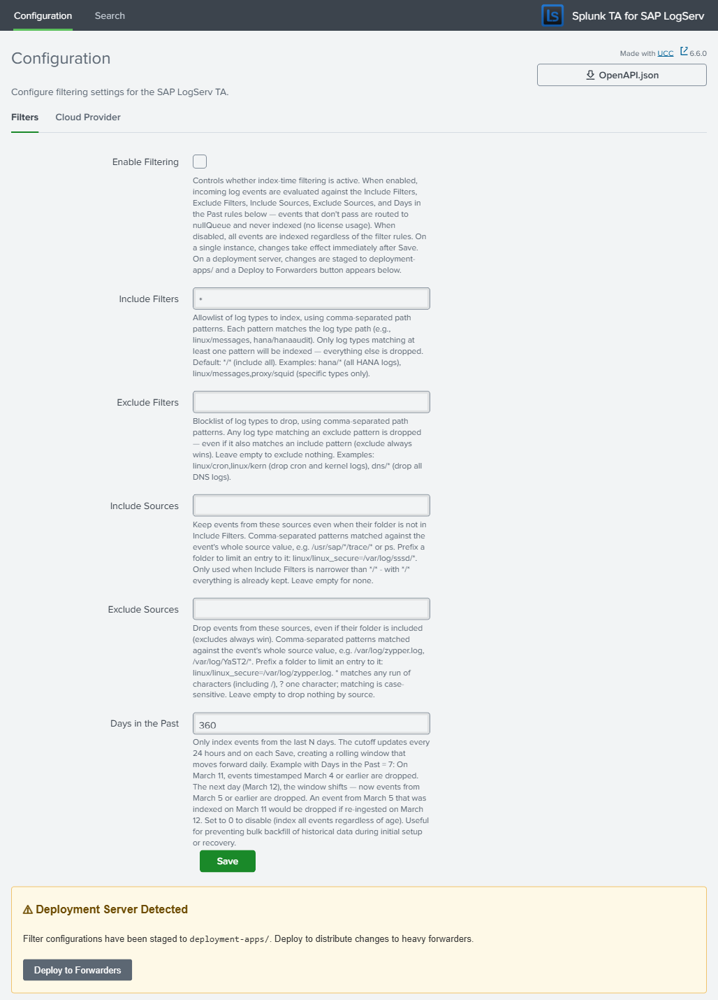
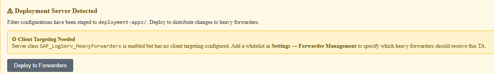
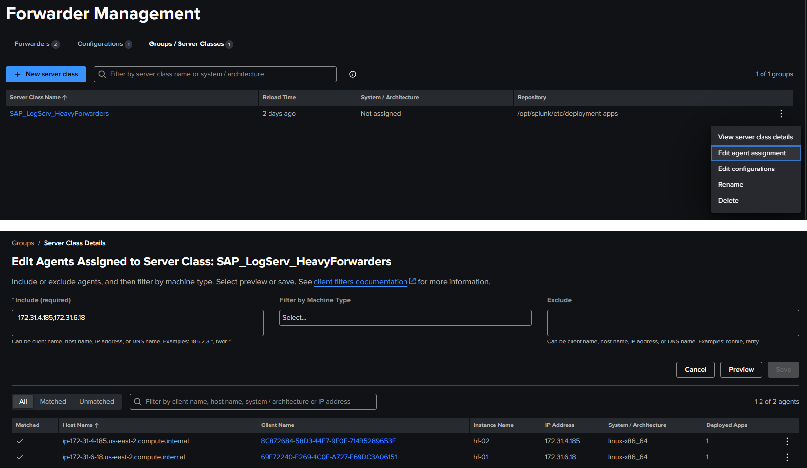
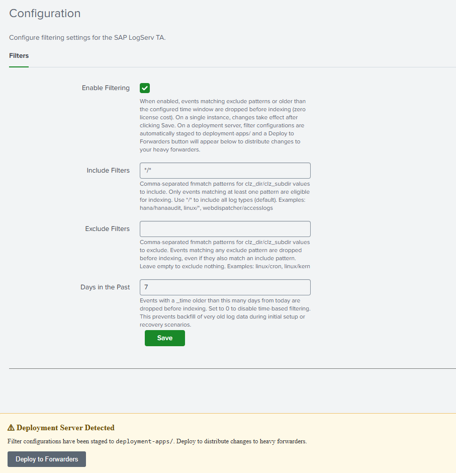
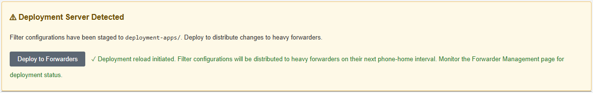
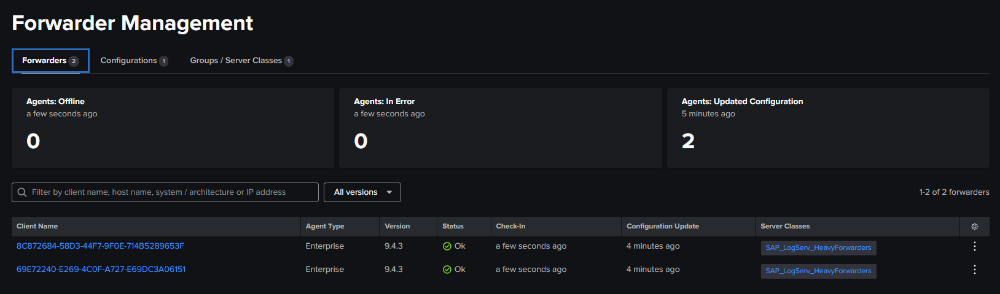
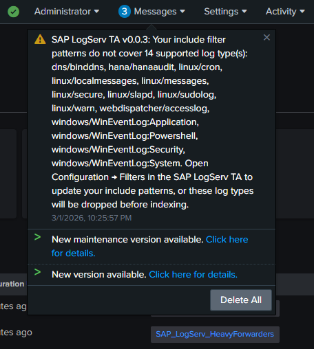

# Configuring Filters

### :material-circle-box:{ .taiconcolor } Overview

The Splunk TA for SAP LogServ provides two complementary approaches to filtering LogServ data — you can use either one independently or combine them for defense-in-depth filtering. (A third, lighter layer exists on the Azure and GCP ingest add-ons: their inputs accept optional `include_filters` / `exclude_filters` substring patterns applied to the object path *before download*, a cheap pre-filter — the canonical allow/deny policy still lives on this page's Filters tab.)

| | Native TA Index-Time Filtering | AWS Lambda-Based Filtering |
|---|---|---|
| **Where it runs** | Inside Splunk at index time | In AWS Lambda, before data reaches Splunk |
| **Configured via** | Splunk Web UI (Configuration → Filters) | Lambda environment variables or migration config |
| **Works with** | All deployment scenarios (Connect, Filter, Copy) | S3 Filter and Connect-to-Filter migration only |
| **What it filters** | Raw NDJSON events via TRANSFORMS queue routing | S3 event notifications via Lambda function |
| **License impact** | Filtered events consume zero Splunk license | Filtered notifications never reach Splunk |
| **Pattern syntax** | `clz_dir/clz_subdir` wildcard patterns, plus patterns on the event's `source` value (Include Sources / Exclude Sources) | `clz_dir/clz_subdir` fnmatch patterns on the S3 object key; no `source` patterns |
| **Time filtering** | Days in the Past (epoch regex, refreshed daily) | Days in the Past (Lambda evaluation) |
| **AWS resources needed** | None | Lambda function, local SQS queue, DLQ |
| **Deployment Server support** | ✅ Auto-distributes to Heavy Forwarders | N/A (AWS-side only) |
| **Upgrade notifications** | ✅ Alerts when new log types aren't covered | ❌ Not available |

<br>

### :material-circle-box:{ .taiconcolor } Which Approach Should I Use?

??? tip "Choosing a filtering approach"
    **Use Native TA filtering (recommended for most users)** if you want the simplest setup — it works with every deployment scenario, requires no AWS resources beyond what you already have, and is managed entirely from Splunk Web. It also provides upgrade notifications when new log types are added to the TA.

    **Use Lambda-based filtering** if you want to reduce the volume of SQS messages that Splunk processes. Because the Lambda filters S3 event notifications *before* they reach Splunk, unwanted objects are never downloaded from S3 at all. This can reduce S3 GET request costs and Splunk ingestion overhead in very high-volume environments.

    **Use both together** for defense-in-depth. The Lambda filters at the AWS pipeline level, and the native TA filters catch anything that slips through at the Splunk level. Since both use the same `clz_dir/clz_subdir` pattern syntax, you can keep the configurations aligned. **Include Sources** and **Exclude Sources** have no Lambda equivalent: the Lambda sees the S3 object key, not the `source` value inside each event, so file-level rules exist only on the Filters tab.

The remainder of this page covers **Native TA Index-Time Filtering** in detail. For Lambda-based filtering setup, see the [AWS Lambda-Based Filtering](#aws-lambda-based-filtering) section at the bottom of this page or the [AWS Remote S3 Filter Setup Guide](aws-remote-s3-filter-guide.md).

<br>

---

## Native TA Index-Time Filtering

### :material-circle-box:{ .taiconcolor } What It Does

The TA includes built-in **index-time filtering** configured entirely through the Splunk Web UI — no manual editing of configuration files is required.

??? tip "How It Works"
    - **Include Filters** — Folder patterns (`clz_dir/clz_subdir`). Only events matching at least one include pattern — or one Include Sources entry — are eligible for indexing. Everything else is dropped before indexing (zero license cost). An entry of `*/*` or `*` keeps everything.
    - **Exclude Filters** — Folder patterns. Events matching any exclude pattern are dropped, even if they also match an include pattern. Excludes override includes.
    - **Include Sources** — Patterns on the event's whole `source` value (the log file's path, such as `/var/log/zypper.log`, or a name such as `ps`). Keeps matching events even when their folder is not in Include Filters — including events that carry no folder fields at all.
    - **Exclude Sources** — Patterns on the event's `source` value. Drops matching events even when their folder is included — for example the zypper and YaST2 logs that share the `linux/linux_secure` folder with primary log types.
    - **Time Filter (Days in the Past)** — Events with a `_time` older than the configured number of days are dropped. This prevents backfill of very old log data during initial setup or recovery scenarios.

    All filtering happens at index time via TRANSFORMS-based queue routing, so filtered events never consume Splunk license. [How the Rules Combine](#how-the-rules-combine) gives the order in which they are applied.

!!! note "The Filters tab does not reduce Heavy Forwarder CPU"
    The filter rules run on the Heavy Forwarder in the same chain of index-time transforms as the Data TA's sourcetype routing, so an event they drop has already been downloaded, split into lines, timestamped and run through that chain. They save license and indexing, not forwarder CPU, and they add rules of their own to the chain. To lower the forwarder's load, drop data before the forwarder downloads it: with the [AWS Lambda pre-filter](#aws-lambda-based-filtering) on AWS, or with the Azure and GCP inputs' path filters. See [Heavy Forwarder Sizing](hf-sizing.md).

<br>

### :material-circle-box:{ .taiconcolor } Deployment Architectures

The TA supports two deployment models. The steps differ slightly depending on which one you use.

#### :material-crop-square:{ .taiconcolor } Single Instance / Search Head

The TA is installed directly on the Splunk instance that indexes data. Filter changes take effect immediately after clicking Save (no restart required).

#### :material-crop-square:{ .taiconcolor } Deployment Server with Heavy Forwarders

The TA is installed on the Deployment Server (DS). The DS distributes the TA and its filter configurations to Heavy Forwarders (HFs) that perform the actual data ingestion. This is the recommended architecture for production environments.

In this model:

- You install and configure the TA on the DS only
- The DS automatically stages configurations for distribution
- You use the built-in **Deploy to Forwarders** button to push changes to HFs
- HFs receive the TA and filter configs on their next phone-home interval

!!! note
    Splunk Cloud cannot act as a Deployment Server. If you are using Splunk Cloud, you will need a separate on-premises Deployment Server to manage your Heavy Forwarders.

<br>

### :material-circle-box:{ .taiconcolor } Open the Configuration > Filters Tab

1. In Splunk Web, open the **Splunk TA for SAP LogServ** app
2. Go to **Configuration > Filters**

??? note "Example"
    

    On the tab the fields appear in this order: **Enable Filtering**, **Include Filters**, **Exclude Filters**, **Include Sources**, **Exclude Sources**, **Days in the Past**.


### :material-circle-box:{ .taiconcolor } Set Your Filter Options

#### :material-crop-square:{ .taiconcolor } Enable Filtering

Check the **Enable Filtering** checkbox to activate index-time filtering. **Default: unchecked** — out of the box no index-time filtering is applied, and the Include Filters, Exclude Filters, Include Sources, Exclude Sources and Days in the Past values below take effect only once this box is checked. When disabled, all events are indexed without any filtering.

#### :material-crop-square:{ .taiconcolor } Include Filters

Comma-separated patterns specifying which log types to include. Patterns use the format `clz_dir/clz_subdir` with `*` and `?` wildcards:

| Pattern | Meaning |
|---------|---------|
| `*/*` | Include all log types (default) |
| `hana/hanaaudit` | Include only HANA audit logs |
| `linux/*` | Include all Linux log types |
| `linux/messages, hana/*` | Include Linux messages and all HANA logs |
| `dns/*` | Include all DNS log types |

:material-lightning-bolt:{ .taiconcolor } **Rules:**

- Each pattern must be in `dir/subdir` format or a standalone `*`
- An entry of `*/*` or a standalone `*` — anywhere in the list — includes everything: the include gate is left out and the other include entries have no effect (see [Include Everything](#include-everything))
- Valid characters: letters, numbers, `*`, `?`, `.`, `-`, `:`, `_`
- `*` matches any run of characters within its segment and `?` exactly one character: `linux/*` covers every `linux` subfolder, `*/cron` every `cron` subfolder. Matching is case-sensitive
- A folder pattern needs the event's `clz_dir` and `clz_subdir` fields — an event without them matches no folder pattern (see [Events Without Folder Fields](#events-without-folder-fields))
- This field cannot be empty when filtering is enabled — use `*/*` to include everything

??? tip "Supported Log Types Reference"
    See the [Supported Log Types](#supported-log-types) section below for a complete list of `clz_dir/clz_subdir` values you can use in your filter patterns.

#### :material-crop-square:{ .taiconcolor } Exclude Filters

Comma-separated patterns for log types to exclude. Same pattern format as includes. Events matching any exclude pattern are dropped even if they also match an include pattern.

**Example:** To include all Linux logs except cron and slapd:

- Include: `linux/*`
- Exclude: `linux/cron, linux/slapd`

Leave this field empty to exclude nothing. A standalone `*` in Exclude Filters excludes nothing (unlike in Include Filters); `*/*` there drops every event that has folder fields.

#### :material-crop-square:{ .taiconcolor } Include Sources

Comma-separated patterns matched against the event's whole `source` value — see [Source Pattern Syntax](#source-pattern-syntax). An event whose `source` matches an entry is kept even when its folder is not in Include Filters, and even when it carries no folder fields at all. **Default: empty** (none).

- Use it beside an Include Filters allow-list, to keep particular files the allow-list would drop — for example the HANA trace files and Unix command output that real Azure deliveries send without folder fields ([Recipe 4](#recipe-4)).
- It only adds to an allow-list. When Include Filters includes everything (`*/*` or `*`), every event is kept already, and with Enable Filtering checked a save that sets Include Sources is refused because its entries would have no effect.
- Days in the Past and both exclude fields still apply to the events it keeps.

**Example:** Include Filters `hana/hanaaudit, hana/tracelogs`, Include Sources `/usr/sap/*/HDB??/*/trace/*` keeps the HANA audit and trace folders, plus HANA trace files that arrive without folder fields.

#### :material-crop-square:{ .taiconcolor } Exclude Sources

Comma-separated patterns matched against the event's whole `source` value — see [Source Pattern Syntax](#source-pattern-syntax). An event whose `source` matches an entry is dropped, even when its folder is included and even when Include Sources matches it: excludes always win. **Default: empty** (nothing is dropped by source).

- Use it for log files that share a folder with a primary log type — YaST2 and zypper in `linux/linux_secure`, corosync in `linux/pacemaker`. A folder pattern cannot drop them without dropping the primary type too ([Recipe 3](#recipe-3)).
- **Example:** `/var/log/zypper.log*, /var/log/YaST2/*`

!!! warning "A broad source pattern drops primary log types too"
    Exclude Sources acts on every event whose `source` matches, whatever its folder. `/var/log/*` drops `/var/log/messages`, `/var/log/firewall`, `/var/log/cron` and every other file under `/var/log`. Name the files, or limit an entry to one folder (`linux/linux_secure=/var/log/zypper.log*`). The [upgrade notification](#upgrade-notifications) does not read source rules, so a pattern that drops a primary log type raises no banner.

#### :material-crop-square:{ .taiconcolor } Source Pattern Syntax

Both source fields take a comma-separated list. Each entry is either a source pattern on its own, or a folder and a source pattern joined by `=`:

| Entry | Matches |
|---|---|
| `/var/log/zypper.log` | Events whose `source` is exactly `/var/log/zypper.log`, in any folder or none |
| `/var/log/zypper.log*` | The same file and its rotated copies, such as `/var/log/zypper.log-20260823` |
| `/var/log/YaST2/*` | Every file under `/var/log/YaST2/`, subfolders included |
| `ps` | Events whose `source` is `ps` (Unix command output, which carries no folder fields) |
| `/usr/sap/*/HDB??/*/trace/*` | HANA trace files of every SID, instance and host |
| `linux/linux_secure=/var/log/YaST2/*` | YaST2 files, only in the `linux/linux_secure` folder |
| `linux/proxy=/var/log/squid/*` | Squid files, only in the `linux/proxy` folder (the Azure layout) |

:material-lightning-bolt:{ .taiconcolor } **Rules:**

- A pattern must match the **whole** `source` value: `/var/log/zypper` does not match `/var/log/zypper.log`. The value is the one the indexed event carries in its `source` field (one exception: see [Long Lines](#long-lines)). To list the values a folder delivers:

    ```spl
    | tstats count where `sap_logserv_idx_macro` by clz_dir, clz_subdir, source
    ```

- `*` matches any run of characters, **including `/`** — unlike a shell glob, `/var/log/YaST2/*` also covers files in subfolders. `?` matches exactly one character
- Any number of `*` is fine: a pattern is matched in linear time however many it has, and `**` means the same as `*`
- Every other character is literal: `.`, `+`, `-` and `:` have no special meaning
- A pattern is matched against the `source` value as it is written in the event's JSON envelope. Real LogServ `source` values contain no backslash, quote or non-ASCII character; a value that did would be written escaped there (a backslash as `\\`, `é` as `\u00e9`, a quote as `\"`), so a `?` would not stand for one such character — match a backslash or a non-ASCII character with `*` instead. A wildcard never crosses a quote; a pattern that ends in `*` or `?` can still match the part of such a value before its first quote
- Matching is case-sensitive: `/var/log/yast2/*` does not match `/var/log/YaST2/mkinitrd.log`
- A folder entry (`dir/subdir=pattern`) matches only when the folder part and the source pattern both match. The folder part follows the Include Filters rules, except that a standalone `*` is not accepted. Events without folder fields never match a folder entry; a plain entry matches them
- Allowed characters in a source pattern: letters, numbers and `/ . _ : * ? + @ ~ -`. A pattern has at most 512 characters and at least one character that is not `*`, `?` or `/` — patterns that match everything (`*`, `**`, `/*`, `*/*`) are refused: use the folder filters, or turn filtering off
- Not allowed: spaces inside an entry, `"`, `\`, `[`, `]`, a second `=`, control characters and non-ASCII characters. A comma always separates entries. Spaces around entries are ignored; an empty entry (two commas in a row, or a trailing comma) is refused. The whole field is limited to 4,096 characters
- A repeated entry is used once

#### :material-crop-square:{ .taiconcolor } Days in the Past

Whole number (0–3650) specifying the maximum age of events to index. Events with a `_time` older than this many days from today are dropped before indexing.

- Set to `7` to only index events from the last 7 days
- Set to `0`, or leave the field empty, to disable time-based filtering
- Default: `7`

??? tip "How the time filter works"
    The time filter uses a pre-computed epoch-based regex that is refreshed automatically once per day by a built-in scripted input. If the refresh does not run, the cutoff does not move forward and the filter becomes slightly less restrictive: it keeps up to one extra day of older events for each missed day, until the next refresh or Save. The daily refresh rewrites all the generated filter rules, the source rules included, from the saved settings.

    On a Deployment Server the refresh also copies the new rules to `deployment-apps/` and reloads the `SAP_LogServ_HeavyForwarders` server class, so the Heavy Forwarders get the new cutoff at their next phone-home. The cutoff changes every day, and the server class the TA creates maps the TA with `restartSplunkd = true`, so while filtering is enabled and Days in the Past is above 0, each Heavy Forwarder in that server class restarts about once a day to apply it, at a time of day set by when the Deployment Server last started. With filtering disabled, or Days in the Past at 0, the refresh changes nothing and no restart follows.

<br>

### :material-circle-box:{ .taiconcolor } How the Rules Combine

The Data TA turns the fields into one chain of index-time transforms. Each step that matches an event decides where it goes — kept for indexing or dropped — and the last step that matched wins:

```
  one NDJSON line (up to 100,000 characters)
    |
    v
  1. Include gate       drop every event                   -+
    |                                                       |  only when Include
    v                                                       |  Filters does not
  2. Include Filters    keep events whose folder matches    |  include everything
    |                                                       |
    v                                                       |
  3. Include Sources    keep events whose source matches   -+
    |
    v
  4. Days in the Past   drop events older than the cutoff
    |
    v
  5. Exclude Filters    drop events whose folder matches
    |
    v
  6. Exclude Sources    drop events whose source matches
    |
    v
  last step that matched: keep -> indexed, drop -> discarded (nullQueue)
  no step matched:        kept
```

In effect, an event is indexed when all of these hold:

- Include Filters includes everything, **or** its folder matches Include Filters, **or** its `source` matches Include Sources
- it is not older than Days in the Past
- its folder matches no Exclude Filters entry
- its `source` matches no Exclude Sources entry

The time filter and both excludes come after the include steps, so they always win. A step whose field is empty is left out of the chain.

#### :material-crop-square:{ .taiconcolor } Include Everything

If any Include Filters entry is `*/*` or a standalone `*`, there is no include gate: steps 1–3 are left out, every event passes them — events without folder fields included — and the other Include Filters entries have no effect. With Enable Filtering checked, a save that also sets Include Sources is refused; a value that reaches the rules anyway (a hand-edited settings file) is ignored, and the Data TA logs a warning. Days in the Past, Exclude Filters and Exclude Sources still apply.

!!! note "Behaviour change"
    Earlier Data TA builds — those without the Include Sources and Exclude Sources fields — skipped the include gate only when `*/*` or `*` stood on its own in Include Filters. A list that mixed `*/*` with other entries (`*/*, linux/cron`) dropped every event without folder fields, and a standalone `*` beside other entries was ignored, so `*, linux/cron` kept only `linux/cron`. Both lists now keep everything. To keep an allow-list, remove `*/*` and `*` from it.

#### :material-crop-square:{ .taiconcolor } Events Without Folder Fields

Not every LogServ event carries `clz_dir` and `clz_subdir`. SAP files some Azure data in a storage folder named `undefined/undefined` (`<prefix>/undefined/undefined/<YYYY>/<MM>/<DD>/`), and its events have neither field. In real Azure deliveries on the reference system that was about 19.9 million events in four weeks, each kind from a single host ([Data Delivered Without Folder Fields](../getting-started/supported-log-types.md#data-delivered-without-folder-fields)):

- the output of Unix commands — about 19.4 million events, with `source` values such as `ps`, `netstat`, `iostat`, `cpu`, `nfsiostat`, `top`, `openPorts`, `interfaces`, `df`, `bandwidth`, `vmstat` and `Unix:ListeningPorts`. They stay under the base `sap_logserv_logs` sourcetype.
- HANA trace directory files, `/usr/sap/<SID>/HDB<nn>/<host>/trace/...` (the `.trc` files and `backup.log`) — about 566,000 events. The Data TA routes them to `sap:hana:tracelogs` by their `source` path ([SAP HANA Trace Logs](../getting-started/supported-log-types.md#sap-hana-trace-logs-logserv-app)); events indexed by an earlier Data TA build keep `sap_logserv_logs`.

Routing does not give an event folder fields, so folder patterns cannot see any of these events, the routed HANA trace files included:

- With Include Filters at `*/*` they are kept.
- With an allow-list — any Include Filters value that does not include everything — **they are all dropped**, unless an Include Sources entry keeps them ([Recipe 4](#recipe-4)). Listing `hana/tracelogs` in Include Filters does not keep the HANA trace files that arrive this way.
- Exclude Filters never drops them: `hana/tracelogs` there leaves these HANA trace files in place. Only Exclude Sources can drop them.
- A folder entry in a source field (`dir/subdir=pattern`) never matches them; a plain source pattern does.
- The [upgrade notification](#upgrade-notifications) reasons about folders only, so it does not point to an allow-list that drops these events. The filter verdict of the LogServ App's [Data Doctor](../logserv-app/dashboards/platform/diagnostics.md#supplying-the-ingest-filter-configuration) for `sap:hana:tracelogs` does take the HANA trace files that arrive this way into account. Wherever it judges that type, it does not treat their arrival as contradicting an Exclude Filters rule on `hana/tracelogs`, and it does not call such a rule a full exclusion. On a HANA Trace panel it also names an allow-list that keeps the `hana/tracelogs` folder but drops these files, as an additional finding listed after the panel's main verdict (such as *Never received* or *Summary not built*), never in its place, because the pasted configuration does not show whether SAP delivers such files to you. A verdict they change is at most *possible*, because the pasted configuration does not show whether your forwarders route these files by their `source` path either. The Data Doctor does not judge the Unix command output, which stays under `sap_logserv_logs`.

:material-lightning-bolt:{ .taiconcolor } **Drop the Unix command output if you do not use it.** It is almost all of this data — about 0.7 million events and roughly 125 MB of text a day on the reference system, about 80% of it `ps` — and the LogServ App does not parse it; it only counts it in its volume dashboards. Exclude Sources `ps, top, netstat, iostat, vmstat, df, cpu, interfaces, bandwidth, openPorts, nfsiostat, Unix:ListeningPorts` drops all twelve wherever they arrive. If you keep them, note that a `ps` row can carry the arguments a process was started with — up to 34% of the real `ps` rows checked on the reference system did — and arguments can contain passwords, keys or tokens.

Before you narrow Include Filters, check what your deliveries carry without folder fields (over a short time range — the search reads raw events):

```spl
`sap_logserv_idx_macro` | where isnull(clz_dir) | stats count by source, sourcetype
```

#### :material-crop-square:{ .taiconcolor } Long Lines

Every rule reads the whole line, up to 100,000 characters — the longest line the Data TA indexes. An index-time transform reads only the first 4,096 characters unless told otherwise, so every filter stanza the Data TA generates sets `LOOKAHEAD = 100000`. This matters for the AWS envelope, which carries the log text (`_raw`) before `source`, `clz_dir` and `clz_subdir`: on a line whose log text ran past about 4,000 characters, earlier Data TA builds could not see the folder fields, so an Include Filters allow-list dropped the line and an exclude missed it.

The rules expect the envelope's metadata keys to sit together, all before or all after the `_raw` value, as in every LogServ delivery seen so far (Azure and GCP put them first, AWS after `_raw`). An envelope that put `_raw` between the keys an entry needs would not match that entry: a folder pattern needs `clz_dir` and `clz_subdir`, and a `dir/subdir=` entry also `source`, on the same side of `_raw`. A plain source pattern needs only `source`, so it would still match.

The sourcetype routing and the indexed `host`, `source`, `clz_dir` and `clz_subdir` fields read the same 100,000 characters as the filters. Data TA builds of 2026-10-13 and earlier read only the first 4,096 characters there, so an AWS line whose log text was longer than that was judged by the filters on its envelope but indexed under the base `sap_logserv_logs` sourcetype, without folder fields and with the input's own `host` and `source`. A line longer than 100,000 characters is cut there (`TRUNCATE`), so an AWS line that long loses its envelope keys whatever the rules read.

<br>

### :material-circle-box:{ .taiconcolor } Save

Click **Save**. The TA validates your patterns and generates the necessary configuration files. If there are any validation errors (invalid characters, empty include field, etc.), the save is blocked and an error message is displayed.

Include Sources and Exclude Sources are checked on every save, even with Enable Filtering unchecked, because their values are written to a configuration file either way. For the same reason every field is refused on every save if it contains a line break, a tab or another control character, or ends with a backslash. The folder patterns are checked when Enable Filtering is checked, as before. [Validation Error on Save](#validation-error-on-save) lists the rules.

The rules are generated from the settings as saved. A save through the REST API or the CLI that sends only some of the fields keeps the saved values of the others, so the generated rules always match what the Filters tab shows.

<br>

---

### :material-circle-box:{ .taiconcolor } Deployment Server: Additional Steps

:material-lightning-bolt:{ .taiconcolor } If you are running on a **single instance**, you can skip this section — filter changes take effect immediately after Save.

<br>

### :material-circle-box:{ .taiconcolor } What Happens Automatically on Save

When you save filter settings on a Deployment Server, the TA automatically:

1. Copies the full TA package to `/opt/splunk/etc/deployment-apps/splunk_ta_sap_logserv/`
2. Mirrors the generated filter configurations (`transforms.conf`, `props.conf`) to the deployment-apps copy
3. Creates a server class named `SAP_LogServ_HeavyForwarders` in a disabled state (if it doesn't already exist). The server class remains disabled until you configure client targeting in the next step.

After saving, the Filters tab displays:

- A **"⚠ Deployment Server Detected"** banner
- A **"⚙ Server Class Setup Required"** or **"Client Targeting Needed"** notice (first time only)
- A **"Deploy to Forwarders"** button

??? note "Example"
    


<br>

### :material-circle-box:{ .taiconcolor } Configure the Server Class (First Time Only)

The auto-created server class needs client targeting to know which Heavy Forwarders should receive the TA:

1. Go to **Settings → Forwarder Management**
2. Find the `SAP_LogServ_HeavyForwarders` server class
3. Click the three-dot menu → **Edit agent assignment**
4. Add your Heavy Forwarder IP addresses, hostnames, or use `*` for all connected forwarders
5. Save the agent assignment — this also enables the server class

??? note "Example"
    


??? tip "Client Targeting"
    Use IP addresses for client targeting, as Splunk matches against the client's IP, hostname, DNS name, or GUID — not the instance name.

Return to the Filters tab — the setup notice should be gone (refresh the page in the browser if needed to see the change in the setup notice).

??? note "Example"
    


<br>

### :material-circle-box:{ .taiconcolor } Deploy to Forwarders

1. On the Filters tab, click **"Deploy to Forwarders"** and confirm
2. You should see the new updated banner on the filters screen confirming the deployment reload has been initiated
??? note "Example"
    
3. Wait for your Heavy Forwarders to phone home (typically 30–60 seconds depending on configuration)
4. Verify deployment status in **Settings → Forwarder Management** — HFs should show as "Ok" under the server class, however it may take 5+ minutes to see the status on the forwarders change from `Pending` to `Ok`

??? note "Example"
    


<br>

### :material-circle-box:{ .taiconcolor } Updating Filters on a Deployment Server

Whenever you change filter settings:

1. Make your changes on the Filters tab and click **Save**
2. Click **"Deploy to Forwarders"** to distribute the updated configurations
3. HFs will pick up the changes on their next phone-home interval

!!! note
    Do not install the TA directly on Heavy Forwarders when using a Deployment Server. The DS manages the TA distribution. Installing locally on an HF can cause configuration conflicts.

<br>

---

## Verifying Filters

### :material-circle-box:{ .taiconcolor } Check Included Data Is Arriving

```spl
`sap_logserv_idx_macro` | stats count by clz_dir, clz_subdir
```

You should see data only for log types matching your include patterns.

??? tip "Index macro"
    The `sap_logserv_idx_macro` macro expands to `index="sap_logserv_logs"` by default. If you changed the index name in your environment, update the macro definition under **Settings → Advanced Search → Search Macros** or substitute your index name directly in the search.

<br>

### :material-circle-box:{ .taiconcolor } Check Excluded Data Is Not Present

If you configured exclude patterns, verify those log types are absent from search results.

For source rules, list the `source` values per folder over a window that starts after the Save (or, on a Deployment Server, after the forwarders received the change) — events indexed earlier stay in the index:

```spl
| tstats count where `sap_logserv_idx_macro` by clz_dir, clz_subdir, source
```

The files named in Exclude Sources must be gone, while the other files of the same folder still arrive — for `linux/linux_secure`, for example, `/var/log/firewall`, `/var/log/kernel`, `/var/log/sssd/...`, `lastlog` and `who`. `tstats … by clz_dir` leaves out events without folder fields; to check those, use the search in [Events Without Folder Fields](#events-without-folder-fields).

<br>

### :material-circle-box:{ .taiconcolor } Check Time Filtering

Search for events older than your configured cutoff:

```spl
`sap_logserv_idx_macro` earliest=-30d latest=-10d
```

If your Days in Past is less than 10, this search should return no results.

<br>

---

## Reading the Active Filter Configuration

Support workflows (and the LogServ App's [Data Doctor](../logserv-app/dashboards/platform/diagnostics.md))
sometimes need the ACTIVE filter configuration as text. Two ways to read it:

**REST — authoritative on the deployment server (distributed) or the single instance:**

```bash
curl -k -u <splunk-admin> "https://<deployment-server>:8089/servicesNS/nobody/splunk_ta_sap_logserv/splunk_ta_sap_logserv_settings/filter_settings?output_mode=json"
```

Omit `?output_mode=json` for the XML form. The response carries `filter_enabled`,
`include_filters`, `exclude_filters`, `include_sources`, `exclude_sources` and `days_in_past`
exactly as configured.

**File — the only reliable artifact on a DS-managed Heavy Forwarder:**

```bash
sudo cat /opt/splunk/etc/apps/splunk_ta_sap_logserv/local/transforms.conf
```

!!! warning "The HF's REST endpoint is misleading"
    On a deployment-server-managed Heavy Forwarder the `filter_settings` REST endpoint
    returns the shipped defaults — the pushed configuration lives only in the generated
    `local/transforms.conf`. Always use the file on an HF.

The LogServ App's **Platform → Diagnostics** page prints these same commands and accepts the
pasted output, turning the ingest filters into evidence its missing-data diagnosis can reason
about — see [Supplying the ingest-filter configuration](../logserv-app/dashboards/platform/diagnostics.md#supplying-the-ingest-filter-configuration).

!!! note "Source rules make the Data Doctor's folder verdicts approximate"
    A source rule acts on single files, not on whole folders. When a pasted configuration
    has Include Sources or Exclude Sources in effect, the Data Doctor cannot say for certain
    whether a folder's events are kept, and its verdict notes that source rules may drop or
    keep some files of a folder. Its verdict for `sap:hana:tracelogs` also accounts for the
    HANA trace files that arrive without folder fields, which the `hana/tracelogs` folder
    rules do not reach: any Include Filters allow-list drops them unless an Include Sources
    entry without a folder keeps them, and of the exclude rules only Exclude Sources drops
    them. Where those files change the verdict, it reads *Partly excluded?* at no more than
    *possible*: an Exclude Filters rule on `hana/tracelogs` leaves them in place wherever the
    trace type is judged, and on a HANA Trace panel an allow-list that keeps the folder but
    drops them is listed as an additional finding after the panel's main verdict, with
    evidence that explains these files (see
    [Events Without Folder Fields](#events-without-folder-fields)).

    This needs LogServ App build 377 or later, which follows the Data TA build that added
    Include Sources and Exclude Sources. App build 376 and earlier do not know the source
    rules: they ignore them, read a paste that holds only source rules as filtering with
    everything included, read only the first stanza of a list split over several, and
    report folder patterns with `*` or `?` as not reconstructable (a partial read).

!!! tip "The transforms paste also carries the Cloud Provider stamp"
    A pasted `local/transforms.conf` includes the generated `[logserv_set_cloud_provider]`
    stanza when the [Cloud Provider Attribution](#cloud-provider-attribution) dropdown is set,
    so the Data Doctor also records the configured stamp and can explain how it interacts
    with a dashboard's Cloud filter. A missing stanza is *not* read as "Not set" — the paste
    may be truncated; only a settings-conf paste can supply the explicit `not_set` value.

## Supported Log Types

### :material-circle-box:{ .taiconcolor } Log Type Reference

The table below lists the **Primary** log types — those with dedicated sourcetype routing. The `clz_dir` and `clz_subdir` columns show the values used in filter patterns; use these values when configuring your include and exclude filters. The canonical, complete reference (including the **Secondary** log types, which have no dedicated routing but can still be filtered by their own `clz_dir/clz_subdir` paths — or, where they share a primary type's folder, by their `source` values; see [Filter Recipes](#filter-recipes)) is [Supported Log Types](../getting-started/supported-log-types.md).

| clz_dir | clz_subdir | Splunk Sourcetype |
|---------|------------|-------------------|
| abap | audit | `sap:abap:audit` |
| abap | dispatcher † | `sap:abap:dispatcher` |
| abap | enqueueserver | `sap:abap:enqueueserver` |
| abap | event † | `sap:abap:event` |
| abap | gateway | `sap:abap:gateway` |
| abap | icm | `sap:abap:icm` |
| abap | messageserver | `sap:abap:messageserver` |
| abap | sapstartsrv | `sap:abap:sapstartsrv` |
| abap | workprocess † | `sap:abap:workprocess` |
| dns | binddns | `isc:bind:query`, `isc:bind:lameserver`, `isc:bind:network`, `isc:bind:transfer` |
| hana | hanaaudit | `sap:hana:audit` |
| hana | tracelogs | `sap:hana:tracelogs` |
| linux | cron | `linux:cron` |
| linux | localmessages | `linux_messages_syslog` |
| linux | messages | `linux_messages_syslog` |
| linux | pacemaker ‡ | `linux:slapd` |
| linux | proxy ‡ | `squid:access`, `squid:cache`, `squid:store`, `linux_messages_syslog` |
| linux | linux_secure | `linux_secure`, `lastlog`, `who` |
| linux | slapd | `linux:slapd` |
| linux | sudolog | `linux:sudolog` |
| linux | warn | `linux:warn` |
| proxy | squid | `squid:access`, `squid:cache`, `squid:store` |
| sap | saphostexec | `sap:saphostexec` |
| sap | saprouter | `sap:saprouter` |
| sap | sapstartsrv | `sap:sapstartsrv` |
| scc | audit | `sap:scc:audit` |
| scc | tracelogs | `sap:scc:http_access` |
| webdispatcher | accesslog | `sap:webdispatcher:access` |
| windows | WinEventLog:Application | `XmlWinEventLog` |
| windows | WinEventLog:Powershell | `XmlWinEventLog` |
| windows | WinEventLog:Security | `XmlWinEventLog` |
| windows | WinEventLog:System | `XmlWinEventLog` |

† `abap/dispatcher`, `abap/event`, and `abap/workprocess` were discontinued by SAP from LogServ delivery effective April 2026 — filters on them affect historical data only. Contact SAP about continued collection.

‡ Paths seen in real LogServ data beside the older layout: Azure delivers Squid under `linux/proxy` (the AWS bucket uses `proxy/squid`), and GCP delivers `pacemaker.log` under `linux/pacemaker` and a proxy VM's `/var/log/messages` under `linux/proxy`. A rule meant to cover a log type on every cloud names all of its paths.

??? tip "Filter pattern examples using this table"
    - To include all DNS logs: `dns/*` or `dns/binddns`
    - To include all Linux logs except cron: Include `linux/*`, Exclude `linux/cron`
    - To exclude Squid on every cloud: Exclude Filters `proxy/squid`, Exclude Sources `linux/proxy=/var/log/squid/*`. Excluding the whole `linux/proxy` folder would also drop the `/var/log/messages` lines a proxy VM delivers there. Likewise, an Include of `linux/*` also keeps Azure's Squid logs
    - To include only HANA audit and web dispatcher logs: `hana/hanaaudit, webdispatcher/accesslog`
    - To include all Windows event logs: `windows/*`
    - To include all ABAP application logs: `abap/*`
    - To include specific ABAP types: `abap/icm, abap/gateway`
    - To include all SAP Cloud Connector logs: `scc/*`
    - To include all SAP service logs: `sap/*`
    - To drop the zypper and YaST2 logs but keep the rest of `linux/linux_secure`: Exclude Sources `/var/log/zypper.log*, /var/log/YaST2/*`
    - To drop zypper's log only where it arrives under `linux/linux_secure`: Exclude Sources `linux/linux_secure=/var/log/zypper.log*` ([Recipe 5](#recipe-5))
    - To keep HANA trace files that arrive without folder fields while Include Filters is an allow-list: Include Sources `/usr/sap/*/HDB??/*/trace/*`
    - Do not drop `/var/log/messages` under `sap/saprouter` as operating-system syslog: there it carries the SAP Router's own records ([Recipe 5](#recipe-5))

<br>

---

## Filter Recipes

Each recipe below is a Filters-tab setting for one goal; several can be combined. Primary log types are routed to their own sourcetypes; Secondary ones stay under the base `sap_logserv_logs` sourcetype ([Supported Log Types](../getting-started/supported-log-types.md#secondary-supported-log-types)), so this search lists the unrouted events by folder and file — the ones these recipes are about:

```spl
| tstats count where `sap_logserv_idx_macro` sourcetype=sap_logserv_logs by clz_dir, clz_subdir, source
```

Enable Filtering must be checked for any recipe to take effect. On a Deployment Server, Save and then **Deploy to Forwarders**; the change applies to events parsed after the forwarders receive it.

### :material-circle-box:{ .taiconcolor } Recipe 1: Allow-list of the Primary Log Types { #recipe-1 }

Keep the folders of the Primary log types and drop every other folder.

- **Include Filters:** `abap/audit, abap/dispatcher, abap/enqueueserver, abap/event, abap/gateway, abap/icm, abap/messageserver, abap/sapstartsrv, abap/workprocess, dns/binddns, hana/hanaaudit, hana/tracelogs, linux/cron, linux/localmessages, linux/messages, linux/linux_secure, linux/pacemaker, linux/proxy, linux/slapd, linux/sudolog, linux/warn, proxy/squid, sap/saphostexec, sap/saprouter, sap/sapstartsrv, scc/audit, scc/tracelogs, webdispatcher/accesslog, windows/*`

The ABAP and Web Dispatcher folders are listed one by one because `abap/*` would also keep the Secondary `abap/transport` and `abap/httpaccess`, and `webdispatcher/*` the Secondary Web Dispatcher traces. `abap/dispatcher`, `abap/event` and `abap/workprocess` stay in the list although SAP discontinued them in April 2026: they keep a backfill of older data, and the Data TA still counts them as supported. Without them, every Save of this list, and every later Data TA upgrade, raises the [upgrade notification](#upgrade-notifications) banner naming the three folders as dropped before indexing; it clears only when they are added.

- **Drops:** every folder not named, including the Secondary folders whose names are not known (Network / Flow, WAF / F5, MSSQL) and any folder a future SAP delivery adds. With this list the upgrade notification stays quiet until a Data TA upgrade adds a Primary log type; it then names the folder to add.
- **Also drops:** every event without folder fields — Unix command output and HANA trace files on Azure (see [Events Without Folder Fields](#events-without-folder-fields)). Add [Recipe 4](#recipe-4) to keep the ones you want.
- **Still keeps:** zypper and YaST2 (they share `linux/linux_secure`) and corosync (it shares `linux/pacemaker`). Add [Recipe 3](#recipe-3).

### :material-circle-box:{ .taiconcolor } Recipe 2: Deny-list of the Secondary Folders { #recipe-2 }

Keep everything except the Secondary folders that have names of their own.

- **Include Filters:** `*/*`
- **Exclude Filters:** `abap/transport, abap/httpaccess, webdispatcher/process, webdispatcher/icm, webdispatcher/sapstartsrv, webdispatcher/devicm, sybase/*, java/*, bobj_bi/*, bobj_bods/*, bobj_sacagent/*, dpagent/*`

The folder names come from the SAP LogServ service description; none of them has appeared in the reference system's real deliveries. Check the folders your own deliveries use with the search above.

- **Keeps:** any folder the list does not name — the Network / Flow, WAF / F5 and MSSQL logs, whose folders are not known, and any folder a future SAP delivery adds. Events without folder fields are kept. With `*/*` the upgrade notification never fires.
- **Still keeps:** zypper, YaST2 and corosync. Add [Recipe 3](#recipe-3).

### :material-circle-box:{ .taiconcolor } Recipe 3: Drop zypper and YaST2, Keep the Rest of linux/linux_secure { #recipe-3 }

zypper and YaST2 write to `linux/linux_secure`, the folder of the Primary firewall, kernel, sssd, `lastlog` and `who` logs. Exclude them by `source`:

- **Exclude Sources:** `/var/log/zypper.log*, /var/log/YaST2/*`

`/var/log/zypper.log*` also covers rotated copies; `/var/log/YaST2/*` covers every YaST2 file, such as `/var/log/YaST2/mkinitrd.log` and `/var/log/YaST2/config_diff_2026_09_28.log` (both seen in real deliveries). To drop them only from that folder, write `linux/linux_secure=/var/log/zypper.log*, linux/linux_secure=/var/log/YaST2/*`.

For corosync in `linux/pacemaker`, add `/var/log/cluster/corosync.log*` — that path is the one the SAP LogServ service description names; corosync has not appeared in the reference system's real deliveries, so check the `source` value your deliveries carry before relying on it.

Combine with Recipe 1 or Recipe 2. Afterwards, the `tstats` search in [Check Excluded Data Is Not Present](#check-excluded-data-is-not-present) must show the other `linux/linux_secure` files still arriving.

### :material-circle-box:{ .taiconcolor } Recipe 4: Keep HANA Trace Files with an Allow-list { #recipe-4 }

An Include Filters allow-list drops every event without folder fields, and real Azure deliveries send HANA trace files without them. Keep them by `source`:

- **Include Filters:** your allow-list, for example Recipe 1's
- **Include Sources:** `/usr/sap/*/HDB??/*/trace/*`

The pattern covers `/usr/sap/<SID>/HDB<nn>/<host>/trace/` and its subfolders for every SID, instance and host. The Data TA routes the `.trc` files and `backup.log` there, and in its `DB_<tenant>/` subfolder, to `sap:hana:tracelogs`; any other file the pattern keeps stays under the base `sap_logserv_logs` sourcetype. To keep the Unix command output too, add the `source` values you want, for example `ps, netstat, iostat, vmstat, df, top`; it stays under `sap_logserv_logs`. Mind the arguments in `ps` rows ([Events Without Folder Fields](#events-without-folder-fields)).

### :material-circle-box:{ .taiconcolor } Recipe 5: Limit a Source Rule to One Folder { #recipe-5 }

A plain source pattern acts in every folder, and on events without folder fields. To make it act in one folder only, write the folder and `=` before it. For example, to drop zypper's log from `linux/linux_secure` and nowhere else:

- **Exclude Sources:** `linux/linux_secure=/var/log/zypper.log*`

The entry matches only events whose folder is `linux/linux_secure` and whose `source` matches `/var/log/zypper.log*`, so a `zypper.log` that a delivery files under another folder is kept. A folder entry never matches an event without folder fields.

!!! warning "Under sap/saprouter, /var/log/messages is SAP Router data"
    On GCP, LogServ files `/var/log/messages` lines under the `sap/saprouter` folder, and the Data TA gives them the `sap:saprouter` sourcetype, so they feed the SAP Router dashboard. On the reference system at least 70% of them, in the one hour measured, were the router's own connection and trace records, and the rest the router container's wrapper output and other text; every line had the same tagged syslog form, and the newest lines carry the router container's tag. An Exclude Sources entry `sap/saprouter=/var/log/messages` drops router records.

<br>

---

## Upgrade Notifications

### :material-circle-box:{ .taiconcolor } How Upgrade Notifications Work

When the TA is upgraded to a new version that supports additional log types, a system message banner appears across all Splunk Web pages if your include filter patterns do not cover the newly supported types. This prevents new log types from being silently dropped.

??? note "Example"
    

To resolve the notification:

1. Open **Configuration → Filters** in the TA
2. Review and update your include patterns to cover the new log types (or use `*/*` to include everything)
3. Save

The banner clears automatically once all supported types are covered.

The same check runs on every Save of the Filters tab with Enable Filtering checked, so an Include Filters list that leaves out a supported folder raises the banner as soon as it is saved, not only after an upgrade.

The check compares the supported folders with Include Filters only. Exclude Filters, Include Sources and Exclude Sources neither raise nor clear the banner, so an exclude that drops a supported log type, or a source rule that drops a primary file, goes unannounced. An Include Filters list with `*/*` or `*` never raises it. It does not know about events without folder fields either: an allow-list that drops the HANA trace files of [Events Without Folder Fields](#events-without-folder-fields) raises no banner, even when it lists `hana/tracelogs`.

<br>

---

## Troubleshooting

### :material-circle-box:{ .taiconcolor } Filters Not Taking Effect (Single Instance)

- Verify filtering is enabled: Check the **Enable Filtering** checkbox
- Check `local/transforms.conf` in the app directory for the generated filter stanzas: `logserv_filter_include_drop`, `logserv_filter_include_allow`, `logserv_filter_include_sources`, `logserv_filter_time_drop`, `logserv_filter_exclude` and `logserv_filter_exclude_sources`, each present only when its field is in use, and each ending in `LOOKAHEAD = 100000`. A long list is split over several stanzas: `logserv_filter_exclude`, `logserv_filter_exclude_2`, and so on
- Check `local/props.conf` for the `TRANSFORMS-00-filter` line under `[sap_logserv_logs]`; it names every generated stanza in the order above
- A source rule matches the whole `source` value and is case-sensitive: compare the entry with the values the folder really delivers (see [Source Pattern Syntax](#source-pattern-syntax))
- Check `_internal` for errors:

```spl
index=_internal sourcetype=splunkd component=PersistentScript splunk_ta_sap_logserv
```

<br>

### :material-circle-box:{ .taiconcolor } Daily Refresh Reports an Invalid Setting

The daily refresh regenerates the filter rules from the saved settings (it runs while Enable Filtering is checked and Days in the Past is above 0). If a saved Include Filters, Exclude Filters, Include Sources or Exclude Sources value breaks the rules for that field — for example after a hand edit of `local/splunk_ta_sap_logserv_settings.conf` — the refresh logs an ERROR and leaves the rules it generated last in place; it never writes a rule built from the invalid value. Find the message with:

```spl
index=_internal sourcetype=splunkd component=ExecProcessor logserv_filter_time_refresh "level=ERROR"
```

Days in the Past is read the same way the Save reads it, so a value the Save accepted is refreshed: `7.0` counts as `7`. A saved value that is not a whole number — such as `7.5`, or text from a hand edit — is reported by the same search: an ERROR that names Days in the Past, and the rules generated last stay in place. Until the value is corrected and saved, the time cutoff does not move forward, so the filter keeps more older events each day.

Open **Configuration → Filters**, correct the field and click **Save**.

<br>

### :material-circle-box:{ .taiconcolor } Filters Not Reaching Heavy Forwarders

- Verify the server class exists and has client targeting configured in **Settings → Forwarder Management**
- Verify deployment-apps has the filter configs:

```bash
cat /opt/splunk/etc/deployment-apps/splunk_ta_sap_logserv/local/transforms.conf
```

- Click **Deploy to Forwarders** and wait for phone-home
- If only the time cutoff lags behind, check the daily refresh on the Deployment Server: it reloads the server class itself and logs a WARNING when it cannot (the Heavy Forwarders then keep the previous cutoff until the next **Deploy to Forwarders**):

```spl
index=_internal sourcetype=splunkd component=ExecProcessor logserv_filter_time_refresh "level=WARNING"
```

- Check HF configs:

```bash
cat /opt/splunk/etc/apps/splunk_ta_sap_logserv/local/transforms.conf
```

<br>

### :material-circle-box:{ .taiconcolor } Deployment Server Not Detected

- The TA detects deployment servers by checking server roles and for connected deployment clients
- Verify your Heavy Forwarders are configured as deployment clients pointing to the DS
- Check with:

```bash
curl -sk -u admin:<password> \
  "https://localhost:8089/services/deployment/server/clients?output_mode=json&count=1"
```

<br>

### :material-circle-box:{ .taiconcolor } Validation Error on Save

- Include patterns must not be empty when filtering is enabled — use `*/*` to include all
- Patterns must use `dir/subdir` format with only valid characters (letters, numbers, `*`, `?`, `.`, `-`, `:`, `_`)
- Days in the Past must be a whole number between 0 and 3650
- Include Sources and Exclude Sources (checked on every save, even with filtering disabled):
    - each entry is a source pattern, or `dir/subdir=` followed by a source pattern
    - a source pattern uses only letters, numbers and `/ . _ : * ? + @ ~ -`, has at most 512 characters, and has at least one character that is not `*`, `?` or `/` — `*`, `**`, `/*` and `*/*` are refused
    - no spaces inside an entry, no `"`, `\`, `[`, `]`, control characters or non-ASCII characters, and only one `=` per entry
    - no empty entries (two commas in a row, or a trailing comma); at most 4,096 characters per field
    - the folder part of a `dir/subdir=` entry follows the Include Filters rules, without a standalone `*`
- With filtering enabled, Include Sources is refused while Include Filters includes everything (`*/*` or `*`): its entries would have no effect — see [Include Everything](#include-everything)
- A single entry whose generated rule would pass 8,000 characters (a very long pattern with many wildcards) is refused; shorten it
- On every save, even with filtering disabled, no field may contain a line break, a tab or another control character, or end with a backslash

<br>

### :material-circle-box:{ .taiconcolor } Time Filter Seems Off by a Day

The time filter epoch cutoff is refreshed once per day by a scripted input. After changing the Days in Past value, the cutoff regex is regenerated immediately on Save. If the daily refresh does not run, or skips because it cannot read the saved settings (see [Daily Refresh Reports an Invalid Setting](#daily-refresh-reports-an-invalid-setting)), the cutoff stays where it was and the filter becomes slightly less restrictive: it keeps up to one extra day of older events for each missed day, until the next refresh or Save.

<br>

---

## Cloud Provider Attribution

### :material-circle-box:{ .taiconcolor } What It Does

The **Configuration** page has two tabs: **Filters** (covered above) and **Cloud Provider**. The Cloud Provider tab controls how the Data TA attributes each event to the cloud it was ingested from.

The Data TA stamps two indexed fields at index time on the bootstrap `sap_logserv_logs` sourcetype — the same `WRITE_META` mechanism it uses to preserve `clz_dir` and `clz_subdir`:

| Indexed field | Value | How it's set | Configurable |
|---|---|---|---|
| `splunk_solution` | `splunk_for_sap_logserv` | Always stamped on every event | No — ships active, no UI control |
| `cloud_provider` | `aws` / `azure` / `gcp` / *(none)* | Stamped per the Cloud Provider dropdown | Yes — **Configuration → Cloud Provider** |

Both fields are written at index time on the Heavy Forwarder (or the indexer in single-instance mode), so they are available as indexed fields for `tstats`, accelerated searches, and raw-event filtering.

<br>

### :material-circle-box:{ .taiconcolor } The splunk_solution Field (always-on)

Every event indexed through the Data TA carries `splunk_solution = splunk_for_sap_logserv`. This is a static attribution stamp — there is no UI control and nothing to configure. It identifies events that flowed through the Splunk for SAP LogServ pipeline, which is useful when the same index or Splunk instance also receives data from other solutions.

!!! note "`splunk_solution` is distinct from `vendor_product`"
    The LogServ App also defines a per-sourcetype `vendor_product` search-time field (e.g., `SAP HANA`, `SAP NetWeaver ABAP`, `SAP Web Dispatcher`, `ISC:Bind`) that dashboards and CIM mapping rely on. That field describes *which product* produced a given event. `splunk_solution` is a separate, coarser stamp identifying the *solution* — this TA — that ingested it. The two coexist and do not collide.

<br>

### :material-circle-box:{ .taiconcolor } The cloud_provider Field (dropdown-driven)

On the **Cloud Provider** tab, the **Cloud Provider** dropdown has four choices:

| Selection | Effect |
|---|---|
| **Not set** (default) | No `cloud_provider` value is stamped at index time. |
| **AWS** | Every event this TA processes is stamped `cloud_provider = aws`. |
| **Microsoft Azure** | Every event this TA processes is stamped `cloud_provider = azure`. |
| **Google Cloud Platform** | Every event this TA processes is stamped `cloud_provider = gcp`. |

Click **Save** to apply. On a single instance the change takes effect immediately. On a Deployment Server, click **Deploy to Forwarders** (see below) to push it to the Heavy Forwarders.

#### :material-crop-square:{ .taiconcolor } Relationship to the search-time default macro

The LogServ App ships a search-time macro, `sap_logserv_cloud_provider_default_macro`, defined as:

```spl
eval cloud_provider=coalesce(cloud_provider, "aws")
```

This macro defaults any event WITHOUT an indexed `cloud_provider` value to `aws` at search time, so legacy events that pre-date this feature (or events from a TA left at **Not set**) still report a provider in dashboards such as [Multi-Cloud Overview](../logserv-app/dashboards/platform/multi-cloud-overview.md). Setting the dropdown to **AWS** makes that attribution explicit at index time — preferable for any new Heavy Forwarder rollout, because the indexed field can then be used directly in raw-event searches, not only in macro-wrapped dashboard panels.

#### :material-crop-square:{ .taiconcolor } Relationship to the per-input `_meta`

The LogServ Azure add-on's **`sap_logserv_azure_queue`** input carries `_meta = cloud_provider::azure` on its stanza automatically (the add-on injects it), and the LogServ GCP add-on's **`sap_logserv_gcp_pubsub`** input likewise carries `_meta = cloud_provider::gcp` — so Azure and GCP events self-attribute regardless of the dropdown; see the [Azure Setup Guide](azure-setup.md) and the [GCP Setup Guide](gcp-setup.md). The Cloud Provider dropdown is the simpler, Data-TA-managed way to stamp the same value on every event a Heavy Forwarder's Data TA processes (useful for the AWS side, or as a single-cloud override). For a Heavy Forwarder that ingests from a single cloud, the dropdown is the recommended mechanism.

!!! warning "Mixed-cloud single Heavy Forwarder"
    The Cloud Provider dropdown is a TA-wide (per-HF) setting — it stamps the same value on every event that HF's Data TA processes. If a **single** Heavy Forwarder ingests from MORE THAN ONE cloud channel (any mix of AWS S3, Azure Blob Storage, and Google Cloud Storage), the dropdown cannot tell the channels apart — and because the `sap_logserv_azure_queue` and `sap_logserv_gcp_pubsub` input stanzas already carry their own `_meta` values, setting the dropdown to a provider would tag those inputs' events with BOTH values. In that case, leave the dropdown at **Not set** and attribute per input instead: set `_meta = cloud_provider::aws` on the `Splunk_TA_aws` SQS-based S3 input(s); the Azure and GCP inputs already self-attribute. With the dropdown at **Not set** the TA adds no `cloud_provider` stamp of its own, so each input's `_meta` value is the only one written.

<br>

### :material-circle-box:{ .taiconcolor } Deploy to Forwarders (Deployment Server)

The Cloud Provider tab uses the same deployment flow as the Filters tab. When you Save on a Deployment Server, the TA writes the selection into its `local/transforms.conf` and mirrors it to the `deployment-apps/` copy. Click **Deploy to Forwarders** to trigger a deployment-server configuration reload; the Heavy Forwarders in the `SAP_LogServ_HeavyForwarders` server class pick up the change on their next phone-home (typically within one phone-home interval — 30–60 seconds by default). This is identical to the Filters-tab deploy procedure described earlier on this page — same server class, same button.

<br>

---

## AWS Lambda-Based Filtering

### :material-circle-box:{ .taiconcolor } Overview

The Lambda-based filtering approach filters S3 event notifications in AWS *before* they reach Splunk. A Lambda function sits between the cross-account SQS queue (in the SAP ECS account) and a local SQS queue (in your Secondary account). It evaluates each S3 event notification against include/exclude path patterns and a time-based cutoff, forwarding only matching notifications to the local queue that Splunk polls.

??? tip "When to use Lambda-based filtering"
    - You want to reduce the number of S3 GET requests Splunk makes (cost savings in high-volume environments)
    - You want to reduce SQS message volume before it reaches Splunk
    - You want filtering to happen at the AWS pipeline level as an additional layer

<br>

### :material-circle-box:{ .taiconcolor } How It Works

```
SAP ECS Account                    Your Secondary Account
+--------------+    +-----------+    +------------+    +-----------+
| S3 Bucket    |--->| SQS Queue |--->|   Lambda   |--->| Local SQS |--->  Splunk HF
| (LogServ)    |    | (cross)   |    |  (filter)  |    |  Queue    |
+--------------+    +-----------+    +------------+    +-----------+
                                       | Drops non-
                                       | matching
                                       v notifications
```

The Lambda function evaluates the S3 object key in each notification to extract `clz_dir` and `clz_subdir` values, then applies the same fnmatch pattern syntax used by the native TA filtering.

<br>

### :material-circle-box:{ .taiconcolor } Setup Options

There are two ways to deploy Lambda-based filtering:

#### :material-crop-square:{ .taiconcolor } New Deployment (S3 Filter Setup)

If you are setting up from scratch, follow the [AWS Remote S3 Filter Setup Guide](aws-remote-s3-filter-guide.md). The CloudFormation template creates all required AWS resources (Lambda, local SQS queue, DLQ, IAM permissions) in a single deployment.

#### :material-crop-square:{ .taiconcolor } Migration from Existing S3 Connect Deployment

If you already have a working **S3 Connect** deployment and want to add Lambda-based filtering, follow the [AWS Remote S3 Connect to Filter Migration](aws-remote-s3-connect-to-filter-migration-guide.md) (a legacy reference kept outside the site navigation). The Python migration script adds the Lambda resources to your existing IAM infrastructure without recreating it. For most deployments the native index-time filtering above is the simpler path.

<br>

### :material-circle-box:{ .taiconcolor } Lambda Filter Settings

The Lambda function uses three environment variables for its filter configuration:

| Variable | Description | Example |
|----------|-------------|---------|
| `DAYS_IN_THE_PAST` | Drop notifications for objects older than this many days | `7` |
| `INCLUDE_FILTERS` | Comma-separated fnmatch patterns for paths to include | `linux/*,hana/*` |
| `EXCLUDE_FILTERS` | Comma-separated fnmatch patterns for paths to exclude | `linux/cron,linux/slapd` |

:material-lightning-bolt:{ .taiconcolor } These use the same `clz_dir/clz_subdir` pattern format as the native TA filters. If you are using both approaches, keep the patterns aligned for consistent behavior. The Lambda has no equivalent of **Include Sources** or **Exclude Sources**: it reads the S3 object key, not the `source` value of each event, so file-level rules apply only on the Filters tab.

<br>

### :material-circle-box:{ .taiconcolor } Comparing the Two Approaches Side by Side

Consider a scenario where you want to ingest only `hana/*` and `linux/messages` logs from the last 7 days:

??? tip "Native TA filtering only (simplest)"
    - **Setup:** Configure the Filters tab with include `hana/*, linux/messages` and days in past `7`
    - **What happens:** All S3 objects are downloaded by Splunk, but unwanted events are dropped at index time via TRANSFORMS before consuming license
    - **Pros:** No extra AWS resources, managed from Splunk Web, upgrade notifications, works with any deployment scenario
    - **Cons:** Splunk still downloads and parses all S3 objects before filtering

??? tip "Lambda filtering only"
    - **Setup:** Configure Lambda with the same include/exclude/days patterns
    - **What happens:** The Lambda drops S3 event notifications for unwanted objects before Splunk ever sees them. Splunk only downloads matching objects from S3
    - **Pros:** Reduces S3 GET request costs, lower Splunk ingestion overhead
    - **Cons:** Requires Lambda + local SQS + DLQ in AWS, no upgrade notifications, filter changes require updating Lambda environment variables

??? tip "Both together (defense-in-depth)"
    - **Setup:** Same patterns configured in both Lambda and the Filters tab
    - **What happens:** Lambda filters at the AWS level first, then native TA filtering catches anything that slips through at the Splunk level
    - **Pros:** Maximum coverage, safety net if either filter is misconfigured
    - **Cons:** Two places to maintain filter configurations

<br>

## :material-circle-box:{ .cboxmove } Next Steps

Return to the [Setup Guides Overview](setup-guides.md) for AWS data pipeline configuration, or see the [Developer Reference](../developer/developer-reference.md) for technical internals.
