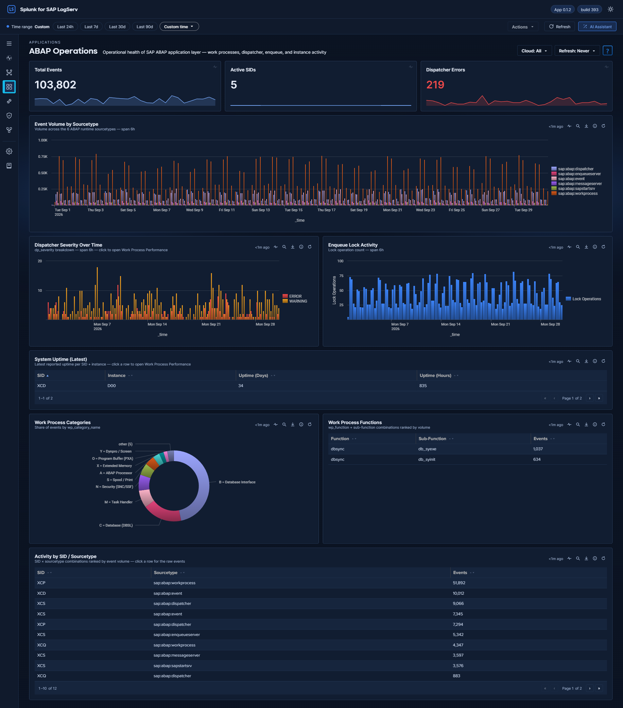

# ABAP Operations

SAP stopped delivering three of the six ABAP logs this dashboard reads through LogServ in April 2026: the work process, dispatcher and event logs. Their panels (Dispatcher Errors, Dispatcher Severity Over Time, System Uptime (Latest), Work Process Categories and Work Process Functions) show only data indexed before then, unless you have arranged continued collection with SAP. The enqueue server, message server and sapstartsrv logs keep arriving.

## :material-circle-box:{ .taiconcolor } Why This Dashboard Matters

The ABAP Operations dashboard provides runtime health monitoring for the SAP ABAP application layer. It covers the dispatcher (request routing), work processes (transaction execution), enqueue server (lock management), and system uptime. These components are the engine of every SAP ABAP system, and their health directly impacts user experience and business process execution.

## :material-circle-box:{ .taiconcolor } Requires

- **Sourcetypes:** `sap:abap:enqueueserver`, `sap:abap:messageserver`, `sap:abap:sapstartsrv`, and the three discontinued ones `sap:abap:workprocess`, `sap:abap:dispatcher` and `sap:abap:event` (LogServ folders `abap/<log>`). The Data TA assigns them at index time where the data is parsed; see [Supported Log Types](../../../getting-started/supported-log-types.md), which marks the discontinued log types.
- **Search-head add-ons:** none beyond the [LogServ App prerequisites](../../prerequisites.md).
- **Dashboard Data row:** **Work Process Performance / ABAP Operations** (one row serves both dashboards). Backfill it once after installing the App so the panels show history: 30 days by default, up to 365 days or a custom range. See [Backfilling on first install](../../dashboard-data.md#backfilling-on-first-install).

Upgrading from an earlier build? See [Upgrading](../../../getting-started/upgrading.md).

## :material-circle-box:{ .taiconcolor } Panels

Every panel reads the hourly summary, which adds each hour at minute :09 of the next hour, so on wide time ranges the panels can leave out up to about the last 70 minutes; ranges shorter than 90 minutes are answered from the raw events automatically. See [Dashboard Data](../../dashboard-data.md).

- **Total Events** -- Aggregate event count across all six ABAP runtime sourcetypes
- **Active SIDs** -- Count of distinct SAP System IDs reporting data
- **Dispatcher Errors** -- Count of ERROR/FATAL severity dispatcher events
- **Event Volume by Sourcetype** -- Trend over time across all six sourcetypes
- **Dispatcher Severity Over Time** -- Column chart of dispatcher log severity levels, one bar per level in each time bucket; click it to open [Work Process Performance](work-process-performance.md)
- **Enqueue Lock Activity** -- Timeline of lock management operations (enqueue server events)
- **System Uptime (Latest)** -- Table showing the most recent uptime in days and hours per SID/instance, from the event log; click a row to open Work Process Performance
- **Work Process Categories** -- Donut chart showing activity distribution across the SAP trace components of the work process trace: the letter that starts each `dev_w*` line (e.g., `B = Database Interface`, `C = Database (DBSL)`, `M = Task Handler`, `N = Security (SNC/SSF)`, `X = Extended Memory`). The donut uses the `wp_category_name` field populated by the app's `props.conf` EVAL, whose names follow SAP's list of trace components, so every mapped letter gets a name; unmapped letters render as `<letter> = Other`.
- **Work Process Functions** -- Table of `wp_function` + sub-function combinations ranked by event volume (events with no sub-function are not listed)
- **Activity by SID / Sourcetype** -- Table of SID × sourcetype combinations ranked by event volume; click a row to open the raw events in Search

## :material-lightning-bolt:{ .taiconcolor } What to Look For

- **Uptime resets** -- A system showing low uptime (hours instead of days) indicates a recent restart. Unexpected restarts may signal crashes, memory issues, or unplanned maintenance.
- **Dispatcher ERROR/FATAL increases** -- Rising error severity in the dispatcher can point at work process, connection or configuration problems before users report them. The Recent Dispatcher Errors table on [Work Process Performance](work-process-performance.md) lists the reasons.
- **Trace component shifts** -- A sudden change in the mix of work process trace components (for example many more `B = Database Interface` or `L = Background (Batch)` lines) shows which subsystem is writing more trace lines.
- **Enqueue lock spikes** -- A sharp increase in lock operations can indicate application deadlocks, long-running transactions holding locks, or database performance issues causing lock wait times to increase.
- **SID/instance imbalance** -- If one system or instance is generating significantly more events than its peers, investigate whether it's handling disproportionate load or experiencing issues.

## :material-circle-box:{ .taiconcolor } Related Dashboards

- [Work Process Performance](work-process-performance.md) -- the work process and dispatcher detail, from the same summary; opens from the Dispatcher Severity chart and the System Uptime table.
- [ABAP Network & Security](abap-security.md) -- the ICM and Gateway side of the same systems; its Activity by SID / Instance chart opens this dashboard.
- [Host Details](../platform/host-details.md) -- its **Data Freshness** table opens this dashboard from an `sap:abap:dispatcher`, `sap:abap:enqueueserver`, `sap:abap:event`, `sap:abap:messageserver` or `sap:abap:sapstartsrv` row.

??? info "Where the data comes from"
    Every panel is summary-backed. Panels read the `logserv_wp_perf_rollup` KV Store collection (metrics `wp`, `dp`, `abap`, `abap_wpfn`, `uptime`), which this dashboard **shares with Work Process Performance** — one hourly aggregation serves both. It is populated at minute :09 of every hour by `logserv_wp_perf_aggregate` from the six ABAP runtime sourcetypes (`sap:abap:dispatcher`, `sap:abap:enqueueserver`, `sap:abap:event`, `sap:abap:messageserver`, `sap:abap:sapstartsrv`, `sap:abap:workprocess`). The `uptime` metric stores a per-hour latest value, so the uptime panels show the most recent reading inside your selected window.

    Summary-backed panels switch automatically to their exact raw-equivalent search when the selected window is shorter than 90 minutes, so sub-hour investigation stays real-time. The collection keeps 365 days of hourly history (trimmed by a daily retention search). The **Cloud** picker in the title row filters every panel by `cloud_provider`; events with no `cloud_provider` value count as `aws`. Full schedule and freshness reference: [Dashboard Data](../../dashboard-data.md).
