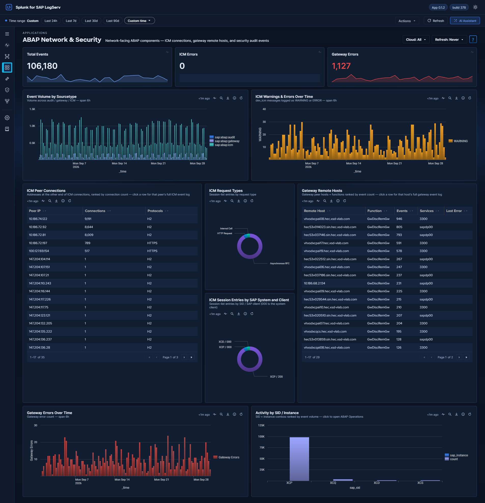

# ABAP Network & Security

## :material-circle-box:{ .taiconcolor } Why This Dashboard Matters

The ABAP Network & Security dashboard monitors the network-facing components of SAP ABAP systems. The Internet Communication Manager (ICM) handles all HTTP/HTTPS traffic into and out of ABAP, while the Gateway controls RFC connections between SAP systems. Together they carry the traffic that reaches ABAP systems over the network, so connection problems and unexpected peers show up in their logs.

## :material-circle-box:{ .taiconcolor } Requires

- **Sourcetypes:** `sap:abap:icm` (LogServ folder `abap/icm`), `sap:abap:gateway` (`abap/gateway`) and `sap:abap:audit` (`abap/audit`; it adds to the event counts only). The Data TA assigns them at index time where the data is parsed; see [Supported Log Types](../../../getting-started/supported-log-types.md).
- **Search-head add-ons:** none beyond the [LogServ App prerequisites](../../prerequisites.md).
- **Dashboard Data row:** **ABAP Network & Security**. Backfill it once after installing the App so the panels show history: 30 days by default, up to 365 days or a custom range. See [Backfilling on first install](../../dashboard-data.md#backfilling-on-first-install).

Upgrading from an earlier build? See [Upgrading](../../../getting-started/upgrading.md).

## :material-circle-box:{ .taiconcolor } Panels

Every panel reads the hourly summary, which adds each hour at minute :14 of the next hour, so on wide time ranges the panels can leave out up to about the last 75 minutes; ranges shorter than 90 minutes are answered from the raw events automatically. See [Dashboard Data](../../dashboard-data.md).

- **Total Events** -- Aggregate event count across the ICM, Gateway and Audit sourcetypes
- **ICM Errors** -- Count of `dev_icm` trace messages the ICM logged as `*** ERROR =>`
- **Gateway Errors** -- Count of Gateway events that carry an error detail
- **Event Volume by Sourcetype** -- Trend over time of each sourcetype
- **ICM Warnings & Errors Over Time** -- Column chart of the `dev_icm` trace messages logged as WARNING or ERROR, one bar per level in each time bucket
- **ICM Peer Connections** -- Table of the addresses at the other end of ICM connections — connections the ICM opened and connections clients opened to it — ranked by connection count, with the protocols seen; click a row for that peer's ICM events in Search
- **ICM Request Types** -- Donut chart of the ICM session-list entries by request type (asynchronous RFC, HTTP, internal)
- **ICM Session Entries by SAP System and Client** -- Donut chart of the ICM session-list entries by SAP system and client (`sap_sid` / `sap_client`; `000` is the system client). A client number belongs to its system, so the same client in two systems is two slices
- **Gateway Remote Hosts** -- Table of gateway peers by remote host and function, with event count, the services seen, and the most recent error detail for that host/function pair; click a row for that host's gateway events in Search
- **Gateway Errors Over Time** -- Timeline of gateway error events
- **Activity by SID / Instance** -- Column chart showing event distribution across SAP systems; click it to open [ABAP Operations](abap-operations.md)

!!! note "What the ICM trace records"
    The ICM trace (`dev_icm`) records sessions, connections and the ICM's own warning and error messages; it records no HTTP status code for individual requests. In a session-list line such as `ASYNC_RFC T229_U23835_M0, 200, BATCH_ALM, , time=10:35:59, ...` the three digits after the session ID are the SAP client, extracted as `sap_client`, followed by the user (`icm_user`) and the terminal (`icm_terminal`).

## :material-lightning-bolt:{ .taiconcolor } What to Look For

- **ICM errors and warnings** -- A burst of ICM ERROR messages (for example failed TLS handshakes or connections) or of warnings such as connections a client closed prematurely can point to front-end, network or certificate problems. Open the raw `dev_icm` lines for the message text.
- **Unexpected SAP clients** -- Sessions in a client you do not expect for that system — one that is not in use, or business-user activity in the system client `000` — warrant a closer look. System users such as `SAPSYS` in client `000` are normal.
- **Unfamiliar peer IPs** -- New IP addresses appearing in the ICM Peer Connections table warrant investigation, especially if they account for many connections or use unusual protocols.
- **Gateway connections from unknown hosts** -- The Gateway Remote Hosts table should show expected RFC partners. Unknown remote hosts or unusual service names may indicate unauthorized access attempts.
- **Error rate trends** -- A gradually increasing error rate across days can signal infrastructure degradation (disk space, memory pressure, certificate expiry) before it becomes an outage.

## :material-circle-box:{ .taiconcolor } Related Dashboards

- [ABAP Operations](abap-operations.md) -- the runtime side of the same ABAP systems; opens from the Activity by SID / Instance chart.
- [Work Process Performance](work-process-performance.md) -- its Async RFC Queue Depth panels read the same ICM log.
- [Environment Health](../environment-health.md) -- its **ICM Warnings & Errors** and **ABAP Error Trend** panels open this dashboard.
- [Host Details](../platform/host-details.md) -- its **Data Freshness** table opens this dashboard from an `sap:abap:icm`, `sap:abap:gateway` or `sap:abap:audit` row.

??? info "Where the data comes from"
    Every panel is summary-backed — there are no live raw scans. Panels read the `logserv_abapnet_rollup` KV Store collection (metrics `vol`, `icmsev`, `icmclient`, `icmreq`, `icmpeer`, `icmerr`, `gwhost`, `gwlatest`), populated at minute :14 of every hour by `logserv_abapnet_aggregate` from three sourcetypes:

    | Source | What it contributes |
    |---|---|
    | `sap:abap:gateway` | RFC-side facts — remote hosts, functions, services, and the latest gateway error detail per host/function |
    | `sap:abap:icm` | ICM facts from the `dev_icm` trace — event volume, the ICM's warning and error messages, session-list entries by request type and by SAP system and client, and connection peers and protocols |
    | `sap:abap:audit` | Event volume only (Total Events, Event Volume by Sourcetype, Activity by SID / Instance) |

    Summary-backed panels switch automatically to their exact raw-equivalent search when the selected window is shorter than 90 minutes, so sub-hour investigation stays real-time. The collection keeps 365 days of hourly history (trimmed by a daily retention search). The **Cloud** picker in the title row filters every panel by `cloud_provider`; events with no `cloud_provider` value count as `aws`. Full schedule and freshness reference: [Dashboard Data](../../dashboard-data.md).
