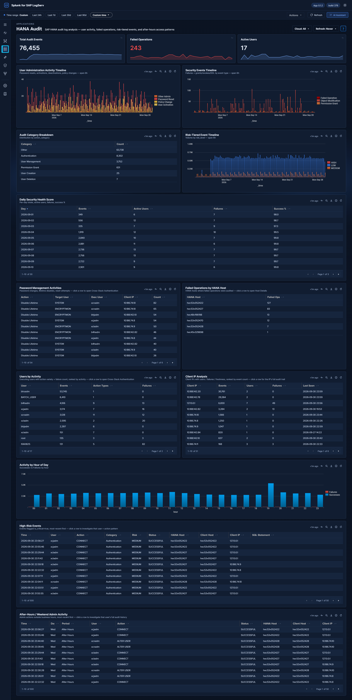

# HANA Audit

## :material-circle-box:{ .taiconcolor } Why This Dashboard Matters

The HANA Audit dashboard supports database security compliance and threat detection. SAP HANA stores the most sensitive business data in the SAP landscape, and it writes an audit record for each action its audit policies cover, such as logons, user and privilege changes, and administrative actions. This dashboard summarizes the audit trail for both real-time threat detection and compliance reporting.

## :material-circle-box:{ .taiconcolor } Requires

- **Sourcetypes:** `sap:hana:audit` (LogServ folder `hana/hanaaudit`). The Data TA assigns it at index time where the data is parsed; see [Supported Log Types](../../../getting-started/supported-log-types.md).
- **Search-head add-ons:** none beyond the [LogServ App prerequisites](../../prerequisites.md).
- **Dashboard Data row:** **HANA Audit**. Backfill it once after installing the App so the panels show history: 30 days by default, up to 365 days or a custom range. See [Backfilling on first install](../../dashboard-data.md#backfilling-on-first-install).

Upgrading from an earlier build? See [Upgrading](../../../getting-started/upgrading.md).

## :material-circle-box:{ .taiconcolor } Panels

Most panels read the hourly summary, which adds each hour at minute :11 of the next hour, so on wide time ranges they can leave out up to about the last 75 minutes; the High-Risk Events and After-Hours tables always read raw events, and any range shorter than 90 minutes is answered from raw events automatically. See [Dashboard Data](../../dashboard-data.md).

- **Total Audit Events** -- Aggregate count of HANA audit log entries
- **Failed Operations** -- Count of audit events with non-successful status
- **Active Users** -- Count of distinct users generating audit activity
- **User Administration Activity Timeline** -- Tracks user administration actions (password resets, activations, deactivations) over time
- **Daily Security Health Score** -- Full-width table with one row per day: total events, active users, failures, and success rate (%), newest day first
- **Audit Category Breakdown** -- Table of audit event categories (`action_category`) with event counts
- **Security Events Timeline** -- Shows failed operations, object modifications (CREATE / DROP), permission grants and permission revokes
- **Password Management Activities** -- Table of password-related audit events with user and IP details, classified as Password Change, Disable Lifetime, Reset Attempts or Other in any letter case; click a row to open Cross-Stack Authentication
- **Failed Operations by HANA Host** -- Table showing which HANA hosts recorded the most failed operations: the host that wrote the audit record, not the client that connected; click a row to open Host Details for that host
- **Users by Activity** -- Table ranking executing users by event count, with the number of distinct action types and failure count; click a row to open Cross-Stack Authentication
- **Activity by Hour of Day** -- Column chart showing successes vs. failures by hour for after-hours detection
- **Client IP Analysis** -- Table of connecting IPs with user counts, failures, and last-seen time; click a row for that IP's audit events in Search
- **Risk-Tiered Event Timeline** -- Column chart of events over time by `risk_level` (HIGH / MEDIUM / LOW), one bar per tier, so severe events never get hidden inside overall volume
- **After-Hours / Weekend Admin Activity** -- Table of admin activity (`is_admin_user=true`) falling outside business hours (weekday 08:00-18:59) or on a weekend, surfacing privileged activity outside normal windows; the Period column labels each row Weekend, After Hours, or Weekend / After Hours. The **HANA Host** and **Client Host** columns show the HANA host that wrote the record and the host name of the client that ran the action. Click a row to drill down by user and HANA host
- **High-Risk Events** -- Full-width table filtered to `is_critical=true`, showing up to the 500 most recent critical audit events with time, user, action, category, risk, status, HANA host, client host, client IP, and SQL statement; click a row to drill down by user

!!! note "Which host is which"
    Every audit record names two machines: the HANA host that wrote it and the client that ran the action. In this App, `host` on `sap:hana:audit` events is the HANA host — the LogServ host that delivered the record, as the index stores it for the event. The client's host name (the record's *Client Name* field) is `src_host`, beside `src_ip` (the client IP, also `client_ip`) and `dest_host` (the database host the record names). The **HANA Host** columns read `host` and the **Client Host** columns read `src_host`; a record that names no client leaves its Client Host and Client IP cells empty.

## :material-lightning-bolt:{ .taiconcolor } What to Look For

- **Failed operations from unusual IPs** -- Authentication failures from IP addresses not in your expected range may indicate brute-force attacks or credential stuffing attempts.
- **Privileged actions from an unexpected client host** -- The High-Risk Events and After-Hours / Weekend Admin Activity tables name both the HANA host and the client host. An administrative action run from a machine that does not normally administer that database is worth a check against your change records.
- **Critical events in the High-Risk Events table** -- The table lists the audit events written at the CRITICAL audit level, and each row warrants a look. The Action and Status columns show what was done and whether it failed; the SQL Statement column shows the statement when it is a user or privilege change (ALTER, CREATE or DROP USER, GRANT, REVOKE).
- **After-hours privileged activity** -- The After-Hours / Weekend Admin Activity table surfaces admin operations outside business hours; correlate with change management records to separate planned maintenance from suspicious activity.
- **Risk-tier shifts over time** -- HIGH counts every failed operation, plus user and privilege changes that target the `SYSTEM` user, so a rising HIGH series in the Risk-Tiered Event Timeline usually means more failures: check Failed Operations by HANA Host and Client IP Analysis. MEDIUM counts successful logons audited at the CRITICAL level and the other User Administration events, so a sudden spike there points at a burst of such logons or user changes, for example from a script.
- **Privilege escalation patterns** -- Watch for sequences where a user's privileges are modified followed by unusual data access patterns. The Security Events Timeline surfaces GRANT and REVOKE operations.
- **Declining security health score** -- A downward trend in the daily success rate or an increase in failures can signal growing security issues that need investigation.
- **Password management anomalies** -- Bulk password resets or resets for service accounts should be correlated with change management records.

## :material-circle-box:{ .taiconcolor } Related Dashboards

- [Cross-Stack Authentication](../security/cross-stack-authentication.md) -- HANA authentication beside SAP and Windows; opens from a row of Users by Activity or Password Management Activities.
- [Change & Configuration Activity](../security/change-config.md) -- HANA user, role, privilege and DDL changes beside the Windows and Linux change trails.
- [Host Details](../platform/host-details.md) -- opens from a row of Failed Operations by HANA Host.
- [Environment Health](../environment-health.md) -- its **HANA Failed Ops** card and **HANA Error Trend** chart open this dashboard.
- [HANA Trace](hana-trace.md) -- the database engine's own trace output.

??? info "Where the data comes from"
    The single source is `sap:hana:audit`. The action status and target principal are read from their fixed positions in the audit record, so every action has them. The SQL Statement column shows user and privilege management statements, in any letter case and also when the record quotes them; quoted identifiers read as in the database — `grant "ROLE" to USER` — without the JSON escapes real ingest keeps.

    - **Summary-backed panels** — the KPIs, category/action/user/client breakdowns and the compliance timelines read the `logserv_hana_category_rollup` KV Store collection: metric `main` carries an hourly grain over (executing user, client IP, status, HANA host, action type), and metrics `useradmin`, `security` and `password` pre-compute the three classified activity timelines. Populated at minute :11 of every hour by `logserv_hana_aggregate`.
    - **Live panels** — the High-Risk Events and After-Hours / Weekend Admin Activity tables are per-event listings dispatched against the raw audit events at view time (capped at the 500 most recent matches each) — deliberately raw, so a compliance reviewer sees the actual event rows.

    Summary-backed panels switch automatically to their exact raw-equivalent search when the selected window is shorter than 90 minutes, so sub-hour investigation stays real-time. The collection keeps 365 days of hourly history (trimmed by a daily retention search). The **Cloud** picker in the title row filters every panel by `cloud_provider`; events with no `cloud_provider` value count as `aws`. Full schedule and freshness reference: [Dashboard Data](../../dashboard-data.md).
