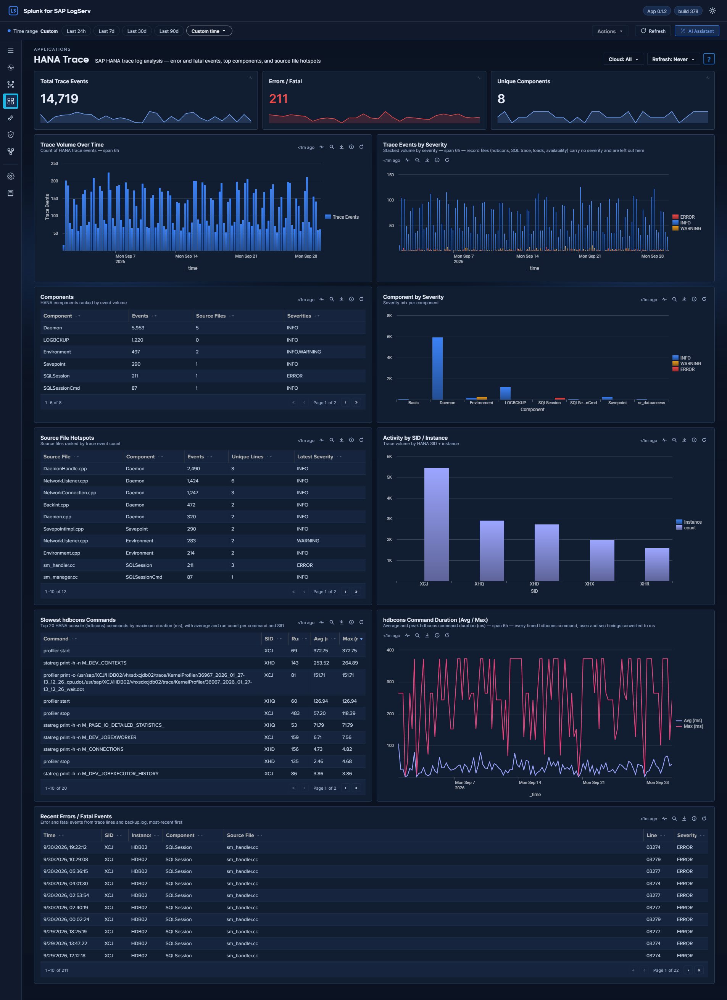

# HANA Trace

## :material-circle-box:{ .taiconcolor } Why This Dashboard Matters

The HANA Trace dashboard provides visibility into SAP HANA's internal diagnostic trace system. Unlike audit logs that capture user actions, trace logs capture what the database engine itself is doing: memory management, query compilation, I/O operations, and internal errors. Use it to diagnose HANA performance issues, stability problems and the root cause of database outages.

## :material-circle-box:{ .taiconcolor } Requires

- **Sourcetypes:** `sap:hana:tracelogs` (LogServ folder `hana/tracelogs`, or the HANA trace directory's source path when the data arrives without folder fields). The Data TA assigns it at index time where the data is parsed; see [SAP HANA Trace Logs](../../../getting-started/supported-log-types.md#sap-hana-trace-logs-logserv-app).
- **Search-head add-ons:** none beyond the [LogServ App prerequisites](../../prerequisites.md).
- **Dashboard Data row:** **HANA Trace**. Backfill it once after installing the App so the panels show history: 30 days by default, up to 365 days or a custom range. See [Backfilling on first install](../../dashboard-data.md#backfilling-on-first-install).

Upgrading from an earlier build? See [Upgrading](../../../getting-started/upgrading.md).

## :material-circle-box:{ .taiconcolor } Panels

Every panel except Recent Errors / Fatal Events reads the hourly summary, which adds each hour at minute :19 of the next hour, so on wide time ranges the panels can leave out up to about the last 80 minutes; ranges shorter than 90 minutes are answered from raw events automatically. See [Dashboard Data](../../dashboard-data.md).

- **Total Trace Events** -- Aggregate count of trace log entries
- **Errors / Fatal** -- Count of error and fatal events: trace lines at level `e` or `f`, and `backup.log` entries at ERROR or FATAL
- **Unique Components** -- Number of distinct HANA components generating traces, with the same noise filter as the Components table, so the count matches its rows
- **Trace Volume Over Time** -- Trend of total trace events over time
- **Trace Events by Severity** -- Column chart showing the severity mix of trace lines and `backup.log` entries, one bar per severity in each time bucket: INFO, WARNING, ERROR and FATAL, plus DEBUG where present and UNKNOWN for lines that carry no level, such as the continuation lines of a multi-line entry. Record files -- the `hdbcons` command timings, SQL trace (`*_statements.N.trc`), load traces and system availability -- carry no severity: they are left out of this chart and of Component by Severity, and still count in Total Trace Events, Trace Volume Over Time and Activity by SID / Instance (the `hdbcons` timings also feed the two duration panels). The chart's subtitle says it leaves them out
- **Components** -- Table of HANA components ranked by event volume, with distinct source-file count and the severities seen; click a row for that component's raw trace events (parsing artefacts -- very short names and values such as `INFO`, `of`, `service:` -- are filtered out). `backup.log` entries appear under their own component, for example `LOGBCKUP`
- **Component by Severity** -- Column chart showing the severity mix per component, one bar per severity (same noise filter applied)
- **Source File Hotspots** -- Table identifying specific source files generating the most trace entries (same noise filter applied); click a row for that file's raw trace events
- **Activity by SID / Instance** -- Event distribution across HANA systems
- **Slowest hdbcons Commands** -- Table of the top 20 HANA console (`hdbcons`) commands ranked by maximum duration (ms), with average duration and run count per command and SID. These are the commands the `hdbcons` trace times (for example `profiler stop`, `statreg print` or `replication info`), not SQL statements. The trace times each command in microseconds, milliseconds or seconds; all three are converted to ms. (Reads the hourly rollup layer; the per-event time/host columns are not retained at the aggregate grain -- use the Recent Errors / Fatal Events table or the Search app for individual events.)
- **hdbcons Command Duration (Avg / Max)** -- Average and peak `hdbcons` command duration (ms) over time, across every timed `hdbcons` command whatever unit the trace used
- **Recent Errors / Fatal Events** -- Table of the latest error and fatal events (up to 500) with component and source location; `backup.log` entries have a component but no source file or line. Click a row for that SID's and component's error events in Search

## :material-lightning-bolt:{ .taiconcolor } What to Look For

- **Error/fatal severity spikes** -- A sudden increase in error-level traces can come before a HANA outage or performance degradation. Investigate the component and source file generating the errors.
- **Single component dominance** -- If one component suddenly generates significantly more traces than usual, it may indicate a runaway process, memory leak, or infinite loop within that subsystem.
- **New source files appearing** -- Trace entries from source files not seen before may indicate recently applied patches or code changes that are generating unexpected behavior.
- **SID/instance imbalance** -- Uneven trace volumes across instances of the same HANA system may indicate hardware issues, unbalanced workload distribution, or replication problems.
- **Persistent warning trends** -- Warnings that gradually increase over days can signal resource exhaustion (disk space, memory pools) that will eventually escalate to errors.

## :material-circle-box:{ .taiconcolor } Related Dashboards

- [HANA Audit](hana-audit.md) -- who did what in the same databases.
- [Environment Topology](../topology.md) -- draws HANA Tenant edges from these traces; an edge's Performance tab shows its `hdbcons` command durations and its Operations tab its trace components.
- [Host Details](../platform/host-details.md) -- its **Data Freshness** table opens this dashboard from an `sap:hana:tracelogs` row.

??? info "Where the data comes from"
    The single source is `sap:hana:tracelogs`. Each line is read by its own format:

    - **Trace lines** -- `[pid]{connection}[transaction/update] date time level component file(line) : text` -- give the level, component, source file and line. Only a line that starts this way is read as one, so text further along a line is never taken for a level or a component.
    - **`backup.log` lines** -- `time  P<pid>  <thread>  LEVEL  COMPONENT  text` -- give their level (INFO, WARNING, ERROR, FATAL) and component, for example `LOGBCKUP`.
    - **`hdbcons` lines** give the command and its duration, converted to ms (`hana_op`, `hana_op_duration_ms`).
    - **Record files** (`hdbcons`, SQL trace, load traces, system availability) carry no severity.

    The `hana_trace_file_type` field names the kind of file each event comes from -- `trace`, `alert`, `backup`, `hdbcons`, `sql_trace`, `load_trace`, `availability` or `other` -- for your own searches; no panel groups by it.

    - **Summary-backed panels** — volume, severity and component panels read metric `main` of the `logserv_hana_trace_rollup` KV Store collection; the `hdbcons` duration panels read metrics `dur` (per-hour duration sums/counts/maxima in ms — the Avg + Max charts reconstruct exact averages from these) and `durop` (the same, per command and SID — the Slowest hdbcons Commands table ranks by stored Max/Avg). Populated at minute :19 of every hour by `logserv_hana_trace_aggregate`.
    - **Recent Errors / Fatal Events** is a live event listing dispatched against the raw trace events at view time, capped at the 500 most recent error/fatal entries.

    Summary-backed panels switch automatically to their exact raw-equivalent search when the selected window is shorter than 90 minutes, so sub-hour investigation stays real-time. The collection keeps 365 days of hourly history (trimmed by a daily retention search). The **Cloud** picker in the title row filters every panel by `cloud_provider`; events with no `cloud_provider` value count as `aws`. Full schedule and freshness reference: [Dashboard Data](../../dashboard-data.md).
