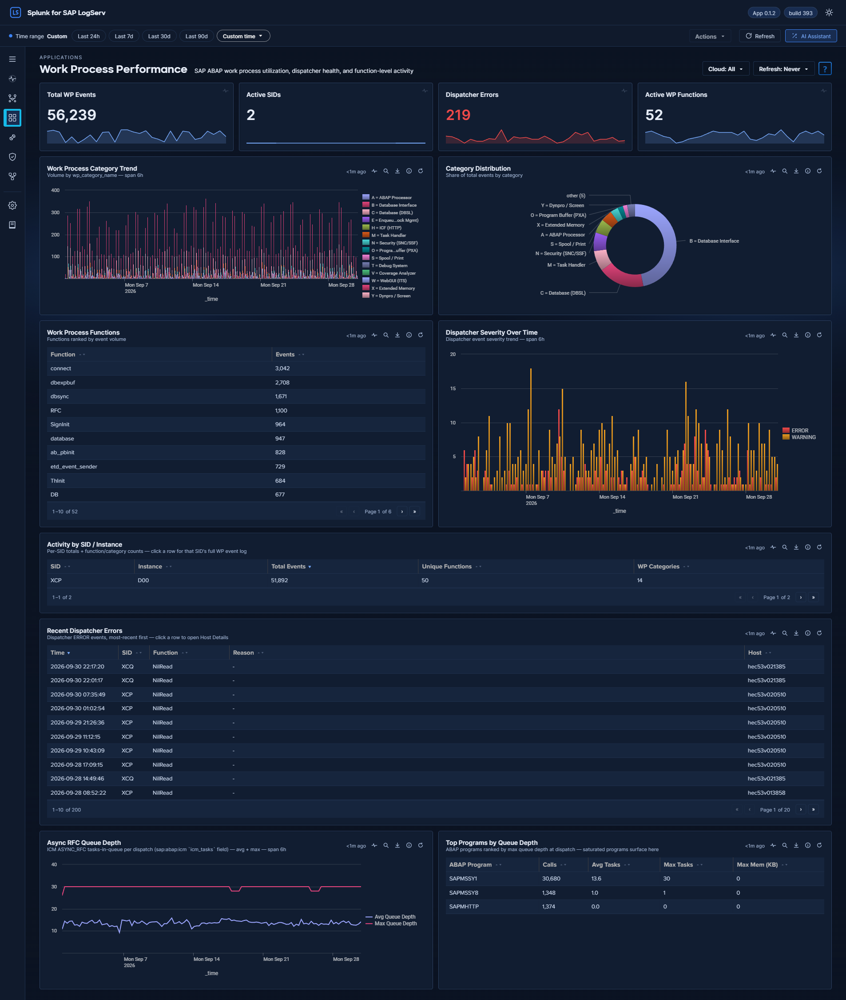

# Work Process Performance

SAP stopped delivering the ABAP work process and dispatcher logs through LogServ in April 2026. Every panel here except Async RFC Queue Depth and Top Programs by Queue Depth therefore shows only data indexed before then, unless you have arranged continued collection with SAP. Those two panels read the ICM log, which keeps arriving.

## :material-circle-box:{ .taiconcolor } Why This Dashboard Matters

Work Process Performance focuses specifically on the ABAP work process layer: the finite pool of processes that execute every dialog request, background job, and RFC call. When all work processes of a type are busy, new requests have to wait for one to become free. Each work process writes its trace lines under SAP's trace components — the letter at the start of each `dev_w*` line, such as `B = Database Interface`, `X = Extended Memory` or `R = Rolling` — so a shift in the mix shows which subsystem is writing more: more `B` and `C` lines point at the database layers, more `X` and `R` lines at extended memory and rolling. This dashboard breaks activity down by those trace components so you can look at the right subsystem first.

## :material-circle-box:{ .taiconcolor } Requires

- **Sourcetypes:** `sap:abap:workprocess` and `sap:abap:dispatcher` (both discontinued), and `sap:abap:icm` for the two Async RFC queue panels (LogServ folders `abap/workprocess`, `abap/dispatcher`, `abap/icm`). The Data TA assigns them at index time where the data is parsed; see [Supported Log Types](../../../getting-started/supported-log-types.md), which marks the discontinued log types.
- **Search-head add-ons:** none beyond the [LogServ App prerequisites](../../prerequisites.md).
- **Dashboard Data row:** **Work Process Performance / ABAP Operations** (one row serves both dashboards). Backfill it once after installing the App so the panels show history: 30 days by default, up to 365 days or a custom range. See [Backfilling on first install](../../dashboard-data.md#backfilling-on-first-install).

Upgrading from an earlier build? See [Upgrading](../../../getting-started/upgrading.md).

## :material-circle-box:{ .taiconcolor } Panels

All panels except Recent Dispatcher Errors read the hourly summary, which adds each hour at minute :09 of the next hour, so on wide time ranges they can leave out up to about the last 70 minutes; ranges shorter than 90 minutes are answered from the raw events automatically. See [Dashboard Data](../../dashboard-data.md).

- **Total WP Events** -- Aggregate `sap:abap:workprocess` event count
- **Active SIDs** -- Count of distinct SAP System IDs reporting work process data
- **Dispatcher Errors** -- Count of dispatcher events with severity ERROR
- **Active WP Functions** -- Count of distinct work process function codes observed
- **Work Process Category Trend** -- Column chart showing activity over time by trace component, with the named codes of the shared `wp_category_name` field (for example `C = Database (DBSL)`)
- **Category Distribution** -- Donut chart showing the overall trace-component mix across the time range (same names)
- **Work Process Functions** -- Table of work process functions (`wp_function`, the first word after the trace-component letter of each trace line) ranked by event volume
- **Dispatcher Severity Over Time** -- Column chart of dispatcher severity levels over time, one bar per level in each time bucket
- **Activity by SID / Instance** -- Table ranking each SAP system/instance by event count, with its number of distinct functions and trace components; click a row for that SID's work process events in Search
- **Recent Dispatcher Errors** -- Table of the most recent dispatcher ERROR events (up to 200) with SID, function, reason, and host; click a row to open Host Details for that host. This panel always reads raw events.
- **Async RFC Queue Depth** -- Average and peak ICM `ASYNC_RFC` tasks-in-queue per dispatch over time (from `sap:abap:icm`)
- **Top Programs by Queue Depth** -- Table of the 20 ABAP programs with the highest ICM queue depth at dispatch (Max Tasks), with call count, average tasks and peak memory (KB)

## :material-lightning-bolt:{ .taiconcolor } What to Look For

- **Trace component dominance** -- If a single trace component (e.g., `B = Database Interface` or `C = Database (DBSL)`, the two database layers, or `X = Extended Memory`) dominates the Category Distribution donut when it historically didn't, that subsystem may be a bottleneck. For the database layers, check [HANA Trace](hana-trace.md); for memory, the OOM Kills panels of [Linux](../platform/linux.md) show the operating-system side.
- **Trend shifts between trace components** -- A gradual increase in `C = Database (DBSL)` lines, the database client layer, can point at trouble between the ABAP server and its database. `N = Security (SNC/SSF)` lines come from secure network communication and digital signatures, and `E = Enqueue (Lock Mgmt)` lines from lock handling, so a rise in either points at that area.
- **Dispatcher error bursts** -- Spikes of ERROR in the Dispatcher Severity Over Time chart can go with work process problems. Compare them with the Work Process Category Trend to see which trace components rose at the same time, and read the reasons in Recent Dispatcher Errors.
- **Instance imbalance** -- If one instance's WP activity is an order of magnitude higher than its peers in the Activity by SID/Instance table, investigate whether that instance is handling disproportionate load or experiencing a local issue.
- **Function hotspots** -- The Work Process Functions table ranks the first word after the trace-component letter of each trace line, often the name of the kernel routine that wrote it (for example `ThrtSetEgUsageSizes` or `dbsync`), by the number of lines. A routine that suddenly leads the table shows which code path is writing more trace lines.
- **Async RFC backlog** -- A rising Max Queue Depth line in Async RFC Queue Depth, or one program far ahead in Top Programs by Queue Depth, can mean asynchronous RFC work is queuing up at the ICM.

## :material-circle-box:{ .taiconcolor } Related Dashboards

- [ABAP Operations](abap-operations.md) -- dispatcher, enqueue and uptime health from the same summary; its Dispatcher Severity chart and System Uptime table open this dashboard.
- [ABAP Network & Security](abap-security.md) -- the ICM and Gateway activity of the same systems.
- [Host Details](../platform/host-details.md) -- opens from a row of Recent Dispatcher Errors; its **Data Freshness** table opens this dashboard from an `sap:abap:workprocess` row.

??? info "Where the data comes from"
    - **Summary-backed panels** — the work-process, dispatcher and ICM panels read the `logserv_wp_perf_rollup` KV Store collection (metrics `wp`, `dp`, `icm`), which this dashboard **shares with ABAP Operations**. Populated at minute :09 of every hour by `logserv_wp_perf_aggregate` from `sap:abap:workprocess` (work-process function/category mix), `sap:abap:dispatcher` (severity counts) and `sap:abap:icm` (per-program call/task/memory aggregates — sums and maxima are stored so averages reconstruct exactly).
    - **Recent Dispatcher Errors** is a live event listing: it dispatches directly against the raw `sap:abap:dispatcher` events at view time, capped at the 200 most recent ERROR events.

    Summary-backed panels switch automatically to their exact raw-equivalent search when the selected window is shorter than 90 minutes, so sub-hour investigation stays real-time. The collection keeps 365 days of hourly history (trimmed by a daily retention search). The **Cloud** picker in the title row filters every panel by `cloud_provider`; events with no `cloud_provider` value count as `aws`. Full schedule and freshness reference: [Dashboard Data](../../dashboard-data.md).
