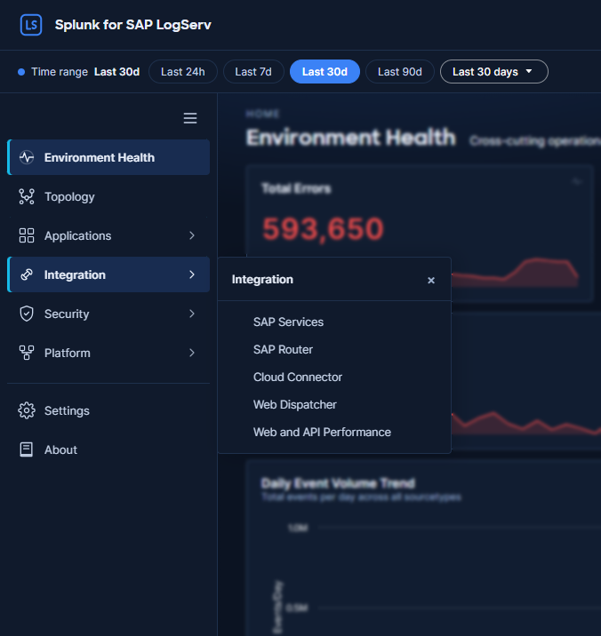
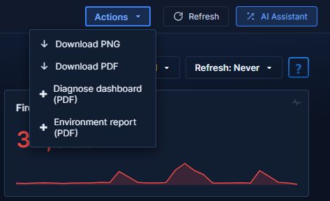

# Dashboards Overview

The LogServ App's dashboards are organized as in the App itself: one landing page, the **Environment Topology** view, and four groups (Applications, Integration, Security, Platform). This page lists them and describes the controls every dashboard shares. The App is built on `@splunk/react-ui` + `@splunk/visualizations` + `@xyflow/react`, ships as a single React bundle, and requires Splunk 9.4.3 or later.

## :material-circle-box:{ .taiconcolor } Navigation rail and header

The navigation rail on the left holds, in this order:

**Environment Health** (default landing) · **Topology** · **Applications ›** · **Integration ›** · **Security ›** · **Platform ›** · **Settings** (admin-tier roles only) · **About**

Each of the four groups opens a flyout beside the rail that lists its dashboards, with a ✓ on the one you are viewing. The button at the top of the rail collapses it to a 56 px strip of icons; the choice is remembered per user in the browser.

The header's first row carries the product name, the **App** version and **build** pills (on windows wider than 900 px) and the light/dark theme toggle. Its second row carries the global time range (the **Last 24h / 7d / 30d / 90d** pills and Splunk's own time-range picker) and, on the right, **Actions ▾** · **Refresh** · **AI Assistant** (when enabled).

## :material-circle-box:{ .taiconcolor } Dashboards

| Dashboard or group | What it covers |
|---|---|
| [Environment Health](environment-health.md) | Cross-cutting operations view of errors, security failures and performance across the whole SAP landscape. The default landing page. Reads all sourcetypes. |
| [Environment Topology](topology.md) | Interactive graph of SAP systems, integration partners and endpoints, built from `sap:abap:gateway`, `sap:abap:icm`, `sap:saprouter`, `sap:hana:audit`, `sap:hana:tracelogs` and `sap:webdispatcher:access`, with IP-node names also from `XmlWinEventLog`, `sap:sapstartsrv`, `linux_secure` and `linux_messages_syslog`. Refreshed hourly from KV Store (the IP-node names once a day); named layouts saved per user. |
| [Applications](applications/index.md) | The SAP application runtime: ABAP Network & Security, ABAP Operations, Work Process Performance, HANA Audit, HANA Trace. |
| [Integration](integration/index.md) | How SAP connects to other systems: SAP Services, SAP Router, Cloud Connector, Web Dispatcher, Web and API Performance. |
| [Security](security/index.md) | Cross-source security and compliance views: Network Perimeter, Cross-Stack Authentication, Change & Configuration Activity. |
| [Platform](platform/index.md) | The infrastructure and ingest underneath SAP: Data Pipeline Overview, DNS Analytics, Linux, Windows, Proxy, Host Details, Multi-Cloud Overview, and the Data Doctor's Diagnostics page. |

Each group page lists its dashboards with their purpose and key data sources.

## :material-circle-box:{ .taiconcolor } Common dashboard controls

### :material-lightning-bolt:{ .taiconcolor } Time range

The selected time range is held app-wide: it follows you when you move between dashboards. Drill-downs carry it to their destination (see [Click-Through Drilldowns](#click-through-drilldowns)).

### :material-lightning-bolt:{ .taiconcolor } Cloud filter

Every dashboard except Multi-Cloud Overview, Environment Topology, Diagnostics and Settings carries a **Cloud** filter (the button reads **Cloud: All**; options `All / aws / azure / gcp`) in its title row, to the left of the auto-refresh picker. Choosing a provider filters **every panel** on the dashboard to that cloud. The choice is **global and remembered per user in this browser**, so it carries across dashboard navigation and page reloads. Leave it on **All** to see the whole estate. Events with no cloud attribution are counted as `aws`, matching the Multi-Cloud Overview convention.

### :material-lightning-bolt:{ .taiconcolor } Per-dashboard auto-refresh

Each dashboard's title row carries a **Refresh** picker (Never / 30s / 1m / 5m / 15m / 30m / 1hr), to the right of the **Cloud** filter. The selection is per user and per dashboard: your choice on Environment Health doesn't carry over to HANA Audit. It persists across browser sessions in Splunk KV Store. The Diagnostics page has no auto-refresh picker; it re-runs its checks on demand.

### :material-lightning-bolt:{ .taiconcolor } Refresh the current view on demand

The header's second row carries a **Refresh** button, between the **Actions** menu and the AI Assistant button. Clicking it re-runs **every panel on the dashboard you're currently viewing** for the selected time range. It is distinct from the per-dashboard auto-refresh picker above (which re-runs on a timer) and from each panel's own **Refresh** toolbar action (which re-runs a single panel). Because it lives in the app-wide header, it's available on every dashboard and on the Environment Topology view. On the Environment Topology view it re-runs the detail searches; the graph itself re-reads only from the view's own toolbar **Refresh** button.

### :material-lightning-bolt:{ .taiconcolor } In-dashboard help: the ? icon

Every dashboard's title row ends with a blue rotating **?** help icon. Clicking it opens this online documentation in a new browser tab, at the page for the dashboard you're looking at. For multi-tab dashboards (Data Pipeline Overview and Host Details) the icon is present on every tab and always links to the same dashboard's page.

### :material-lightning-bolt:{ .taiconcolor } Per-panel toolbar

Every chart and table panel header carries a small action toolbar plus a "&lt;1m ago" stamp showing when the panel's search last ran:

| Action | What it does |
|---|---|
| **Diagnose** | Runs the Data Doctor's checks on this panel and opens the diagnosis drawer — explains why the panel is empty or partially blank ([Data Doctor](platform/diagnostics.md)). |
| **Open in Search** | Opens Splunk's Search app in a new tab with the panel's dispatched query and the current time range pre-applied (the rollup read for a cached panel; the raw query at sub-hour ranges). |
| **Download (CSV)** | Exports the panel's current result set as CSV. |
| **Inspect** | Opens Splunk's Job Inspector for the panel's last search — useful for diagnosing performance or verifying what ran. |
| **Refresh** | Re-runs the panel's search immediately. |

KPI single-value cards show the loading spinner and a corner **Diagnose** button (revealed on hover or keyboard focus) but no full toolbar — they have no tabular result to export or inspect. While any panel's search is in flight it renders a dot-ring loading spinner with "Loading data…".

### :material-lightning-bolt:{ .taiconcolor } Dashboard Export (Actions Menu)

The header's **Actions** menu includes **Download PNG** and **Download PDF**. Both captures use `html2canvas` to render the full dashboard DOM (including off-screen content), so the saved output always covers the entire dashboard length — not just what's visible in the viewport. Useful for sharing in slide decks, embedding in incident reports, or capturing a dashboard's state at a specific moment for compliance evidence. The same menu carries the two [Data Doctor](platform/diagnostics.md) reports — **Diagnose dashboard (PDF)** and **Environment report (PDF)**.

### :material-lightning-bolt:{ .taiconcolor } Which build am I running? The About dialog

The **About** item at the bottom of the navigation rail opens a dialog showing the app icon, the product name, and the **version**, **build number** and **build date** (UTC) of the app you are running. Use it to confirm an upgrade landed, or to quote the exact build when reporting an issue. The values are read from the app's own `app.conf` at build time (the date is stamped as the bundle is compiled), so they always match the installed bundle. The header's **App** and **build** pills show the same version and build number at a glance.

### :material-lightning-bolt:{ .taiconcolor } Searching LogServ data

All dashboards use the `sap_logserv_idx_macro` macro to query the LogServ index. You can use this same macro in your own searches: `` `sap_logserv_idx_macro` | stats count by sourcetype ``. Some App builds change search-time fields that your own searches may read; when you upgrade, check [Upgrading to This Release](../../getting-started/upgrading.md).

### :material-lightning-bolt:{ .taiconcolor } Performance and data freshness

The dashboards are tuned to stay fast at high event volume: most panels read from an hourly KV-Store rollup layer rather than scanning raw events on every open. After installing on an index that already holds history, an admin runs a one-time backfill. See [Dashboard Data: Backfill and Freshness](../dashboard-data.md) for how each panel sources its data, what "hourly fresh" means, and the backfill step.

---

## :material-circle-box:{ .taiconcolor } Visual Style

All dashboards share a consistent framed-card visual language, built on Cisco's Magnetic design tokens, so that patterns are easy to recognize as you move between views. The app ships **light and dark modes** — toggled via the sun/moon button at the right end of the header, persisted per user — and every color is a mode-resolved design token rather than a fixed hex:

- **Page background** with slightly lighter **panel cards** outlined by a muted border token — each visualization sits inside its own framed card with consistent spacing
- **KPI typography** — large numeric headline with a small muted label; number color carries semantic meaning (white for neutral counts, red for errors/failures/denials, orange for warnings, teal for healthy/positive signals)
- **Standard colors** — a single semantic red token is used across all error/failure signals so that "red means something went wrong" is unambiguous in both modes
- **Tables** use a fixed header row with alternating row striping; clickable cells are highlighted in the accent color to indicate a drilldown affordance
- **Charts** strip non-essential ink (no axis titles, no data labels, no progress bars) so the data shape is what your eye lands on

The implementation uses styled-components on top of `@splunk/react-ui` primitives.

### :material-lightning-bolt:{ .taiconcolor } KPI Sparklines

Most KPI panels display a small inline **sparkline** directly below the headline number. The sparkline visualizes the daily trend across the dashboard's current time range, so you get both the cumulative total and the shape of how that total accumulated in a single glance. There is no separate "up/down by N" trend value — the sparkline alone carries the trend signal.

Sparklines come in a few flavors depending on what the KPI measures:

- **Count-based KPIs** (e.g., Total Events, Auth Failures) — sparkline shows daily event count
- **Distinct-count KPIs** (e.g., Active Hosts, Unique Components) — sparkline shows daily distinct count
- **Rate KPIs** (e.g., HTTP Error Rate, Web Error Rate %) — sparkline shows daily error percentage
- **Volume KPIs** (e.g., Total Volume, Total Bandwidth) — sparkline shows daily MB; headline shows formatted KB/MB/GB
- **No-data rendering** — while a KPI's search runs, the card shows a small spinner; a search that returns no rows renders an em-dash (—) plus a short inline explanation of why (see [Data Doctor](platform/diagnostics.md)). KPIs with an empty-safe SPL wrap render `0` instead, with a flat-zero sparkline

Hovering a sparkline shows the value of the nearest day and its date. A sparkline's days follow your Splunk time-zone preference, and the hover shows the date in that zone. The **Beaconing Domains** sparklines are the exception: beaconing is detected per UTC day, so each of their points is one UTC day and the hover shows its date labelled *(UTC day)*. A day's beaconing count is written once that UTC day has ended, so on DNS Analytics and Network Perimeter, whose lines run to the end of the selected range, a UTC day that has not ended yet is drawn at 0 and its hover reads *(UTC day, not yet computed)*. That is today's UTC day, and west of UTC also the next one, which begins before your local day ends.

### :material-lightning-bolt:{ .taiconcolor } Chart Time Buckets

Time charts follow the time-range picker: the wider the range, the wider each bar or line point (its **bucket**), so a chart stays readable from *Last 24 hours* to *Last 90 days*. Every time chart prints the bucket it is drawing in its subtitle -- for example *Proxy request count — span 6h*.

| Selected range | Charts counted from the index | Summary-backed charts |
|---|---|---|
| Under 90 minutes | 1 minute | 1 minute (they read raw events at this range) |
| 90 minutes to 6 hours | 1 minute | 1 hour |
| Up to 24 hours (*Last 24 hours*) | 15 minutes | 1 hour |
| Up to 7 days (*Last 7 days*) | 1 hour | 1 hour |
| Up to 30 days (*Last 30 days*) | 6 hours | 6 hours |
| Longer (*Last 90 days*) | 1 day | 1 day |

Summary-backed charts never draw buckets finer than an hour, because the summaries they read are hourly (see [Dashboard Data: Backfill and Freshness](../dashboard-data.md)). Day-sized buckets, and the days of the KPI sparklines, follow your Splunk time-zone preference; shorter buckets are aligned to UTC, so a 6-hour bucket starts at 00:00, 06:00, 12:00 or 18:00 UTC.

### :material-lightning-bolt:{ .taiconcolor } Click-Through Drilldowns

Table rows are the main drill-down surface; Environment Health additionally makes its KPI cards and chart panels clickable, and other dashboards wire panel-level drill-downs selectively. A pointer cursor and a hover highlight mark what you can click:

- **Clicking a KPI** opens a contextual destination — typically the related drill-down dashboard with the current time range preserved, or Splunk's Search app with a pre-built SPL query for cross-cutting KPIs (e.g., the Environment Health "Total Errors" KPI runs a cross-cutting OR search spanning every error-bearing sourcetype across the estate).
- **Clicking a table row** opens a filtered view — Host Details for `host` columns, the relevant specialist dashboard for `sourcetype` columns, or Splunk's Search app with the row's context spliced into a SPL filter.
- **Clicking a chart panel** — on dashboards that wire a panel-level drill-down, clicking anywhere in the panel (outside its toolbar) opens the related dashboard or search. Individual chart points are not separately clickable.
- Every drill-down opens in a **new browser tab** with `noopener,noreferrer` security flags. Time-range query params (`?earliest=...&latest=...`) are preserved across the navigation, and the destination sets its time-range picker from them, so it loads at the source dashboard's window.

The AI Assistant's result tiles carry their own drill-down chips back into these dashboards; see [Drill-down Chips](../../ai-assistant/drill-down-chips.md).
