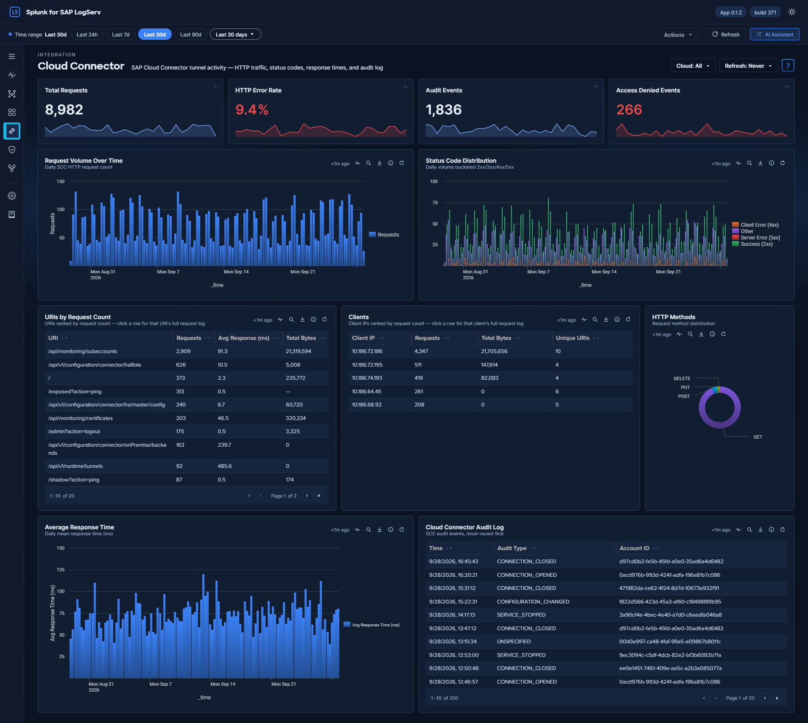

# Cloud Connector

## :material-circle-box:{ .taiconcolor } Why This Dashboard Matters

The Cloud Connector dashboard monitors SAP Cloud Connector (SCC), which provides secure tunneled connectivity between on-premise SAP systems and SAP BTP (Business Technology Platform) cloud services. As the bridge between on-premise and cloud, the Cloud Connector's health directly impacts hybrid integration scenarios, Fiori apps, and cloud-based analytics that depend on on-premise data access.

## :material-circle-box:{ .taiconcolor } Requires

- **Sourcetypes:** `sap:scc:http_access` (LogServ folder `scc/tracelogs`) and `sap:scc:audit` (`scc/audit`). The Data TA assigns them at index time where the data is parsed; see [Supported Log Types](../../../getting-started/supported-log-types.md).
- **Search-head add-ons:** none beyond the [LogServ App prerequisites](../../prerequisites.md).
- **Dashboard Data row:** **Cloud Connector**. Backfill it once after installing the App so the panels show history: 30 days by default, up to 365 days or a custom range. See [Backfilling on first install](../../dashboard-data.md#backfilling-on-first-install).

## :material-circle-box:{ .taiconcolor } Panels

Total Requests, Audit Events and Request Volume Over Time count the indexed events directly, and the Cloud Connector Audit Log table reads raw events; every other panel reads the hourly summary, which adds each hour at minute :23 of the next hour, so on wide time ranges those panels can leave out up to about the last 85 minutes. Ranges shorter than 90 minutes are answered from the raw events automatically. See [Dashboard Data](../../dashboard-data.md).

- **Total Requests** -- Count of HTTP requests processed by the Cloud Connector
- **HTTP Error Rate** -- Percentage of HTTP requests returning 4xx or 5xx status codes (scoped name clarifies that this is HTTP-only, not audit-log errors)
- **Audit Events** -- Count of Cloud Connector audit log entries
- **Access Denied Events** -- Count of `sap:scc:audit` entries with `scc_audit_type="ACCESS_DENIED"`
- **Request Volume Over Time** -- HTTP request trend over time
- **Status Code Distribution** -- Column chart of 2xx, 3xx, 4xx, and 5xx responses over time, one bar per status class in each time bucket
- **URIs by Request Count** -- Table of the most requested URIs with average response time and total bytes; click a row for that URI's requests in Search
- **Average Response Time** -- Mean response time (ms), charted over time
- **HTTP Methods** -- Pie chart breakdown of request methods; click it for the method counts in Search
- **Clients** -- Table of the most active client IPs with request counts, total bytes, and unique URI counts; click a row for that client's requests in Search
- **Cloud Connector Audit Log** -- Table of the most recent audit events (up to 200) with audit type and account ID; click a row for every event of that audit type in Search

## :material-lightning-bolt:{ .taiconcolor } What to Look For

- **HTTP Error Rate increases** -- A rising error rate can point at connectivity problems between the cloud and the on-premise systems. Check the Status Code Distribution for whether errors are client-side (4xx) or server-side (5xx).
- **Access Denied events** -- A non-zero Access Denied KPI means the Cloud Connector logged that it denied a request for a resource, for example a backend path that is not exposed to the requesting subaccount, or an unauthorized access attempt. The entry's message names the resource and the requesting address, and its account ID (`scc_account_id`) the subaccount; use the Cloud Connector Audit Log table (click a row) to see which audit types and accounts are involved.
- **Response time degradation** -- Gradually increasing response times suggest bandwidth constraints, backend system slowdowns, or Cloud Connector resource exhaustion. Sudden spikes may indicate outages.
- **Unusual URIs** -- Requests to unexpected URI paths in the URIs by Request Count table may indicate scanning or misconfigured cloud applications attempting to access unauthorized resources.
- **Audit events indicating config changes** -- Cloud Connector audit entries for configuration modifications should correlate with approved change windows. Unexpected changes may indicate unauthorized access.
- **New client IPs** -- Compare the Clients table with the callers you expect. New client IPs may indicate unauthorized access attempts or misconfigured routing.

## :material-circle-box:{ .taiconcolor } Related Dashboards

- [Web and API Performance](web-api-performance.md) -- Cloud Connector HTTP timing beside the Web Dispatcher's, and the Cloud Connector auth failure rate.
- [Environment Health](../environment-health.md) -- its **Cloud Connector Error Trend** chart opens this dashboard.
- [Host Details](../platform/host-details.md) -- its **Data Freshness** table opens this dashboard from an `sap:scc:http_access` or `sap:scc:audit` row.

??? info "Where the data comes from"
    - **Summary-backed panels** read the `logserv_cloudconn_rollup` KV Store collection — metrics `http`, `status`, `method` and `client` summarise `sap:scc:http_access` (request volume, status classes including the HTTP error rate, methods, top clients, response-time sums for the Avg charts), and metric `audit` summarises `sap:scc:audit` (including ACCESS_DENIED counts). Populated at minute :23 of every hour by `logserv_cloudconn_aggregate`.
    - **Pure-count panels** (Total Requests, Audit Events, Request Volume Over Time) run `tstats` directly against indexed fields.
    - **The Audit Log table** is a live event listing dispatched against the raw `sap:scc:audit` events at view time, capped at the 200 most recent entries.

    Summary-backed panels switch automatically to their exact raw-equivalent search when the selected window is shorter than 90 minutes, so sub-hour investigation stays real-time. The collection keeps 365 days of hourly history (trimmed by a daily retention search). The **Cloud** picker in the title row filters every panel by `cloud_provider`; events with no `cloud_provider` value count as `aws`. Full schedule and freshness reference: [Dashboard Data](../../dashboard-data.md).
