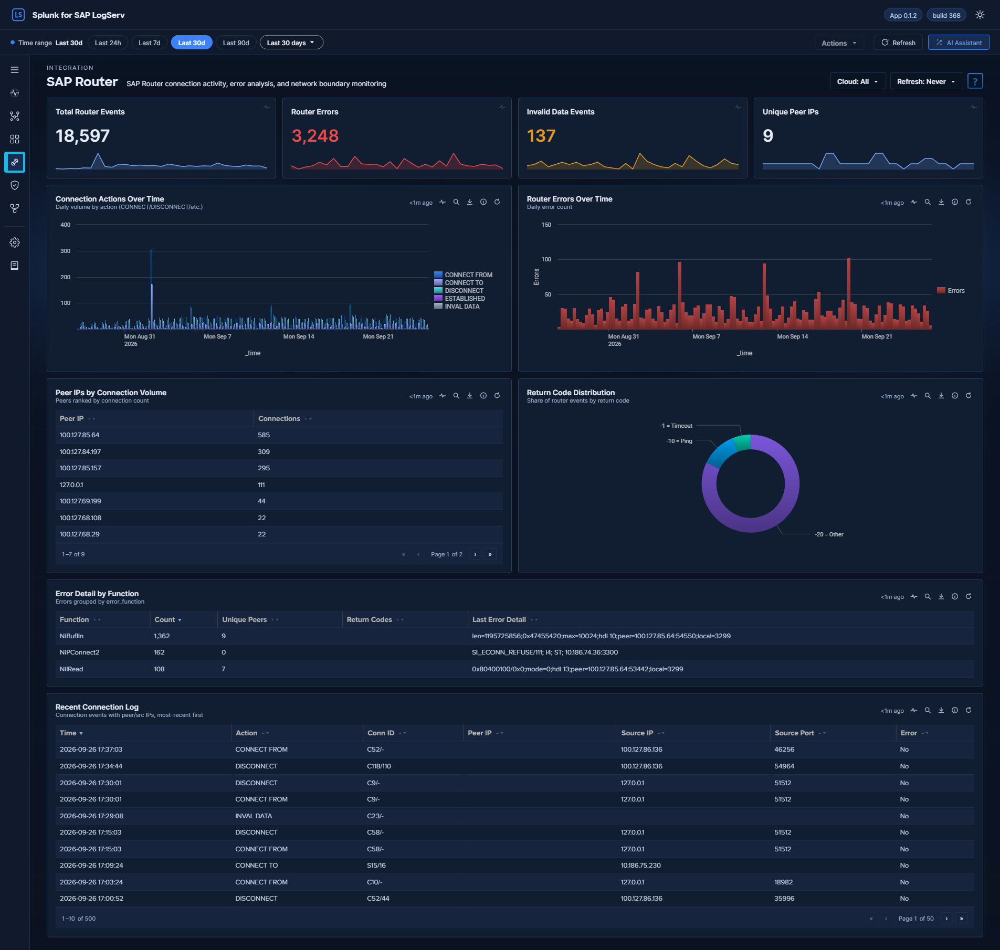

# SAP Router

## :material-circle-box:{ .taiconcolor } Why This Dashboard Matters

SAP Router is the network gateway that sits between SAP systems and external networks, forwarding RFC and HTTP traffic across trust boundaries. Because it is exposed to the network, its logs are a primary audit trail for cross-boundary SAP traffic: every connection attempt, protocol error, and invalid-data event gets recorded. This dashboard separates the SAP Router signal from other services so that spikes in router errors (connectivity breakage, misconfigured routetab, or attempted protocol abuse) are visible on their own.

## Panels

- **Total Router Events** -- Aggregate SAP Router event count
- **Router Errors** -- Count of router error events
- **Invalid Data Events** -- Count of events where the router received malformed or unexpected protocol data -- often indicates a misconfigured client or probing
- **Unique Peer IPs** -- Distinct count of peer IPs seen in the time window
- **Connection Actions Over Time** -- Stacked column chart of CONNECT, DISCONNECT, and error actions over time
- **Router Errors Over Time** -- Trend of router error events over time (column chart)
- **Peer IPs by Connection Volume** -- Table of peer IPs ranked by connection count; a row click opens that peer's full router event log
- **Return Code Distribution** -- Donut chart of router return codes over the time range, decoded to readable labels ("0 = OK (Success)", "-93 = Connection Refused", "-92 = Host Unknown (DNS)", ...)
- **Error Detail by Function** -- Table of router error functions (NiBuf, NiI, ...) with count, unique peer count, the return codes seen, and the most recent error detail text (paginated 5 rows at a time); a row click opens that function's error events
- **Recent Connection Log** -- Table of the most recent connection events (CONNECT / DISCONNECT / INVAL DATA) with time, action, connection ID, peer IP, source IP/port, and an error flag; a row click opens that peer/source pair's events

## :material-circle-box:{ .taiconcolor } Where the Data Comes From

The single source is `sap:saprouter` (covering both the `.log` connection events and the `.trc`
error traces).

- **Summary-backed panels** read the `logserv_saprouter_rollup` KV Store collection — metric
  `main` carries an hourly grain over (action, peer IP, return code, error flag, error function);
  metric `errdetail` stores the latest error-detail text per error function. Return codes are
  stored raw and decoded to their human labels at read time. Populated at minute :13 of every hour
  by `logserv_saprouter_aggregate`.
- **Recent Connection Log** is a live event listing dispatched against the raw events at view time,
  capped at the 500 most recent entries.

On a `CONNECT TO` line the address after `host` is the connection's **target**, and the router's
search-time `src_ip` (with its CIM alias `src`) takes that first address — so on those rows the
Recent Connection Log's source IP column shows the target. The target also has its own fields:
`saprouter_target_ip` / `saprouter_target_addr`, `saprouter_target_service` (`sapms<SID>`, `33NN`,
`sapgwNN`, ...), `saprouter_target_sid` (for a `sapms<SID>` target), `saprouter_target_role`
(message server, gateway, gateway (secure), dispatcher, SAP Router, niping, other service) and
`saprouter_target_instance`. A server-side receive failure that names an IPv4 address
(`NiBufReceive S<n>/<m> '<IPv4>' failed`) carries `saprouter_fail_target_ip`; client-side failures
(`NiBufReceive C<n>/...`) and failures that name a host do not.

Summary-backed panels switch automatically to their exact raw-equivalent search when the selected window is shorter than 90 minutes, so sub-hour investigation stays real-time. The collection keeps 365 days of hourly history (trimmed by a daily retention search); a fresh install seeds the last 30 days from **Settings → Dashboard Data → Run backfill**. The global **Cloud** dropdown filters the summaries through the `cloud_provider` dimension stored in every rollup row. Full schedule and freshness reference: [Performance & Data Freshness](../performance.md).

## :material-circle-box:{ .taiconcolor } In the Environment Topology

The [Environment Topology](../topology.md) draws each router's routed connections as **SAP Router**
edges, from the router host (a "SAP ROUTER" square) to each `CONNECT TO` target, rolled up hourly.
A target named `sapms<SID>` is that SID's message server, so its address is attributed to the SID and
the edge ends on the SID's circle; targets reached by port (`3300`) or `sapgw<NN>` stay addresses until
another source attributes them. Server-side receive failures that name a target address
(`NiBufReceive S... '<IPv4>' failed`) count as the edge's failed connections; client-side failures and
failures that name a host are not counted. Loopback targets (127.0.0.0/8 — such as the niping self-test,
`127.0.0.1/3298`) are left out of the graph.

## :material-lightning-bolt:{ .taiconcolor } What to Look For

- **Invalid Data spikes** -- A sudden increase in the Invalid Data KPI suggests either a misconfigured client speaking a wrong protocol or a port scan / probe. Check the Peer IPs by Connection Volume table for new entries.
- **Unfamiliar peers near the top of the table** -- Known SAP-to-SAP traffic should come from a predictable IP set; new IPs near the top of the Peer IPs by Connection Volume table warrant investigation, especially if they generate high connection volume or show up only in the Error Detail by Function table.
- **Return code imbalance** -- The Return Code Distribution pie should be dominated by normal-case codes. A sudden growth of the "-93 = Connection Refused" or "-92 = Host Unknown (DNS)" slices usually means a downstream SAP system is down or a routetab entry is wrong.
- **Rising error trend** -- An upward slope in Router Errors Over Time can precede an outage. Cross-reference with ABAP Operations (dispatcher errors) and Cloud Connector (for hybrid flows) to see whether the root cause is local to the router or broader.
- **Concentrated errors by function** -- If one row of the Error Detail by Function table accumulates most errors, that function is the specific RFC/HTTP path where the problem lives -- a much narrower investigation scope than "the router is broken".

