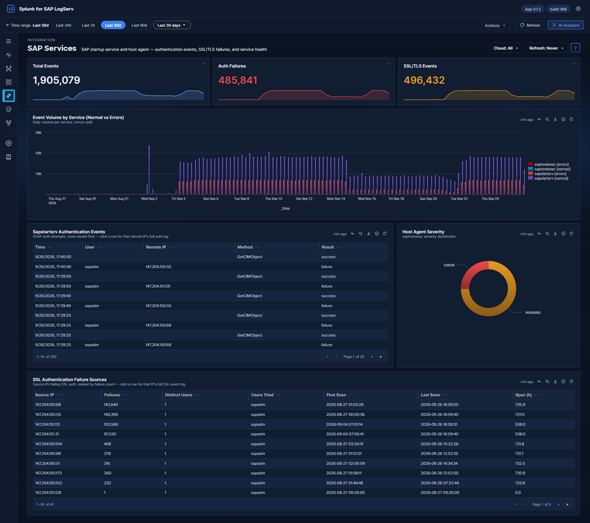

# SAP Services

## :material-circle-box:{ .taiconcolor } Why This Dashboard Matters

The SAP Services dashboard monitors two host-level services that are critical to SAP system availability: **sapstartsrv** (system startup and management) and the **SAP Host Agent** (host monitoring and management). These services operate at the infrastructure layer, below the application, and their failures can prevent SAP systems from starting or being managed remotely. sapstartsrv accepts logons over the network (its SOAP web service interface), so failed logons matter; the dashboard's main investigation panel is SSL Authentication Failure Sources. (SAP Router activity lives on its own [SAP Router](sap-router.md) dashboard.)

## :material-circle-box:{ .taiconcolor } Requires

- **Sourcetypes:** `sap:sapstartsrv` (LogServ folder `sap/sapstartsrv`) and `sap:saphostexec` (`sap/saphostexec`). The Data TA assigns them at index time where the data is parsed; see [Supported Log Types](../../../getting-started/supported-log-types.md).
- **Search-head add-ons:** none beyond the [LogServ App prerequisites](../../prerequisites.md).
- **Dashboard Data row:** **SAP Services**. Backfill it once after installing the App so the panels show history: 30 days by default, up to 365 days or a custom range. See [Backfilling on first install](../../dashboard-data.md#backfilling-on-first-install).

## :material-circle-box:{ .taiconcolor } Panels

All panels except Sapstartsrv Authentication Events read the hourly summary, which adds each hour at minute :21 of the next hour, so on wide time ranges they can leave out up to about the last 85 minutes; ranges shorter than 90 minutes are answered from the raw events automatically. See [Dashboard Data](../../dashboard-data.md).

- **Total Events** -- Aggregate event count across sapstartsrv and saphostexec
- **Auth Failures** -- Count of sapstartsrv authentication failures
- **SSL/TLS Events** -- Count of events involving SSL/TLS negotiation
- **Event Volume by Service (Normal vs Errors)** -- Full-width column chart with four series side by side: sapstartsrv (normal), sapstartsrv (errors), saphostexec (normal), saphostexec (errors). Errors are defined per service: sapstartsrv = failed authentication events; saphostexec = severity ERROR/WARNING.
- **Sapstartsrv Authentication Events** -- Table of the most recent authentication attempts (up to 200) showing user, IP, method, and result; click a row for that remote IP's events in Search
- **Host Agent Severity** -- Pie chart of SAP Host Agent log severity distribution; click it for a severity-by-host breakdown in Search
- **SSL Authentication Failure Sources** -- Full-width table aggregating SSL/TLS auth failures by source IP, with failure count, distinct user count, user list, first/last seen, and activity span (hours); the table paginates, and a row click opens the full event set for that IP.

## :material-lightning-bolt:{ .taiconcolor } What to Look For

- **Auth failure sources** -- The SSL Authentication Failure Sources table is the primary investigation surface. A single source IP with many distinct usernames suggests credential stuffing; many sources with a few usernames each suggest a distributed brute-force attempt; a long activity span suggests a persistent rather than an opportunistic attacker.
- **Authentication failures from new IPs** -- Any new source IP appearing in the SSL Authentication Failure Sources table should be cross-referenced with your expected SAP admin network. Production sapstartsrv should rarely see failed authentications from unfamiliar ranges.
- **Error bars rising in the volume chart** -- If an error series in the Event Volume chart grows relative to its normal series, look at that service first. For sapstartsrv the errors are failed logons (see Sapstartsrv Authentication Events); for saphostexec they are ERROR and WARNING lines (the Host Agent Severity pie shows which grew).
- **Host Agent ERROR severity** -- If the Host Agent severity distribution shifts toward ERROR, the host monitoring infrastructure may be degrading, which impacts central management capabilities.

## :material-circle-box:{ .taiconcolor } Related Dashboards

- [Cross-Stack Authentication](../security/cross-stack-authentication.md) -- sapstartsrv authentication failures beside HANA and Windows failures.
- [Environment Health](../environment-health.md) -- its **Auth Failures** card and **Security Error Trend** chart open this dashboard.
- [SAP Router](sap-router.md) -- the third SAP service log (`sap/saprouter`), with its own dashboard.
- [Host Details](../platform/host-details.md) -- its **Data Freshness** table opens this dashboard from an `sap:sapstartsrv` or `sap:saphostexec` row.

??? info "Where the data comes from"
    - **Summary-backed panels** read the `logserv_sapservices_rollup` KV Store collection — metric `main` (service/auth activity over `sap:sapstartsrv` + `sap:saphostexec`) and metric `ssl` (SSL/TLS negotiation facts from sapstartsrv). Populated at minute :21 of every hour by `logserv_sapservices_aggregate`.
    - **Sapstartsrv Authentication Events** is a live listing dispatched against the raw events at view time, capped at the 200 most recent matches.

    Summary-backed panels switch automatically to their exact raw-equivalent search when the selected window is shorter than 90 minutes, so sub-hour investigation stays real-time. The collection keeps 365 days of hourly history (trimmed by a daily retention search). The **Cloud** picker in the title row filters every panel by `cloud_provider`; events with no `cloud_provider` value count as `aws`. Full schedule and freshness reference: [Dashboard Data](../../dashboard-data.md).
