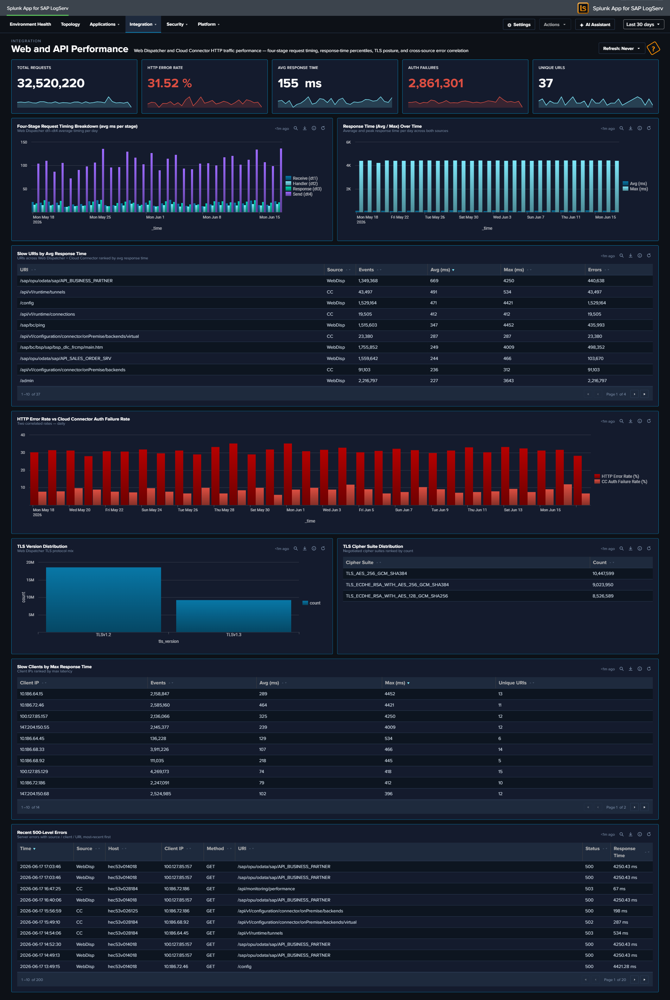

# Web and API Performance

## :material-circle-box:{ .taiconcolor } Why This Dashboard Matters

The Web Dispatcher dashboard answers "what's the traffic doing?" -- volume, status codes, top URIs. Web and API Performance answers the next question: "*why* does it feel slow or unreliable?" It exposes the per-request timing stages that the `sap:webdispatcher:access` sourcetype records (`dt1` receive / `dt2` handler / `dt3` response / `dt4` send), combines response-time averages and maxima across Web Dispatcher and Cloud Connector HTTP traffic, and correlates the HTTP error rate with the Cloud Connector auth failure rate so that you can see whether a spike in user-visible failures is actually a backend-auth problem. It also surfaces TLS posture (version and cipher suite distributions) from the Web Dispatcher log, so that cipher-suite drift or legacy TLS traffic becomes visible.

## :material-circle-box:{ .taiconcolor } Requires

- **Sourcetypes:** `sap:webdispatcher:access` (LogServ folder `webdispatcher/accesslog`) and `sap:scc:http_access` (`scc/tracelogs`). The four-stage timing and TLS panels read the Web Dispatcher only. The Data TA assigns both sourcetypes at index time where the data is parsed; see [Supported Log Types](../../../getting-started/supported-log-types.md).
- **Search-head add-ons:** none beyond the [LogServ App prerequisites](../../prerequisites.md).
- **Dashboard Data row:** **Web & API Performance / Web Dispatcher** (shared with Web Dispatcher). Backfill it once after installing the App so the panels show history: 30 days by default, up to 365 days or a custom range. See [Backfilling on first install](../../dashboard-data.md#backfilling-on-first-install).

## :material-circle-box:{ .taiconcolor } Panels

All panels except Recent 500-Level Errors read the hourly summary, which adds each hour at minute :18 of the next hour, so on wide time ranges they can leave out up to about the last 80 minutes; ranges shorter than 90 minutes are answered from the raw events automatically. See [Dashboard Data](../../dashboard-data.md).

- **Total Requests** -- Aggregate HTTP request count across Web Dispatcher and Cloud Connector
- **HTTP Error Rate** -- Percentage of requests returning 4xx or 5xx status (combined across both sources); click to open the matching events
- **Avg Response Time** -- Average `response_time_ms` across both sources, in milliseconds
- **Auth Failures** -- Count of requests rejected for authentication reasons: Web Dispatcher `status IN (401, 403)` OR Cloud Connector `(status IN (401, 403)) OR is_authenticated="false"`; click to drill down
- **Unique URLs** -- Distinct count of URIs seen across both sources
- **Four-Stage Request Timing Breakdown (avg ms per stage)** -- Column chart of the average milliseconds a request spends in each of the Web Dispatcher's four internal stages per time bucket, one bar per stage: `dt1` receive, `dt2` handler, `dt3` response, `dt4` send. Compare the four bars in a bucket to see where the time goes.
- **Response Time (Avg / Max) Over Time** -- Average and peak `response_time_ms` over time (column chart, two series: Avg (ms) and Max (ms)). Max climbing while Avg stays flat is the classic tail-latency signal. The chart shows averages and maxima rather than percentiles because averages and maxima combine exactly across the hourly summary, and percentiles do not (see *Where the data comes from* below).
- **Slow URIs by Avg Response Time** -- Table of the slowest URIs ranked by average response time, with source (WebDisp or CC), event count, avg ms, max ms, and error count. Row drilldown opens the events for that URI.
- **HTTP Error Rate vs Cloud Connector Auth Failure Rate** -- Full-width column chart of two series in the error palette: the overall HTTP error rate (4xx/5xx across both sources) and the Cloud Connector auth failure rate (401/403/anonymous, scoped to CC's own denominator). Use this to answer "are the user-visible errors actually auth failures at the backend?"
- **TLS Version Distribution** -- Column chart of request volume per negotiated TLS version
- **TLS Cipher Suite Distribution** -- Table of negotiated cipher suites ranked by count (Cipher Suite, Count)
- **Slow Clients by Max Response Time** -- Full-width table of the client IPs experiencing the highest peak latency, with event count, avg ms, max ms, and distinct URI count. Row drilldown opens the events for that client IP.
- **Recent 500-Level Errors** -- Full-width table of the most recent 5xx events (up to 200) with time, source, host, client IP, method, URI, status, and response time. Row drilldown opens that client + URI's 5xx events in Splunk Search.

## :material-lightning-bolt:{ .taiconcolor } What to Look For

- **Stage imbalance in the timing breakdown** -- Watch how the four bars change against each other over time. If `dt3` (response) or `dt4` (send) suddenly grow relative to `dt2` (handler), the extra time is spent on the response or send side rather than in the handler stage.
- **Tail latency growth (Max)** -- Max drifting up while Avg stays flat means a small number of requests are getting much slower -- causes can include database contention or garbage-collection pauses. Correlate with Slow URIs to identify which paths are affected.
- **Error-rate and auth-failure-rate correlation** -- When the two series in the correlation chart track together, your HTTP error spikes are likely driven by backend auth rejection. When they diverge (HTTP errors up, auth failures flat), the cause is likely elsewhere (backend unavailable, 500s, timeouts).
- **Legacy TLS traffic** -- Any non-trivial TLS 1.0 or 1.1 volume in the TLS Version Distribution is a compliance concern. Correlate the TLS Cipher Suite Distribution table to see whether legacy ciphers are still being negotiated.
- **Slow clients vs slow URIs** -- The two "Slow" tables answer different questions. A single slow client with diverse URIs suggests network-path problem between that client and your infrastructure; a single slow URI across many clients points at a backend issue with that specific endpoint.
- **Concentrated 500 errors** -- Recurring entries in the Recent 500-Level Errors table from a single host, URI, or client IP narrow the investigation scope immediately.

## :material-circle-box:{ .taiconcolor } Related Dashboards

- [Web Dispatcher](web-dispatcher.md) -- volume, status codes, top URIs and the slowest request traces, from the same summary.
- [Cloud Connector](cloud-connector.md) -- the Cloud Connector's own HTTP and audit view.

??? info "Where the data comes from"
    Sources are `sap:webdispatcher:access` and `sap:scc:http_access`, summarised together.

    - **Summary-backed panels** read the `logserv_web_timing_rollup` KV Store collection (shared with the Web Dispatcher dashboard): metric `core` carries per-hour request/error/auth-failure counts plus response-time sums, metric `timing` the four-stage `dt1–dt4` timing sums, `url` the per-URI facts (including the slow-URI Avg/Max ranking via `slowuri`), `client` the per-client facts, and `tls` / `cipher` the TLS posture. Averages are reconstructed exactly from stored sums and counts — which is also why the latency charts show **Avg + Max** rather than percentiles (percentiles cannot be merged across hourly buckets without approximation). Populated at minute :18 of every hour by `logserv_web_timing_aggregate`.
    - **Recent 500-Level Errors** is a live event listing dispatched against the raw events at view time, capped at the 200 most recent matches.

    Summary-backed panels switch automatically to their exact raw-equivalent search when the selected window is shorter than 90 minutes, so sub-hour investigation stays real-time. The collection keeps 365 days of hourly history (trimmed by a daily retention search). The **Cloud** picker in the title row filters every panel by `cloud_provider`; events with no `cloud_provider` value count as `aws`. Full schedule and freshness reference: [Dashboard Data](../../dashboard-data.md).
