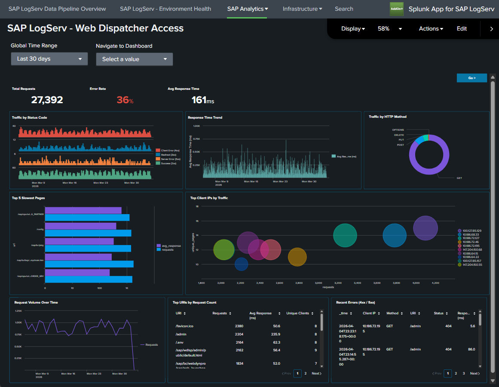

# Web Dispatcher

## :material-circle-box:{ .taiconcolor } Why This Dashboard Matters

The Web Dispatcher dashboard analyzes HTTP traffic flowing through the SAP Web Dispatcher, which acts as the reverse proxy and load balancer for SAP web applications including Fiori, WebGUI, and custom web services. As the front door for web-based SAP access, the Web Dispatcher's traffic patterns reveal both performance issues and potential security threats. For deeper per-request timing analysis (four-stage breakdown, Avg/Max response-time trends, TLS posture), see [Web and API Performance](web-api-performance.md).

## :material-circle-box:{ .taiconcolor } Requires

- **Sourcetypes:** `sap:webdispatcher:access` (LogServ folder `webdispatcher/accesslog`). The Data TA assigns it at index time where the data is parsed; see [Supported Log Types](../../../getting-started/supported-log-types.md).
- **Search-head add-ons:** none beyond the [LogServ App prerequisites](../../prerequisites.md).
- **Dashboard Data rows:** **Web & API Performance / Web Dispatcher** (shared with Web and API Performance) and **Web Dispatcher Slowest Traces**. Backfill both once after installing the App so the panels show history: 30 days by default, up to 365 days or a custom range. See [Backfilling on first install](../../dashboard-data.md#backfilling-on-first-install).

## :material-circle-box:{ .taiconcolor } Panels

Total Requests and Request Volume Over Time count the indexed events directly, and Recent Errors reads raw events; every other panel reads an hourly summary. The summary adds each hour at minute :18 of the next hour (Slowest Request Traces at :28), so on wide time ranges those panels can leave out up to about the last 80 minutes (90 for Slowest Request Traces). Ranges shorter than 90 minutes are answered from the raw events automatically. See [Dashboard Data](../../dashboard-data.md).

- **Total Requests** -- Aggregate count of HTTP requests processed by the Web Dispatcher
- **Error Rate** -- Percentage of requests returning 4xx or 5xx status codes
- **Avg Response Time** -- Average response time across all requests in milliseconds
- **Traffic by Status Code** -- Multi-line chart of 2xx / 3xx / 4xx / 5xx volume over time (lines rather than bars, so the small 4xx/5xx series stay visible next to 2xx)
- **Response Time Trend** -- Average and peak latency per bin (two lines: Avg (ms) and Max (ms)); the Max line rising while Avg stays flat is the tail-latency signal
- **Traffic by HTTP Method** -- Breakdown of GET, POST, PUT, DELETE, etc.; click it for the method counts in Search
- **Slowest Pages** -- Table of URIs ranked by average response time (URI, Avg Response (ms), Requests); a row click opens that URI's full latency distribution
- **Client IPs by Traffic** -- Table of client IPs ranked by request count, with unique pages and average response time; a row click opens that client's full request log
- **Request Volume Over Time** -- Request volume over time (column chart)
- **URIs by Request Count** -- Table of the most accessed URIs with average response time; a status-code dropdown in the panel header (All / 2xx / 3xx / 4xx / 5xx) rescopes the table, and a row click drills into that URI within the selected status class
- **Recent Errors (4xx / 5xx)** -- Table of the latest error events (up to 200) with time, client IP, method, URI, status code, and response time; a row click investigates that client + URI's error path
- **Slowest Request Traces** -- Waterfall of the 20 slowest requests in the range, each broken into its dt1 receive / dt2 handler / dt3 response / dt4 send stages; click the panel to open the 100 slowest requests, with their stage timings, in Search

## :material-lightning-bolt:{ .taiconcolor } What to Look For

- **4xx/5xx status code spikes** -- Client errors (4xx) may indicate broken links, misconfigured apps, or scanning activity. Server errors (5xx) point at the backend ABAP or Java systems, or at the Web Dispatcher's connection to them.
- **Response time degradation** -- Slow response times impact user experience. Correlate with the Slowest Pages table to identify which applications are affected, then investigate backend system load.
- **Unusual HTTP methods** -- PUT, DELETE, or PATCH requests where only GET/POST are expected may indicate API abuse or vulnerability exploitation.
- **Concentrated client IP traffic** -- A single IP generating disproportionate traffic in the Client IPs by Traffic table may be a bot, scraper, or denial-of-service source.
- **TLS posture** -- Web Dispatcher records TLS version and cipher suite, but the distributions are charted on [Web and API Performance](web-api-performance.md); check there for clients still using deprecated TLS versions (1.0, 1.1).

## :material-circle-box:{ .taiconcolor } Related Dashboards

- [Web and API Performance](web-api-performance.md) -- four-stage timing, TLS posture and the Cloud Connector side, from the same summary.
- [Environment Health](../environment-health.md) -- its **Web Error Rate** card and **Web/Network Error Trend** and **Web Dispatcher Response Time** charts open this dashboard.
- [Environment Topology](../topology.md) -- draws HTTP edges from the Web Dispatcher's access log.
- [Host Details](../platform/host-details.md) -- its **Data Freshness** table opens this dashboard from an `sap:webdispatcher:access` row.

??? info "Where the data comes from"
    The single source is `sap:webdispatcher:access`.

    - **Summary-backed panels** read the `wd_*` metrics (`wd_core`, `wd_status`, `wd_method`, `wd_uristat`, `wd_client`) of the `logserv_web_timing_rollup` KV Store collection, which this dashboard **shares with Web and API Performance**. Populated at minute :18 of every hour by `logserv_web_timing_aggregate`.
    - **Slowest Request Traces** reads its own `logserv_webdisp_slowtrace_rollup` collection (minute :28): each hour stores that hour's top-20 slowest requests, and re-sorting the union of per-hour top-20s yields exactly the global top-20 — the table is precise, not an approximation.
    - **Pure-count panels** (Total Requests, Request Volume Over Time) run `tstats` directly against indexed fields.
    - **Recent Errors** is a live event listing dispatched against the raw events at view time, capped at the 200 most recent `status >= 400` requests.

    Each event also carries the SAP system ID and instance of the Web Dispatcher, `sap_sid` and `sap_instance`, extracted from the log's path (`/usr/sap/<SID>/<instance>/log/http_access_log`) as for the ABAP sourcetypes: a Web Dispatcher installed under its own SID (for example `/usr/sap/WDP/W00/`) gives that SID, and one embedded in an ABAP instance gives the ABAP system's SID. A path with no `/usr/sap/<SID>/` directory (three upper-case letters or digits) gives no `sap_sid`, and one with no instance directory (upper-case letters followed by digits, such as `W00`) right below `/usr/sap/<dir>/` gives no `sap_instance`. The panels here do not group by them; use them in your own searches. Environment Topology never attributes a host or an address to a system by them, nor by the Web Dispatcher's own ICM trace (see [Environment Topology](../topology.md)).

    Summary-backed panels switch automatically to their exact raw-equivalent search when the selected window is shorter than 90 minutes, so sub-hour investigation stays real-time. The collections keep 365 days of hourly history (trimmed by a daily retention search). The **Cloud** picker in the title row filters every panel by `cloud_provider`; events with no `cloud_provider` value count as `aws`. Full schedule and freshness reference: [Dashboard Data](../../dashboard-data.md).
