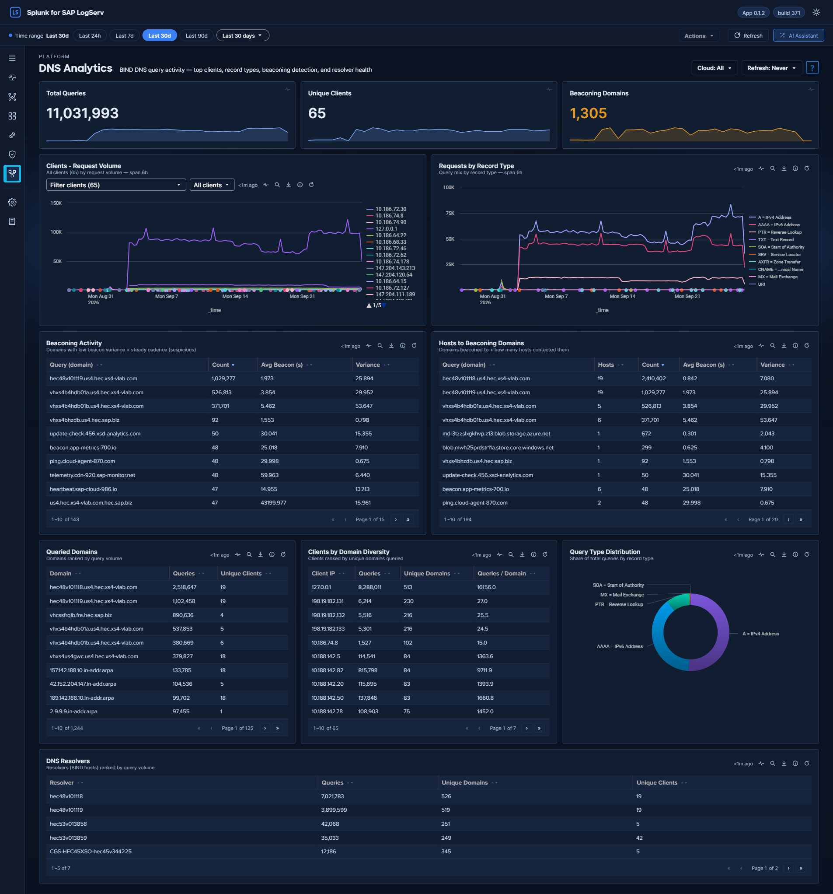

# DNS Analytics

## :material-circle-box:{ .taiconcolor } Why This Dashboard Matters

The DNS Analytics dashboard reads the BIND query log of your SAP landscape for security signals. DNS is used by almost all network communication and is often abused for command-and-control (C2) beaconing, data exfiltration through DNS tunneling, and reconnaissance. The dashboard shows query volume per client and record type, flags domains that are queried at regular intervals (beaconing), and ranks clients by how many different domains they query.

## :material-circle-box:{ .taiconcolor } Requires

- **Sourcetypes:** `isc:bind:query` and `isc:bind:queryerror` (the BIND query events, selected with `tag=dns`).
- **Search-head add-ons:** none beyond the LogServ App, which has the BIND parsing built in. Do not install the standalone Splunk Add-on for ISC BIND alongside it: you would get duplicate field extraction, and the App shows a compatibility banner on its home view while that add-on is enabled.
- **Dashboard Data rows** on **Settings → Dashboard Data**: *DNS Analytics*, and *Beaconing detection (Environment Health / DNS / Network Perimeter)* for the beaconing panels. On a new install, **Run backfill** there seeds the last 30 days by default (60, 90, 180 or 365 days, or a custom range, are also offered); without a backfill the summary-backed panels fill one hour (the beaconing panels one day) at a time. See [Backfilling on first install](../../dashboard-data.md#backfilling-on-first-install).

## :material-circle-box:{ .taiconcolor } Panels

- **Total Queries** -- Aggregate count of DNS queries in the selected time range
- **Unique Clients** -- Count of distinct client IPs generating DNS queries
- **Beaconing Domains** -- Count of domains exhibiting periodic query patterns consistent with C2 beaconing; hovering its sparkline shows the UTC day of each point (beaconing is detected per UTC day). A UTC day that has not ended yet is drawn at 0 and labelled *not yet computed*
- **Clients - Request Volume** -- Line chart of DNS query volume per client IP. Defaults to all clients; the panel header carries a client-IP filter (Multiselect) and a Top-N picker (All / Top 5 / 10 / 20 / 50) — picking specific clients overrides the Top-N setting. The chart, the client-IP filter's list and **Requests by Record Type** follow the global **Cloud** dropdown like every other panel
- **Query Type Distribution** -- Donut chart showing the breakdown of DNS record types. Codes are shown in expanded form (e.g. `A = IPv4 Address`, `TXT = Text Record`); any code not in the label map is displayed as-is
- **DNS Resolvers** -- Table of the BIND resolvers (the DNS hosts processing queries), ranked by query count, with unique-domain and unique-client counts. The resolver is the `host` field (the BIND server that logged the query); `src` is the querying client and drives the Unique Clients KPI and the Clients by Domain Diversity table
- **Requests by Record Type** -- Line chart trending DNS query types (A, AAAA, PTR, MX, etc.) over time
- **Beaconing Activity** -- Sortable table of domains with low beacon variance and steady cadence, showing query count, average beacon interval (s), and interval variance. Click a row to open the search app with an hourly timechart of that domain
- **Hosts to Beaconing Domains** -- Table of suspected beaconing domains with the number of distinct hosts that contacted each, alongside beacon interval and variance. Click a row for a per-source/per-resolver breakdown in the search app
- **Queried Domains** -- Table of the most looked-up domains with unique client counts
- **Clients by Domain Diversity** -- Table ranking clients by number of unique domains queried, with queries-per-domain ratio for DGA detection

## :material-lightning-bolt:{ .taiconcolor } What to Look For

- **Beaconing patterns** -- The Beaconing Activity panel uses statistical analysis (low variance in query intervals) to detect domains being contacted at regular intervals, which is a hallmark of malware C2 communication. Beaconing detection is computed once per day from per-day inter-arrival gaps, so a gap that straddles midnight is not counted, the numbers refresh daily rather than hourly, and the beaconing panels do not respond to sub-hour time ranges. Domains with low variance and high count are the highest priority.
- **Unusual record types** -- TXT record queries at high volume are a common DNS tunneling technique. MX queries from non-mail servers may indicate reconnaissance. Watch the Query Type Distribution donut and the Requests by Record Type line chart for deviations from your normal mix.
- **New high-volume clients** -- A host that suddenly becomes one of the top DNS clients may be compromised and performing domain generation algorithm (DGA) lookups or reconnaissance scanning.
- **Multiple hosts reaching beaconing domains** -- The Hosts to Beaconing Domains panel shows lateral spread. If multiple internal hosts contact the same suspected C2 domain, it suggests widespread compromise.
- **High domain diversity** -- Clients querying many unique domains with a low queries-per-domain ratio in the Clients by Domain Diversity table may indicate Domain Generation Algorithm (DGA) activity or automated reconnaissance.
- **Resolver imbalance** -- The DNS Resolvers table should show an expected workload split across your BIND servers. One resolver handling disproportionate load may indicate a misconfigured forwarder or a cluster failover that wasn't noticed.

## :material-circle-box:{ .taiconcolor } Related Dashboards

- [Network Perimeter](../security/network-perimeter.md) -- DNS beside firewall drops and proxy traffic, with the cross-source Suspicious Activity Indicator.
- [Proxy Analytics](proxy.md) -- the HTTP connections that follow DNS resolution.
- [Host Details](host-details.md) -- a host's DNS top queries beside its other activity.

??? info "Where the data comes from"
    The source is the BIND DNS query stream (`isc:bind:query` and `isc:bind:queryerror`, selected via `tag=dns`).

    - **Summary-backed panels** — query volume, clients, domains, resolvers and record types read
      the `logserv_dns_rollup` KV Store collection (metrics `main`, `rtype`), populated at minute :25
      of every hour by `logserv_dns_aggregate`.
    - **The beaconing panels** read the daily collections: `logserv_beaconing_rollup` (populated 00:30)
      for the KPI and `logserv_beaconing_detail_rollup` (00:32, metric `qs` — per-(query, source)
      inter-arrival gap statistics) for the detection tables. Daily cadence is inherent to the
      detection: it measures the regularity of a query's inter-arrival gaps over a full day, so these
      panels update once per day and need at least a day of history before they show anything.

    The hourly summary-backed panels switch automatically to their exact raw-equivalent search when the selected window is shorter than 90 minutes, so sub-hour investigation stays real-time; the beaconing panels always read their daily summaries. Each collection keeps 365 days of history (trimmed by a daily retention search). The global **Cloud** dropdown filters the summaries through the `cloud_provider` dimension stored in every rollup row. Full schedule and freshness reference: [Dashboard Data: Backfill and Freshness](../../dashboard-data.md).
