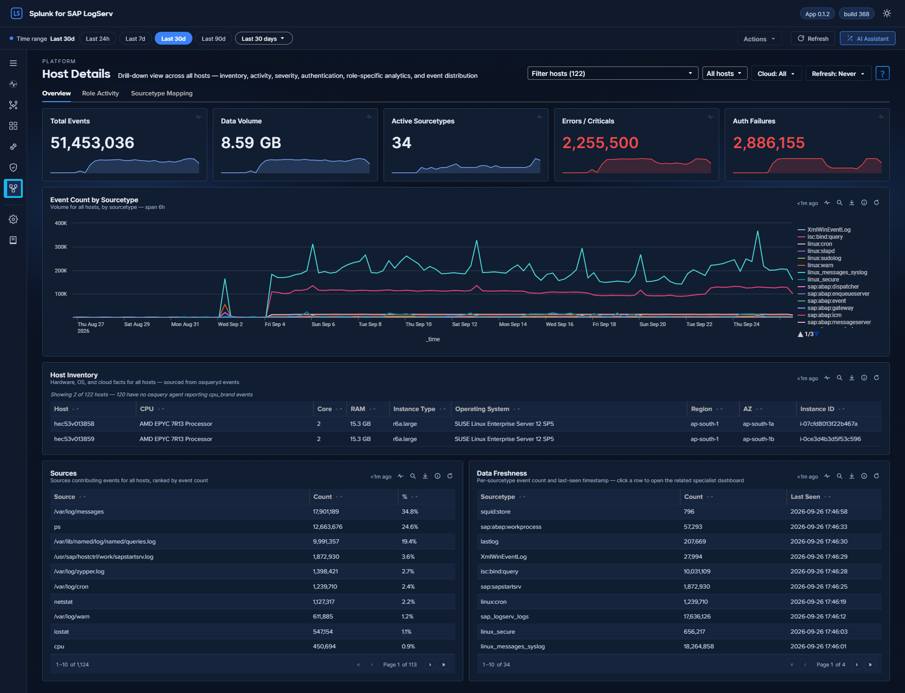
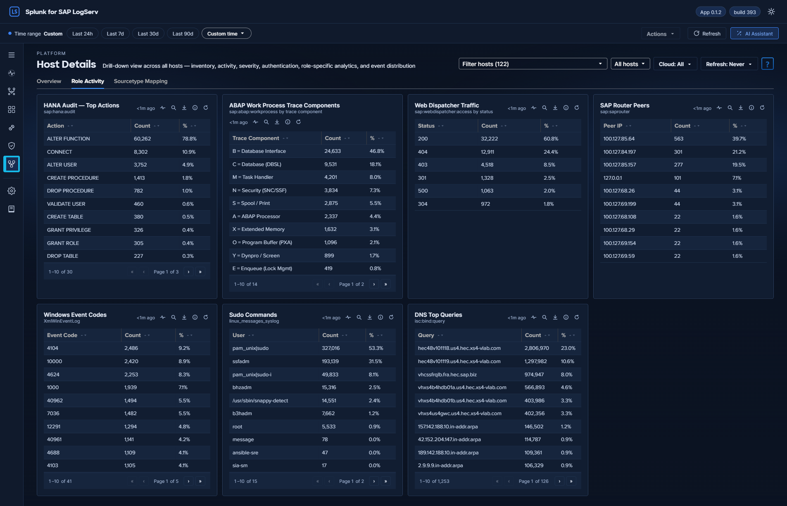
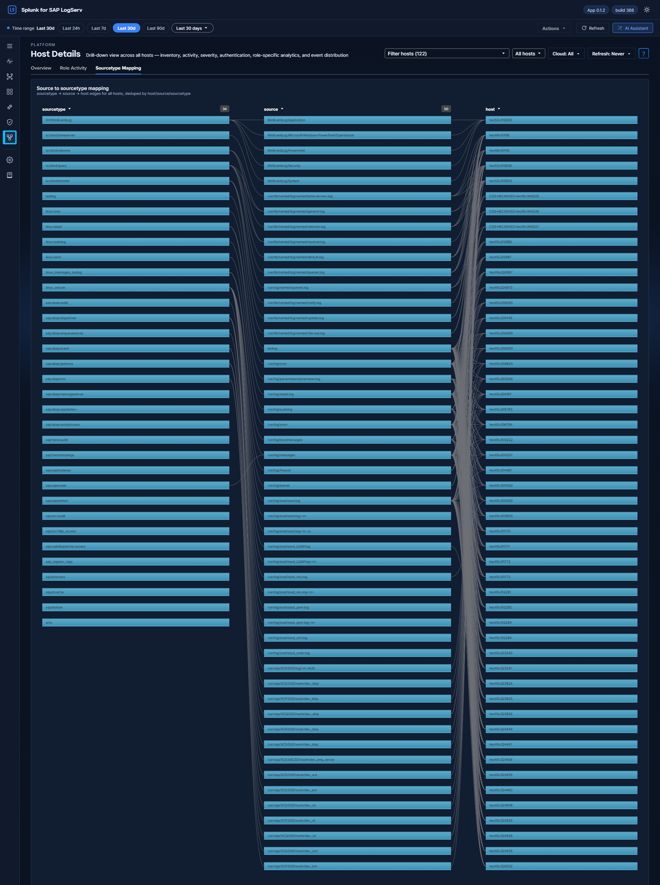

# Host Details

## :material-circle-box:{ .taiconcolor } Why This Dashboard Matters

The Host Details dashboard is the forensic drill-down tool for investigating one or more hosts. Accessed by clicking a host row in any dashboard's host-keyed table (Data Pipeline Overview, Cross-Stack Authentication, Environment Health, etc.) or by selecting hosts from the title-row Multiselect, it surfaces event volume, data freshness, authentication activity, inventory, errors, and role-specific signals (HANA audit, ABAP work process, web dispatcher traffic, etc.) for the selected scope. This view is essential for root cause analysis, incident response, capacity investigations, and validating that all expected data sources are present.

## :material-circle-box:{ .taiconcolor } Requires

- **Sourcetypes:** any; the Overview and Sourcetype Mapping tabs read every event of the selected hosts. Each Role Activity panel needs its own sourcetype (listed with the panel below), and **Host Inventory** needs osquery facts in `linux_messages_syslog`.
- **Search-head add-ons:** the Splunk Add-on for Microsoft Windows (742), for the Windows hosts' **Windows Event Codes** panel, their failed logons (EventCode 4625) in the **Auth Failures** KPI and their critical events (`severity=critical`) in the **Errors / Criticals** KPI. Without it those two KPIs undercount on Windows hosts; see [Windows Events](windows.md#requires).
- **Dashboard Data rows** on **Settings → Dashboard Data**: *Host Details* (the Data Volume, Errors / Criticals and Auth Failures KPIs), *Host Role Activity (Host Details)* (the Role Activity tab) and *Sourcetype Mapping (Host Details / Data Pipeline)* (the Sourcetype Mapping tab). On a new install, **Run backfill** there seeds the last 30 days by default (60, 90, 180 or 365 days, or a custom range, are also offered); without a backfill the summary-backed panels fill one hour at a time. See [Backfilling on first install](../../dashboard-data.md#backfilling-on-first-install).

## :material-circle-box:{ .taiconcolor } Panels

The title-row **host picker** is a Multiselect (with filter input + Select All Matches) supporting three scopes:

- **All Hosts** (no hosts selected) — no host filter is applied and panels aggregate across every host. The adjacent Top-N picker (default **All hosts**; options Top 5 / 10 / 20 / 50) narrows this to the busiest N hosts in the selected time range, and is disabled whenever specific hosts are selected.
- **Single host** — splices `host="X"` into all SPL; URL becomes `?host=X` (back-compatible deep-link form).
- **Multiple hosts** — splices `host IN ("X","Y","Z")` into all SPL; URL becomes `?hosts=h1,h2,h3` (CSV form). The last host selection is remembered in the browser (localStorage, shared across tabs of the same browser profile) and restored the next time you open the dashboard; a `?host=`/`?hosts=` URL parameter takes priority over it.

The dashboard is organized into three tabs:

- **Overview** -- universal panels that populate for any host with any event: KPIs, the per-sourcetype event timeline, inventory, top sources, and data-freshness checks.
- **Role Activity** -- panels scoped to a specific role (HANA, ABAP, Web Dispatcher, SAP Router, Windows, Linux sudo, DNS). Each panel auto-hides when the selected host(s) have no data for that role, so the tab only shows what's relevant for the host(s) in front of you.
- **Sourcetype Mapping** -- Link graph showing the distribution of events across sourcetypes and sources for the selected host(s).

This dashboard accepts `host` and global time-range query params from the URL, so the time range and host selection carry over from the [Data Pipeline Overview](data-pipeline-overview.md) and other dashboards.

### :material-circle-box:{ .taiconcolor } Overview Tab

The screenshot at the top of this page shows this tab.

- **KPI row (5 values)** -- Total Events, Data Volume (auto-scaled B/KB/MB/GB), Active Sourcetypes, Errors / Criticals, and Auth Failures. The last two turn amber above zero and red above 100
- **Event Count by Sourcetype** -- Multi-line chart of event volume per sourcetype for the selected scope; the time bucket adapts to the selected range (shown in the panel subtitle)
- **Host Inventory** -- Table of hardware specs (CPU, cores, RAM), EC2 instance type, OS, region, and availability zone. Sourced from osquery data in `linux_messages_syslog`.
- **Sources** -- Paginated table of the log sources contributing events for the selected scope, ranked by event count with percentage share. Click a row to open that source's events in the search app
- **Data Freshness** -- Per-sourcetype event count and last-seen timestamp, sorted newest-first; a sourcetype whose Last Seen has fallen behind the others is the collection gap. Click a row to open the specialist dashboard for that sourcetype.

### :material-circle-box:{ .taiconcolor } Role Activity Tab

Role-specific panels. Each panel only appears when the host has data for that role; irrelevant panels auto-hide.

- **HANA Audit - Top Actions** -- Table of audit action types from `sap:hana:audit`, with count and share
- **ABAP Work Process Trace Components** -- Table of the trace components of `sap:abap:workprocess` (`dev_w*`) lines: the letter that starts each line, with its name (for example `B = Database Interface`; a letter without a name shows as `<letter> = Other`), with count and share. Lines without a component letter are not counted. SAP stopped delivering the ABAP work process log through LogServ in April 2026, so this panel shows only data indexed before then, unless you have arranged continued collection with SAP (see [Supported Log Types](../../../getting-started/supported-log-types.md))
- **Web Dispatcher Traffic** -- Table of HTTP status codes from `sap:webdispatcher:access` (individual codes, not 2xx/3xx buckets)
- **SAP Router Peers** -- Connection counts by peer IP from `sap:saprouter`
- **Windows Event Codes** -- Table of `EventCode` values from `XmlWinEventLog*` (paginated, not capped); `EventCode` comes from the Splunk Add-on for Microsoft Windows (742) on the search head
- **Sudo Commands** -- Table of the users invoking `sudo`, with event count and share. It reads only `linux_messages_syslog` lines that contain `sudo:`; the separate sudo log (`linux:sudolog`) is not counted here — the [Change & Configuration Activity](../security/change-config.md) dashboard covers it
- **DNS Top Queries** -- Top query strings from `isc:bind:query`

!!! note "Why some panels may show for certain hosts but not others"
    Panels on the **Role Activity** tab — and **Host Inventory** on the Overview tab — render only when their search returns rows, so the layout adapts to what the host actually is. A panel whose search **fails** still renders, showing the error, so a broken query is never mistaken for an absent role.

    This means the dashboard adapts its layout to what the host actually is:

    - A **HANA host** sees the HANA Audit - Top Actions panel on Role Activity and hides ABAP, Web Dispatcher, Router, Windows, Sudo, and DNS.
    - An **ABAP application server** with work process data in the selected range sees the ABAP Work Process Trace Components panel and hides the HANA / Windows / DNS panels. Because SAP stopped delivering that log in April 2026, a range after that usually shows no ABAP panel.
    - A **Windows host** sees Windows Event Codes and hides the SAP-specific panels.
    - A **full-stack Linux host** (with osquery + sudo + SAP ABAP) sees all of Host Inventory, Sudo Commands, and, for ranges with ABAP work process data, ABAP Work Process Trace Components.
    - A **sparse host** with only one or two sourcetypes will see just the universal Overview panels plus whichever Role Activity panels match.
    - Selecting **All Hosts** aggregates across every host — most panels populate because at least one host in the environment contributes data to each.

    Empty panels aren't a bug; they're the dashboard telling you the selected host doesn't have that role or doesn't forward that log type. If you expect a panel to populate for a specific host (for example, a HANA host that should have `sap:hana:audit` data but doesn't), that's a genuine collection issue worth investigating — check the forwarder configuration and the host's logging policy. An empty ABAP Work Process Trace Components panel for a range after April 2026 is expected (see above).

### :material-circle-box:{ .taiconcolor } Sourcetype Mapping Tab

Full-width link graph showing how the host's events flow from source files to sourcetypes. Source paths are **normalized** — embedded UUIDs, dates, and long numeric runs are collapsed to placeholders — so rotated per-day files appear as a single logical source rather than one node per day. Useful for spotting a noisy logical source that's producing an outsized share of the host's volume, or for validating that a host's expected sources are all represented.

## :material-lightning-bolt:{ .taiconcolor } What to Look For

- **Sourcetype gaps** -- If a host is missing a sourcetype that similar hosts have (e.g., a HANA host without `sap:hana:audit`), it may indicate a misconfigured audit policy or broken log forwarding.
- **Stale sourcetypes** -- A row in the **Data Freshness** table whose Last Seen has fallen well behind the others signals that a specific log pipeline has stopped delivering. The three ABAP log types SAP discontinued in April 2026 (`sap:abap:workprocess`, `sap:abap:dispatcher`, `sap:abap:event`) stop there by design.
- **Volume anomalies** -- Compare the selected host's event volume to its peers. Significantly higher or lower volume may indicate a workload issue, logging configuration problem, or security event.
- **Sudden volume changes** -- A host that normally generates a steady volume but suddenly spikes or drops warrants investigation. Spikes may indicate security events; drops may indicate system or agent failures.
- **Auth failure spikes** -- A non-zero Auth Failures KPI on a host that usually has zero is worth immediate attention. Use [Cross-Stack Authentication](../security/cross-stack-authentication.md) for the cross-source failure detail.
- **Sudo command patterns** -- On the Role Activity tab, unexpected users invoking `sudo` on a host may reflect lateral-movement attempts or misconfigured automation.
- **Single-sourcetype dominance** -- If the Sourcetype Mapping link graph shows one sourcetype accounting for the vast majority of the host's events, the balance may indicate a noisy process (check ICM, workprocess, or web dispatcher logs for runaway activity).

## :material-circle-box:{ .taiconcolor } Related Dashboards

- [Data Pipeline Overview](data-pipeline-overview.md) -- the whole estate's hosts and sourcetypes.
- [Cross-Stack Authentication](../security/cross-stack-authentication.md) -- the failure detail behind the Auth Failures KPI.
- [Environment Health](../environment-health.md) -- errors and failures across the landscape.
- [Data Doctor (Diagnostics)](diagnostics.md) -- when a panel you expect is empty.

??? info "Where the data comes from"
    As the estate-wide drill-down target, this dashboard mixes all three source kinds:

    - **Summary-backed KPIs** — Data Volume, Errors/Criticals and Auth Failures (plus their
      sparklines) read the `logserv_hostdetails_rollup` KV Store collection (metrics `vol`, `err`,
      `auth`, one row per host per hour; populated at minute :27 of every hour by
      `logserv_hostdetails_aggregate` over the entire index).
    - **The Role Activity tab** reads the `logserv_hostrole_rollup` collection (minute :04) — seven
      per-role metrics (`hana_action`, `abap_wp`, `webdisp_status`, `saprouter_peer`, `win_eventcode`,
      `sudo_user`, `dns_query`), each an hourly (host, value) count grain that reproduces the original
      top-N tables exactly.
    - **The Sourcetype Mapping tab** reads the `logserv_stmap_rollup` collection (minute :03), with
      `source` values normalised at aggregation time (UUIDs / dates / digit runs collapsed).
    - **`tstats` panels** — Total Events, Active Sourcetypes, the events-by-sourcetype chart, Top
      Sources, Data Freshness and the host picker run `tstats` against indexed fields, honouring the
      host filter at any volume.
    - **Host Inventory** is live: it reads the osquery facts embedded in `linux_messages_syslog` events
      at view time (hosts without an osquery agent simply don't appear).

    Summary-backed panels switch automatically to their exact raw-equivalent search when the selected window is shorter than 90 minutes, so sub-hour investigation stays real-time. Each collection keeps 365 days of hourly history (trimmed by a daily retention search). The global **Cloud** dropdown filters the summaries through the `cloud_provider` dimension stored in every rollup row. Full schedule and freshness reference: [Dashboard Data: Backfill and Freshness](../../dashboard-data.md).
