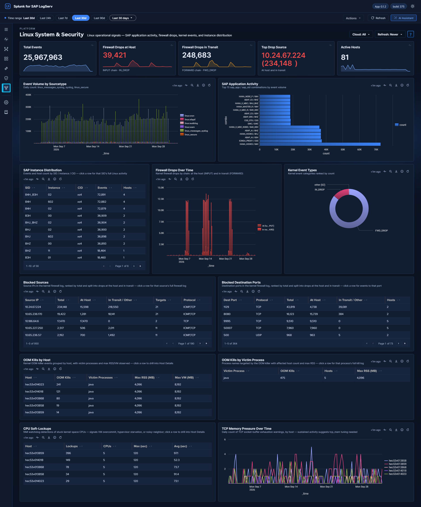

# Linux System & Security

## :material-circle-box:{ .taiconcolor } Why This Dashboard Matters

The Linux dashboard provides OS-level visibility for the hosts running SAP applications. Most SAP ABAP and HANA systems run on Linux, making OS-level monitoring essential for understanding the infrastructure beneath the application layer. This dashboard combines SAP-aware context (SID, instance, application identification from syslog) with kernel-level security monitoring (firewall drops at the host and in transit, and kernel events).

## Panels

- **Total Events** -- Aggregate event count across all Linux sourcetypes
- **Firewall Drops at Host** -- Count of kernel firewall drops of packets addressed to the host itself: `IN_DROP` lines, from the INPUT chain
- **Firewall Drops in Transit** -- Count of kernel firewall drops of packets the host was routing on to another system: `FWD_DROP` lines, from the FORWARD chain. Only hosts that forward traffic, such as VPN or IPsec gateways, log these. A packet passes through one chain or the other, never both, so the two KPIs add up without double counting
- **Top Drop Source** -- Single-value panel showing the #1 source IP by firewall-drop count, drops at the host and in transit together, in the format `<IP> (<count>)`. This surfaces the dominant drop source directly in the KPI row so it doesn't get buried in the table; the full ranking is in the **Blocked Sources** table below — click any row there to open that source IP's firewall log
- **Active Hosts** -- Count of distinct Linux hosts reporting data.
- **Event Volume by Sourcetype** -- Trend over time across `linux_messages_syslog` plus the dedicated Linux sourcetypes (`linux:cron`, `linux:warn`, `linux:sudolog`, `linux:slapd`) and `linux_secure`. The legacy `syslog` sourcetype is OR-ed alongside the new sourcetypes during the transition; existing `sourcetype=syslog` indexed data ages out per index retention.
- **SAP Application Activity** -- Horizontal bar chart of the top 15 `sap_app` / `sap_sid` combinations by event volume (the combination label sits on the y-axis so long application names stay readable)
- **SAP Instance Distribution** -- Table of SAP instances with event counts by SID, instance number, and CID
- **Firewall Drops Over Time** -- Kernel firewall drops over the selected range, split by chain into two series: *At host (INPUT)* (`IN_DROP`) and *In transit (FORWARD)* (`FWD_DROP`)
- **Kernel Event Types** -- Donut breakdown of kernel event categories parsed from the `kernel:` prefix — the ALL-CAPS tag that follows the kernel timestamp, such as `IN_DROP`, `FWD_DROP`, `ACPI` or `EXT4` (at least two leading capitals, digits allowed after them). Kernel lines that start with an ordinary sentence-case word ("Write cache…", "I/O error…") carry no tag and are not counted here
- **Blocked Sources** -- Table of source IPs seen in firewall events, ranked by **Total** and split into **At Host** and **In Transit / Other**, with target counts and protocols
- **Blocked Destination Ports** -- Table of destination ports targeted by firewall traffic, ranked and split the same way, with the number of hosts

    *The two Blocked tables count every firewall event carrying a source IP / destination port. At Host is the `IN_DROP` events among them; In Transit / Other is the rest: nearly all `FWD_DROP`, plus any other firewall line logged with a source or port. ICMP carries no destination port, so ICMP drops appear in Blocked Sources but not in Blocked Destination Ports.*
- **OOM Kills by Host** -- Kernel OOM-killer events per host, with the max process RSS/VM observed
- **OOM Kills by Victim Process** -- Process names targeted by the OOM killer
- **CPU Soft Lockups** -- Kernel soft-lockup events per host and CPU, with max/total stall duration
- **TCP Out-of-Memory Timeline** -- Kernel TCP memory-pressure events over time

## :material-circle-box:{ .taiconcolor } Where the Data Comes From

Every panel is summary-backed — there are no live raw scans. Panels read the
`logserv_linux_rollup` KV Store collection (nine metrics: `total`, `hosts`, `fw`, `kernel`,
`sapapp`, `sapinst`, `oom`, `lockup`, `tcpoom`), populated at minute :17 of every hour by
`logserv_linux_aggregate` from the seven Linux sourcetypes (`linux_messages_syslog`,
`linux_secure`, `linux:cron`, `linux:warn`, `linux:sudolog`, `linux:slapd`, plus legacy `syslog`).
The firewall fields (`SRC=` / `DST=` / `DPT=` / `PROTO=` and the drop/accept action) and the kernel
event names are extracted from the raw events at aggregation time, and the OOM / CPU-lockup / TCP
memory metrics store sums and maxima so the tables reconstruct averages and worst cases exactly.

**Firewall Drops in Transit** and **Firewall Drops Over Time** read the `kernel` metric, which counts the kernel tag of every `linux_secure` line (`IN_DROP`, `FWD_DROP`, …) per hour. **Firewall Drops at Host**, **Top Drop Source** and the two Blocked tables read the `fw` metric, whose action field records only `IN_DROP` and `IN_ACCEPT`; a `FWD_DROP` line is stored there with no action, which is why the Blocked tables count it under **In Transit / Other**.

Summary-backed panels switch automatically to their exact raw-equivalent search when the selected window is shorter than 90 minutes, so sub-hour investigation stays real-time. The collection keeps 365 days of hourly history (trimmed by a daily retention search); a fresh install seeds the last 30 days from **Settings → Dashboard Data → Run backfill**. The global **Cloud** dropdown filters the summaries through the `cloud_provider` dimension stored in every rollup row. Full schedule and freshness reference: [Performance & Data Freshness](../performance.md).

## :material-lightning-bolt:{ .taiconcolor } What to Look For

- **Firewall drop spikes** -- A sudden increase in **Firewall Drops at Host** may indicate port scanning, network reconnaissance, or a brute-force attack against SAP services.
- **Top Drop Source concentration** -- If the Top Drop Source KPI shows a single IP accounting for the overwhelming majority of drops, that IP is either a misconfigured internal system hammering a blocked port (check if it's an internal SAP host that recently changed config) or a persistent external scanner. The Blocked Sources table below has the full ranking, and its At Host and In Transit / Other columns show whether that source was reaching the host itself or systems the host routes to.
- **Drops in transit** -- Only a host that routes traffic onward, such as a VPN or IPsec gateway, logs `FWD_DROP`. On a gateway, drops in transit are traffic its forwarding policy does not allow, often a monitoring or discovery job pinging or probing the systems behind it, and they can outnumber the drops at the host many times over. Find the source in the Blocked Sources table and the job that owns it, then either allow that traffic or stop the job. Drops in transit on a host that is not meant to route at all mean IP forwarding is switched on there (container runtimes and Kubernetes nodes do this) and deserve a look.
- **New blocked source IPs** -- Unfamiliar source IPs appearing in the Blocked Sources table should be investigated, especially if they target SAP service ports (3200-3299 for dialog, 8000-8099 for HTTP, 30015 for HANA).
- **SAP application distribution changes** -- If the SAP Application Activity chart shows a previously active SID or application going silent, it may indicate a process crash or configuration issue.
- **OOM kills and soft lockups** -- The OOM Kills panels and CPU Soft Lockups table are the crash-adjacent signals on this dashboard: a process repeatedly targeted by the OOM killer, or recurring soft lockups on one host, may affect SAP system stability.
- **Port targeting patterns** -- The Blocked Destination Ports table reveals which services attackers are targeting. Ports associated with SAP services warrant immediate attention.

