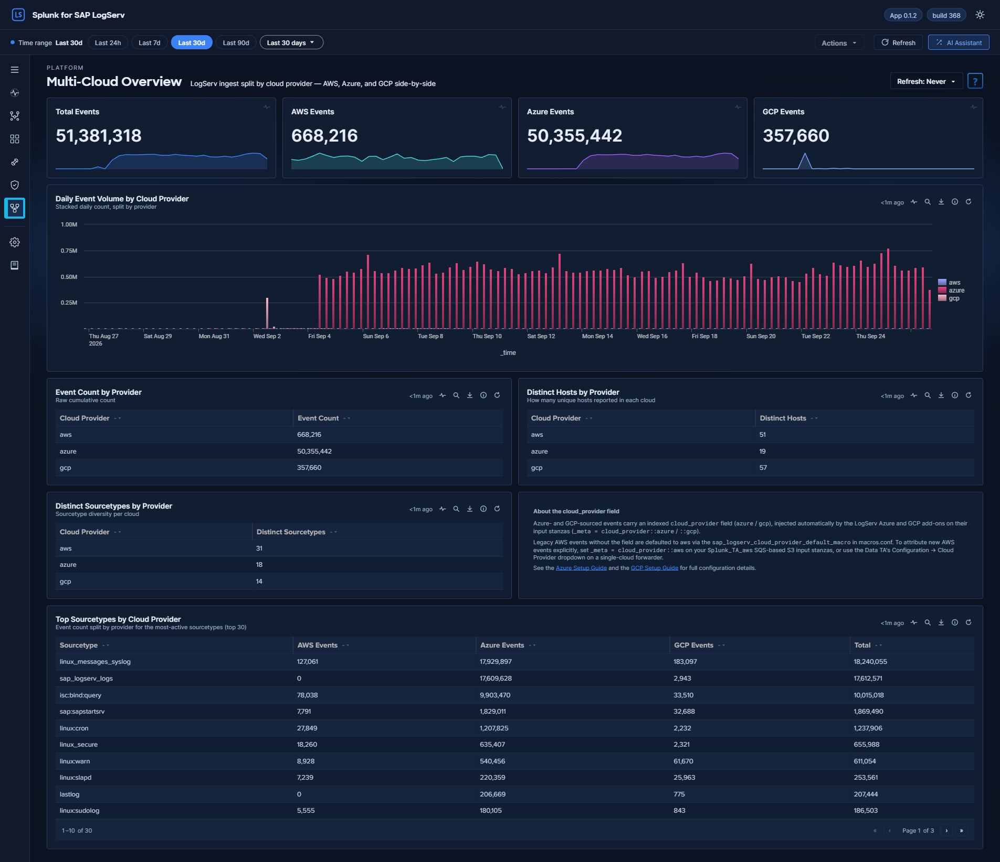

# Multi-Cloud Overview

## :material-circle-box:{ .taiconcolor } Why This Dashboard Matters

The Multi-Cloud Overview dashboard answers the question: **"Where is our LogServ data coming from, and is it balanced between cloud providers?"** It splits ingest by the indexed `cloud_provider` field so admins running any mix of **AWS S3**, **Azure Blob Storage**, and **Google Cloud Storage** ingest can confirm each pipeline is healthy and see relative volume at a glance.

Customers running a single cloud see the dashboard collapse cleanly to one provider (the unused providers' KPIs show `0`, the active provider's series carries the trend chart). Customers running two or three clouds see comparative KPIs + side-by-side trend so they can spot a stalled ingest channel before it becomes a visible gap in their other operational dashboards.

!!! tip "How `cloud_provider` is attributed"
    `cloud_provider` is an indexed field, written when each event is indexed:

    - The **LogServ Azure** and **LogServ GCP** add-ons stamp `azure` and `gcp` on every event their inputs read (`_meta = cloud_provider::azure` / `::gcp`, set automatically).
    - Inputs the Data TA's **AWS S3 Direct** screen creates stamp `aws` automatically, and the screen names any input whose stamp did not complete. Inputs made from the `curl` commands it generates under **Apply this as an administrator** carry no stamp: add the `_meta` line to their stanzas by hand (the `inputs.conf` stanzas it generates there already carry it).
    - For the Splunk Add-on for AWS SQS-Based S3 inputs, you add `_meta = cloud_provider::aws` to each input's stanza, and leave the Data TA's **Configuration → Cloud Provider** dropdown at **Not set**.

    Events with no stamp are counted as `aws` by the LogServ App's dashboards, this one included, but not by searches outside the App (see **Requires** below). The recommended setup, and the one case where the dropdown is an alternative, are on [Choose Cloud Attribution](../../../install-setup/cloud-attribution.md).

## :material-circle-box:{ .taiconcolor } Requires

- **Sourcetypes:** any. The dashboard reads every event in the LogServ data index and splits it by `cloud_provider`.
- **Search-head add-ons:** none beyond the LogServ App.
- **Dashboard Data row:** *Multi-Cloud Overview* on **Settings → Dashboard Data**. On a new install, **Run backfill** there seeds the last 30 days by default (60, 90, 180 or 365 days, or a custom range, are also offered); without a backfill the panels fill one hour at a time. See [Backfilling on first install](../../dashboard-data.md#backfilling-on-first-install).
- **Attribution at ingest.** The dashboard works on any LogServ App install (it shows `0` for unused providers), but how well it splits your data depends on the ingest configuration:

    1. **For Azure ingest:** nothing to do. The LogServ Azure add-on sets `_meta = cloud_provider::azure` on its input kind (`[sap_logserv_azure_queue]` in the add-on's `default/inputs.conf`), so every input inherits it. See the [Azure Setup Guide](../../../install-setup/azure-setup.md).
    2. **For GCP ingest:** nothing to do. The LogServ GCP add-on sets `_meta = cloud_provider::gcp` on its input kind (`[sap_logserv_gcp_pubsub]`), so every input inherits it. See the [GCP Setup Guide](../../../install-setup/gcp-setup.md).
    3. **For AWS ingest:** add `_meta = cloud_provider::aws` to each `[aws_sqs_based_s3://<your input name>]` stanza in `Splunk_TA_aws`'s `local/inputs.conf` on each heavy forwarder (on Splunk Cloud with no heavy forwarder, see Choose Cloud Attribution), before the input first runs: events indexed before the line is added keep no stamp. For inputs it creates, the AWS S3 Direct screen adds the line itself, and says so when it could not. Leave the Data TA's **Configuration → Cloud Provider** dropdown at **Not set** (its default). The dropdown writes its value in addition to any `_meta` an input already sets, so an event whose input stamps a different provider carries both values. [Choose Cloud Attribution](../../../install-setup/cloud-attribution.md) explains this, including the case where both name the same provider.
    4. **Unstamped events:** the LogServ App's dashboards count events with no `cloud_provider` as `aws` (their summaries apply `coalesce(cloud_provider, "aws")`, and the global **Cloud** filter set to **aws** also matches events with no value). This is not a field default: ad-hoc searches, `tstats`, `cloud_provider=aws` term filters and Enterprise Security see no value on those events. To apply the same default in your own searches, call the `sap_logserv_cloud_provider_default_macro` macro.
    5. **Macro must be present:** the LogServ App's `default/macros.conf` defines `[sap_logserv_cloud_provider_default_macro]` with `definition = eval cloud_provider=coalesce(cloud_provider, "aws")`. If you've overridden `macros.conf` in your local app directory, ensure this macro is still defined.

## :material-circle-box:{ .taiconcolor } Panels

Unlike the other dashboards, this one has no Cloud Provider picker in its title row: the provider split *is* the dashboard, so every panel reports all providers side by side. The time-range picker and the per-dashboard Refresh picker work as on any other LogServ App dashboard. The tables are inventory views and have no row drill-downs.

- **Total Events** -- Aggregate event count across ALL ingest channels with a daily-volume sparkline. Useful as the baseline for comparing the per-provider KPIs that follow.
- **AWS Events** -- Event count where `cloud_provider = "aws"`: events stamped `aws` at ingest, plus events with no stamp, which this dashboard counts as `aws`. Sparkline shows daily AWS-only volume.
- **Azure Events** -- Event count where `cloud_provider = "azure"`. Sparkline shows daily Azure-only volume. On an install without Azure ingest, this KPI shows `0` and its sparkline is empty.
- **GCP Events** -- Event count where `cloud_provider = "gcp"`. Sparkline shows daily GCP-only volume. On an install without GCP ingest, this KPI shows `0` and its sparkline is empty.
- **Event Volume by Cloud Provider** -- Column chart of event counts over time, one bar per provider in each time bucket. Useful for spotting shifts over time: when one provider's bars drop suddenly while the others stay level, that provider's ingest has likely stalled.
- **Event Count by Provider** -- One-row-per-provider table with the raw cumulative event counts. The same data as the per-provider KPIs but in tabular form so the ratios are easy to read.
- **Distinct Hosts by Provider** -- One-row-per-provider table showing how many unique `host` values reported under each `cloud_provider`. Confirms forwarder coverage across the cloud boundary.
- **Distinct Sourcetypes by Provider** -- One-row-per-provider table showing how many distinct sourcetypes have at least one event per provider. Useful for confirming every cloud is producing the full sourcetype mix (e.g., not just `linux_messages_syslog` from Azure while AWS has the SAP stack).
- **About the cloud_provider field** -- Inline reference panel (not a search result) explaining how the field is set and linking to the Azure and GCP Setup Guides. Where its short text and [Choose Cloud Attribution](../../../install-setup/cloud-attribution.md) differ on the Cloud Provider dropdown, follow Choose Cloud Attribution.
- **Top Sourcetypes by Cloud Provider** -- Wide table of the 30 most-active sourcetypes with per-provider columns (AWS Events / Azure Events / GCP Events / Total). The Total column is sorted descending so the high-volume sourcetypes lead. Useful for spotting per-sourcetype anomalies (e.g., `sap:hana:audit` is only appearing under one cloud when several should be producing it).

## :material-lightning-bolt:{ .taiconcolor } What to Look For

- **Stalled ingest channel** -- If one provider's KPI sparkline goes flat-zero for the most recent 1–3 days while the others continue to climb, the affected channel's input has likely stalled. Check the LogServ Azure add-on's `sap_logserv_azure_queue` input on the heavy forwarder (per-firing summary in `splunk_ta_sap_logserv_azure_queue.log`: `Input '<name>' done: messages=N blobs=N events=N ...`), the LogServ GCP add-on's `sap_logserv_gcp_pubsub` input (`splunk_ta_sap_logserv_gcp_pubsub.log`: `Input '<name>' done: messages=N objects=N events=N ...`), or, for AWS, the Splunk Add-on for AWS SQS-Based S3 input's own log (`index=_internal sourcetype=aws:sqsbaseds3:log`).
- **Asymmetric sourcetype coverage** -- If both clouds report comparable total event counts but the Top Sourcetypes table shows one cloud with a narrow sourcetype mix (e.g., AWS only producing `sap:hana:audit` while Azure produces 25+ sourcetypes), the AWS-side filter rules may be set to include-only rather than include-all. Check [Configuring Filters](../../../install-setup/configure-filters.md).
- **Unexpected appearance of `aws` from an Azure- or GCP-only customer** -- If your environment has no AWS ingest but the AWS Events KPI shows non-zero values, some events carry no `cloud_provider` stamp and this dashboard counts them as `aws`: for example, events from an input that sets no `_meta`. An indexed event cannot be stamped afterwards; those events keep counting as `aws` until they age out of the index. To find them, run ``| tstats fillnull_value="(unstamped)" count WHERE `sap_logserv_idx_macro` BY cloud_provider, sourcetype`` and look at the `(unstamped)` rows.
- **Distinct Hosts count substantially lower than expected** -- If a single cloud's "Distinct Hosts" count is much lower than the actual count of SAP hosts in that cloud, your add-on input config may be too narrow (wrong container prefix on the Azure side, wrong subscription on the GCP side, wrong bucket prefix on the AWS side). Compare against your topology source-of-truth.
- **Total Events ≠ sum of the per-provider KPIs** -- The per-provider KPIs match `aws` / `azure` / `gcp` exactly, while Total Events adds up every value. If Total exceeds their sum, some events carry another `cloud_provider` value — run ``| tstats fillnull_value="(unstamped)" count WHERE `sap_logserv_idx_macro` BY cloud_provider`` to see every value (unstamped events show as `(unstamped)`; this dashboard counts them as `aws`). An event that carries two different values, for example when the Cloud Provider dropdown is set on a forwarder whose inputs stamp a different provider, is counted once under each value; find such events with ``search `sap_logserv_idx_macro` earliest=-24h | where mvcount(cloud_provider) > 1 | stats count by host, sourcetype`` and see [Choose Cloud Attribution → Check the Result](../../../install-setup/cloud-attribution.md#check-the-result). If instead the AWS KPI under-reports, check that the `sap_logserv_cloud_provider_default_macro` macro is defined on your search head — the LogServ App ships it in `default/macros.conf`; confirm with `| rest /services/configs/conf-macros | search title=sap_logserv_cloud_provider_default_macro`.

## :material-circle-box:{ .taiconcolor } Related Dashboards

- [Data Pipeline Overview](data-pipeline-overview.md) -- the same ingest by host and sourcetype, across all clouds.
- [Data Doctor (Diagnostics)](diagnostics.md) -- rollup freshness and sourcetype presence.
- [Azure Setup Guide](../../../install-setup/azure-setup.md) and [GCP Setup Guide](../../../install-setup/gcp-setup.md) -- the cloud-side configuration of each channel.

??? info "Where the data comes from"
    Panels read the `logserv_mc_rollup` KV Store collection — metric `count` carries per-hour event
    counts by (cloud provider, sourcetype) and metric `hosts` the per-provider host sets (kept separate
    so distinct-host counts stay correct when an event carries a multivalue host). Populated at minute
    :22 of every hour by `logserv_mc_aggregate` over the entire index, keyed on the **`cloud_provider`
    indexed field** stamped at ingest (see **Requires**); the aggregate applies the
    `sap_logserv_cloud_provider_default_macro` macro, so events with no provider attribution are
    counted as `aws`.

    Summary-backed panels switch automatically to their exact raw-equivalent search when the selected window is shorter than 90 minutes, so sub-hour investigation stays real-time. The collection keeps 365 days of hourly history (trimmed by a daily retention search). Unlike the other dashboards, this one is exempt from the global **Cloud** dropdown — its panels pin their own provider values (AWS / Azure / GCP side by side), so a global filter would be circular. Full schedule and freshness reference: [Dashboard Data: Backfill and Freshness](../../dashboard-data.md).
