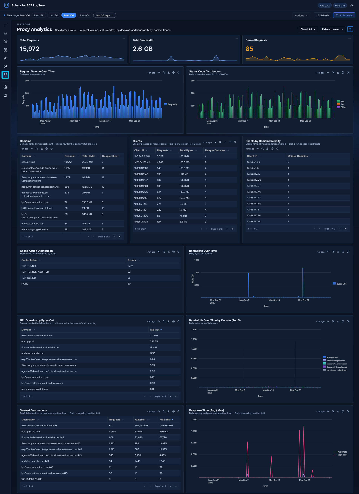

# Proxy Analytics

## :material-circle-box:{ .taiconcolor } Why This Dashboard Matters

The Proxy Analytics dashboard monitors outbound internet access through the Squid proxy server. In SAP environments, proxy logs reveal which systems and users are accessing external resources, enabling detection of data exfiltration attempts, policy violations (unauthorized internet access), and compromised systems communicating with malicious infrastructure. Proxy logs complement DNS analytics by showing the actual HTTP connections that follow DNS resolution.

## :material-circle-box:{ .taiconcolor } Requires

- **Sourcetypes:** `squid:access`, its `access.log` lines only.
- **Search-head add-ons:** none beyond the LogServ App, which has the Squid parsing built in. Do not install the standalone Squid add-on alongside it; see the note below.
- **Dashboard Data row:** *Proxy Analytics* on **Settings → Dashboard Data**. On a new install, **Run backfill** there seeds the last 30 days by default (60, 90, 180 or 365 days, or a custom range, are also offered); without a backfill the summary-backed panels fill one hour at a time. See [Backfilling on first install](../../dashboard-data.md#backfilling-on-first-install).

!!! note "Squid parsing is built into the LogServ App"
    The App absorbed the native-format parsing from the archived Splunk Add-on for Squid Proxy, and parses the `splunk_recommended_squid` format with its own transforms. Do **not** install the standalone Squid TA alongside it — you would get double parsing, and its CIM-standard `action="blocked"` vocabulary differs from the App's customized `action="denied"`, which the Denied Requests KPI and the Cache Action panel depend on. The App shows a detection banner on the home view when a conflicting add-on is enabled.

## :material-circle-box:{ .taiconcolor } Panels

- **Total Requests** -- Aggregate proxy request count
- **Total Bandwidth** -- Sum of bytes transferred through the proxy (formatted KB/MB/GB)
- **Denied Requests** -- Count of requests blocked by proxy policy: those whose `action` is `denied`, which the App's Squid action lookup assigns to `TCP_DENIED`, `UDP_DENIED`, `TCP_SWAPFAIL` and `UDP_INVALID`. [Network Perimeter](../security/network-perimeter.md) counts denied requests as `status=403` or `TCP_DENIED` instead, so the two counts can differ
- **Request Volume Over Time** -- Request trend over time
- **Status Code Distribution** -- Column chart of requests over time, one bar per response category in each time bucket: 2xx, 3xx, 4xx, 5xx, and Other for a status below 200 or none at all
- **Domains** -- Table of the most accessed domains with request counts, bandwidth, and unique client counts
- **Clients** -- Table of the most active client IPs with request counts, bandwidth, and domain diversity. Click a row to open Host Details for that client
- **Clients by Domain Diversity** -- Table ranking client IPs by the count of distinct URL domains they accessed. Click a row to open Host Details for that client
- **Cache Action Distribution** -- Table of Squid cache/result actions (`vendor_action`, e.g. TCP_TUNNEL, TCP_HIT, TCP_MISS, TCP_DENIED, TCP_TUNNEL_ABORTED) ranked by event count; it shows how well the proxy cache is working
- **Bandwidth Over Time** -- Column chart of total bytes out over time
- **URL Domains by Bytes Out** -- Table of URL domains ranked by MB delivered (the data-exfiltration detection surface); paginated, not capped. Click a row for that domain's full proxy log
- **Bandwidth Over Time by Domain (Top 5)** -- Column chart of the five highest-bandwidth domains over time, one bar per domain in each time bucket -- pairs with URL Domains by Bytes Out to show whether exfiltration is ongoing or historical
- **Slowest Destinations** -- Top destinations by peak response time, with request count and average/max latency (ms), from the Squid `duration` field
- **Response Time (Avg / Max)** -- Average and peak proxy response time over time

## :material-lightning-bolt:{ .taiconcolor } What to Look For

- **Denied request spikes** -- A sudden increase in denied requests may indicate a compromised system attempting to reach blocked destinations, or a policy change affecting legitimate traffic.
- **High-bandwidth domains** -- The URL Domains by Bytes Out panel is tuned specifically for exfiltration detection. A new domain appearing near the top, or a known-OK domain spiking, warrants investigation.
- **Sustained-bandwidth domains** -- The Bandwidth Over Time by Domain chart shows whether a top domain's traffic is steady (expected service) or a sudden burst (exfiltration attempt, large file transfer).
- **Client domain diversity** -- A client IP with extremely high domain diversity in the Clients by Domain Diversity panel is unusual for a well-behaved SAP server -- most production systems talk to a predictable small set of external domains.
- **Cache miss dominance** -- If Cache Action Distribution is dominated by TCP_MISS, the proxy cache may not be earning its keep (or a new workload is defeating it). For security-relevant investigations, TCP_TUNNEL dominance signals mostly CONNECT-tunnelled HTTPS traffic that the proxy can't inspect.
- **New high-volume clients** -- A system that suddenly appears as a top proxy client may be compromised and performing outbound scanning, beaconing, or data exfiltration.

## :material-circle-box:{ .taiconcolor } Related Dashboards

- [Network Perimeter](../security/network-perimeter.md) -- proxy traffic beside firewall drops and DNS, with the cross-source Suspicious Activity Indicator.
- [DNS Analytics](dns-analytics.md) -- the lookups that come before the connections.
- [Host Details](host-details.md) -- where the client rows lead.

??? info "Where the data comes from"
    The single source is `squid:access`, and only its **access-log lines** count as requests. The Data TA routes Squid's `cache.log` and `store.log` to `squid:cache` and `squid:store`; data indexed by older Data TA builds still carries them as `squid:access`, where they record cache housekeeping, not requests, so every panel scopes to `source="*access.log*"`. Both access-log formats are parsed: Squid's native format, and the `logformat=splunk_recommended_squid` key=value format that SAP LogServ proxy logs use.

    - **Summary-backed panels** read the `logserv_proxy_rollup` KV Store collection — metrics
      `core` (per-hour request/denied/bandwidth sums), `status` (HTTP status classes), `dur` +
      `destdur` (response-time sums/counts/maxima overall and per destination — the Avg/Max panels
      reconstruct exact averages from these), `domain` (per-domain traffic and bandwidth) and
      `cacheaction` (Squid cache verdicts). Populated at minute :24 of every hour by
      `logserv_proxy_aggregate`.
    - **Pure-count panels** (Total Requests and Request Volume Over Time) run `tstats` directly
      against indexed fields.

    Summary-backed panels switch automatically to their exact raw-equivalent search when the selected window is shorter than 90 minutes, so sub-hour investigation stays real-time. The collection keeps 365 days of hourly history (trimmed by a daily retention search). The global **Cloud** dropdown filters the summaries through the `cloud_provider` dimension stored in every rollup row. Full schedule and freshness reference: [Dashboard Data: Backfill and Freshness](../../dashboard-data.md).
