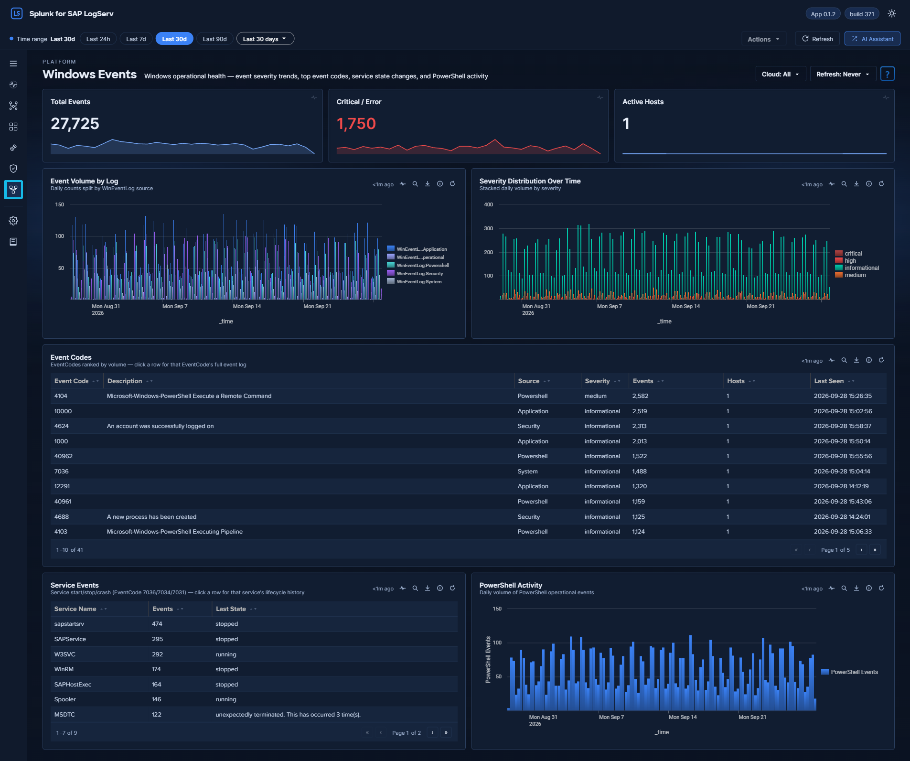

# Windows Events

## :material-circle-box:{ .taiconcolor } Why This Dashboard Matters

The Windows Events dashboard monitors Windows hosts in the SAP landscape, which commonly run SAP application servers, database instances, and management consoles. Windows Event Logs capture service health, PowerShell execution, and system errors that indicate Windows-specific operational issues. This dashboard focuses on operational health and service state -- the authentication-failure story is owned by the [Cross-Stack Authentication](../security/cross-stack-authentication.md) dashboard so that all three layers (SAP / HANA / Windows) can be investigated together.

## :material-circle-box:{ .taiconcolor } Requires

- **Sourcetypes:** `XmlWinEventLog`.
- **Search-head add-ons:** the Splunk Add-on for Microsoft Windows (742). See the warning below.
- **Dashboard Data row:** *Windows* on **Settings → Dashboard Data**. On a new install, **Run backfill** there seeds the last 30 days by default (60, 90, 180 or 365 days, or a custom range, are also offered); without a backfill the panels fill one hour at a time. See [Backfilling on first install](../../dashboard-data.md#backfilling-on-first-install).

!!! warning "Requires the Splunk Add-on for Microsoft Windows on the Search Head"
    Several panels here depend on the **Splunk Add-on for Microsoft Windows** (<a href="https://splunkbase.splunk.com/app/742" target="_blank">Splunkbase 742</a>) being installed on the **Search Head** tier. The LogServ App ships **no `XmlWinEventLog` field extraction of its own** — `EventCode` and `severity` are search-time fields provided by add-on 742 (its `xmlwindows_severities.csv` lookup maps the event `<Level>` to severity: `1`→critical, `2`→high, `3`→medium, `0`/`4`/`5`→informational).

    **Without add-on 742 on the search tier**, Windows events still index fine and the **Total Events**, **Event Volume by Log**, **Active Hosts**, and **PowerShell Activity** panels populate (they read envelope fields), but the **Event Codes** table collapses to a single row labelled `(none)` and the **Severity Distribution**, **Critical / Error**, and **Service Events** panels stay empty.

    **Tier matters:** `EventCode`/`severity` are *search-time* extractions, so add-on 742 must be on the **Search Head** — installing it on a heavy forwarder or indexer does nothing for these panels. On Splunk Cloud, install it on the Cloud SH via self-service app management (it is replicated to the indexer search peers through the knowledge bundle). See [Where Each Package Goes](../../../getting-started/package-placement.md#package-matrix).

    **If the App ran before you installed the add-on**, rebuild the summaries on **Settings → Dashboard Data**:

    1. On the *Windows* row, note its **History**, click **Clear**, then **Backfill** it with a window that covers that history (the 365-day preset or a custom range). The Clear is needed because the rows written without the add-on are keyed on empty event codes and severities; a Backfill alone would add the new rows beside them and the totals would count those hours twice. The Clear removes all of the row's history; the Backfill restores only the hours whose raw events your index still holds.
    2. **Backfill**, with the same window, the other rows that read Windows fields: *Environment Health*, *Cross-Stack Authentication*, *Change & Configuration Activity*, *Host Role Activity (Host Details)*, *Host Details* and *Environment Topology (detail tabs)*. None of them needs a Clear. The first four stored no Windows rows that depend on the add-on. *Host Details* keys its rows by host and hour, so the Backfill replaces their counts with ones that include the Windows failed logons (EventCode 4625) and critical events; *Environment Topology (detail tabs)* gains new rows for the Windows events whose add-on severity is `critical`, which it did not count before. The names that [Environment Topology](../topology.md) shows for IP addresses take in the Windows logons on their own at the next daily refresh (02:32 search-head time), which reads the last 30 days.

    Run the rebuild outside the nightly retention window (00:34–00:58, 01:30–01:58 and 02:34–02:36 search-head time), when the retention searches rewrite the rollups and can erase rows a backfill is writing; see [Backfilling on first install](../../dashboard-data.md#backfilling-on-first-install).

## :material-circle-box:{ .taiconcolor } Panels

- **Total Events** -- Aggregate Windows event count
- **Critical / Error** -- Count of Windows Critical (Level 1) and Error (Level 2) events. In CIM severity vocabulary these are `severity="critical"` and `severity="high"` — there is no `error` severity value
- **Active Hosts** -- Count of distinct Windows hosts reporting data
- **Event Volume by Log** -- Trend over time by Windows log source (Application, Security, System, PowerShell)
- **Severity Distribution Over Time** -- Column chart of events over time, one bar per severity in each time bucket
- **Event Codes** -- Featured full-width table of the most frequent EventCodes with 7 enriched columns: Event Code, Description (signature), Source log, Severity, Events, Hosts (distinct count), Last Seen. Row drilldown opens the search app filtered by that event code.
- **Service Events** -- Table of Windows service start/stop activity with latest state
- **PowerShell Activity** -- Column chart of PowerShell operational event volume over time

## :material-lightning-bolt:{ .taiconcolor } What to Look For

- **High-frequency Event Codes** -- The Event Codes table is the primary starting point. EventCode 7031 / 7034 (service terminated unexpectedly), 1000 (application crash), and 41 (unexpected shutdown) are high-priority. Click through to see every occurrence of a specific code.
- **Service crashes** -- EventCode 7031 (service terminated unexpectedly) in either the Event Codes table or the Service Events panel indicates a critical service failure. For SAP services (sapstartsrv, SAPService), this requires immediate attention.
- **PowerShell activity spikes** -- Sudden increases in PowerShell execution may indicate lateral movement by an attacker using PowerShell-based attack tools. Correlate with the [Cross-Stack Authentication](../security/cross-stack-authentication.md) dashboard to see whether any Windows logons were concurrent.
- **Critical/error severity trends** -- A rising trend in critical and error events over multiple days indicates accumulating system health issues that need proactive investigation.
- **Event Code hosts expanding** -- The Hosts column on the Event Codes table makes it obvious when a normally-host-isolated error starts appearing on multiple hosts -- a sign the underlying cause is environmental (failed update, domain policy change) rather than local.

## :material-circle-box:{ .taiconcolor } Related Dashboards

- [Cross-Stack Authentication](../security/cross-stack-authentication.md) -- Windows logon failures beside the SAP and HANA layers.
- [Change & Configuration Activity](../security/change-config.md) -- Windows account and group changes.
- [Host Details](host-details.md) -- one host's event codes beside its other activity.

??? info "Where the data comes from"
    The single source is `XmlWinEventLog`. Every panel is summary-backed: panels read the
    `logserv_windows_rollup` KV Store collection — metric `main` carries an hourly grain over
    (event code, severity, source/channel, host) plus per-bucket latest values for the descriptive
    columns, and metric `svc` carries the service-event facts. Populated at minute :20 of every hour by
    `logserv_windows_aggregate`.

    Summary-backed panels switch automatically to their exact raw-equivalent search when the selected window is shorter than 90 minutes, so sub-hour investigation stays real-time. The collection keeps 365 days of hourly history (trimmed by a daily retention search). The global **Cloud** dropdown filters the summaries through the `cloud_provider` dimension stored in every rollup row. Full schedule and freshness reference: [Dashboard Data: Backfill and Freshness](../../dashboard-data.md).
