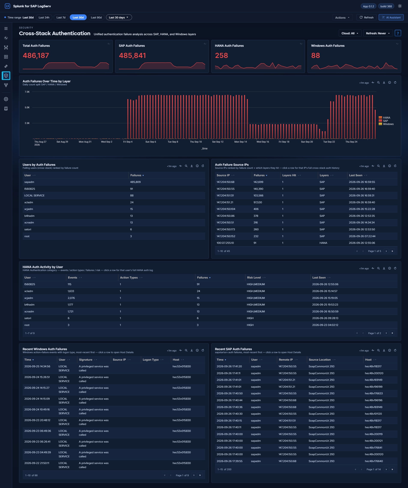

# Cross-Stack Authentication

## :material-circle-box:{ .taiconcolor } Why This Dashboard Matters

Authentication failures are usually investigated one layer at a time -- someone looks at HANA audit logs, then switches to Windows Event Log, then opens the SAP services dashboard. An attacker who probes multiple layers at once is therefore hard to spot. Cross-Stack Authentication unifies the failure signal across the three layers that matter in an SAP landscape -- **SAP sapstartsrv**, **HANA audit**, and **Windows Security Event Log** -- so that one dashboard shows the total, the per-layer split, and the source IPs and users in common across layers. Use it as the first stop when you suspect credential-based attacks or widespread misconfiguration after a password rotation.

## :material-circle-box:{ .taiconcolor } Requires

- **Sourcetypes:** `sap:sapstartsrv`, `sap:hana:audit` and `XmlWinEventLog`.
- **Search-head add-ons:** the Splunk Add-on for Microsoft Windows (742), for the Windows layer. See the warning below.
- **Dashboard Data row:** *Cross-Stack Authentication* on **Settings → Dashboard Data**. On a new install, **Run backfill** there seeds the last 30 days by default (60, 90, 180 or 365 days, or a custom range, are also offered); without a backfill the summary-backed panels fill one hour at a time. See [Backfilling on first install](../../dashboard-data.md#backfilling-on-first-install).

!!! warning "The Windows layer needs the Splunk Add-on for Microsoft Windows on the Search Head"
    The LogServ App ships **no `XmlWinEventLog` field extraction of its own**. The Windows layer counts events whose CIM `action` field is `failure`, and its table shows the logon type, user and source address; all of these are search-time fields from the **Splunk Add-on for Microsoft Windows** (<a href="https://splunkbase.splunk.com/app/742" target="_blank">Splunkbase 742</a>).

    **Without add-on 742 on the search tier**, the Windows events still index, but the **Windows Auth Failures** KPI stays at 0, **Recent Windows Auth Failures** stays empty, and the other panels show the SAP and HANA layers only.

    **Tier matters:** these are *search-time* fields, so add-on 742 must be on the **Search Head**; installing it on a heavy forwarder or indexer does nothing for this dashboard. On Splunk Cloud, install it on the Cloud search head. After installing it, **Backfill** the *Cross-Stack Authentication* row on **Settings → Dashboard Data** with a window that covers the history you want, so the summaries pick up the Windows failures. No **Clear** is needed: without the add-on this row stored no Windows rows. See [Where Each Package Goes](../../../getting-started/package-placement.md#package-matrix).

## :material-circle-box:{ .taiconcolor } Panels

The title row carries the app-wide **Cloud Provider** picker (All / aws / azure / gcp); any setting other than **All** scopes every panel below to that ingest channel.

- **Total Auth Failures** -- Aggregate failed authentication count across all three layers
- **SAP Auth Failures** -- Count of sapstartsrv authentication failures
- **HANA Auth Failures** -- Count of HANA audit events where the connection/authentication was rejected
- **Windows Auth Failures** -- Count of Windows Security-channel events (sourcetype `XmlWinEventLog`) where the CIM `action` field is `failure` (the classification comes from the Splunk Add-on for Windows on the search-head tier)
- **Auth Failures Over Time by Layer** -- Column chart of failures over time, one bar per layer (SAP / HANA / Windows) in each time bucket, so correlated spikes across layers are visible at a glance
- **Users by Auth Failures** -- Table of failing usernames ranked by failure count, summed across all three layers (paginated)
- **Auth Failure Source IPs** -- Table of source IPs ranked by failure count, showing how many layers each IP hit and which ones, plus last-seen time (paginated); row drilldown opens that IP's full cross-stack auth history in Search
- **HANA Auth Activity by User** -- Table of HANA users across ALL authentication activity (successes included), showing total events, distinct action types, failure count, risk level, and last-seen time, sorted by failures; row drilldown opens that user's full HANA auth log
- **Recent Windows Auth Failures** -- Table of the most recent Windows failure events (up to 200) with user, event signature, source IP, logon type, and host; row drilldown opens Host Details for that host
- **Recent SAP Auth Failures** -- Table of the most recent sapstartsrv failed-auth events (up to 200) with user, remote IP, source location, and host; row drilldown opens Host Details for that host

## :material-lightning-bolt:{ .taiconcolor } What to Look For

- **Correlated spikes across layers** -- If the Auth Failures Over Time by Layer chart shows all three layers rising at the same time, that's almost always a network-level attack (password spray, credential stuffing) rather than a local misconfiguration. Investigate source IPs immediately.
- **Single source IP across layers** -- The Auth Failure Source IPs table makes it obvious when one IP is failing against SAP, HANA, AND Windows. That's the hallmark of a targeted attack rather than an expired-password incident.
- **High user failure count concentrated on service accounts** -- Service accounts (sapadm, sapservice accounts, DBADMIN-style) with large failure counts suggest either a recently rotated password that wasn't updated downstream, or an attacker trying to abuse a high-privilege account.
- **Asymmetry between layers** -- Many HANA failures but zero SAP / Windows failures usually indicates an application-layer issue (bad connection string, expired JDBC cert). Asymmetry the other way (many Windows failures, no HANA failures) often points to a domain-level issue. A Windows layer that is always zero while Windows events are arriving usually means add-on 742 is missing from the search head (see **Requires**).
- **After a password rotation** -- Expect a short burst of failures across one or more layers immediately after a change. If the burst persists beyond the rotation window, some downstream system is still using the old credential.

## :material-circle-box:{ .taiconcolor } Related Dashboards

- [Host Details](../platform/host-details.md) -- where the Recent Windows and Recent SAP Auth Failures rows lead.
- [SAP Services](../integration/sap-services.md) -- sapstartsrv authentication and TLS failures in detail.
- [HANA Audit](../applications/hana-audit.md) -- the full HANA audit trail.
- [Windows Events](../platform/windows.md) -- Windows operational health.
- [Change & Configuration Activity](change-config.md) -- account and privilege changes that often follow, or explain, a burst of failures.

??? info "Where the data comes from"
    - **Summary-backed panels** read the `logserv_xstack_auth_rollup` KV Store collection — metric
      `fail` carries the cross-source authentication-failure grain over (layer, failed user) spanning
      `sap:sapstartsrv`, `sap:hana:audit` and `XmlWinEventLog`; metric `failip` the per-source-IP
      failure facts (layers hit, last seen); metric `hanauser` the full HANA authentication population
      (successes included) per user/action/status/risk level. Populated at minute :15 of every hour by
      `logserv_xstack_auth_aggregate`.
    - **Live panels** — the Windows events and SAP authentication tables are per-event listings
      dispatched against the raw events at view time, capped at the 200 most recent matches each.

    Summary-backed panels switch automatically to their exact raw-equivalent search when the selected window is shorter than 90 minutes, so sub-hour investigation stays real-time. The collection keeps 365 days of hourly history (trimmed by a daily retention search). The global **Cloud** dropdown filters the summaries through the `cloud_provider` dimension stored in every rollup row. Full schedule and freshness reference: [Dashboard Data: Backfill and Freshness](../../dashboard-data.md).
