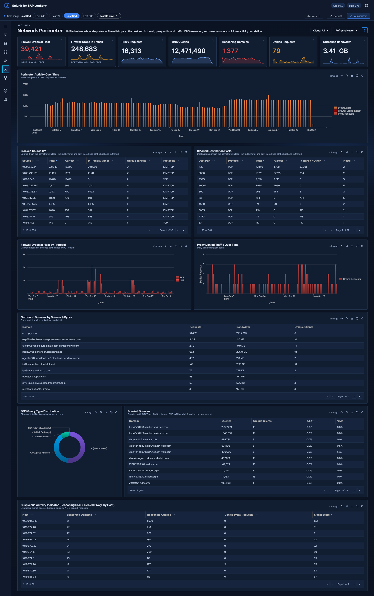

# Network Perimeter

## :material-circle-box:{ .taiconcolor } Why This Dashboard Matters

Firewall drops, proxy traffic, and DNS queries are three different lenses on the same underlying question: **what is crossing the network boundary and should it be there?** Each lens lives on its own operational dashboard ([Linux](../platform/linux.md), [Proxy Analytics](../platform/proxy.md), [DNS Analytics](../platform/dns-analytics.md)), but an attacker rarely limits themselves to a single surface -- a compromised host often shows up in multiple signals simultaneously, and that correlation is where the security value lives. Network Perimeter synthesizes the three sources into a single view: rejected traffic (firewall drops at the host and in transit), outbound flow (proxy), and resolution activity (DNS), with a dedicated cross-source panel that ranks hosts by combined suspicious-signal score. Use it as the first stop for "is our network perimeter healthy and clean?"

## Panels

The title row carries the app-wide **Cloud Provider** picker (All / aws / azure / gcp). Every panel on this dashboard is scoped by it; leave it on **All** unless you are deliberately isolating one ingest channel.

- **Firewall Drops at Host** -- Count of kernel firewall `IN_DROP` events from `linux_secure`: packets addressed to the host itself, dropped by its INPUT chain
- **Firewall Drops in Transit** -- Count of kernel firewall `FWD_DROP` events: packets a host was routing on to another system, dropped by its FORWARD chain. Only hosts that forward traffic, such as VPN or IPsec gateways, log these. Read from the [Linux](../platform/linux.md) dashboard's summary data, so it shows 0, or undercounts, for any period the Linux rollup has not summarised: its aggregation turned off, or those days not backfilled. The row to rebuild in **Settings → Dashboard Data** is *Linux System & Security / Network Perimeter*
- **Proxy Requests** -- Count of HTTP requests handled by Squid
- **DNS Queries** -- Count of DNS queries from `isc:bind:query`
- **Beaconing Domains** (red) -- Domains exhibiting periodic query patterns (low variance in inter-query interval) -- candidate C2 channels. Beaconing is detected **per UTC calendar day** (a domain's inter-query gaps are analysed within each UTC day, whatever timezone you view the dashboard in), and the KPI is the **sum of each day's distinct beaconing-domain count** over the selected range -- a domain beaconing every day for a week counts 7. Its sparkline has one point per UTC day, and hovering a point shows that UTC date; a UTC day that has not ended yet is drawn at 0 and labelled *not yet computed*. The beaconing panels are refreshed by a daily scheduled search (00:30 search-head local time), so they can lag up to 24 h; the other panels on this dashboard refresh hourly
- **Denied Requests** (orange when non-zero) -- Count of proxy requests with `status=403` or `vendor_action="TCP_DENIED"`; click to drill down
- **Outbound Bandwidth** -- `sum(bytes_out)` across all proxy requests, formatted KB/MB/GB
- **Perimeter Activity Over Time** -- Full-width stacked column chart showing counts of all three sources over time on a single timeline; simultaneous spikes across two or three series are the correlation signal to watch for. Its firewall series is **Firewall Drops at Host**; drops in transit are not charted here.
- **Blocked Source IPs** -- Every source IP in the firewall log, ranked by **Total** (paginated) and split into **At Host** and **In Transit / Other**, with unique target count and protocols seen; row drilldown to the matching events
- **Blocked Destination Ports** -- All destination ports targeted by firewall traffic, grouped by port + protocol, ranked by **Total** (paginated) and split the same way

    *Both Blocked tables count every firewall event carrying a source IP / destination port. At Host is the `IN_DROP` events among them; In Transit / Other is the rest: nearly all `FWD_DROP`, plus any other firewall line logged with a source or port. ICMP carries no destination port, so ICMP drops appear in Blocked Source IPs but not in Blocked Destination Ports.*
- **Firewall Drops at Host by Protocol** -- Stacked column showing `IN_DROP` events over time (drops at the host, INPUT chain) split by TCP / UDP / ICMP. Protocol shifts are often the clearest signal (ICMP spikes = ping flood / recon; UDP spikes = DNS amplification / port scan; TCP spikes = SYN-style port scan)
- **Proxy Denied Traffic Over Time** -- Column chart of denied proxy requests over time -- the outbound complement to the firewall drops
- **Outbound Domains by Volume & Bytes** -- All destination domains receiving outbound traffic, ranked by bytes (paginated), with request count and unique client count. Row drilldown opens the events for that domain.
- **DNS Query Type Distribution** -- Donut of query-type mix (A / AAAA / PTR / TXT / MX / other). High TXT or MX volume from non-mail hosts is a DNS-tunneling / exfiltration indicator.
- **Queried Domains** -- Table (right of the query-type donut) of all queried domains ranked by query count, with unique-client count and per-domain `%TXT` / `%MX` ratios for quick anomaly spotting. Row drilldown opens DNS query events for that domain.
- **Suspicious Activity Indicator** -- Full-width cross-source table of internal hosts appearing in **both** beaconing DNS queries and denied proxy requests, ranked by signal score (`beacon_domains × 3 + denied_requests`). Columns: Host, Beaconing Domains, Beaconing Queries, Denied Proxy Requests, Signal Score. Row drilldown opens the Host Details dashboard for that host (its full cross-sourcetype activity), carrying the current time range.

## :material-circle-box:{ .taiconcolor } Where the Data Comes From

This dashboard synthesises three perimeter sources, all summary-backed:

- **`logserv_perimeter_rollup`** (populated at minute :16 of every hour by
  `logserv_perimeter_aggregate`) carries seven metrics: `fw` (firewall actions/sources/ports —
  the `SRC=` / `DST=` / `DPT=` / `PROTO=` fields are extracted from the raw `linux_secure` events at
  aggregation time), `proxy` + `proxydom` (Squid request/denied/bandwidth counts and per-domain
  traffic), `dnscount` + `dnstype` + `dnsq` (DNS query volume, types, and per-query/source counts
  over the `tag=dns` events), and `activity` (the combined activity chart's classification).
- **Firewall Drops in Transit** reads the [Linux](../platform/linux.md) dashboard's
  `logserv_linux_rollup` collection (metric `kernel`, the kernel tag of every `linux_secure` line
  per hour), because the perimeter `fw` metric does not tell a `FWD_DROP` line from other firewall
  lines. For any period that rollup has not summarised (its aggregation turned off, or those days
  not backfilled) it shows 0 or undercounts. The row to rebuild in **Settings → Dashboard Data** is
  *Linux System & Security / Network Perimeter*.
- **The beaconing panels** read the daily collections: `logserv_beaconing_rollup` (00:30) for the
  KPI and `logserv_beaconing_detail_rollup` (00:32, metrics `qs` + `denied`) for the suspicious
  activity detail — daily cadence because the gap-variance detection needs a day of
  inter-arrival history, so these panels update once per day rather than hourly.

Summary-backed panels switch automatically to their exact raw-equivalent search when the selected window is shorter than 90 minutes, so sub-hour investigation stays real-time. The collection keeps 365 days of hourly history (trimmed by a daily retention search); a fresh install seeds the last 30 days from **Settings → Dashboard Data → Run backfill**. The global **Cloud** dropdown filters the summaries through the `cloud_provider` dimension stored in every rollup row. Full schedule and freshness reference: [Performance & Data Freshness](../performance.md).

## :material-lightning-bolt:{ .taiconcolor } What to Look For

- **Correlated spikes across sources** -- The Perimeter Activity Over Time chart is the quickest read on "is something happening right now?" Watch for days when two or three of the series spike together -- that's usually an active event (port scan, active C2, exfiltration window) rather than baseline drift.
- **Protocol shifts in firewall drops** -- The protocol chart of drops at the host is more diagnostic than raw drop counts. A normally TCP-heavy mix suddenly showing large UDP or ICMP bands signals a different attacker technique.
- **Blocked Source IPs concentration** -- A single source IP generating the overwhelming majority of drops is either a persistent attacker or a misconfigured internal host. Either way, the action is the same: investigate that specific IP.
- **Drops in transit** -- `FWD_DROP` comes only from hosts that route traffic, such as VPN or IPsec gateways. On a gateway it is traffic the forwarding policy does not allow, often a monitoring or discovery job probing the systems behind the gateway, and it can outnumber the drops at the host many times over. Use the In Transit / Other column of Blocked Source IPs to find the source, then allow its traffic or stop the job. Drops in transit on a host that should not route at all mean IP forwarding is switched on there.
- **TXT-heavy queries to a single domain** -- A domain in Queried Domains with a high `%TXT` ratio is a DNS-tunneling pattern. Cross-reference the Suspicious Activity Indicator to see which hosts are issuing those queries.
- **Hosts in the Suspicious Activity table** -- Any non-empty row here is worth investigating. A host showing up in both beaconing DNS and denied proxy is strong evidence of compromise -- the DNS lookups suggest malware C2, and the denied proxy requests suggest the same malware trying to reach blocked destinations.
- **Outbound Bandwidth spikes** -- A sudden rise in the Outbound Bandwidth KPI that isn't matched by a proportional rise in Proxy Requests means individual transfers are getting larger -- often the signature of an exfiltration event.

