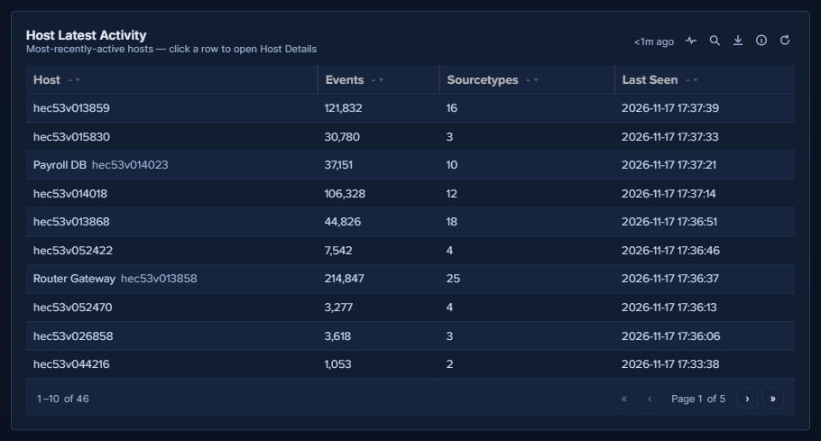
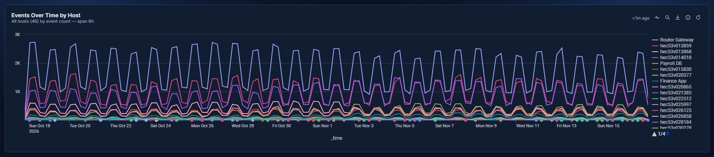

# Host Names

**Host Names** lets an admin give hosts names of your own. The LogServ App's dashboards then show that name for the host name or IP address the logs carry. Tables and host lists show the name next to the value from the logs, and the entries of the **Host** filter show the name with the value from the logs on the line under it. The per-host charts, the two **Sourcetype Mapping** graphs and the **Host** filter button with one host picked show the name alone ([Where the Names Show](#where-the-names-show)).

The logs often name one machine in several ways: a fully qualified name, a short name and an IP address. None of them says what the machine does. A list of host names maps each of them to one name everyone recognizes.

The names are for display only. Searches, filters, sorting, clicks and a panel's CSV download keep using the host values from the logs. So adding, changing or deleting a name never needs a **Clear** or a **Backfill**.

## :material-circle-box:{ .taiconcolor } An Example

The **Gateway Remote Hosts** table on [ABAP Network & Security](dashboards/applications/abap-security.md) lists the RFC partners of a system. Say one partner shows up under three values: `vm0417a.prod.example.com`, `vm0417a` and `192.0.2.41`. All three are the payroll application server.

Two entries cover them:

| Host value | Name |
|---|---|
| `vm0417a` | Payroll app server |
| `192.0.2.41` | Payroll app server |

The entry `vm0417a` has no dot, so it also covers `vm0417a.prod.example.com`. The **Remote Host** column then reads:

```
Remote Host
---------------------------------------------------
Payroll app server   vm0417a.prod.example.com
Payroll app server   vm0417a
Payroll app server   192.0.2.41
```

The host value from the logs follows the name in a muted color. Hovering over a cell shows both in full, for example `Payroll app server - vm0417a.prod.example.com`. The three rows stay separate, and a click on a row still opens the search for its own host value.

On a dashboard it looks like this: **Host Latest Activity** on [Data Pipeline Overview](dashboards/platform/data-pipeline-overview.md), with made-up names for two of its hosts.



## :material-circle-box:{ .taiconcolor } Who Can Edit and Who Can Read

- **Edit:** users who hold a role named exactly `admin`, `sc_admin` or `sc_subadmin`. These are the roles that open the Application Settings page ([Who Can Open the Page](../ai-assistant/settings.md#who-can-open-the-page)). The KV Store collection that holds the names accepts writes only from the same three roles.
- **Read:** every role. Every user sees the names on the dashboards, and every role can read the whole list, descriptions included, for example through Splunk's KV Store REST API. Do not put personal data in a name or a description.
- **No `admin_all_objects` needed.** A KV Store write is governed by the collection's own permissions, so a user with one of the three roles can edit names without `admin_all_objects`, a delegated `sc_subadmin` on Splunk Cloud included.

## :material-circle-box:{ .taiconcolor } Where the List Is Kept

The names live in the LogServ App's KV Store collection `logserv_host_aliases`. It holds one row per host value: the value as entered, the name, an optional description, and when and by whom the row was last changed. That time and user name are what the saving page sent (the **Host Names** tab sends the signed-in user and the browser's clock), and a row written through the KV Store REST API carries whatever its writer sent, so they are not an audit record.

- **It is not dashboard data.** **Clear** and **Clear all rollups** on [Settings > Dashboard Data](dashboard-data.md) never touch it. No retention search trims it, and no scheduled search writes it.
- **Nothing to rebuild.** No summary stores a name, so a change shows at once, over every time range.
- **It survives upgrades,** like the App's other KV Store data.
- **A rollback leaves it unused.** Builds 399 and earlier have no Host Names: after a rollback to one of them the dashboards show host values only. That build's `default/collections.conf` does not name the collection either, so neither its pages nor a collection list taken from its tarball reach the names ([Removing the Solution](../getting-started/upgrading.md#removing-the-solution)). To remove the names, delete them before the rollback, while build 404 or later is installed ([Undo an Import or Remove Many Names](#undo-an-import-or-remove-many-names)). Upgrading again shows the names the collection then holds, with nothing to rebuild.
- **No lookup definition.** The App ships none for this collection, and none of its searches reads it.

## :material-circle-box:{ .taiconcolor } Add, Edit and Delete Names

Open **Settings** in the App's navigation rail, then the **Host Names** tab, after **Dashboard Data**. The tab shows how many rows the list holds, out of the 5,000 it can hold.


- **Add a host name.** Enter the **Host value**: a full name such as `app01.example.com`, a short name such as `app01`, or an IP address. Enter the **Name** and, if you like, a **Description**. Then click **Add**. Under the host value, the form says what the entry will match. If the list already holds that host value, the page asks before it replaces its name, and when you leave **Description** empty, the row keeps the description it has.
- **The list.** Its columns are **Name**, **Host value**, **Description**, **Updated by** and **Updated**. Type in the filter box to find rows by name, host value or description. Click the **Name** or **Host value** heading to sort. A row written outside this page under a key its host value does not give is marked *written outside this page*. When two or more rows written outside this page give one host different names, and the latest of them, which carry the same time of change (hover the **Updated** cell for the exact time) or none, give different names, the list marks the host's rows as well, and the dashboards use none of them: the host then shows no name unless another entry covers it, such as a short-name entry for a full name ([Troubleshooting](#troubleshooting)).
- **Edit.** **Edit** loads a row into the form, and **Save changes** writes it. If you change the host value, the page writes the new row first and then deletes the old one, so the host is never without a name in between. If the new host value is one the list already holds, the page asks first, as for an add.
- **A row stored under the same key.** A row written outside this page can be stored under the key that the host value you save gives, while it holds another host value. A save replaces that row, so the page names it and asks first.
- **Delete.** **Delete** asks first. The question says what the dashboards then show for the host, the name another entry gives it (a short-name entry still covers a full name, for example) or no name, and that this browser tab shows the change at once, other open tabs after their next **Refresh**. A delete cannot be undone.
- **At most 5,000 rows.** **Add** and **Save changes** refuse a write that would take the list past 5,000 rows: delete a row first.
- **The list is read again before Add, Save changes and Delete.** Before **Add** or **Save changes** writes, the page reads the list again. If the save would now do something else (another admin has named the same host in the meantime, say), or the row you are editing has changed, the page writes nothing: it shows the list as it is now and says what a save would now do, with the new question if there is one. Check it and save again. After you confirm a **Delete**, the page reads the list again too. If the row has changed or is gone, or the host would then show something other than the question said, the page deletes nothing: it shows the list as it is now and says what changed. Press **Delete** again if you still want the row deleted. When the list cannot be read again, nothing is written or deleted.

A change shows on the dashboards in the same browser tab at once. Other open pages show it after a **Refresh** or the next page load ([Refresh](#refresh)).

## :material-circle-box:{ .taiconcolor } Import and Export a CSV File

### The file format

```
host,alias,description
vm0417a,Payroll app server,Payroll production
192.0.2.41,Payroll app server,
db01.prod.example.com,Payroll database,HANA primary
2001:db8::17,Shop web server,
```

- **The first line is the header** `host,alias,description`. The `description` column may be left out. The column names may come in any order and any letter case. Other columns are ignored, with a warning.
- **One row per host value.** `host` is the host value and `alias` is the name.
- **Commas only.** A file whose columns are separated by semicolons or tabs, as some spreadsheet programs save them in some regions, is refused, with its values in quotes or not. The error then says to separate the columns with commas.
- **UTF-8.** In a spreadsheet program, save the file as **CSV UTF-8** (in Excel: **Save As > CSV UTF-8 (Comma delimited)**). A line with a character that cannot be read as UTF-8 is refused, and the error says to save the file as CSV UTF-8. When a refused header line holds such a character, the error says to save the file as CSV UTF-8 instead. A byte order mark, Windows or Unix line endings and blank lines are fine.
- **Quoting.** Put a value that holds a comma, a double quote or a line break in double quotes, and double each quote inside it: `"Payroll, EU"`.

### Import

Under **Import from CSV**, choose a file with **Choose a CSV file...**: the preview appears at once. Or paste the text into the box and click **Preview**.

1. The preview counts the rows to add, the rows whose name changes, the rows whose description alone changes, the rows that stay the same and the lines it refuses. When the import replaces rows of other hosts (see the rules below), it counts them too. When no line is refused, it lists the hosts whose name changes (`host: old name -> new name`, or `host: no name (its rows give A / B) -> new name` for a host whose rows give it different names), the hosts to add and the rows of other hosts the import replaces, the first 100 of each, then `and N more`. Rows whose description alone changes are only counted.
2. It also lists the lines it refuses, with the line number and the reason (the first 100, then `and N more`), and its warnings. **Any refused line blocks the whole import.** Fix the file, then preview again.
3. Click **Import**. When the import would change names already in the list, or replace a row of another host, the page asks you to confirm first. When the import can run, the preview suggests clicking **Export CSV** first, to keep a copy.

Before **Import** writes, the page reads the list again. If the import would now do something other than the preview showed (another admin has saved a name in the meantime, say), the page writes nothing: it shows the list and a new preview for the list as it is now. Check the preview and click **Import** again.

The rows are written 1,000 at a time. If a batch fails, the tab says how many rows were written and which rows were not written or not confirmed. A batch that the server answers without confirming its rows, for example with a sign-in page from a proxy, is reported as not confirmed, not as written. The other rows stay written, and **Import** again writes only what still differs.

The rules:

- **Import merges.** It adds rows and changes names. It never deletes a row: to remove a name, delete it in the list.
- **An empty description cell keeps the stored description.** To clear a description, edit the row.
- **A repeated line** is skipped, with a warning. A line repeats an earlier one when it gives the same host the same name, with the same description or with a description on only one of the two lines. The description is kept either way.
- **One host with two different names (letter case counts), or with two different descriptions,** in the file is an error: every line of that host is refused, a line that would otherwise be skipped as a repeat included, so the import is blocked.
- **Host values compare after the same normalizing as matching** (letter case, a trailing dot, IP address forms): `APP01`, `app01.` and `app01` are one host, and so are `::ffff:192.0.2.10` and `192.0.2.10`. A full name and its short name, such as `app01.example.com` and `app01`, are two hosts in a file.
- **A row written outside the App.** When the row the dashboards use for a host is marked *written outside this page*, a file that changes that host's name or description writes a new row under the host's own key, and the dashboards use the new row. The old row stays in the list, still marked, and counts toward the 5,000 rows until you delete it.
- **A row stored under the same key.** When a row written outside the App holds another host value but is stored under the key that a host in the file gives, the import replaces that row: the preview names it, and the page asks first.
- **Size:** at most 5,000 rows and 2 MB per file. After the import, the list may hold at most 5,000 rows.

### Export

**Export CSV** downloads the list as `host_aliases.csv`, with the same header, so an exported file imports back unchanged, unless the list marks a host's rows as giving it different names: the file then holds one of those names, and importing it gives the host that name. The file starts with a UTF-8 byte order mark, so that Excel opens it as UTF-8; after editing it there, save it as **CSV UTF-8** again. The rows are sorted by name, then by host value. A cell that starts with `=`, `+`, `-` or `@` gets a leading apostrophe (`'`), so that a spreadsheet does not read it as a formula. Import removes that apostrophe again. With an empty list, the file is an empty template.

### Undo an Import or Remove Many Names { #undo-an-import-or-remove-many-names }

Import never deletes a row, and the list deletes one row at a time. To keep a way back, and to remove many names:

- **Export first.** Click **Export CSV** before an import and keep the file. Importing it again brings back the names the import changed (for a host whose rows the list marked as giving it different names, it gives the host the name the file holds). It does not remove the hosts the import added, and its empty description cells do not clear a description the import added.
- **A few rows:** delete them in the list, one at a time.
- **Many rows:** delete them with Splunk's KV Store REST API, on the search head's management port, with an account that holds `admin`, `sc_admin` or `sc_subadmin`. On Splunk Cloud the management port must first be opened for you ([On Splunk Cloud](../getting-started/upgrading.md#on-splunk-cloud)).

Each row's key (`_key`) is its host value as matching normalizes it: lower case, without a trailing dot, and an IP address in one written form (an IPv6 address shortened, such as `2001:db8::17`, and an IPv4-mapped address as its IPv4 address). A row marked *written outside this page* can be stored under another key: to find it, run the call below with `-X GET` in place of `-X DELETE` and without its query, which lists every row with its `_key` and its `match_value` (the host value as entered). This deletes the rows of the made-up hosts `stage-app07` and `stage-db07.example.com`:

```bash
curl -k -u admin -G -X DELETE \
  "https://<search-head>:8089/servicesNS/nobody/splunk_app_sap_logserv/storage/collections/data/logserv_host_aliases" \
  --data-urlencode 'query={"$or":[{"_key":"stage-app07"},{"_key":"stage-db07.example.com"}]}'
```

Run the same call with `-X GET` in place of `-X DELETE` first: it returns the rows the query matches. A DELETE without its query empties the whole list. Open pages show the change after a **Refresh** ([Refresh](#refresh)).

## :material-circle-box:{ .taiconcolor } How Host Values Match { #how-host-values-match }

Matching ignores letter case and a trailing dot. The first rule that applies wins:

1. **An IP address** (IPv4 or IPv6) matches only the entry for the same address. An IPv6 address matches in any of its written forms, without brackets or a zone id (`[2001:db8::17]` and `fe80::1%eth0` get no name). An IPv4-mapped IPv6 address, such as `::ffff:192.0.2.10`, counts as its IPv4 address. An IP address never matches a short name.
2. **A full name**, one with dots, matches the entry for the same full name.
3. **An entry without a dot** (a short name) also covers that name's full names: the entry `app01` covers `app01.example.com` and `app01.eu.example.net`.
4. **A short value from the logs** gets the name of its short entry. Without one, it gets the name of the entries for full names whose first label it is, when they all give one name: `db01` gets the name of `db01.example.com`. When they give different names, the short value gets no name, because which one is meant cannot be told.
5. **Anything else gets no name:** empty values, placeholders such as `-`, `(none)` or `unknown`, URLs, `host:port` values, and values with a space or a slash.

There are no wildcards and no address ranges (CIDR).

With these entries:

| Host value | Name |
|---|---|
| `app01` | Payroll app server |
| `db01.example.com` | Payroll database |
| `192.0.2.10` | Payroll app server |
| `2001:db8::17` | Shop web server |
| `web01.eu.example.com` | Shop web EU |
| `web01.us.example.com` | Shop web US |

values from the logs get these names:

| Value from the logs | Entry that matches | Name shown |
|---|---|---|
| `app01` | `app01` | Payroll app server |
| `APP01.Example.COM.` | `app01`: a short entry covers full names; case and the trailing dot are ignored | Payroll app server |
| `db01.example.com` | `db01.example.com` | Payroll database |
| `db01` | `db01.example.com`: the one full-name entry with the first label `db01` | Payroll database |
| `db01.test.example.com` | none: an entry for a full name covers only that full name and its short name | none |
| `192.0.2.10` | `192.0.2.10` | Payroll app server |
| `::ffff:192.0.2.10` | `192.0.2.10` | Payroll app server |
| `2001:DB8:0:0:0:0:0:17` | `2001:db8::17` | Shop web server |
| `192.0.2.11` | none: no address ranges | none |
| `web01.eu.example.com` | `web01.eu.example.com` | Shop web EU |
| `web01` | none: two full-name entries with different names | none |
| `https://app01.example.com/` | none: not a host value | none |

## :material-circle-box:{ .taiconcolor } Where the Names Show

- **Table columns that hold a host, an IP address or a client** (the list below): the name, then the host value from the logs in a muted color, on one line. When the column is too narrow for both, the line is cut at its end with one ellipsis: the host value gives way first, and the name is cut only when it no longer fits with the ellipsis after it, so the name always comes first and the ellipsis always comes last. A host value longer than about 30 characters is cut even in a wide column. Where a table has room, a long name takes more of the table's width than a host value alone would. Hover over the cell to read both in full, as `name - host value`. When you copy a selection inside such a cell, the App writes it as `name - host value` on one line. Sorting, row clicks and the searches they open use the host value.
- **The Host filter** in the title row: an entry with a name shows the name, with the host and its role on the line under it. Typing the name in the filter's search box finds the entry. The search box shows whenever any names exist, however short the list is. A name does not change the order of the entries. When exactly one host is picked, the button shows its name. While any names exist, the button's tooltip also lists the picked hosts as the logs give them (the first 10, then how many more); with no names, the tooltip reads as before. See [The Host Filter and Names](#the-host-filter-and-names).
- **The other host lists:** Data Pipeline Overview's host list, Host Details' host picker and DNS Analytics' client list show `name (host)`.
- **Charts and graphs:** the per-host charts (Data Pipeline Overview's **Events Over Time by Host**, Linux's **TCP Memory Pressure Over Time** and DNS Analytics' **Clients - Request Volume**) and the two **Sourcetype Mapping** graphs (Data Pipeline Overview and Host Details) show the name alone. When two hosts share a name, each gets its short host name or IP address in parentheses (or the full host value, if the short ones collide too), so two series or nodes never merge. Splunk's own **OTHER** and **NULL** series on a per-host chart keep those labels, since they are not hosts, even when an entry such as `other.example.com` exists.
- **Linux's Top Drop Source card:** when the top source IP address has a name, the card shows the name and the drop count on one line, with the IP address on the line under it. A name too long for the card is cut with an ellipsis, and the count stays visible. Hover over the value to read `name - IP address (count)` in full.
- **Host Details:** the page subtitle and the panel texts that name the selected host.
- **Environment Topology:** a partner square or database disc whose label is a host value with a name shows the name on a line under the label; hovering over that line shows `name (from Host Names)`. When the logs also name the machine behind that IP address, that hostname moves to the node's tooltip. The name also shows in the tooltip, the Details panel (a **Name** row reading `name (from Host Names)`), the partner donuts, Edge Details, the Hosts tab and Live Activity. The screen-reader label of the square or disc reads `name (host value)`. The node label itself stays the value from the logs. See [Environment Topology](dashboards/topology.md).
- **Page exports:** **Download PNG** and **Download PDF** in the **Actions** menu capture the page, so they show the names. A name and host value that the page cuts short are cut the same way in the export: the host value first, then the name, with the ellipsis at the end. The export lays the page out on its own, so a line close to the edge of its column can be cut in the export and whole on screen, or the other way round, and a line cut in both can be cut at a different point.

On screen, Data Pipeline Overview's **Events Over Time by Host** shows the names alone in its legend, here with made-up names for three of its hosts:



??? info "Table columns that show names"
    | Dashboard | Panels (columns) |
    |---|---|
    | Environment Health | Recent Critical Events (Host); Affected Hosts (Host) |
    | ABAP Network & Security | ICM Peer Connections (Peer IP); Gateway Remote Hosts (Remote Host) |
    | Work Process Performance | Recent Dispatcher Errors (Host) |
    | HANA Audit | Password Management Activities (Client IP); Failed Operations by HANA Host (HANA Host); Client IP Analysis (Client IP); High-Risk Events and After-Hours / Weekend Admin Activity (HANA Host, Client Host, Client IP) |
    | SAP Services | Sapstartsrv Authentication Events (Remote IP); SSL Authentication Failure Sources (Source IP) |
    | SAP Router | Peer IPs by Connection Volume (Peer IP); Recent Connection Log (Peer IP, Source IP) |
    | Cloud Connector | Clients (Client IP) |
    | Web Dispatcher | Client IPs by Traffic (Client IP); Recent Errors (4xx / 5xx) (Client IP) |
    | Web and API Performance | Slow Clients by Max Response Time (Client IP); Recent 500-Level Errors (Host, Client IP) |
    | Network Perimeter | Blocked Source IPs (Source IP); Suspicious Activity Indicator (Beaconing DNS + Denied Proxy, by Host) (Host) |
    | Cross-Stack Authentication | Auth Failure Source IPs (Source IP); Recent Windows Auth Failures (Source IP, Host); Recent SAP Auth Failures (Remote IP, Host) |
    | Change & Configuration Activity | HANA Audit &mdash; Change Events (HANA Host, Client Host); Windows &mdash; Account & Group Modifications (Computer); Linux &mdash; Sudo & Command Activity (Host) |
    | Data Pipeline Overview | Host Latest Activity (Host) |
    | DNS Analytics | Clients by Domain Diversity (Client IP); DNS Resolvers (Resolver) |
    | Linux System & Security | Blocked Sources (Source IP); OOM Kills by Host (Host); CPU Soft-Lockups (Host) |
    | Proxy Analytics | Clients (Client IP); Clients by Domain Diversity (Client IP) |
    | Host Details | Host Inventory (Host); Role Activity's SAP Router Peers (Peer IP) |

## :material-circle-box:{ .taiconcolor } Where the Names Do Not Show

- **Searches.** No name is ever put into a search. **Open in Search**, **Inspect**, a panel's **Download (CSV)** and the Splunk searches that clicks open show the host values from the logs.
- **The AI Assistant.** Names never enter its searches or its tool results, so no name reaches an AI vendor, at any privacy tier ([Privacy](#privacy)).
- **The Data Doctor.** Its diagnosis drawer and its PDF reports show host values only.
- **Values that are not hosts:** URLs, domains, DNS query names, user names, SIDs, HANA tenants, sourcetypes and source paths. For example, Proxy Analytics' **Destination** column holds URLs and shows no names.
- **Counts of hosts,** such as **Active Hosts** or **Unique Clients**.

## :material-circle-box:{ .taiconcolor } The Host Filter and Names { #the-host-filter-and-names }

The **Host** filter ([SID and Host filters](dashboards/index.md#sid-and-host-filters)) lists the machines that **wrote** the logs: the `host` field of each event. Picking an entry by its name filters on its host value, exactly as before.

So the filter narrows a dashboard by the machine that logged each event, not by the hosts or addresses in a panel's columns. On **Gateway Remote Hosts**, picking `Payroll app server` shows the gateway events that the payroll server logged. It does not show the rows where the payroll server is the remote partner.

Several host values with one name, such as a full name and an IP address, stay separate entries. Typing the name lists all of them, and each can be ticked.

## :material-circle-box:{ .taiconcolor } Refresh { #refresh }

The App reads the names when it loads in a browser tab; moving between dashboards does not read them again. The **Refresh** button in the header reads them again, and so does the Environment Topology toolbar's **Refresh**. On the **Host Names** tab, the header's **Refresh** also reads the tab's list again. A change made on the **Host Names** tab shows at once in the same browser tab.

## :material-circle-box:{ .taiconcolor } Splunk Cloud

Nothing extra is needed. Install the App as a private app, as for any other build ([On Splunk Cloud](../getting-started/upgrading.md#on-splunk-cloud)); the collection starts empty. Removing many rows, or a row the page cannot delete, uses Splunk's KV Store REST API on the management port, which must first be opened for you ([Undo an Import or Remove Many Names](#undo-an-import-or-remove-many-names)). Editing names needs `sc_admin`, or a delegated admin role named `sc_subadmin`, and no `admin_all_objects` ([Splunk Cloud Considerations](../getting-started/splunk-cloud.md#splunk-cloud-roles)).

## :material-circle-box:{ .taiconcolor } Privacy { #privacy }

- **Every role can read the list:** host values, names, descriptions, and the Splunk user name stored with each row's last change ([Where the List Is Kept](#where-the-list-is-kept)). Do not put personal data in a name or a description.
- **Names never reach an AI vendor.** They are drawn in the browser and never put into a search, so no tool result can hold one. The collection has no lookup definition, and the AI Assistant's ad-hoc queries may not read it. As a further guard, Tier 2 redacts a column named like a host's alias (`alias`, `host_alias`, `friendly_name` and the like) as it redacts host names, when **Tier 2 hostname redaction** is on ([Privacy Tiers](../ai-assistant/privacy-tiers.md#host-names-never-reach-the-vendor)).
- **The Data Doctor's reports keep host values,** because every role can read the saved reports.

## :material-circle-box:{ .taiconcolor } Limits

| Item | Limit |
|---|---|
| Rows in the list | 5,000 |
| Rows per import file | 5,000 |
| Size of an import file | 2 MB |
| Name | 64 characters, with at least one character that shows |
| Host value | 255 characters: an IPv4 or IPv6 address, or a host name of letters, digits, dots, hyphens and underscores that starts with a letter, a digit or an underscore and in which every dot-separated part holds a letter or a digit. A value of digits and dots only must be an IPv4 address. |
| Description | 256 characters, optional |

No field may hold control characters, line breaks, direction marks, invisible characters (the tag characters and the supplementary variation selectors among them), `<` or `>`.

**Add**, **Save changes** and **Import** refuse a write that would take the list past 5,000 rows. If more than 5,000 rows are stored, for example rows written outside the App, only 5,000 are read, on this tab and on the dashboards. The tab then warns that some names may not show and that **Export CSV** leaves some rows out, and no host can be added until rows are deleted. An import that changes a host whose row is marked *written outside this page* is refused too, because that change adds a row ([Import](#import)). A row written outside the App that breaks the rules above is not used and is not listed, but it still counts toward the 5,000: the tab says how many such rows it cannot show. Remove them with Splunk's KV Store REST API ([Undo an Import or Remove Many Names](#undo-an-import-or-remove-many-names)); on Splunk Cloud the management port must first be opened for you.

## :material-circle-box:{ .taiconcolor } Troubleshooting

- **A name does not show.**
    - Check the [matching rules](#how-host-values-match). An entry for a full name covers only that full name and its short name. An entry for a short name covers all of that name's full names.
    - Click **Refresh** in the header, or reload the page. A page that was open before the change reads the names again only then.
    - Check that the value is a host value: URLs, `host:port` values and placeholders never get a name.
    - Check that the column is one of those [that show names](#where-the-names-show).
    - Check whether the list marks the host's rows as giving it different names. When two or more rows written outside this page give one host different names, none of them is stored under the key the host value gives, and the latest of them, which carry the same time of change (hover the **Updated** cell for the exact time; the column shows only minutes) or none, give different names, which name is meant cannot be told, so the dashboards use none of them: the host shows no name unless another entry covers it, such as a short-name entry for a full name. Edit the row with the right name and save it: the page asks first, and its question lists the names the latest of those rows give. It then stores the name under the host's own key, and the dashboards use that row. The other rows stay in the list until you delete them.
- **A short name gets no name, although an entry exists for its full name.** Another entry for a full name with the same first label gives a different name, for example `web01.eu.example.com` and `web01.us.example.com`. Add an entry for the short name itself. That entry also covers every other full name that starts with `web01.` and has no entry of its own, such as `web01.ap.example.com`.
- **Import stays off.**
    - The preview lists the refused lines with the reason. Fix those lines and preview again. A file separated by semicolons or tabs is refused, and so is a file with characters not saved as UTF-8 (Excel's plain CSV on Windows): save it as **CSV UTF-8**, with commas.
    - The file changes nothing: the preview says *Every host in the file already has these names*. A file with only the header line holds no rows, and the preview says so.
    - The rows the file adds (new hosts, and new rows for hosts written outside the App) would take the list past 5,000 rows: the preview says so. Delete rows first, or import a smaller file.
- **A row cannot be deleted.** The page does not send a delete for a row written outside the App whose key is of one of the kinds below (keys the App itself never writes), and marks the row as one it cannot delete. Remove such a row with Splunk's KV Store REST API: a DELETE with a query on `_key` carries the key in the query, not in the URL path ([Undo an Import or Remove Many Names](#undo-an-import-or-remove-many-names)). On Splunk Cloud the management port must first be opened for you. The page refuses a key that:
    - holds a slash, a backslash or a percent sign, or a `?`, `#` or `;`: a delete sent with such a key in its URL could reach the whole collection;
    - is only dots or blanks, such as `..`, or has a part of only dots or blanks between slashes or backslashes;
    - holds a control, direction or invisible character;
    - is longer than 1,024 characters.
- **A save, an import or a delete fails.** An HTTP error gives the status and, when Splunk sends one, Splunk's own message, which names the cause. A request that does not complete gives the browser's own error, and a batch the server answers without confirming its rows says so. For example, Import sends up to 1,000 rows per request, and Splunk refuses a request with more rows than `max_documents_per_batch_save` allows (`[kvstore]` in `limits.conf`, 1,000 by default).
- **The tab cannot read the list.** The dashboards then show host values only. Check that KV Store is running on the search head, then click **Retry**.

## :material-circle-box:{ .cboxmove } Next Steps

1. [Application Settings](../ai-assistant/settings.md): the other tabs of the Settings page.
2. [Dashboards Overview](dashboards/index.md#sid-and-host-filters): the SID and Host filters.
3. [Privacy Tiers](../ai-assistant/privacy-tiers.md): what the AI Assistant may send to a vendor.
