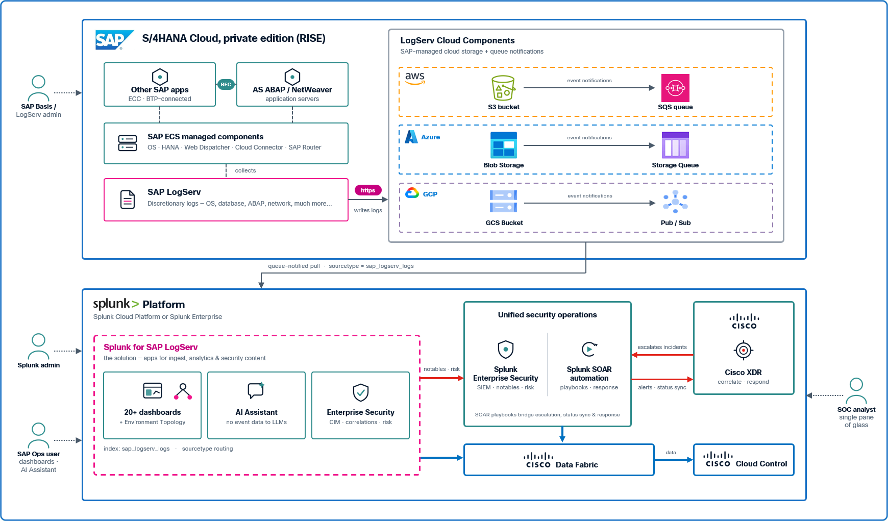
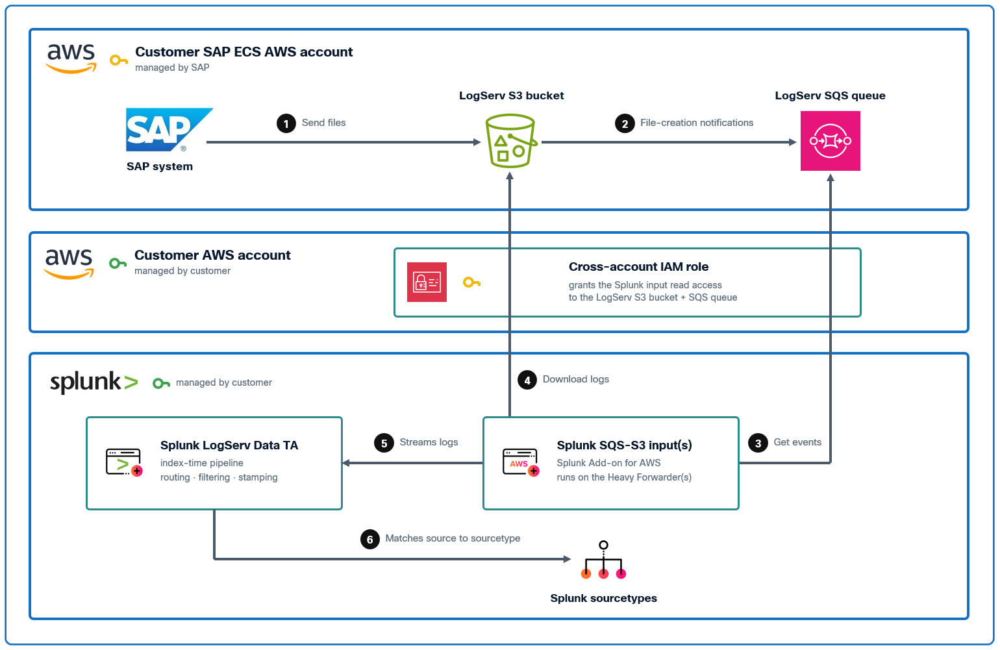
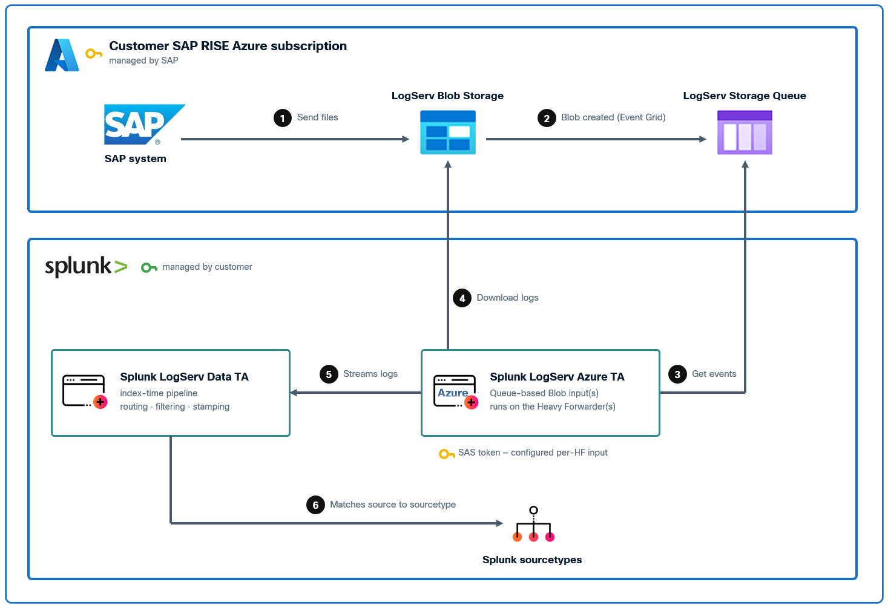
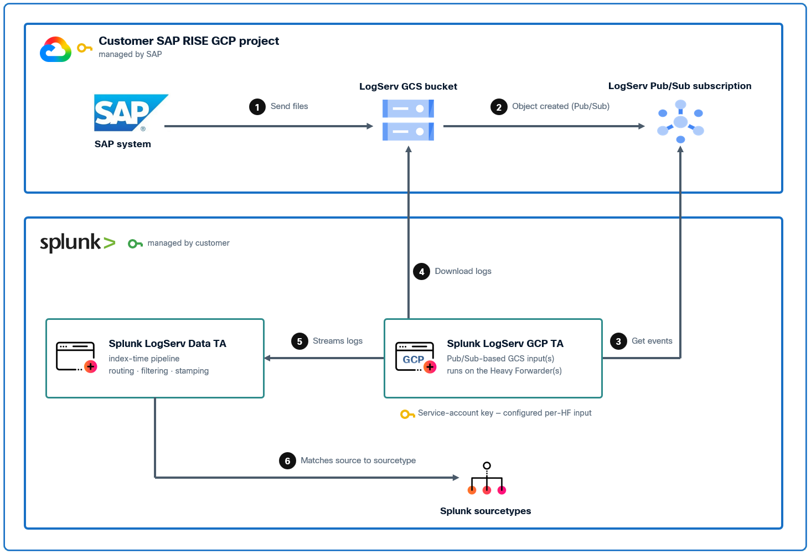
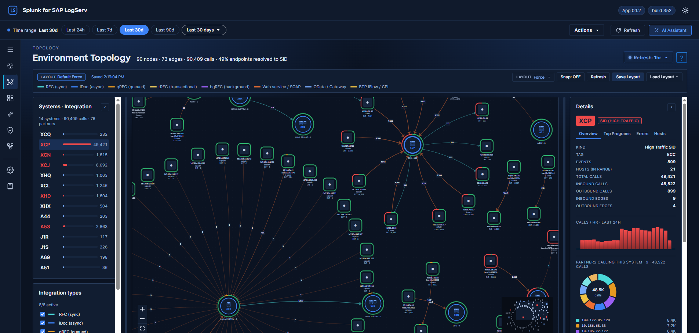
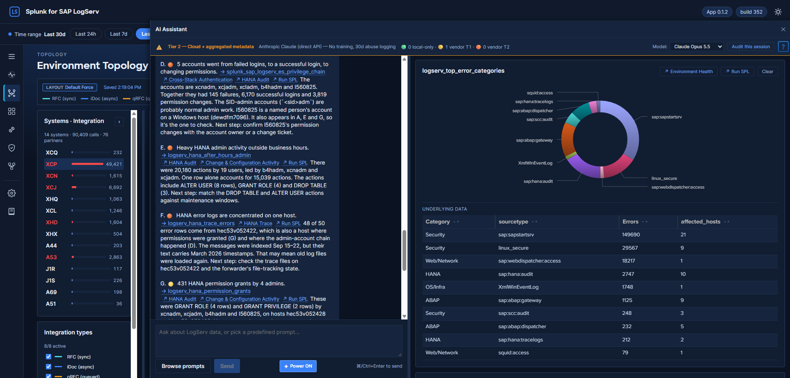
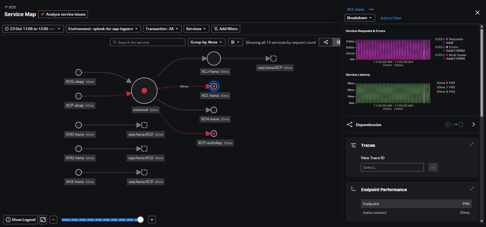

# Announcing Limited Preview of Splunk for SAP LogServ Integration for SAP RISE/ECS Customers

We are thrilled to announce the limited preview of **Splunk for SAP LogServ** — a joint step with Splunk by Cisco and SAP Enterprise Cloud Services (ECS) that brings the logs of the world's most critical business systems into the platform their security teams already trust. For SAP RISE/ECS private cloud edition customers, moving to RISE no longer has to mean a visibility trade-off: the telemetry SAP operates on your behalf now flows into your own Splunk — ready for the dashboards, detections, and AI-assisted investigations your teams run everywhere else.

*Splunk and the SAP ECS team have worked side by side to develop this integration and bring it to this point. Thank you to <a href="https://www.linkedin.com/in/james-schneider-76905a4/" target="_blank">James Schneider</a> (Splunk Senior Partner Solutions Engineer), <a href="https://www.linkedin.com/in/hemanth-varma-kusampudi-b04b877a/" target="_blank">Hemanth Kusampudi</a> (SAP Chief Security Architect), <a href="https://www.linkedin.com/in/mateusz-macalik/" target="_blank">Mateusz Macalik</a> (Splunk Senior Partner Solutions Engineer), <a href="https://www.linkedin.com/in/jimsbarton/" target="_blank">Jim Barton</a> (Splunk Global Strategic Alliances), and <a href="https://www.linkedin.com/in/subarno-mukherjee-b2580225/" target="_blank">Subarno Mukherjee</a> (Splunk WW Leader - Partner Solutions Engineering).*

## :material-circle-box:{ .taiconcolor } SAP LogServ — the centralized log surface for SAP ECS

SAP LogServ is an SAP Enterprise Cloud Services (ECS) service aimed at collection, storage, forwarding and access of logs. LogServ centralizes the logs from all systems, applications, and ECS services used by a registered customer.

**Main features include:**

- **Near-Realtime Log Collection** — with the ability to integrate into customer SIEMs or Log Management systems.
- **Log Retention** — a 365-day retention period, adjustable for each data source; logs can be retained indefinitely.
- **Recovery of Logs** — ability to recover logs which were retained.

## :material-circle-box:{ .taiconcolor } Splunk — the data platform behind the world's most security-conscious SAP customers

Splunk by Cisco is the data platform of choice for security and observability across the world's largest enterprises. **Splunk Enterprise** powers the on-premises analytics workload; **Splunk Cloud Platform** delivers the same capabilities as a managed SaaS service; and **Splunk Enterprise Security** layers a market-leading SIEM with AI-powered detections, threat-intel correlation, and SOC workflows on top of either deployment.

Together, these products bring the operational depth, scale, and security analytics that SAP customers expect for their mission-critical workloads — from the underlying HANA database through the ABAP application server, Web Dispatcher, Cloud Connector, and beyond.

The **Splunk for SAP LogServ** integration is the product of that collaboration: SAP operates the log collection and delivery; Splunk turns it into security and operational insight. RISE customers keep the accountability model they signed up for — SAP runs the landscape while the customer's own security team keeps full-fidelity visibility — and gain an AI-aware investigative experience that extends protection beyond SAP to the whole IT estate.

## :material-circle-box:{ .taiconcolor } Architecture – Multi-Cloud Support

The Splunk for SAP LogServ integration **supports ingest from AWS, Microsoft Azure, and Google Cloud** — the three hyperscalers SAP ECS operates RISE landscapes on. The pattern is the same everywhere: customer SAP systems forward logs into LogServ; LogServ stages the consolidated stream into customer-accessible cloud storage; and Splunk picks up new data automatically the moment it lands, delivering it to the customer's Splunk environment — on-premises Splunk Enterprise or Splunk Cloud Platform — where the **Splunk for SAP LogServ** App provides the analyst-facing experience and, optionally, Splunk Enterprise Security provides the SIEM correlation surface. One integration, any hyperscaler: if a landscape moves clouds, the dashboards, detections, and AI Assistant come along unchanged.

*Splunk for SAP LogServ — AWS data flow (S3 + SQS notifications)*

**The same integration runs on Microsoft Azure.** For customers whose LogServ delivery targets Azure, the stream lands in Azure Blob Storage and Splunk consumes it through event-driven queue notifications — the Azure twin of the AWS pattern. Everything downstream — the filtering, the dashboards, the AI Assistant, and the Enterprise Security content — is identical to the AWS deployment; only the ingest mechanism differs.

*Splunk for SAP LogServ — Azure data flow (Blob Storage + Event Grid queue notifications)*

**And now: Google Cloud.** This preview round extends the same pattern to Google Cloud: for RISE landscapes running on GCP, LogServ delivers to Google Cloud Storage and Splunk consumes it through Pub/Sub notifications — completing coverage of all three hyperscalers SAP ECS operates on.

*Splunk for SAP LogServ — Google Cloud data flow (GCS + Pub/Sub notifications)*

## :material-circle-box:{ .taiconcolor } Native index-time filtering

**Keep only the data you want — before it is indexed.** Administrators choose which LogServ log types to keep and how far back in time to accept, from a point-and-click page in Splunk Web — no custom configuration to write or maintain. With a Deployment Server, one click ([Deploy to Forwarders](../install-setup/distribute-data-ta.md#4-deploy-to-forwarders)) pushes the rules to every forwarder, where unwanted and stale events are dropped before they are ever indexed — controlling ingest and license cost and keeping the environment focused on the data that matters. The same filtering works identically on every cloud ingest path.

## :material-circle-box:{ .taiconcolor } Log types covered

LogServ complements the existing SAP application layer threat monitoring with the log types owned by SAP ECS as the system provider. This includes logs like:

!!! note ""
    *SAP Security Audit Log, HANA database, ICM, SAP Web Dispatcher, SAP Cloud Connector, OS, SAP Gateway, 3rd-party Database, Network, DNS, Proxy, Firewall... logs*

The list is growing as new sources become available and SAP ECS onboards more.

**Splunk for SAP LogServ** is available as a limited preview today; GA coming soon.

## :material-circle-box:{ .taiconcolor } What customers see — the Environment Topology view

The LogServ App ships an interactive **Environment Topology** view that auto-discovers a living map of the customer's SAP estate directly from the logs — no CMDB integration, no manual diagramming. Teams see at a glance which systems talk to which partners, where errors concentrate, and how the estate is behaving right now — and click any system or connection to drill into the detail behind it.

*Environment Topology view in Splunk for SAP LogServ*

## :material-circle-box:{ .taiconcolor } What analysts see — the AI Assistant chat panel

Above any LogServ App dashboard, analysts can open the **AI Assistant** as a docked side panel. The chat sits next to the data — in the screenshot below, it's open alongside the Environment Topology dashboard — and the dashboard remains live and interactive while the analyst converses with the assistant.

The assistant offers two paths. **Predefined prompts** run curated, SAP-aware investigations against the customer's own data — no AI vendor involved — with results landing inline as charts, KPIs, and tables. **Free-form prompts** let analysts ask questions in natural language through the customer's choice of leading AI providers; the assistant plans the investigation, runs it, and writes a narrative answer with citations that link straight back to the underlying data, so an analyst can pivot from summary to source in one click.

**Crucially, this is AI on the customer's terms.** A privacy guarantee engineered into the product ensures raw customer events never leave the customer's Splunk for any AI vendor, and the [privacy tier](../ai-assistant/privacy-tiers.md) an administrator chooses sets exactly what the vendor does see. Every action the assistant takes for a user whose Splunk role [can write audit events](../ai-assistant/audit-log.md#who-can-write-audit-events) is recorded to a dedicated audit trail — with optional tamper-evident forwarding to storage the customer controls — and administrators can switch the AI-vendor path off entirely at any time while keeping the curated investigations. AI-era capability, enterprise-grade governance.

*AI Assistant chat panel docked beside the Environment Topology dashboard*

## :material-circle-box:{ .taiconcolor } What ES customers get — out-of-the-box SAP correlation

For SAP RISE customers running **Splunk Enterprise Security**, the LogServ App includes a complete ES content layer built in — no separate content pack, no extra license SKU. ES features ship enabled and work wherever ES runs once its [setup checklist](../enterprise-security/overview.md#setup-checklist) is done; on a search head without ES, an administrator [turns them off](../enterprise-security/overview.md#disabling-or-tuning-the-es-content), so a single App serves every Splunk topology.

**SAP events become first-class security citizens.** LogServ data is normalized into the same standard data models ES detections, dashboards, and investigations already use — authentication, change, network, and web activity from the SAP stack correlates directly with everything else the SOC monitors, with no per-customer field-mapping work.

**Out-of-the-box SAP detections and risk scoring.** Curated correlation searches cover the attack patterns that matter most in SAP estates — privilege escalation, cross-stack authentication-failure bursts, anomalous gateway connections, and more — landing directly in ES Incident Review for SOC triage. Each detection also feeds ES's risk-based alerting, so repeated low-level signals accumulate into high-confidence incidents instead of alert noise.

**Asset and identity context, auto-derived.** The App builds asset and identity feeds for the SAP estate directly from the logs and keeps them current automatically — no CMDB integration project required to give ES its context.

**Dual-mode by design.** Customers without ES lose nothing — the dashboards, AI Assistant, and data normalization all work standalone. Install ES later, [turn the ES content back on](../enterprise-security/overview.md#prerequisites), and the SAP detections light up — nothing else in the App changes.

## :material-circle-box:{ .taiconcolor } Benefits of Integration

**SAP-aware Splunk experience from day one.** More than twenty purpose-built dashboards cover the estate end to end — environment health, HANA, ABAP, Web Dispatcher, Cloud Connector, network perimeter, cross-stack authentication, change activity, and more — so teams get value immediately, without writing a single query.

**AI-assisted investigations with enterprise governance.** Analysts investigate in natural language or through curated SAP prompts, while the product guarantees [raw customer events never reach an AI vendor](../ai-assistant/privacy-tiers.md), records every action of users whose role can write audit events to an [audit trail](../ai-assistant/audit-log.md) that the optional forwarder makes tamper-evident, aligns its safeguards to the OWASP LLM Top 10, and gives administrators a runtime switch to disable the AI-vendor path entirely.

**Runs wherever your Splunk — and your SAP — runs.** On-premises Splunk Enterprise, Splunk Cloud Platform, and Splunk Enterprise Security are all supported by the same App; on the SAP side, AWS-, Azure-, and Google-Cloud-hosted RISE landscapes are all supported by the same integration. No topology lock-in, no separate editions.

**Centralized monitoring across the IT estate.** SAP LogServ data sits next to the customer's existing Splunk-managed infrastructure logs, application logs, network telemetry, and security signals — one platform, one query language, one operations workflow. SOC analysts pivot from a Linux auth-failure to an SAP HANA audit event without leaving the Splunk console.

**Auditability and tamper-evidence.** Every AI Assistant action of a user whose role [can write audit events](../ai-assistant/audit-log.md#who-can-write-audit-events) — every prompt, vendor call, tool dispatch, legal acknowledgement and privacy-tier elevation — is recorded to a dedicated Splunk audit index, with an optional HEC forwarder for tamper-evident dual-write to a customer-controlled remote destination.

## :material-circle-box:{ .taiconcolor } Splunk Observability Cloud support

For teams that run their operations in Splunk Observability Cloud, RISE takes the SAP core out of reach of the agents they rely on: customers have no operating-system access to the SAP-managed hosts. The Splunk for SAP LogServ add-on for Observability Cloud brings the same LogServ feed into Splunk Observability Cloud — with no agents on SAP systems and no log lines copied.

**Live SAP signals as metrics.** Every few minutes, the add-on on your Splunk search head counts what arrived from LogServ — event volume and freshness, HANA audit activity, Web Dispatcher traffic and errors, and more — and sends those counts to Observability Cloud as metrics you can filter by SAP system, host and cloud.

**The LogServ App's pages, in Observability Cloud.** The SAP-aware views teams know from the Splunk for SAP LogServ App — environment health, HANA audit, Web Dispatcher, the SAP network and more — as Observability Cloud dashboards, next to everything else the team watches.

**Logs searched in place.** Through Log Observer Connect, analysts search the LogServ data where it already lives in Splunk, with the App's SAP field extractions; the logs are not copied, and your Splunk permissions apply. Log Observer Connect is included in every Observability Cloud edition at no additional charge.

**The SAP landscape on a map.** A live map of the SAP landscape in Observability Cloud — application servers, HANA databases, Web Dispatchers and their connections — drawn from the LogServ logs, with calls and errors per connection as charts.

**SAP-aware detectors.** Ready-made detectors on the SAP health signals, such as a LogServ feed that stops, data that arrives late, or HANA audit failures above their usual level, so problems reach the right team quickly.

**One click back to the detail.** Links from Observability Cloud into the Splunk for SAP LogServ App, including the interactive Environment Topology view, for when someone needs the story behind a number.

**Built for trust.** Nothing is sent until an administrator turns it on, and the metrics carry counts only — never user names, IP addresses, URLs or SQL text. The logs themselves stay in Splunk.

Observability Cloud support is designed for Splunk Cloud Platform and Splunk Enterprise and requires Splunk Observability Cloud; LogServ metrics count toward Observability Cloud usage. If your teams also use Splunk Observability Cloud, mention it when you sign up for the preview.

## :material-circle-box:{ .taiconcolor } What Observability Cloud teams see — the SAP landscape map

The same LogServ logs that draw the Environment Topology view in the Splunk App also draw the SAP landscape where Observability Cloud teams already work. SAP application servers, HANA databases and Web Dispatchers appear as services, with the connections between them drawn from the logs — no agents on SAP systems.

*The SAP landscape on a map in Splunk Observability Cloud, drawn from LogServ logs (demo landscape)*

## :material-circle-box:{ .taiconcolor } How to Sign Up

To participate in the limited preview of this integration, SAP RISE customers are invited to sign up by reaching out to:

!!! note ""
    *<a href="mailto:james101@cisco.com">james101@cisco.com</a>*

Please include your SAP RISE customer details in the request. The Splunk and SAP teams will review eligibility and process your request accordingly.

## :material-circle-box:{ .taiconcolor } Get Started Today

Don't miss this opportunity to strengthen your SAP security and observability posture with the powerful combination of SAP LogServ and Splunk. Sign up today and be among the first to experience the benefits of this groundbreaking integration.

We look forward to your participation and to helping you incorporate your SAP RISE environments into your overall Splunk-managed observability and security platform.

*Thank you again to James, Hemanth, Mateusz, Jim, Subarno, Jaclyn, Jan-Micheal and Gene — and to the broader Splunk for SAP LogServ team and the SAP ECS Security organization that made this preview possible.*
