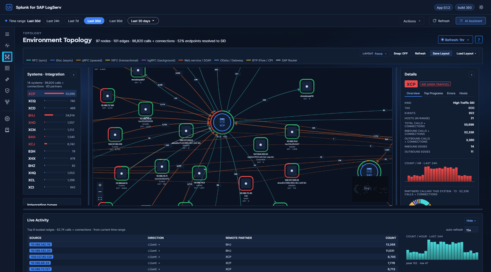
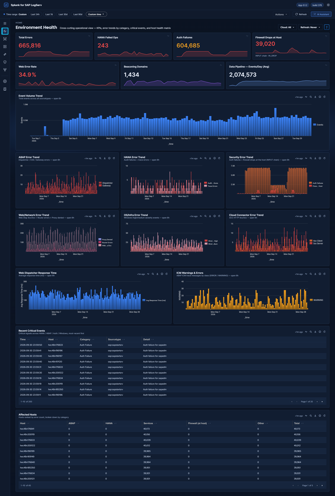

# About Splunk for SAP LogServ

## :material-circle-box:{ .cboxmove } Introduction

SAP offers **RISE with SAP**, built on SAP S/4HANA Cloud Private Edition (marketed as SAP Cloud ERP Private since 2025). It is a managed private-cloud service, not IaaS: **SAP Enterprise Cloud Services (SAP ECS)**, formerly SAP HANA Enterprise Cloud, runs the infrastructure, operating system, database and SAP technical layers of the customer's SAP systems. These systems usually run on AWS, Microsoft Azure or Google Cloud, in accounts that SAP owns and manages, so the customer cannot reach their logs directly.

<a href="https://docs.aws.amazon.com/sap/latest/general/rise-observability-options-logserv.html" target="_blank">SAP LogServ</a>, an optional SAP ECS service, collects the logs of those systems and layers (operating system, database, SAP application) and delivers them to cloud object storage with an event notification for each new object: Amazon S3 with an SQS queue, Azure Blob Storage with a Storage Queue, or Google Cloud Storage with Pub/Sub. Your SAP account team or SAP ECS contact provides the full LogServ service description.

**Splunk for SAP LogServ** ingests those deliveries into Splunk, gives each log type its own sourcetype, and adds the **LogServ App**: dashboards, an Environment Topology view, a missing-data diagnostic (the **LogServ Data Doctor**), Enterprise Security content and an optional AI Assistant.

!!! tip "Start here"
    New to the solution? Follow the [Deployment Roadmap](content/getting-started/roadmap.md). It takes you from the request to SAP to working dashboards in order, with a check at the end of each step.

## :material-circle-box:{ .cboxmove } What You Install

| Component | Splunk Web label | App ID | Where it goes |
|---|---|---|---|
| **Data TA** | Splunk TA for SAP LogServ | `splunk_ta_sap_logserv` | Where the data is parsed: each heavy forwarder, or the single instance. A Deployment Server holds it to push it to the heavy forwarders. |
| **LogServ App** | Splunk App for SAP LogServ | `splunk_app_sap_logserv` | The search head (or search head cluster), or the single instance. |
| **Splunk Add-on for AWS** (Splunkbase 1876) | Splunk Add-on for AWS | `Splunk_TA_aws` | AWS only: each heavy forwarder (or the single instance) that runs a LogServ input. Version 8.2.2 or later is recommended (SVD-2026-1005). |
| **LogServ Azure add-on** | Splunk TA for SAP LogServ on Azure | `splunk_ta_sap_logserv_azure` | Azure only: installed directly on each heavy forwarder (or the single instance) that may run an Azure input, not through the Deployment Server. |
| **LogServ GCP add-on** | Splunk TA for SAP LogServ on GCP | `splunk_ta_sap_logserv_gcp` | GCP only: installed directly on each heavy forwarder (or the single instance) that may run a GCP input, not through the Deployment Server. |

- **The Data TA collects nothing itself.** It parses, routes and filters at index time the data that the Splunk Add-on for AWS or the LogServ Azure / GCP add-on collects. It also holds the Deployment Server automation, the configuration screens, the AWS S3 Direct backfill screen and the definitions of the two indexes.
- **The two indexes**, `sap_logserv_logs` and `logserv_ai_assistant_audit`, are created where the data is indexed. On a single instance the Data TA creates them. With a separate indexer tier, or on Splunk Cloud, you create them yourself, with the retention you want, before any data arrives (see [Create the Indexes and Install the Data TA](content/install-setup/install-ta.md#1-create-the-indexes)).
- **Without a heavy forwarder.** The Data TA and the cloud add-ons also work on a search head that runs the inputs itself, Splunk Cloud included. The LogServ Azure and GCP add-ons declare the search-head workload, but they have not yet been tested on a Splunk Cloud search head. This is supported and not blocked, but a heavy forwarder is strongly recommended, because ingest then competes with your users' searches. With Splunk Cloud and no heavy forwarder, they all go on the Splunk Cloud search head ([Running the TAs on a search head](content/install-setup/install-ta.md#running-the-tas-on-a-search-head)).
- **On the search head** the LogServ App also needs the Splunk Common Information Model add-on and the Splunk Add-on for Microsoft Windows (for the Windows panels); the Splunk Add-on for Unix and Linux adds the CIM fields of `linux_secure`; the AI Assistant also needs the Splunk MCP Server. See [LogServ App Prerequisites](content/logserv-app/prerequisites.md).

For every topology, see [Where Each Package Goes](content/getting-started/package-placement.md#package-matrix). Download the four LogServ packages from the `release_binaries` folder of the <a href="https://github.com/splunk/splunk-sap-logserv/tree/main/release_binaries" target="_blank">public repository</a>, and the Splunk Add-on for AWS from <a href="https://splunkbase.splunk.com/app/1876" target="_blank">Splunkbase</a>.

## :material-circle-box:{ .cboxmove } Key Features

- **One pipeline for three clouds.** Deliveries from AWS S3, Azure Blob Storage and Google Cloud Storage become the same sourcetypes, dashboards and Enterprise Security content. Each event can carry an indexed `cloud_provider` field: the Azure and GCP add-ons stamp it on every event their inputs collect, and for AWS you add it to each input ([Choose Cloud Attribution](content/install-setup/cloud-attribution.md)). The LogServ App's dashboards count events with no stamp as `aws`; your own searches and `tstats` see only the stamped value. See [Choose Your Cloud and AWS Scenario](content/install-setup/choose-your-cloud.md) and [Supported Log Types](content/getting-started/supported-log-types.md).
- **Index-time routing and filtering.** The Data TA gives each log type its own sourcetype and can leave log types or old events out of the index. Filtered events are never indexed, so they do not count against your license. You configure it in Splunk Web. With a Deployment Server, the Data TA sets up a server class for the heavy forwarders, and once you have assigned them to it, its **Deploy to Forwarders** button pushes the add-on and your settings to them. See [Decide Filtering](content/install-setup/decide-filtering.md), [Distribute the Data TA to Heavy Forwarders](content/install-setup/distribute-data-ta.md) and [Configuring Filters](content/install-setup/configure-filters.md).
- **Search-time field extractions.** The LogServ App extracts the fields of the SAP sourcetypes, of its own Linux sourcetypes (`linux:cron`, `linux:warn`, `linux:sudolog`, `linux:slapd`, `lastlog`, `who`, `linux_messages_syslog`), and of ISC BIND and Squid, whose parsers it took over from Splunk's archived add-ons. Windows (`XmlWinEventLog`) fields come from the Splunk Add-on for Microsoft Windows, and the CIM fields of `linux_secure` from the Splunk Add-on for Unix and Linux, both on the search head.
- **Dashboards, Environment Topology and the Data Doctor.** An **Environment Health** landing page and four groups of dashboards: Applications, Integration, Security and Platform. The dashboards read hourly KV Store rollups, so they load fast at any data volume ([Dashboard Data: Backfill and Freshness](content/logserv-app/dashboard-data.md)). **Environment Topology** draws the SAP systems, their integration partners and endpoints as a graph ([Environment Topology](content/logserv-app/dashboards/topology.md)). The **Data Doctor** explains every empty panel and produces a downloadable diagnosis report ([Data Doctor](content/logserv-app/dashboards/platform/diagnostics.md)).
- **Enterprise Security content.** CIM tagging for the Authentication, Change, Network_Sessions, Network_Resolution and Web data models, correlation searches with risk-based alerting, and a feed of SAP systems and user identities into ES asset and identity management. The content ships enabled. On a search head without Enterprise Security, turn it off; 13 of its searches also run AI Assistant prompts, which fail while those searches are disabled, so if you use the prompts, stop only the schedule of those 13 ([Disabling or tuning the ES content](content/enterprise-security/overview.md#disabling-or-tuning-the-es-content)).
- **AI Assistant (optional).** It ships turned off. Once an admin turns it on and the Splunk MCP Server is installed, analysts run a catalog of predefined investigations with no LLM involved. Free-form questions use an LLM provider that an admin configures; raw events never go to the AI vendor, and the [privacy tier](content/ai-assistant/privacy-tiers.md) sets what the vendor does see ([OWASP LLM Top 10 (2025) Compliance](content/ai-assistant/owasp-llm-compliance.md) lists the controls). An admin can limit the assistant to predefined prompts with the **Templates-only mode** setting ([Restricting the LLM Path](content/ai-assistant/templates-only-build.md)). See [Set Up the AI Assistant](content/ai-assistant/enable.md).

|             |                                                                                                                                                                        |
|-------------|------------------------------------------------------------------------------------------------------------------------------------------------------------------------|
| Version     | 0.1.2                                                                                                                                                           |
| Supported vendor products     | SAP LogServ for SAP ECS in Amazon Web Services (AWS), Microsoft Azure, and Google Cloud Platform (GCP)                                                                    |
| Splunk platform versions | Splunk Enterprise 9.4.3 and later; Splunk Cloud Platform (tested on the Victoria Experience; see [Splunk Cloud Considerations](content/getting-started/splunk-cloud.md)) |
| CIM | 5.0.0 and later |

 

